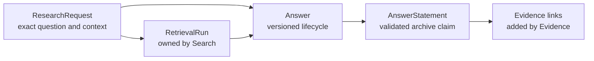
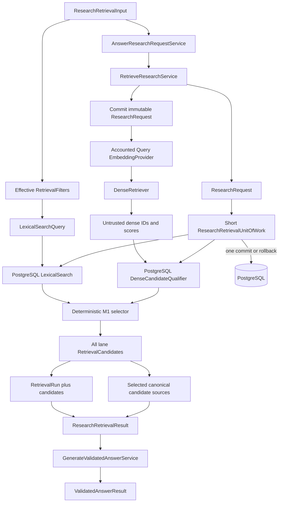
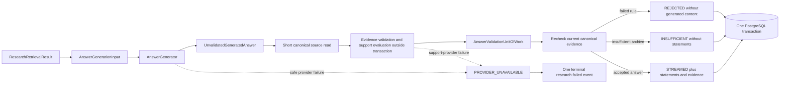
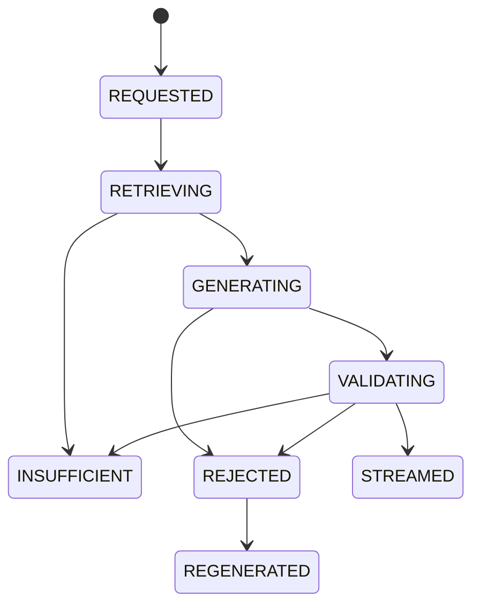
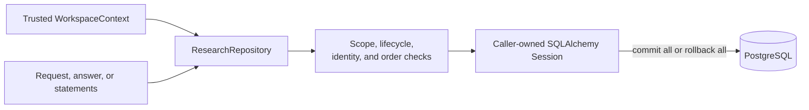

# Research

This module owns immutable research requests, versioned answer lifecycles, and validated answer statements. It orchestrates Search and exposes the application-owned generation boundary; it does not own retrieval candidates, source spans, or validation records.

## Contents

| File             | Responsibility                                                                         |
| ---------------- | -------------------------------------------------------------------------------------- |
| `application.py` | Orchestrates atomic retrieval and validated terminal-answer persistence.               |
| `contracts.py`   | Defines strict retrieval, generation, and validated-answer boundary values.            |
| `domain.py`      | Defines requests, temporal modes, answer states, coverage, statements, and invariants. |
| `ports.py`       | Defines repositories, units of work, and the answer-generator contract.                |
| `persistence.py` | Maps three PostgreSQL tables and implements workspace-scoped repository behavior.      |

## Ownership and traceability



An answer references the exact retrieval run that supplied its context. The composite database relationship includes workspace, request, and run identifiers, so a run from another request or workspace cannot be attached accidentally.

Research imports only typed domain contracts from dependencies when application orchestration requires them. It never imports another module's `persistence.py`.

## Temporal request context

```text
CURRENT               → no time cutoff
PUBLIC_KNOWLEDGE      → available_at <= cutoff
PERSONAL_ARCHIVE      → available_at <= cutoff and captured_at <= cutoff
```

The request preserves the user's exact question and explicit document filters. The Search module
separately records the normalized query and effective retrieval-filter snapshot because those are
execution details needed to reproduce a specific run. `RetrieveResearchService` performs the mode
translation once, so Search receives concrete predicates and does not depend on Research enums.

## Retrieval orchestration



The service creates all identifiers server-side, retains the exact question, and normalizes only
its search form. Without M1 query dependencies it preserves the credential-free lexical regression
path. With those dependencies it first commits the immutable research request in one short
transaction. Each query-embedding attempt then reserves budget, calls the provider outside a
transaction, and finalizes usage and cost before dense retrieval. Only classified transient
provider failures receive one bounded retry, with a separate ledger record per paid attempt.
Exhausted, permanent, or budget failures retain the request for safe correlation but persist no
retrieval run or candidates.

Inside one short transaction the service executes lexical search, reloads dense identifiers through
canonical PostgreSQL state, applies the versioned selector, and persists every qualified lane
candidate. A chunk found in both lanes retains one `LEXICAL` and one `DENSE` audit record, but only
its first selected occurrence becomes a `CanonicalCandidateSource`. Empty lanes remain a valid,
explicit retrieval result and never create invented candidates.

`AnswerResearchRequestService` is the route-facing application use case. It passes the committed
retrieval result to the selected `GenerateValidatedAnswerService` and returns only the validated
terminal result. In the provider-backed runtime, answer-generation and statement-support models
are selected independently from the approved Terra/Luna pairs before retrieval starts. The
credential-free runtime retains its deterministic service and Terra/Terra request defaults, without
making a paid provider call. This composition keeps HTTP code unaware of intermediate retrieval
data and preserves the two focused services as independently testable boundaries.

The same use case owns the public provider-failure policy. Generation and statement-support
adapters retain their distinct internal safe error categories, while the route receives only
`ResearchProviderUnavailableError` with the persisted research-request ID and a bounded
`retriable` decision. Only classified transient failures are retriable; configuration, contract,
and refusal failures are permanent. The policy never performs a hidden retry.

## Answer-generation boundary



`AnswerGenerationInput` contains the exact question and a bounded, ordered snapshot of the selected
retrieval sources. Each source keeps its retrieval-candidate, chunk, document-version, structure,
media locator, and text identity. A generated evidence reference points to a candidate and an exact
block-relative text range; it is only a proposal until the server reloads and validates canonical
data. For pasted text, the server derives the absolute original range from the canonical structure
block rather than accepting one from the generator.

The generator returns an immutable `AnswerGenerationResult` containing the schema-valid but
intentionally `Unvalidated` proposal plus content-free `ProviderUsage`. The proposal may never be
persisted as an accepted statement or emitted to a client merely because its Pydantic schema parsed
successfully. The `AnswerGenerator` port lets M0.0 use a deterministic fixture adapter and M1 use an
approved model adapter without changing this trust boundary.

For M1, `GenerateValidatedAnswerService` reserves budget in one short transaction, calls the
generator without an open database transaction, and finalizes reported usage and cost in another
short transaction. M0.0 calls its zero-cost deterministic generator directly. The service then
reads the proposed canonical sources in a short transaction and evaluates statement support after
that transaction closes. Its final answer transaction reloads eligible sources and rechecks the
same evidence rules before saving the answer. Previously recorded support decisions are reused
only for the same statement and exact evidence text; sources that became ineligible before the
final recheck cannot become published citations. Visible streamed text is rebuilt from accepted
statements rather than copied
from the generator's untrusted `rendered_text`. Insufficient output uses an application-owned
message, and rejected output retains safe rule findings but no generated content.

An answer-generator failure occurs before the answer unit of work opens. A statement-support
provider call receives its own committed budget reservation and usage finalization while no answer
transaction is open. A provider failure leaves no answer aggregate to roll back. Each statement
produces a separately attributable `STATEMENT_SUPPORT` operation. Neither failure path persists or
emits partial generated content. The already committed research request, retrieval run, and
candidates remain available for later audit and a deliberate new user attempt. The HTTP boundary
exposes only `PROVIDER_UNAVAILABLE`; provider authentication, rate-limit, timeout, refusal, schema,
prompt, and source details remain internal.

## Answer lifecycle



`REGENERATED` closes the rejected attempt; regeneration creates a new answer row with the next version number. Only `STREAMED` and `INSUFFICIENT` contain user-visible rendered text. A streamed answer has `COMPLETE`, `PARTIAL`, or `CONFLICTING` archive coverage. An insufficient answer explicitly uses `INSUFFICIENT` coverage and has no archive-derived statements.

Answer statements represent accepted archive-derived claims, not raw model output. M0.0 persists only the `ARCHIVE_DERIVED` statement type with `VALIDATED` support status. The Evidence module adds the required source links and validation records in the same caller-owned transaction before any statement is emitted.

## Transaction and isolation boundary



Every table and relationship carries `workspace_id`. Unknown and inaccessible identifiers produce
the same repository result. Repositories stage changes but never commit; the application service
owns the unit of work across Research and Evidence. For a streamed answer it flushes the staged
answer, statements, and spans before adding their foreign-key dependents. This is an ordering
boundary inside the same transaction, not an early commit, so any later failure still rolls back the
complete aggregate.

Retrieval provider calls occur before the database transaction. The transaction then atomically
persists the request, reproducible run, all qualified lane candidates, and their final selection
ranks. Answer generation also remains outside its later validation transaction.
`AnswerResearchRequestService` composes retrieval and validated generation as one complete use case.
The HTTP route consumes only `ValidatedAnswerResult` and maps it to versioned terminal stream events;
it never receives an `UnvalidatedGeneratedAnswer`. Resolving a citation identifier to an authorized
source location remains a separate Evidence application and HTTP boundary.
