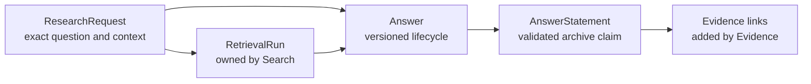
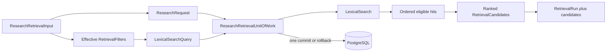
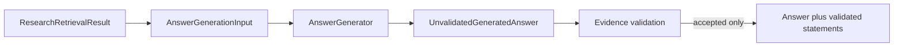
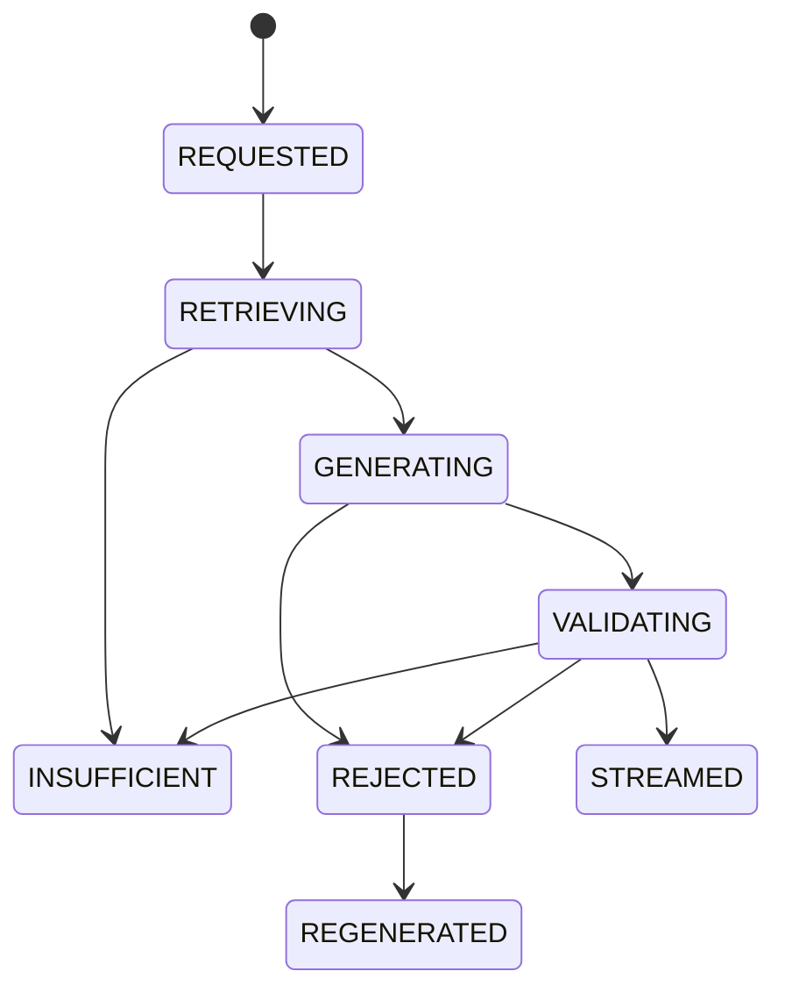
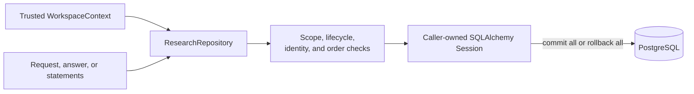

# Research

This module owns immutable research requests, versioned answer lifecycles, and validated answer statements. It orchestrates Search and exposes the application-owned generation boundary; it does not own retrieval candidates, source spans, or validation records.

## Contents

| File             | Responsibility                                                                         |
| ---------------- | -------------------------------------------------------------------------------------- |
| `application.py` | Orchestrates one atomic request and bounded lexical retrieval.                         |
| `contracts.py`   | Defines strict retrieval and unvalidated answer-generation boundary values.            |
| `domain.py`      | Defines requests, temporal modes, answer states, coverage, statements, and invariants. |
| `ports.py`       | Defines repository, retrieval unit-of-work, and answer-generator contracts.            |
| `persistence.py` | Maps three PostgreSQL tables and implements workspace-scoped repository behavior.      |

## Ownership and traceability



An answer references the exact retrieval run that supplied its context. The composite database relationship includes workspace, request, and run identifiers, so a run from another request or workspace cannot be attached accidentally.

Research imports only typed domain contracts from dependencies when application orchestration requires them. It never imports another module's `persistence.py`.

## Temporal request context

```text
CURRENT               → no time cutoff
PUBLIC_KNOWLEDGE      → available_at <= cutoff
PERSONAL_ARCHIVE      → available_at <= cutoff and captured_at <= cutoff
```

The request preserves the user's exact question and explicit document filters. The Search module
separately records the normalized query and effective retrieval-filter snapshot because those are
execution details needed to reproduce a specific run. `RetrieveResearchService` performs the mode
translation once, so Search receives concrete predicates and does not depend on Research enums.

## Lexical retrieval orchestration



The service creates all identifiers server-side, retains the exact question, normalizes only its
search form, and maps each ordered hit to one persisted `LEXICAL` candidate. An empty hit sequence is
a valid reproducible retrieval result and does not create invented candidates. The returned
`ResearchRetrievalResult` keeps each persisted candidate aligned with the canonical hit data needed
by the later generation and evidence path.

## Answer-generation boundary



`AnswerGenerationInput` contains the exact question and a bounded, ordered snapshot of the selected
retrieval sources. Each source keeps its retrieval-candidate, chunk, document-version, structure,
page, and text identity. A generated evidence reference points to a candidate and an exact text
range; it is only a proposal until the server reloads and validates canonical data.

The generator result is immutable and schema-valid but intentionally named `Unvalidated`. It may
never be persisted as an accepted statement or emitted to a client merely because its Pydantic
schema parsed successfully. The `AnswerGenerator` port lets M0.0 use a deterministic fixture adapter
and later use an approved model adapter without changing this trust boundary.

## Answer lifecycle



`REGENERATED` closes the rejected attempt; regeneration creates a new answer row with the next version number. Only `STREAMED` and `INSUFFICIENT` contain user-visible rendered text. A streamed answer has `COMPLETE`, `PARTIAL`, or `CONFLICTING` archive coverage. An insufficient answer explicitly uses `INSUFFICIENT` coverage and has no archive-derived statements.

Answer statements represent accepted archive-derived claims, not raw model output. M0.0 persists only the `ARCHIVE_DERIVED` statement type with `VALIDATED` support status. The Evidence module adds the required source links and validation records in the same caller-owned transaction before any statement is emitted.

## Transaction and isolation boundary



Every table and relationship carries `workspace_id`. Unknown and inaccessible identifiers produce the same repository result. The repository stages changes but never commits; the application service owns the unit of work across Research, Search, and Evidence.

Step 6 creates and atomically persists the request, lexical retrieval run, and selected candidates.
Step 7 begins with the typed generation boundary; persistence, evidence validation, and safe output
remain downstream of every generator implementation.
