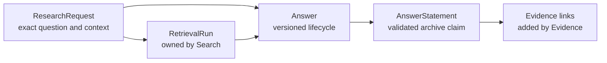
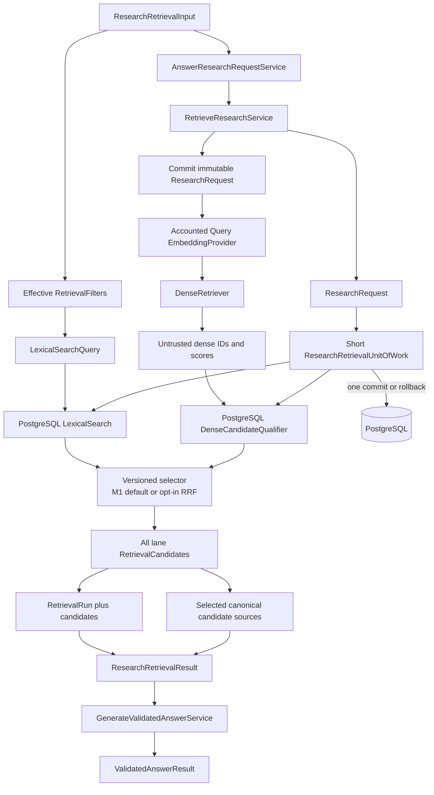
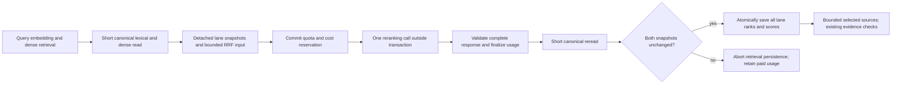
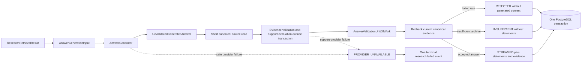
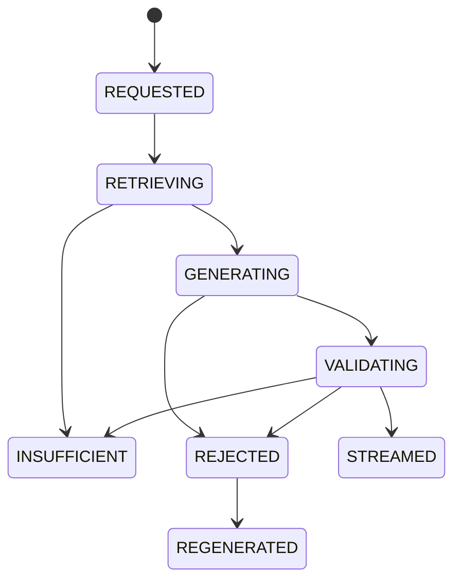
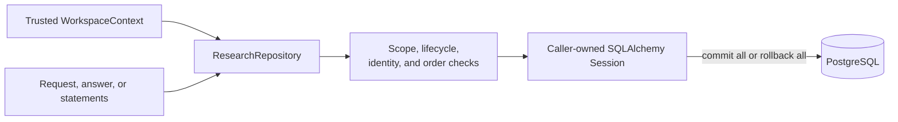

# Research

This module owns immutable research requests, versioned answer lifecycles, and validated answer statements. It orchestrates Search and exposes the application-owned generation boundary; it does not own retrieval candidates, source spans, or validation records.

## Contents

| File                        | Responsibility                                                                            |
| --------------------------- | ----------------------------------------------------------------------------------------- |
| `application.py`            | Connects retrieval and answer validation and preserves existing application imports.      |
| `retrieval.py`              | Runs lexical or dual-lane retrieval and persists qualified candidates.                    |
| `reranking.py`              | Reserves quota/cost, validates one reranking attempt, and finalizes usage outside retrieval transactions. |
| `answer_validation.py`      | Accounts for generation and support, validates evidence, and saves terminal answers.      |
| `errors.py`                 | Defines the safe provider failure shared by retrieval and answer generation.              |
| `contracts.py`              | Defines strict retrieval, generation, and validated-answer boundary values.               |
| `citable_unit_contracts.py` | Defines immutable source snapshots, exact range identities, and bounded request catalogs. |
| `citable_units.py`          | Prepares exact source units and resolves selected IDs to unvalidated evidence references. |
| `citable_generation.py`     | Reloads eligible canonical blocks in a short read scope and builds detached generation input. |
| `domain.py`                 | Defines requests, temporal modes, answer states, coverage, statements, and invariants.    |
| `ports.py`                  | Defines repositories, units of work, and the answer-generator contract.                   |
| `persistence.py`            | Maps three PostgreSQL tables and implements workspace-scoped repository behavior.         |

## Ownership and traceability



An answer references the exact retrieval run that supplied its context. The composite database relationship includes workspace, request, and run identifiers, so a run from another request or workspace cannot be attached accidentally.

Research imports only typed domain contracts from dependencies when application orchestration requires them. It never imports another module's `persistence.py`.

## Temporal request context

```text
CURRENT               → no time cutoff
PUBLIC_KNOWLEDGE      → available_at <= cutoff
PERSONAL_ARCHIVE      → available_at <= cutoff and captured_at <= cutoff
```

The request preserves the user's exact question and explicit document filters. The Search module
separately records the normalized query and effective retrieval-filter snapshot because those are
execution details needed to reproduce a specific run. `RetrieveResearchService` performs the mode
translation once, so Search receives concrete predicates and does not depend on Research enums.

## Retrieval orchestration



The service creates all identifiers server-side, retains the exact question, and normalizes only
its search form. Without M1 query dependencies it preserves the credential-free lexical regression
path. With those dependencies it first commits the immutable research request in one short
transaction. Each query-embedding attempt then reserves budget, calls the provider outside a
transaction, and finalizes usage and cost before dense retrieval. Only classified transient
provider failures receive one bounded retry, with a separate ledger record per paid attempt.
Exhausted, permanent, or budget failures retain the request for safe correlation but persist no
retrieval run or candidates.

Inside one short transaction the service executes lexical search, reloads dense identifiers through
canonical PostgreSQL state, applies the versioned selector, and persists every qualified lane
candidate. A chunk found in both lanes retains one `LEXICAL` and one `DENSE` audit record, but only
its first selected occurrence becomes a `CanonicalCandidateSource`. Empty lanes remain a valid,
explicit retrieval result and never create invented candidates.

M1 remains the normal selector. For the isolated M1.5 experiment, the same dependency bundle can
instead receive `RrfSelectionProfile`; this is internal injection, not a new API or environment
option. Qualified lanes are fused before the unchanged whole-chunk budget is applied. Each lane
record retains its original rank and score plus the chunk's shared `fused_rank`; only the selected
representative receives `selection_rank` and supplies the canonical source ID. Search verifies
fusion ranks before persistence. No provider call, accounting rule, or evidence check is bypassed.
See [Search](../search/README.md#standalone-m15-reciprocal-rank-fusion) for the fixed formula and
comparison boundary.

### Internally injected accounted reranking

The query dependency bundle can instead receive `RrfRerankingProfile` together with
`AccountedRerankingService`; either without the other is rejected. This internal opt-in is tested,
but bootstrap, API profiles, and evaluator configuration do not enable it yet. M1 and plain RRF
keep their existing behavior.



Composition must explicitly supply a reviewed provider identity, unit-price policy, positive
input-unit ceiling with zero output units, and server-owned approval scoped to the reviewed
public/synthetic corpus. This approval is not a client flag, authorization proof, or permission
to transmit private archive content. Operations independently denies reranking when the durable
monthly request policy is absent or exhausted; budget protection also applies. Synthetic test
rates are not an approved live price or proof of provider-account allowance.

The reranking call runs once, after the read session closes. It validates correlation, model,
configuration, scores, and context bounds before recording success. Empty eligible input skips
reranking reservations and calls. Failure never silently falls back to RRF or automatically
retries; unknown failed usage retains its reservation through the existing ledger policy.

Before saving the retrieval result, the service rereads both canonical lanes and requires exact
snapshot equality, including membership, order, provenance, text, and raw scores. Any change
aborts without replacing sources or repeating the paid call. A successful provider operation
remains charged even when that later check rejects persistence. All qualified lane records retain
shared fusion ranks and reranking scores; only chosen representatives supply source identities.
Subsequent source-unit preparation, support evaluation, and final evidence rechecks stay unchanged.

`AnswerResearchRequestService` is the route-facing application use case. It passes the committed
retrieval result to the selected `GenerateValidatedAnswerService` and returns only the validated
terminal result. In the provider-backed runtime, answer-generation and statement-support models
are selected independently from the approved Terra/Luna pairs before retrieval starts. The
credential-free runtime retains its deterministic service and Terra/Terra request defaults, without
making a paid provider call. This composition keeps HTTP code unaware of intermediate retrieval
data and preserves the two focused services as independently testable boundaries.

`RetrieveResearchService` is implemented in `retrieval.py`; `application.py` re-exports the
existing public names so bootstrap and API imports remain stable during this internal split.
`GenerateValidatedAnswerService` and its provider-accounting profiles are implemented in
`answer_validation.py` and re-exported from `application.py` for the same reason.

The same use case owns the public provider-failure policy. Generation and statement-support
adapters retain their distinct internal safe error categories, while the route receives only
`ResearchProviderUnavailableError` with the persisted research-request ID and a bounded
`retriable` decision. Only classified transient failures are retriable; configuration, contract,
and refusal failures are permanent. The policy never performs a hidden retry.

## Standalone M1.5 citable-unit preparation

The source-unit functions and ID-selection adapter are independently tested building blocks,
wired into the opt-in evaluation workflow and API composition. The normal M1 exact-substring
behavior remains the default. The versioned design and remaining comparison/adoption gates are in the
[M1.5 Step 2 contract](../../../../../docs/13-m1-5-rag-quality-plan.md#step-2-contract--citable-units-v1).

`CitableUnitSource` pairs one selected `CanonicalCandidateSource` with its independently loaded
`StructureBlock`. It verifies the complete block mapping, including exact text and media locator.
The caller must already have canonically qualified the source; this pair does not prove current
eligibility or authorization.

`build_citable_unit_catalog` requires the trusted `WorkspaceContext`, research-request UUID, and
those pairs. It preserves the existing 8-source/24,000-code-point budget, splits unchanged block
text under the English v3 heuristic, and retains at most 256 units of at most 800 code points each.
Sentence-ending punctuation and blank paragraphs create boundaries; a single PDF line break does
not, except for the bounded uppercase-heading rule described below. The final periods of standalone
`U.S.` and `U.K.` are not sentence boundaries on their own; other abbreviations can still create
short units. This explicit heuristic is not a claim of perfect
sentence recognition. Overflow is rejected rather than silently dropping evidence.

Each unit has a canonical key identifying its workspace, immutable version, block, exact range,
and policy. UUIDv5 derives a reproducible request-scoped internal ID from that key. Repeated wording
at different offsets gets distinct IDs; the same block found by both lanes is offered once with
the first candidate's provenance. Unknown future partial/multi-block mappings are not assumed to
start at zero.

`resolve_citable_unit_ids` accepts one or two distinct IDs for the current workspace/request and
returns the existing `UnvalidatedEvidenceReference` values. Text and offsets come from the
server-owned catalog, not a model-authored quote. Selection order is preserved and separated
units are not expanded into an implied combined quote. The catalog validates exact slices,
source order, non-overlap, and preservation of every visible source character. Its source text is
excluded from object representations and validation-error rendering, not from an explicit model
dump; do not log or publish catalogs.

`CitableAnswerGenerationInput` extends the existing bounded generation input with the trusted
workspace context and catalog. `from_catalog` projects its retained sources into the existing
source shape. Validation requires identical request, workspace, ordered provenance, and text;
it does not establish current canonical eligibility. The
[`OpenAICitableUnitAnswerGenerator`](../../infrastructure/generation/README.md#standalone-m15-source-unit-id-adapter)
revalidates this input and assigns short model-facing handles (`u1`, `u2`, and so on) in catalog
order. It restricts model selection to these handles, checks membership and duplicates, then maps
them back to the current catalog's internal UUIDs and calls the resolver. Handles are temporary
labels, not database keys or authorization proof; `u1` can refer to a different unit in a later
request. Exact text, ranges, scope checks, and persisted evidence remain unchanged.

These functions do not call providers, touch repositories, create `EvidenceSpan` records, or replace
the existing support evaluation and final canonical recheck. Catalogs are temporary values, never
new canonical tables or public citation identities. The new tests are automatically discovered by
the existing backend-unit CI gate; PostgreSQL CI also discovers the workflow integration tests.

### Opt-in workflow and evaluation integration

`CitableGenerationInputBuilder` uses a short `CitableSourceUnitOfWork` to reload each selected
candidate and its complete block. It reuses Evidence's workspace, active-version, processing,
configuration, and temporal eligibility rules and compares every selected source identifier,
locator, range, and text with canonical state. Missing, stale, foreign, or mismatched sources fail
closed before generation. Catalog construction and provider preparation happen after the read
session closes.

`GenerateValidatedAnswerService` receives this builder only for the experimental profile. An
empty catalog persists the existing insufficient result without generation or support calls.
The optional `AnswerGenerationPreflight` rejects metadata overflow before accounting starts.
For nonempty input the existing operation ledger, detached support evaluation, final canonical
recheck, atomic answer aggregate, and canonical span reuse remain unchanged.

```mermaid
flowchart LR
    SELECTED[Selected canonical sources] --> READ[Short PostgreSQL source and block read]
    READ --> CATALOG[Detached request-scoped catalog]
    CATALOG --> PREFLIGHT[Free schema and reservation check]
    PREFLIGHT --> ACCOUNT[Reserve generation budget]
    ACCOUNT --> MODEL[Model selects unit IDs]
    MODEL --> REFERENCES[Server resolves exact ranges]
    REFERENCES --> SUPPORT[Support check outside transaction]
    SUPPORT --> FINAL[Canonical recheck and atomic persistence]
    FINAL --> VIEW[Existing PDF or text citation reader]
```



The evaluation CLI independently selects `--answer-policy m1` (default) or
`--answer-policy citable_units`; `--retrieval-policy` independently selects M1 or RRF.
The recorded prompt version identifies the frozen answer/unit policy and resolves to a distinct
model-specific generation profile. Separately, API-owned `research_profile=m1-5-citable-units`
selects the existing RRF selector, source-unit generator, canonical document-prefix reader, and
contextual support evaluator in `bootstrap.py`. All four generation/support model pairs share
the unchanged monthly budget executor and retain model-specific pricing and configuration versions.
The provider-backed local runtime defaults to M1.5; M1 remains explicitly available for comparison
and the credential-free adapters retain it. No public request field or browser
policy switch is added; the source viewer still receives canonical evidence-span identities.
The live Compose overlay forwards this non-secret profile only to the API; the
[local run guide](../../../../../docs/development.md#default-m15-source-id-research) gives normal
startup and explicit M1 comparison commands. Local default adoption was owner-approved on
2026-10-12; it does not establish a new quality result or full M1.5 acceptance.
The current source-unit policy is `m1-5-citable-units-en-v3`. It preserves the v2 rule that separates
a short uppercase PDF heading at the start of a range from capitalized mixed-case prose on the
next line. For both PDF and pasted text, it additionally keeps `U.S.`/`U.K.` continuations in one
unit without rewriting characters or offsets. Explicit paragraphs and question/exclamation marks
still split ranges; ambiguous sentence-final country abbreviations may retain a wider exact unit.
The 800-code-point limit remains in force. See the
[abbreviation amendment](../../../../../docs/13-m1-5-rag-quality-plan.md#country-abbreviation-amendment-2026-10-13)
for v3 and the original PDF-heading rule in the
[precision amendment](../../../../../docs/13-m1-5-rag-quality-plan.md#pdf-citation-precision-amendment--block-1-2026-10-09).
This changes only temporary selection ranges, not canonical blocks, chunks, or historical evidence.
Quality scoring remains unchanged: a wider exact unit can still fail reviewed containment even
though canonical validation passes. The deterministic revenue regression now selects the exact
reviewed sentence without its heading. Historical v1 live results keep their precision penalty;
integration success is not live quality acceptance.

## Answer-generation boundary



`AnswerGenerationInput` contains the exact question and a bounded, ordered snapshot of the selected
retrieval sources. Each source keeps its retrieval-candidate, chunk, document-version, structure,
media locator, and text identity. A generated evidence reference points to a candidate and an exact
block-relative text range; it is only a proposal until the server reloads and validates canonical
data. For pasted text, the server derives the absolute original range from the canonical structure
block rather than accepting one from the generator.

The generator returns an immutable `AnswerGenerationResult` containing the schema-valid but
intentionally `Unvalidated` proposal plus content-free `ProviderUsage`. The proposal may never be
persisted as an accepted statement or emitted to a client merely because its Pydantic schema parsed
successfully. The `AnswerGenerator` port lets M0.0 use a deterministic fixture adapter and M1 use an
approved model adapter without changing this trust boundary.

For M1, `GenerateValidatedAnswerService` reserves budget in one short transaction, calls the
generator without an open database transaction, and finalizes reported usage and cost in another
short transaction. M0.0 calls its zero-cost deterministic generator directly. The service then
reads the proposed canonical sources in a short transaction and evaluates statement support after
that transaction closes. Its final answer transaction reloads eligible sources and rechecks the
same evidence rules before saving the answer. Previously recorded support decisions are reused
only for the same statement and exact evidence text; sources that became ineligible before the
final recheck cannot become published citations. Visible streamed text is rebuilt from accepted
statements rather than copied
from the generator's untrusted `rendered_text`. Insufficient output uses an application-owned
message, and rejected output retains safe rule findings but no generated content.

An answer-generator failure occurs before the answer unit of work opens. A statement-support
provider call receives its own committed budget reservation and usage finalization while no answer
transaction is open. A provider failure leaves no answer aggregate to roll back. Each statement
produces a separately attributable `STATEMENT_SUPPORT` operation. Neither failure path persists or
emits partial generated content. The already committed research request, retrieval run, and
candidates remain available for later audit and a deliberate new user attempt. The HTTP boundary
exposes only `PROVIDER_UNAVAILABLE`; provider authentication, rate-limit, timeout, refusal, schema,
prompt, and source details remain internal.

## Answer lifecycle



`REGENERATED` closes the rejected attempt; regeneration creates a new answer row with the next version number. Only `STREAMED` and `INSUFFICIENT` contain user-visible rendered text. A streamed answer has `COMPLETE`, `PARTIAL`, or `CONFLICTING` archive coverage. An insufficient answer explicitly uses `INSUFFICIENT` coverage and has no archive-derived statements.

Answer statements represent accepted archive-derived claims, not raw model output. M0.0 persists only the `ARCHIVE_DERIVED` statement type with `VALIDATED` support status. The Evidence module adds the required source links and validation records in the same caller-owned transaction before any statement is emitted.

## Transaction and isolation boundary



Every table and relationship carries `workspace_id`. Unknown and inaccessible identifiers produce
the same repository result. Repositories stage changes but never commit; the application service
owns the unit of work across Research and Evidence. For a streamed answer it flushes the staged
answer, statements, and spans before adding their foreign-key dependents. This is an ordering
boundary inside the same transaction, not an early commit, so any later failure still rolls back the
complete aggregate.

Retrieval provider calls occur before the database transaction. The transaction then atomically
persists the request, reproducible run, all qualified lane candidates, and their final selection
ranks. Answer generation also remains outside its later validation transaction.
`AnswerResearchRequestService` composes retrieval and validated generation as one complete use case.
The HTTP route consumes only `ValidatedAnswerResult` and maps it to versioned terminal stream events;
it never receives an `UnvalidatedGeneratedAnswer`. Resolving a citation identifier to an authorized
source location remains a separate Evidence application and HTTP boundary.
