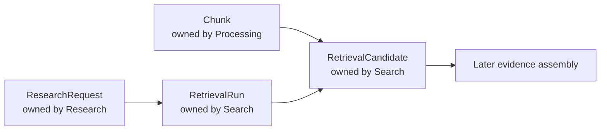
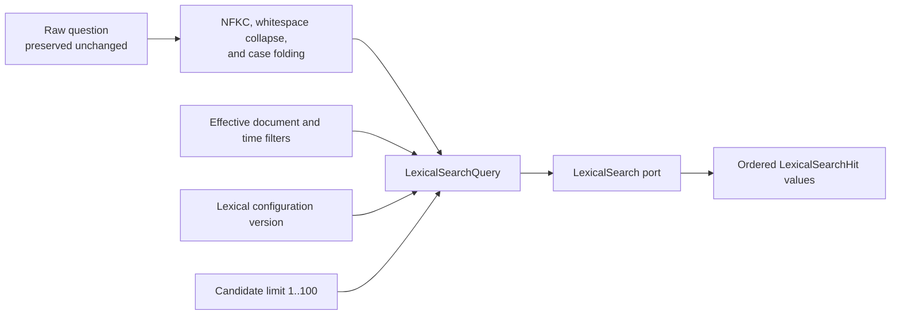
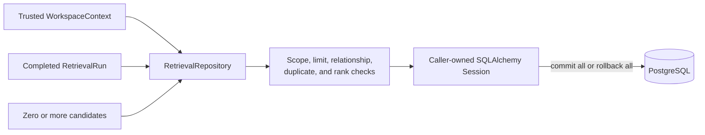

# Search

This module owns reproducible retrieval records and ranked candidates from eligible chunks. It does not own chunk text, research questions, answers, or evidence validation.

## Contents

| File             | Responsibility                                                                 |
| ---------------- | ------------------------------------------------------------------------------ |
| `application.py` | Normalizes raw questions and builds bounded lexical-search queries.            |
| `contracts.py`   | Defines immutable lexical and provider-neutral retrieval boundary values.      |
| `domain.py`      | Defines retrieval runs, filter snapshots, candidates, origins, and invariants. |
| `indexing.py`    | Orchestrates bounded embedding, deterministic writes, and vector readiness.    |
| `ports.py`       | Defines lexical, embedding, dense, reranking, and repository contracts.        |
| `persistence.py` | Maps retrieval records and implements workspace-scoped repository behavior.    |
| `selection.py`   | Applies deterministic lexical-first M1 context selection and deduplication.    |
| `fusion_contracts.py` | Defines versioned RRF contributions, fusion ranks, and context limits. |
| `fusion.py` | Calculates opt-in M1.5 RRF and bounded context without provider or database calls. |

## Ownership and relationships



The arrows between modules are identifier-based contracts and database relationships. Search does not import another module's persistence implementation. `research_request_id` connects a run to the initiating request, while `chunk_id` connects a candidate to canonical retrieval content.

## Lexical query contract

The application retains the user's raw question on `ResearchRequest` and `RetrievalRun`, while
`normalize_lexical_query` derives a deterministic search-only form. It applies Unicode NFKC
normalization, collapses whitespace, and case-folds text. The normalized value, effective filters,
lexical configuration version, and bounded candidate limit form `LexicalSearchQuery`.



Temporal filters record the actual eligibility predicates rather than repeating a research mode:
`available_at_cutoff` limits public availability, while `captured_at_cutoff` additionally limits when
the document entered the workspace archive. An archive cutoff therefore requires an availability
cutoff. This keeps Search independent of Research while preserving the exact executed filter state.

Each hit identifies its canonical chunk, document, version, source block, and media-appropriate
locator kind. PDF hits carry a physical page; pasted-text hits deliberately carry no invented page.
Every hit retains the exact chunk text and a positive finite lexical score. A hit is only a
retrieval candidate; it cannot become citation evidence until the later evidence-validation step
succeeds.

## Persisted retrieval result



Zero candidates are valid and preserve the explicit insufficient-evidence path. For non-empty results,
ranks start at one and remain contiguous within each retrieval origin. A `LEXICAL` run accepts only
lexical candidates. A `DUAL_LANE` run accepts lexical and dense candidates under independently
bounded route limits.

The same canonical chunk may appear once per origin, because that preserves which routes found it.
Only the candidate chosen for context receives a `selection_rank`; selected chunks are unique and
their ranks are contiguous. Reads return selected candidates in this final order, followed by any
unselected candidates in stable origin and route-rank order. The opt-in M1.5 RRF experiment
described below uses this same persisted path; reranking remains deferred.

## Reproducibility and isolation

A run preserves the exact and normalized query, typed filters, retrieval mode, all applicable
lexical, embedding, dense-index, and selector configuration versions, independent route limits,
context limits, and execution timing. Candidate rows preserve origin-local rank and finite raw
score without comparing unlike score scales. `selection_rank` records M1 context order, while
nullable fusion and reranking fields remain unset in the default M1 runtime. Opt-in RRF records a
`fused_rank` on every qualified lane candidate, including both records for a shared chunk and
unselected candidates. Before staging a run with `m1-5-rrf-k60-v1`, the repository reconstructs the
fusion ranks from all origin-local ranks and rejects inconsistent fusion or selection order. The
score is reproducible from those ranks and the fixed versioned formula; no new column or migration
is needed.

Every table and relationship carries `workspace_id`. Repository writes reject a mismatched trusted context before staging rows, and repository reads use the workspace in every query. Composite foreign keys let PostgreSQL reject cross-workspace links independently of application checks.

The outer `infrastructure/search/postgresql.py` adapter implements `LexicalSearch` with one
eligibility-first query over the existing English `tsvector` and GIN index. It joins canonical
document and processing state, applies workspace, current-version, active-set, configuration,
document, and temporal filters before `ts_rank_cd` ranking, then uses `chunk_id` as the final stable
tie-breaker before applying the candidate limit. Both `LEXICAL_READY` regression sources and fully
`SEARCHABLE` M1 sources remain eligible for this lane. The adapter only returns hits. Research's
`RetrieveResearchService` invokes it through the port and preserves the lexical-only regression
path without importing Search persistence.

## Provider seams

The application owns `EmbeddingProvider`, `DenseIndexWriter`, `DenseRetriever`,
`DenseCandidateQualifier`, and `Reranker`; no provider SDK appears in this module. Their immutable
contracts preserve input correlation, configuration versions, bounded batch and candidate sizes,
canonical filters, and finite vectors and scores. The M1 embedding boundary accepts at most 16
inputs and 32,000 total Unicode code points, and every returned vector must contain exactly 1536
finite values. `EmbeddingResult` keeps those ordered vectors together with content-free
provider-reported `ProviderUsage`; the deterministic adapter reports zero external usage.

```mermaid
flowchart LR
    CHUNKS[Ordered active canonical chunks] --> BATCH[Bounded document batches]
    TEXT[Query text] --> EMBED[EmbeddingProvider]
    BATCH --> EMBED
    EMBED --> RESULT[EmbeddingResult<br/>vectors plus usage]
    RESULT --> VALIDATE[Ordered response validation]
    RESULT --> USAGE[Canonical provider accounting]
    VALIDATE --> VECTOR[Correlated EmbeddingVector]
    VECTOR --> ID[Workspace-scoped deterministic vector ID]
    ID --> WRITER[DenseIndexWriter]
    WRITER --> VISIBLE[Bounded fetch-based visibility sequence]
    VISIBLE --> READY[All IDs visible]
    VECTOR --> DENSE[DenseRetriever]
    FILTERS[Canonical RetrievalFilters] --> DENSE
    DENSE --> HITS[Untrusted dense hits]
    HITS --> QUALIFY[PostgreSQL DenseCandidateQualifier]
    FILTERS --> QUALIFY
    QUALIFY --> ELIGIBLE[Qualified canonical dense hits]
    ELIGIBLE --> SELECT[M1 deterministic selector]
    ELIGIBLE -. future M4 .-> RERANK[Reranker]
```



The deterministic M1 vector identity hashes the trusted workspace ID, canonical chunk ID, and
embedding configuration version. Provider metadata contains only bounded canonical IDs and
configuration versions; it contains no source text, title, filename, prompt, answer, or
authorization decision. The provider adapter derives the workspace namespace from the trusted
`WorkspaceContext`, never from a client-supplied value.

Dense provider hits contain only an untrusted chunk ID and finite raw score. The PostgreSQL
qualifier preserves their provider order but returns canonical text only when workspace, current
document version, active lifecycle, active chunk set, `SEARCHABLE` processing state, explicit
filters, and lexical, embedding, and dense-index configuration versions all match. Unknown,
foreign, stale, and filtered identifiers are indistinguishable and absent from the result.

`select_m1_context` receives only lexical hits and already-qualified dense hits. It alternates
lexical rank 1, dense rank 1, lexical rank 2, dense rank 2, and so on without comparing their raw
scores. The first interleaved occurrence of each chunk wins. Selection stops at the configured
chunk limit, skips rather than truncates text that would exceed the remaining character budget, and
records one contiguous `selection_rank` per chosen chunk. The fixed behavior is identified by
`m1-lexical-first-round-robin-v1`. Research now orchestrates query embedding and dense retrieval
before a short PostgreSQL unit of work, then runs lexical search, dense qualification, selection,
and atomic result persistence inside that unit of work. All qualified lane candidates remain
auditable even when overlap deduplication excludes one from generation context.

### Standalone M1.5 reciprocal-rank fusion

`fuse_rrf_hits` accepts at most 20 canonical lexical hits and 20 already-qualified dense hits.
It ranks each unique chunk by `sum(1 / (60 + lane_rank))`, with equal lane weights and one vote
per lane. The version is `m1-5-rrf-k60-v1`. This fixed starting formula follows the
[original RRF paper](https://cormack.uwaterloo.ca/cormack/cormacksigir09-rrf.pdf); it is not a claim
that k = 60 is optimal for this corpus. Input rank is the one-based position after qualification,
as in the existing M1 selector. Raw scores are retained, never used for fusion.

Exact rational arithmetic determines order; equal sums use ascending chunk UUID. A shared chunk
retains both origin/rank/raw-score contributions and the lexical hit as its representative.
Duplicates within a lane and disagreement about the same chunk's canonical text or identifiers
fail explicitly rather than add votes or silently choose one source. Type checks reject raw dense
provider objects; they do not replace upstream workspace and eligibility enforcement.

`select_rrf_context` applies the same 8-chunk and 24,000-code-point maxima, or smaller configured
limits. It skips rather than truncates an oversized chunk. `fused_rank` remains its position before
budget filtering; `selection_rank` is the contiguous context position afterward. Fusion can return
all 40 unique hits for inspection; the selection result retains this full ranking alongside the
bounded context so excluded candidates remain auditable.

```text
Canonical lexical + qualified dense hits → RRF ranks → whole-chunk budget → context
```

These pure functions make no provider calls and write no state. `RetrieveResearchService` can
explicitly receive `RrfSelectionProfile` in its query dependency bundle, after canonical lane
qualification. It translates the selected representatives into the existing source contract and
persists both lane contributions with their fusion ranks. The normal composition still supplies
`M1SelectionProfile`; there is no new environment setting, browser switch, or OpenAPI change.
Canonical revalidation and statement-support checks are still required before any selected text
can become citation evidence. A same-corpus comparison against M1 must precede any default-policy
decision. Offline service tests and `test_rrf_retrieval_postgresql.py` exercise the opt-in path,
persisted ranks, budget exclusions, and canonical workspace/time/active-state boundaries.

`IndexActiveChunksService` owns the document-index sequence without importing a provider SDK. It
requires one leased `LEXICAL_READY` or `INDEXING` run and one coherent active chunk set, orders
chunks deterministically, and packs requests under both the 16-item and 32,000-character limits.
Embedding and upsert operations receive at most two application-owned attempts; adapters perform no
nested retries. Each document-embedding attempt reserves and finalizes canonical provider usage in
separate short transactions linked to the processing run. No database transaction remains open
during the provider call. After every exact provider acknowledgement, the service polls fetch
batches under one 30-second total deadline and succeeds only when every deterministic vector ID is
visible. Before each fetch, it passes the remaining deadline to the adapter; after each fetch, it
rejects a response that arrived too late, even if every ID is visible. Pinecone work remains outside
database transactions.

Unavailable infrastructure adapters fail explicitly with `SearchProviderUnavailableError`, so an
accidentally enabled path cannot masquerade as a valid empty result. The Pinecone infrastructure
adapters implement separate `DenseIndexWriter` and `DenseRetriever` roles through the provider's
gRPC data plane while this module remains SDK-free. The worker owns the writer credential and the
API owns the reader credential; each process closes only its own client. Reranking is activated only
after its evaluation gate. Provider results remain candidates, never citation evidence, until
canonical eligibility and evidence validation succeed.
