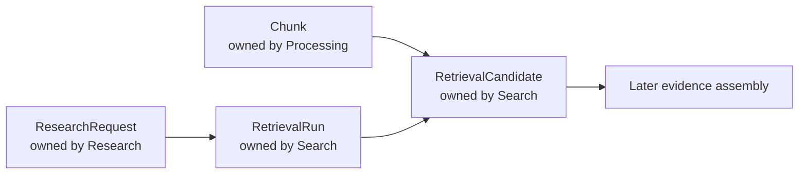
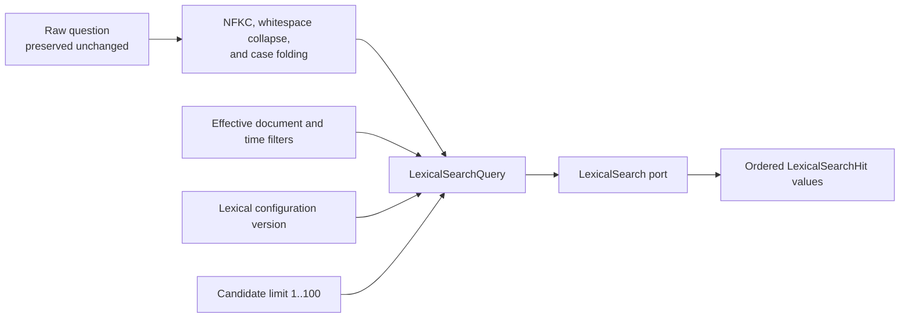
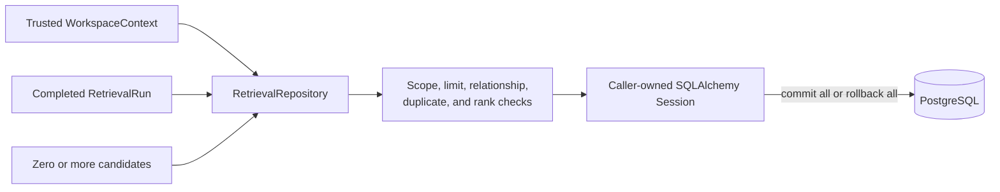
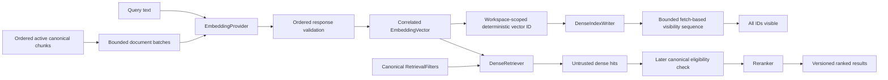

# Search

This module owns reproducible retrieval records and the ordered candidates selected from eligible chunks. It does not own chunk text, research questions, answers, or evidence validation.

## Contents

| File             | Responsibility                                                                 |
| ---------------- | ------------------------------------------------------------------------------ |
| `application.py` | Normalizes raw questions and builds bounded lexical-search queries.            |
| `contracts.py`   | Defines immutable lexical and provider-neutral retrieval boundary values.      |
| `domain.py`      | Defines retrieval runs, filter snapshots, candidates, origins, and invariants. |
| `indexing.py`    | Orchestrates bounded embedding, deterministic writes, and vector readiness.    |
| `ports.py`       | Defines lexical, embedding, dense, reranking, and repository contracts.        |
| `persistence.py` | Maps retrieval records and implements workspace-scoped repository behavior.    |

## Ownership and relationships

The arrows between modules are identifier-based contracts and database relationships. Search does not import another module's persistence implementation. `research_request_id` connects a run to the initiating request, while `chunk_id` connects a candidate to canonical retrieval content.

## Lexical query contract

The application retains the user's raw question on `ResearchRequest` and `RetrievalRun`, while
`normalize_lexical_query` derives a deterministic search-only form. It applies Unicode NFKC
normalization, collapses whitespace, and case-folds text. The normalized value, effective filters,
lexical configuration version, and bounded candidate limit form `LexicalSearchQuery`.

Temporal filters record the actual eligibility predicates rather than repeating a research mode:
`available_at_cutoff` limits public availability, while `captured_at_cutoff` additionally limits when
the document entered the workspace archive. An archive cutoff therefore requires an availability
cutoff. This keeps Search independent of Research while preserving the exact executed filter state.

Each hit identifies its canonical chunk, document, version, source block, and media-appropriate
locator kind. PDF hits carry a physical page; pasted-text hits deliberately carry no invented page.
Every hit retains the exact chunk text and a positive finite lexical score. A hit is only a
retrieval candidate; it cannot become citation evidence until the later evidence-validation step
succeeds.

## Persisted retrieval result

Zero candidates are valid and preserve the explicit insufficient-evidence path. For non-empty results, ranks start at one and remain contiguous within each retrieval origin. Stable UUID ordering is the final read tie-breaker.

`RetrievalOrigin` already defines the production vocabulary `LEXICAL`, `DENSE`, and `STRUCTURED`. M0.0 persists only lexical candidates; defining later origin names does not implement their retrieval paths. Dense retrieval begins in M1, while fusion and reranking begin only in their approved milestones.

## Reproducibility and isolation

A run preserves the exact query, its normalized form, typed filters, the lexical configuration version, candidate limit, and execution timing. Candidate rows preserve raw route rank and score, with nullable fields reserved for later fusion and reranking results.

Every table and relationship carries `workspace_id`. Repository writes reject a mismatched trusted context before staging rows, and repository reads use the workspace in every query. Composite foreign keys let PostgreSQL reject cross-workspace links independently of application checks.

The outer `infrastructure/search/postgresql.py` adapter implements `LexicalSearch` with one
eligibility-first query over the existing English `tsvector` and GIN index. It joins canonical
document and processing state, applies workspace, current-version, active-set, configuration,
document, and temporal filters before `ts_rank_cd` ranking, then uses `chunk_id` as the final stable
tie-breaker before applying the candidate limit. The adapter only returns hits. Research's
`RetrieveResearchService` invokes it through the port and maps those ordered hits to an atomically
persisted retrieval run and `LEXICAL` candidates without importing Search persistence.

## Provider seams

The application owns `EmbeddingProvider`, `DenseIndexWriter`, `DenseRetriever`, and `Reranker`; no
provider SDK appears in this module. Their immutable contracts preserve input correlation,
configuration versions, bounded batch and candidate sizes, canonical filters, and finite vectors
and scores. The M1 embedding boundary accepts at most 16 inputs and 32,000 total Unicode code
points, and every returned vector must contain exactly 1536 finite values.

The deterministic M1 vector identity hashes the trusted workspace ID, canonical chunk ID, and
embedding configuration version. Provider metadata contains only bounded canonical IDs and
configuration versions; it contains no source text, title, filename, prompt, answer, or
authorization decision. The provider adapter derives the workspace namespace from the trusted
`WorkspaceContext`, never from a client-supplied value.

`IndexActiveChunksService` owns the document-index sequence without importing a provider SDK. It
requires one leased `LEXICAL_READY` or `INDEXING` run and one coherent active chunk set, orders
chunks deterministically, and packs requests under both the 16-item and 32,000-character limits.
Embedding and upsert operations receive at most two application-owned attempts; adapters perform no
nested retries. After every exact provider acknowledgement, the service polls fetch batches under
one 30-second total deadline and succeeds only when every deterministic vector ID is visible. The
service performs no database writes, so its provider work always remains outside a transaction.

Unavailable infrastructure adapters fail explicitly with `SearchProviderUnavailableError`, so an
accidentally enabled path cannot masquerade as a valid empty result. The Pinecone infrastructure
adapter now implements `DenseIndexWriter` through the provider's gRPC data plane while this module
remains SDK-free. Embedding and dense retrieval begin in their assigned blocks, and reranking is
activated only after its evaluation gate. Provider results remain candidates, never citation
evidence, until canonical eligibility and evidence validation succeed.
