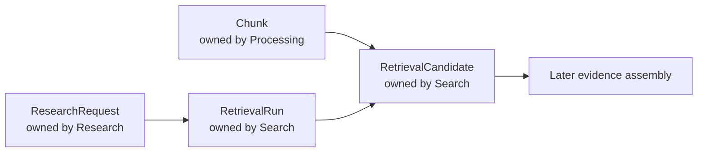
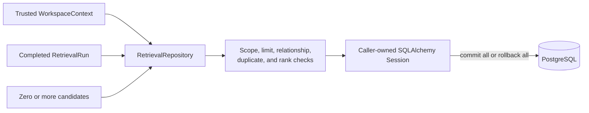

# Search

This module owns reproducible retrieval records and the ordered candidates selected from eligible chunks. It does not own chunk text, research questions, answers, or evidence validation.

## Contents

| File             | Responsibility                                                                 |
| ---------------- | ------------------------------------------------------------------------------ |
| `domain.py`      | Defines retrieval runs, filter snapshots, candidates, origins, and invariants. |
| `ports.py`       | Defines the application-owned `RetrievalRepository` contract.                  |
| `persistence.py` | Maps retrieval records and implements workspace-scoped repository behavior.    |

## Ownership and relationships

The arrows between modules are identifier-based contracts and database relationships. Search does not import another module's persistence implementation. `research_request_id` connects a run to the initiating request, while `chunk_id` connects a candidate to canonical retrieval content.

## Persisted retrieval result

Zero candidates are valid and preserve the explicit insufficient-evidence path. For non-empty results, ranks start at one and remain contiguous within each retrieval origin. Stable UUID ordering is the final read tie-breaker.

`RetrievalOrigin` already defines the production vocabulary `LEXICAL`, `DENSE`, and `STRUCTURED`. M0.0 persists only lexical candidates; defining later origin names does not implement their retrieval paths. Dense retrieval begins in M1, while fusion and reranking begin only in their approved milestones.

## Reproducibility and isolation

A run preserves the exact query, its normalized form, typed filters, the lexical configuration version, candidate limit, and execution timing. Candidate rows preserve raw route rank and score, with nullable fields reserved for later fusion and reranking results.

Every table and relationship carries `workspace_id`. Repository writes reject a mismatched trusted context before staging rows, and repository reads use the workspace in every query. Composite foreign keys let PostgreSQL reject cross-workspace links independently of application checks.

The PostgreSQL lexical-search query itself is implemented in Step 6. This Step 3 module provides only the persistence boundary and records required by that later application service.
