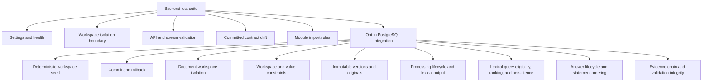

# Backend Tests

This directory verifies deterministic application behavior and architectural boundaries without live paid providers.

## Structure

| Path           | Responsibility                                                                                    |
| -------------- | ------------------------------------------------------------------------------------------------- |
| `unit/`        | Fast tests for settings, health, identity, contracts, OpenAPI drift, and module dependency rules. |
| `integration/` | Opt-in PostgreSQL tests for migrations, seeds, persistence, constraints, and isolation.           |
| `acceptance/`  | Added for the complete M0.0 fixture journey.                                                      |

## Current coverage

Tests use application factories and explicit test settings. They must not read secret environment files, depend on private documents, contact paid providers, or weaken workspace and evidence rules merely to pass.

PostgreSQL integration tests are skipped unless `INVESTMENT_RESEARCH_DATABASE_URL` is explicitly
configured. They additionally require `INVESTMENT_RESEARCH_ENVIRONMENT=test`, use a schema already
migrated by Alembic, and never create tables implicitly. The current suite verifies durable commits,
complete rollback after failure, and non-disclosure of documents, current versions, and original
artifact metadata across workspace boundaries. It also verifies database rejection of cross-workspace
document relationships and invalid constrained values, plus trigger-enforced immutability for document
versions and original artifacts. Processing coverage verifies the captured-to-lexical-ready lifecycle,
rejects cross-workspace source versions, enforces one active chunk set per profile, and confirms that
PostgreSQL builds searchable English `tsvector` values from chunk text. Processing-status API
coverage additionally proves that an owning workspace can read a run while foreign and unknown run
identifiers produce the same response. Search coverage verifies PostgreSQL full-text matching,
eligibility-first workspace, current-version, active-set, configuration, document, and temporal
filters, deterministic score ordering and limiting, stable candidate persistence, and database
rejection of foreign request and chunk relationships and duplicate ranks within one retrieval
origin. Research coverage follows every permitted transition from `REQUESTED` to `STREAMED`, verifies
ordered statements and non-disclosure, and rejects foreign or mismatched request-to-retrieval
relationships and duplicate versions. Orchestration from a research request through persisted
retrieval candidates remains the next Step 6 work block. Evidence coverage verifies atomically
persisted exact spans, statement relationships, and answer validations; stable scoped reads;
cross-workspace source and subject rejection; and unique answer- and statement-level rule results.
Generation and canonical evidence validation behavior remain Step 7 scope.

For a complete local check, `uv run --locked python -m scripts.verify_postgres` creates a uniquely
named disposable Docker environment, migrates and seeds it, runs this integration suite, verifies
migration drift and the downgrade/upgrade cycle, and removes its container and volume even after a
failed check.

Run commands are documented in the repository [`README.md`](../../README.md#verify-changes). Database
tests must prove both same-workspace access and cross-workspace non-disclosure.
