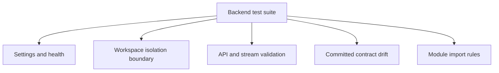

# Backend Tests

This directory verifies deterministic application behavior and architectural boundaries without live paid providers.

## Structure

| Path           | Responsibility                                                                                    |
| -------------- | ------------------------------------------------------------------------------------------------- |
| `unit/`        | Fast tests for settings, health, identity, contracts, OpenAPI drift, and module dependency rules. |
| `integration/` | Added with persistence and external-service adapters when those implementation steps begin.       |
| `acceptance/`  | Added for the complete M0.0 fixture journey.                                                      |

## Current coverage

Tests use application factories and explicit test settings. They must not read secret environment files, depend on private documents, contact paid providers, or weaken workspace and evidence rules merely to pass.

Run commands are documented in the repository [`README.md`](../../README.md#verify-changes). Future database tests must prove both same-workspace access and cross-workspace non-disclosure.
