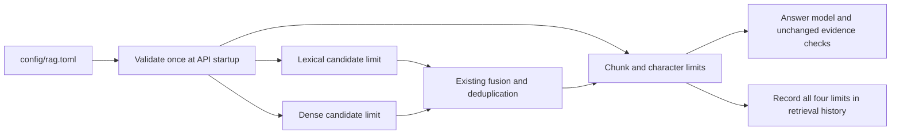

# Local RAG tuning

Edit [rag.toml](./rag.toml) to tune normal provider-backed M1 or M1.5 research. This is
non-secret application configuration: commit intentional changes, never credentials.

| Setting | Default | Allowed range | Effect |
| --- | --- | --- | --- |
| `retrieval.lexical_candidate_limit` | 20 | 1–20 | Maximum keyword-search candidates before context selection |
| `retrieval.dense_candidate_limit` | 20 | 1–20 | Maximum vector-search candidates before canonical qualification |
| `context.chunk_limit` | 8 | 1–32 | Maximum unique chunks selected for the answer model |
| `context.character_limit` | 24000 | 1–24000 | Combined selected source text, measured in Unicode code points |

For a first multi-document experiment, change only `chunk_limit = 8` to `chunk_limit = 16`.
More chunks are not necessarily better: compare evidence coverage, answer support, latency,
and estimated cost on the same questions.

## Data flow



The count and text limits both apply. Selection uses whole chunks, does not pad results to
the configured count, and does not guarantee one result per selected document or exhaustive
coverage of every PDF page. Shared lexical/dense hits count once. Candidates must still pass
workspace, version, deletion, and temporal eligibility checks.

The 24,000-character text ceiling, 256 source-unit ceiling, source-unit metadata limits,
statement/evidence limits, provider timeouts, and cost reservations remain in force. Extra
chunks can hit a separate safety limit; this file does not disable those protections.

## Apply a change

The API reads and validates the complete file at startup. Unknown or missing keys, invalid
TOML, non-integer values, and out-of-range values fail startup; there is no silent fallback.
Do not remove either section. Changes do not reprocess documents or rebuild their vectors.

- Host-run API: stop and restart the existing Uvicorn process. TOML changes are not guaranteed
  to trigger Python's reload watcher.
- Existing live Compose stack, from the repository root:

  ```bash
  docker compose --env-file .env -f compose.yaml -f compose.m1-live.yaml restart api
  ```

Compose mounts the file read-only at `/config/rag.toml`. After initially installing this
feature, rebuild/start the stack normally so migration `0012_rag_context_bounds` and the new
mount are installed. Subsequent value-only edits need just the API restart above.

## Reproducibility and scope

The algorithm version still identifies the unchanged selection algorithm; each new retrieval
run records its four effective numeric limits alongside that version. Old runs, answers, and
evaluation outputs are never rewritten. Historical M0/M1 acceptance adapters and standalone
M1/M1.5 baseline evaluation keep their explicitly constructed, frozen profiles; they do not
adopt these tuning values. The API still validates its startup file. Programmatic tests use
fixed defaults unless they inject tuning.

This file does not choose models, enable reranking, change chunking or embedding dimensions,
or set provider budgets. Answer/support models remain independently selectable in the UI.
Keys and budgets retain their existing separate configuration. Increasing the text ceiling,
candidate-lane ceilings, or other hard limits requires a separately reviewed code change.

A schema downgrade to the old eight-chunk ceiling is refused if recorded retrieval runs
contain larger configured counts. Never delete real history just to force a downgrade.
