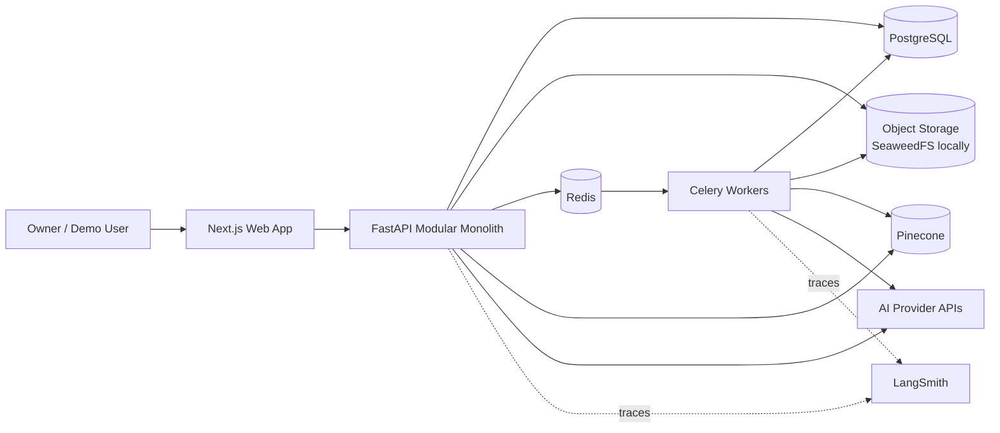
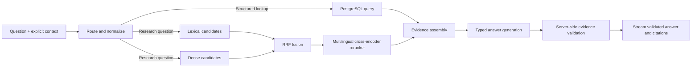
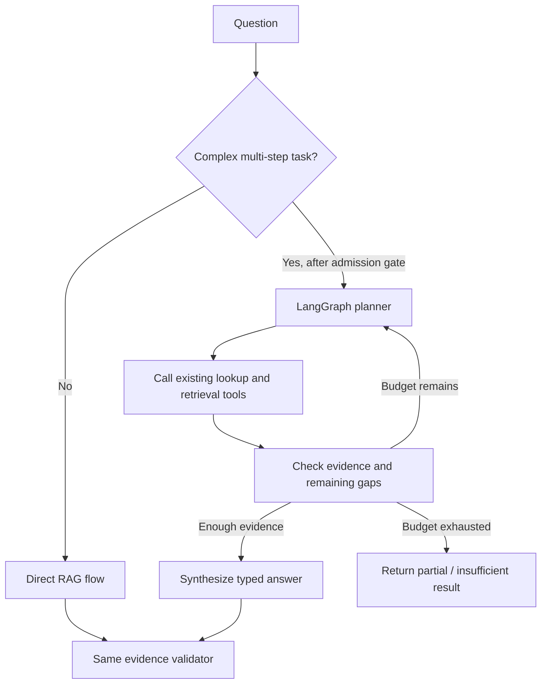

# Investment Research Archive — System Design

**Status:** Draft v0.3
**Scope:** V1 production architecture with planned extension points  
**Related:** [01-product-scope.md](./01-product-scope.md), [07-m0-0-architecture-flows.md](./07-m0-0-architecture-flows.md), [08-m0-0-implementation-plan.md](./08-m0-0-implementation-plan.md), [09-m0-implementation-plan.md](./09-m0-implementation-plan.md), [10-m1-implementation-plan.md](./10-m1-implementation-plan.md)

## 1. Design goals

The system must:

- produce evidence-grounded answers from English documents while preserving explicit language metadata and extension points for additional languages;
- preserve exact provenance from an answer to the original document location;
- keep private and demo workspaces isolated;
- tolerate retries, partial failures, reprocessing, and deletion;
- make AI behavior observable, versioned, and testable;
- remain understandable and affordable for one developer;
- support later structured research and bounded agentic workflows without a rewrite.

The design favors a **modular monolith with asynchronous workers**. Microservices, Kubernetes, and autonomous agents are deferred until measured needs justify their cost.

## 2. System context

V1 is developed and operated locally with Docker Compose. Pinecone and approved AI providers remain external trust boundaries. Only public or non-sensitive documents may cross those boundaries until their privacy and retention behavior has been approved for private data.

The first public deployment is a separate milestone. The containers and provider adapters keep the system portable; the hosting platform is selected only after the complete local vertical slice works reliably.

## 3. Technology baseline

| Area | Choice | Purpose |
|---|---|---|
| Web | Next.js, TypeScript, Tailwind CSS, shadcn/ui | English user interface, streaming chat, document and citation views |
| API | Python, FastAPI, Pydantic | Typed HTTP and streaming APIs, application orchestration |
| Persistence | PostgreSQL, SQLAlchemy, Alembic | Canonical business, provenance, audit, and lexical-search state |
| Original files | S3-compatible object storage; SeaweedFS locally | Immutable PDFs and submitted-text originals |
| Background work | Celery and Redis | Retryable parsing, enrichment, embedding, and index jobs |
| Vector retrieval | Pinecone | Managed dense retrieval with metadata filtering |
| AI integrations | Thin application-owned provider adapters | Replaceable LLM, embedding, and reranking providers |
| AI observability | OpenTelemetry/OpenInference and LangSmith | Tracing, experiments, evaluation, and failure analysis |
| Runtime | Docker Compose, PostgreSQL, Redis, SeaweedFS | Complete production-shaped local environment |
| Public hosting — later | Container platform plus managed database and object storage | Selected after the local vertical slice; AWS remains one option |

The RAG core is implemented in application code. LlamaIndex and LangChain are not required in the direct V1 path. LangGraph is introduced later only for bounded multi-step workflows.

### Pre-foundation proof of value

M0.0 precedes this production baseline with a local-only walking skeleton. It may use only Next.js, FastAPI, PostgreSQL, development-only local artifact storage, and a bounded development processing runner to validate one answerable and one unanswerable fixture case. PostgreSQL lexical retrieval is sufficient for this proof.

M0.0 is an implementation experiment, not an alternative V1 architecture. It excludes Celery,
Redis, SeaweedFS, Pinecone, reranking, LangSmith, public deployment, and private data. The API
records a canonical `ProcessingRun`; a separate, single-job development runner invokes the same
processing application service that the Celery worker will invoke from M0 onward. The runner has no
durability, retry, or availability guarantee. It never shares an API database session and never
performs CPU-heavy parsing on the API event loop. This process and resource separation is not an
operating-system sandbox: [ADR-0004](./adr/0004-m0-0-parser-isolation-boundary.md) limits accepted
M0.0 processing to the frozen synthetic fixture and makes tested parser isolation an M0 gate.

Application-owned contracts, Alembic migrations, module boundaries, and the real evidence validator are established in M0.0. Development-only artifact storage and processing delivery are replaced during M0. Passing M0.0 does not satisfy the M0 or M1 exit gates. The paired diagrams are maintained in [07-m0-0-architecture-flows.md](./07-m0-0-architecture-flows.md), the completed proof sequence in [08-m0-0-implementation-plan.md](./08-m0-0-implementation-plan.md), the M0 replacement sequence in [09-m0-implementation-plan.md](./09-m0-implementation-plan.md), and the M1 thin-slice sequence in [10-m1-implementation-plan.md](./10-m1-implementation-plan.md).

M1 retains the server-owned fixed local identity solely to focus the first complete RAG slice on
document inputs, dense indexing, retrieval, generation, and evidence. This exception is limited to
a local runtime whose host entry point is published only on loopback; backend containers may bind
inside private Compose networks. It does not weaken workspace scoping or permit client-selected
authorization context. M5 replaces the fixed provider with OIDC users, canonical memberships, and
server-side sessions before any public deployment begins.

## 4. Component boundaries

The backend remains one deployable application but is divided into explicit modules:

| Module | Responsibility |
|---|---|
| Identity and workspace | Authentication context and workspace isolation |
| Companies | Companies, aliases, tickers, and watchlist |
| Documents | Uploads, versions, metadata, lifecycle, and originals |
| Processing | Parsing, structure extraction, chunking, enrichment, and indexing |
| Search | Structured lookup, lexical retrieval, dense retrieval, fusion, and reranking |
| Research | Query routing, context handling, evidence assembly, and answer orchestration |
| Evidence | Statement-to-source validation and citation resolution |
| Audit and usage | Reproducibility records, latency, tokens, cost, and product events |
| Provider adapters | Model, embedding, reranker, vector store, and object-store interfaces |

Modules communicate through application services and typed contracts, not direct access to one another's internal tables. Dependency direction is acyclic: the API layer calls module application services; `Documents` requests `Processing`; `Research` depends on `Search`, answer generation, and `Evidence`; those dependencies do not import or call back into `Research`. Response values and events travel back through return types or declared event contracts, not reverse module dependencies. A module may later be extracted only when scale, ownership, or reliability measurements require it.

## 5. Data ownership

| Store | Role | Recovery rule |
|---|---|---|
| PostgreSQL | Canonical metadata, document versions, chunks, lifecycle, answers, evidence, jobs, and audit records | Restore from tested database backups |
| Object storage | Canonical immutable originals and durable processing artifacts | SeaweedFS locally; versioned managed storage after deployment |
| Pinecone | Derived dense retrieval index | Rebuild from active canonical chunk and embedding versions |
| Redis | Temporary queue, lock, and cache state | Safe to recreate; never the only copy of business state |
| LangSmith | Operational AI traces and evaluation workspace | Never the only copy of product-critical audit data |

Every record is scoped by `workspace_id`. Pinecone uses a namespace per workspace plus workspace metadata as defense in depth.

## 6. Document ingestion

Ingestion is split into a required searchable stage and optional enrichment.

Required behavior:

- API requests store the original and enqueue work; they do not perform long processing inline.
- Jobs are idempotent, retryable, and have visible states and failure reasons.
- Parser, chunking, embedding, and enrichment outputs carry configuration versions.
- Reprocessing creates new derived versions and activates them atomically in canonical state.
- Optional enrichment failure does not make successfully indexed content unavailable.
- Exact duplicate detection preserves separate provenance rather than silently dropping an import.

### Cross-store consistency

PostgreSQL and Pinecone do not use distributed transactions.

1. A PostgreSQL transaction writes the canonical change and an outbox event.
2. A worker applies that event to Pinecone using deterministic vector identifiers.
3. The worker records success or a retryable failure.
4. A reconciliation job detects and repairs missing, stale, or orphaned vectors.
5. Retrieval accepts a Pinecone hit only after resolving it to an active canonical chunk version.

Soft deletion changes canonical eligibility immediately; asynchronous vector deletion is cleanup, not the access-control mechanism.

## 7. Direct RAG flow

The first production path is deterministic and bounded:

### Initial retrieval strategy

- Route structured aggregation and metadata lookup to PostgreSQL.
- Store a versioned PostgreSQL `tsvector`, index it with GIN, and rank candidates with `ts_rank_cd` as the low-operations lexical baseline.
- Use `pg_trgm` only for explicitly designed phrase, identifier, or fuzzy-match behavior; it does not replace full-text search.
- Use Pinecone for dense multilingual candidates.
- Fuse independent rankings with unweighted Reciprocal Rank Fusion (RRF).
- Rerank a bounded candidate set with a multilingual cross-encoder.
- Apply workspace, document-state, company, and temporal eligibility filters before evidence reaches generation.

True BM25, learned sparse retrieval, or late-interaction retrieval are later alternatives, adopted only if corpus evaluation demonstrates a meaningful improvement.

The diagram describes the target flow, not the current default selector. M1.5 has approved an
opt-in experiment with Pinecone Inference's `bge-reranker-v2-m3` after canonical qualification and
RRF, before bounded context selection. [ADR-0018](./adr/0018-pinecone-reranking-experiment.md)
governs its additional question/passage-text boundary; it does not permit raw text in vector
metadata or private-data processing. The adapter and bounded evaluation path are implemented;
the recorded six-case comparison did not establish a quality benefit, so reranking remains
experimental rather than a runtime default. See
[M1.5 Step 3](./13-m1-5-rag-quality-plan.md#step-3--bounded-reranking-experiment) for its measurements
and the [portfolio guide](./14-m1-5-portfolio.md) for the implemented no-rerank source-ID flow.
The no-rerank path and server-side source/support validation remain intact.

### Answer contract

The model returns a typed structure containing answer statements and evidence identifiers. The API then verifies that:

- each archive-derived statement has eligible evidence;
- every citation resolves to the active, permitted document version used by the request;
- quoted spans match stored source text;
- unsupported statements are rejected, removed, or regenerated;
- conflicting evidence and insufficient coverage remain visible.

The rendered prose is therefore downstream of evidence validation, not the source of citation truth. Raw or merely schema-valid model text is never streamed as answer content. Before validation completes, the API may emit progress events only; statement and citation events are emitted only from the accepted validation result.

## 8. Temporal and conversation behavior

- Publication time, public-availability time, and archive-ingestion time are separate fields.
- Historical queries explicitly select public-knowledge time or personal-archive time.
- Conversation state stores the active company, time scope, filters, and references to prior turns.
- Previous assistant text may guide a follow-up query but never becomes retrieval evidence.
- Every answer records the effective context and retrieval configuration for later reproduction.

## 9. Agentic extension

LangGraph does not replace the direct RAG flow. It later orchestrates the same tested search, evidence, and answer services for questions that genuinely require multiple steps.

Admission requires stable direct-RAG evaluation and named multi-step user cases where an agent measurably helps. Each run has tool allowlists, iteration/time/token/cost budgets, explicit stop conditions, traceable state, and the same workspace and evidence enforcement as the direct path.

## 10. Security and operational boundaries

- Authorization is enforced server-side for every canonical lookup and storage operation.
- Provider credentials remain server-side and are separated by environment.
- Uploaded content is untrusted data; document instructions cannot alter system policy or enable tools.
- Logs and traces avoid raw document content by default and apply redaction where needed.
- File type, size, malware, parser timeout, and decompression limits protect ingestion.
- Rate limits and bounded AI calls control abuse and cost.
- PostgreSQL audit records preserve product-critical provenance independently of LangSmith.
- Any later staging and production environments use separate databases, buckets, Pinecone namespaces or projects, and provider keys.

Detailed controls, threat scenarios, retention, backup, and incident procedures belong in `04-security-and-operations.md`.

## 11. Deployment and observability

### Initial local runtime

Docker Compose runs:

- the Next.js web application;
- the FastAPI backend;
- separate Celery workers;
- PostgreSQL;
- Redis;
- SeaweedFS as S3-compatible object storage.

Pinecone and approved AI providers remain managed external services. OpenTelemetry trace IDs connect web requests, jobs, retrieval, and AI calls. LangSmith stores AI traces and evaluation results, while PostgreSQL retains product-critical audit data.

### Public deployment — later milestone

After the complete local vertical slice is reliable, select a container-capable hosting platform and managed PostgreSQL/object storage. A simpler platform may be used for the first portfolio demo; AWS ECS/Fargate, RDS, S3, and ElastiCache remain an optional path when demonstrating AWS skills justifies the additional operational work.

The production environment must provide HTTPS, secrets management, backups, restore testing, persistent object storage, monitoring, and isolated provider credentials. Docker alone packages the services but does not provide those operational capabilities.

CI/CD runs formatting, type checks, unit tests, database and queue integration tests, provider contract tests, migrations, security checks, and a small retrieval/evidence regression suite before deployment.

High-risk changes to prompts, models, embeddings, chunking, reranking, or agents use explicit versions and controlled rollout.

## 12. Architecture invariants

1. PostgreSQL and object storage hold canonical state; Pinecone is rebuildable.
2. No vector result becomes evidence without canonical authorization and active-version validation.
3. Every archive-derived answer statement has validated evidence.
4. Workspace isolation applies to storage, queues, retrieval, traces, and audit records.
5. Processing and indexing are idempotent and repairable.
6. Model, prompt, parser, chunk, embedding, retrieval, and reranker versions are recorded.
7. Direct RAG remains the default path; agents are bounded extensions.
8. External providers are replaceable through application-owned interfaces.
9. Production-critical audit data does not depend on an observability vendor.
10. Complexity is added only after measurement shows a need.

## 13. Decisions requiring ADRs

Separate ADRs should record the reasons for:

- modular monolith plus workers;
- PostgreSQL/object storage as canonical state and Pinecone as derived state;
- [workspace isolation through trusted context, scoped access, and relational constraints](./adr/0003-workspace-isolation-strategy.md);
- transactional outbox and reconciliation;
- hybrid retrieval with RRF and multilingual reranking;
- typed answers with server-side evidence validation;
- LangSmith for AI observability while PostgreSQL retains canonical audit data;
- delayed, bounded LangGraph adoption;
- local Docker Compose first and the later public-hosting selection;
- [SeaweedFS for local S3-compatible storage and a separately selected managed public
  service](./adr/0007-local-s3-provider.md);
- provider integrations behind thin application-owned ports.
