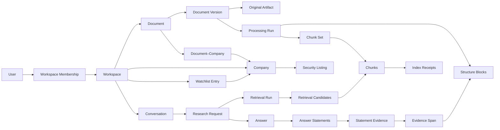

# Investment Research Archive — Domain Model

**Status:** Draft v0.1  
**Scope:** Conceptual V1 model with planned extension points  
**Related:** [01-product-scope.md](./01-product-scope.md), [02-system-design.md](./02-system-design.md)

## 1. Modeling principles

1. Every product record belongs to exactly one workspace unless explicitly defined as global reference data.
2. Original evidence and document versions are immutable; corrections create new versions.
3. Reprocessing creates new derived outputs, not new source evidence.
4. Retrieval chunks help find evidence but are not the evidence itself.
5. Every archive-derived answer statement resolves to an eligible span in an original document version.
6. Model output is an untrusted suggestion until schema and business-rule validation succeed.
7. Search indexes and AI traces are derived operational views, not canonical archive state.
8. Publication, public availability, archive ingestion, and system-recording times remain distinct.
9. Research annotations and rankings express judgments; they do not change evidence truth.

This document defines business meaning and relationships. SQL tables, ORM classes, indexes, and API payloads are designed later from this model.

## 2. Domain areas

| Area | Owns |
|---|---|
| Identity and workspace | Users, workspaces, memberships, and authorization scope |
| Companies | Companies, security listings, aliases, and watchlists |
| Archive | Documents, immutable versions, originals, metadata, associations, and lifecycle |
| Processing | Processing runs, structure blocks, chunk sets, chunks, and index state |
| Research | Conversations, requests, routes, retrieval runs, candidates, and query context |
| Answers and evidence | Answers, statements, evidence spans, citations, and validation results |
| Operations | Jobs, outbox events, index receipts, reconciliation, audit, and cost records |
| Structured knowledge — later | Actors, claims, metrics, forecasts, topics, profiles, and impact analysis |

## 3. Core V1 model

### 3.1 Identity and workspace

| Entity | Meaning | Important properties |
|---|---|---|
| `User` | Authenticated human identity | External identity-provider subject; no stored credentials |
| `Workspace` | Tenant, authorization, retention, indexing, and cost boundary | Type: private or sanitized demo |
| `WorkspaceMembership` | Time-bound access of a user to a workspace | V1 roles: owner, demo viewer |

All repository operations require an explicit `workspace_id`. Object keys, queue messages, retrieval-index partitions, audit events, traces, and costs carry the same boundary.

### 3.2 Companies and watchlist

| Entity | Meaning | Important properties |
|---|---|---|
| `Company` | Economic entity followed in the archive | Canonical name, aliases, status |
| `SecurityListing` | Exchange-specific tradable security | Ticker, exchange, security type, optional ISIN/FIGI, validity period |
| `WatchlistEntry` | Workspace selection of a company | Active period and user attribution |

A company is not a ticker. One company may have multiple active, historical, or exchange-specific listings.

### 3.3 Documents and originals

| Entity | Meaning | Important properties |
|---|---|---|
| `Document` | Logical archive item visible to the user | Type, lifecycle state, current version reference |
| `DocumentVersion` | Immutable captured content edition | Version number, content hash, language, captured time |
| `OriginalArtifact` | Immutable PDF or submitted-text original | Storage key, media type, byte size, checksum |
| `PublicationMetadata` | Source-time description of a version | Title, publication time, public-availability time, publisher text |
| `DocumentCompany` | Association between a document and company | Method, confidence, review status, reviewer |
| `DuplicateRelation` | Provenance-preserving exact duplicate link | Related versions, matching hash, detection time |

`Document` owns user-facing lifecycle. `DocumentVersion` owns immutable content. A text edit or corrected edition creates a new version; parsing or chunking changes do not.

Automatic company assignments remain reviewable suggestions. A duplicate relation never silently deletes either archive item.

### 3.4 Processing and retrieval content

| Entity | Meaning | Important properties |
|---|---|---|
| `ProcessingRun` | One versioned attempt to process a document version | Configuration versions, state, timestamps, error summary |
| `ProcessingStage` | Independently retryable step within a run | Stage type, attempt, state, input/output references |
| `StructureBlock` | Canonical parsed unit anchored to the source | Page, type, order, text, source offsets, optional geometry |
| `ChunkSet` | Versioned chunking result for a document version | Chunker and configuration version; active flag |
| `Chunk` | Retrieval unit built from one or more blocks | Text, block references, token count, ordinal |
| `IndexReceipt` | Result of applying a chunk version to a vector index | Vector ID, embedding version, index state, timestamp |

Structure blocks preserve source location independently of a particular chunking strategy. This allows chunks and embeddings to change without breaking historical citations.

Only one chunk set per configured retrieval profile is active for new searches. Historical answers retain references to the versions they used.

### 3.5 Research requests and retrieval

| Entity | Meaning | Important properties |
|---|---|---|
| `Conversation` | Container for related research turns | Workspace, title, active status |
| `ResearchRequest` | Immutable user question and effective context | Question, company/document filters, temporal mode, cutoff time |
| `ResearchRoute` | Routing decision for a request | Structured lookup, hybrid retrieval, or explicit combination; reason and version |
| `RetrievalRun` | One reproducible search execution | Query forms, filters, retrieval configuration, timing |
| `RetrievalCandidate` | Candidate from lexical, dense, or structured retrieval | Origin, rank, raw score, fused rank, reranker score |
| `ContextBundle` | Bounded evidence input sent to generation | Ordered candidate references and token budget |

Conversation context may populate explicit filters for a new request. It never becomes evidence by itself.

### 3.6 Answers and evidence

| Entity | Meaning | Important properties |
|---|---|---|
| `Answer` | Versioned response to a research request | State, model/prompt version, coverage status, rendered text |
| `AnswerStatement` | Smallest independently supportable answer unit | Order, structured text, statement type, support status |
| `EvidenceSpan` | Stable source span in a document version | Structure-block reference, page, character offsets, exact text/hash |
| `StatementEvidence` | Link from a statement to supporting or conflicting evidence | Relationship type and display order |
| `AnswerValidation` | Server-side validation result | Rule, pass/fail, reason, timestamp |

An answer may be `complete`, `partial`, `insufficient`, or `conflicting`. Coverage describes the archive evidence available for the question; it does not claim real-world completeness.

Evidence relationships initially use `supports` and `conflicts`. Later structured knowledge may add `updates`, `supersedes`, or `answers` where their meanings are explicitly reviewed.

## 4. Core relationships



The diagram shows ownership and traceability, not physical database cardinalities.

## 5. Lifecycles

### Document lifecycle

```text
ACTIVE → SOFT_DELETED → PURGE_PENDING → PURGED
   ↑          |
   └── RESTORE┘  within the recovery period
```

- `SOFT_DELETED` content is immediately ineligible for normal browsing, retrieval, and new answers.
- Restoration is allowed for 30 days.
- Purging removes canonical content and schedules removal of derived records and stored artifacts according to retention rules.
- Historical audit records retain only the minimum permitted identifiers after purge.

### Processing readiness

```text
CAPTURED → PARSING → LEXICAL_READY → INDEXING → SEARCHABLE
               ↘ FAILED              ↘ FAILED
```

Each failed stage can retry without repeating completed work unnecessarily. Optional enrichment has a separate status and cannot downgrade a searchable document.

### Answer lifecycle

```text
REQUESTED → RETRIEVING → GENERATING → VALIDATING → STREAMED
                    ↘ INSUFFICIENT      ↘ REJECTED / REGENERATED
```

Only validated statements are rendered as archive-derived claims. A failed generation attempt remains operational history, not a user-visible archive fact.

## 6. Time model

The model keeps these times separate:

| Time | Meaning |
|---|---|
| `published_at` | When the publisher states the material was published |
| `available_at` | Earliest supported time the material was publicly accessible |
| `ingested_at` | When it entered this workspace |
| `recorded_at` | When the system stored a record or decision |
| `valid_from` / `valid_to` | When a time-bound domain assertion applies |

Historical public-knowledge queries use `available_at`. Personal-archive-time queries additionally require that the document was present and eligible in the workspace by the selected cutoff.

Unknown time values remain unknown; the system does not silently substitute import time for publication or availability time.

## 7. Operations and consistency

| Entity | Meaning |
|---|---|
| `Job` | Durable business view of asynchronous work and retries |
| `OutboxEvent` | Canonical event written in the same transaction as its business change |
| `ReconciliationRun` | Comparison and repair of canonical active chunks versus indexed vectors |
| `AuditEvent` | Actor, workspace, action, target, time, and safe change metadata |
| `UsageRecord` | Provider, operation, model, tokens or units, latency, and estimated cost |

Queue delivery is at least once. Consumers therefore use deterministic identifiers and idempotency keys. Temporary queue-delivery state may disappear without losing canonical job intent.

## 8. Planned structured-knowledge extension

The following concepts are intentionally named now but are not required to complete V1:

| Concept | Purpose |
|---|---|
| `Actor`, `ActorAlias`, `Role`, `Affiliation` | Separate publisher, author, speaker, person, and organization identities |
| `ActorAssessment`, `ActorCompanyAssessment` | Versioned factual reliability, forecast reliability, expertise, stance, and relationship judgments |
| `ClaimOccurrence`, `ClaimAttribution` | A statement in a specific evidence span and its attributed speaker |
| `Proposition` | Reviewed normalized meaning shared by comparable claim occurrences |
| `MetricObservation` | Numeric value with unit, currency, period, and evidence |
| `Forecast`, `ForecastOutcome` | Prediction and later assessment as correct, incorrect, partial, or open |
| `ClaimRelation` | Reviewed support, contradiction, update, or supersession link |
| `Topic`, `TopicAlias`, `CompanyTopic` | Controlled topics and evidence-backed company relevance |
| `CompanyProfile`, `ProfileFact` | Versioned company facts with supporting evidence |
| `ImpactSuggestion`, `ImpactReview` | Watchlist effect with direction, directness, mechanism, horizon, confidence, and evidence |

Model extraction creates suggestions, never silently accepted facts or relationships. Human review, provenance, confidence, and model/configuration version remain attached to every promoted result.

## 9. Domain invariants

1. A record cannot reference content from another workspace.
2. A document version and original artifact are immutable after capture.
3. Reprocessing never changes the meaning or checksum of its source version.
4. A chunk must resolve to source blocks in exactly one document version.
5. A vector-search result is unusable until its chunk is active, authorized, and not deleted in canonical state.
6. An archive-derived answer statement has at least one validated evidence link.
7. An evidence span resolves to exact source text in the cited immutable version.
8. Conversation history and model output are not evidence.
9. Missing evidence is represented as insufficient coverage, not a negative real-world fact.
10. Conflicting evidence remains attributable to each source.
11. Historical eligibility uses the explicitly selected temporal mode.
12. Scores, annotations, and AI suggestions retain method, version, author, and review status.

## 10. Deferred physical-design decisions

The implementation phase will decide:

- exact table boundaries and PostgreSQL data types;
- database constraints, indexes, partitioning, and row-level security policy;
- object-key and deterministic vector-ID formats;
- chunk and evidence-offset serialization;
- job payloads, retry policies, and outbox schemas;
- API request, response, event, and streaming contracts;
- which global reference values use enums versus versioned lookup tables.

Those decisions must preserve the meanings and invariants in this document rather than redefining them implicitly in code.
