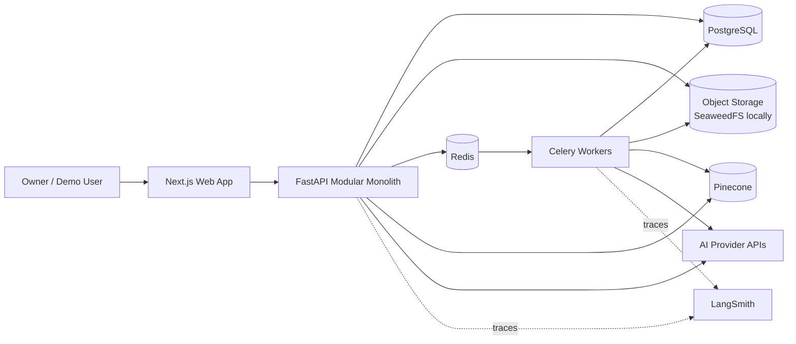
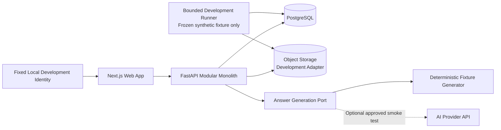
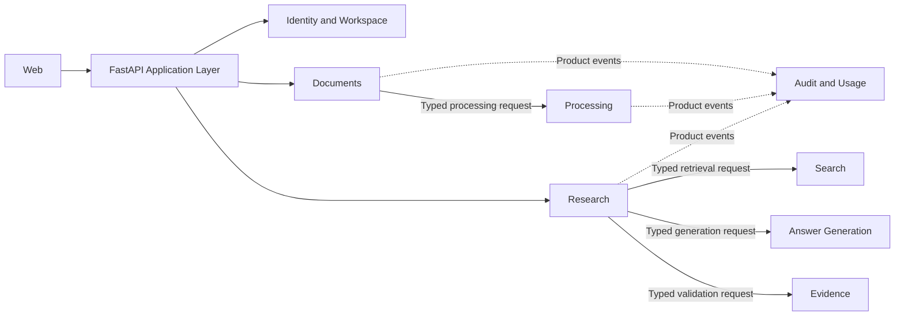
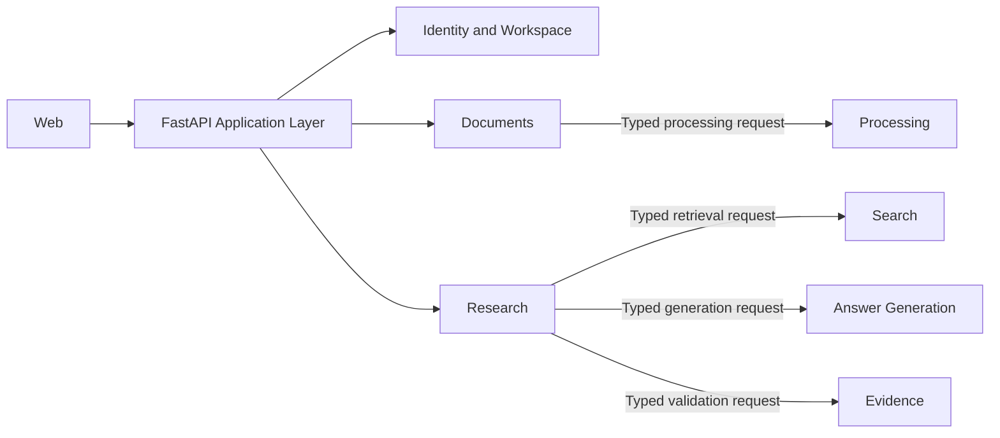
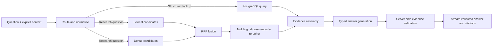
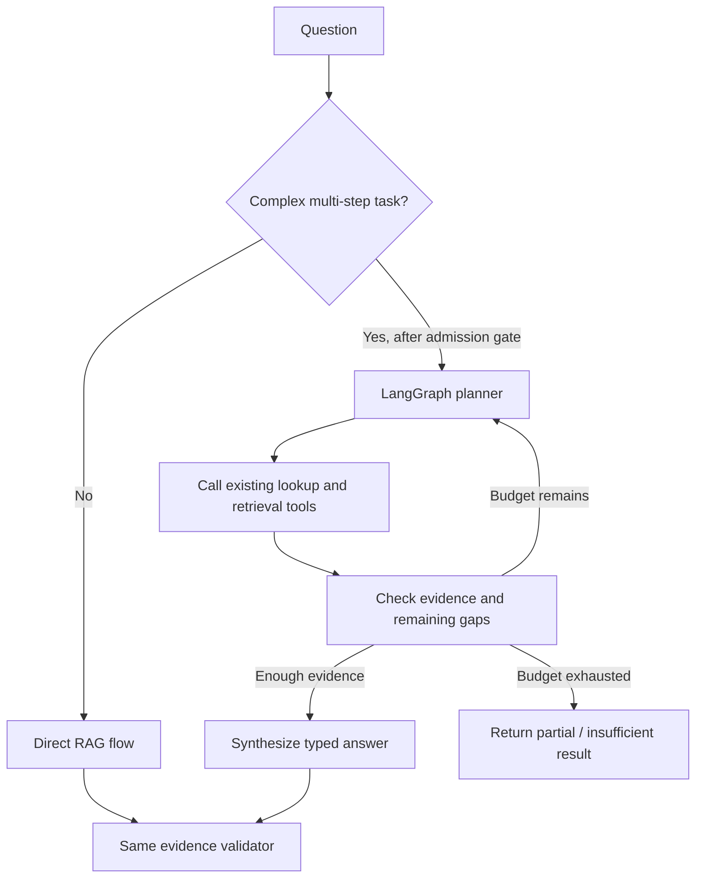
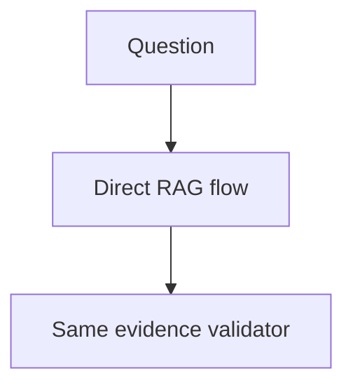
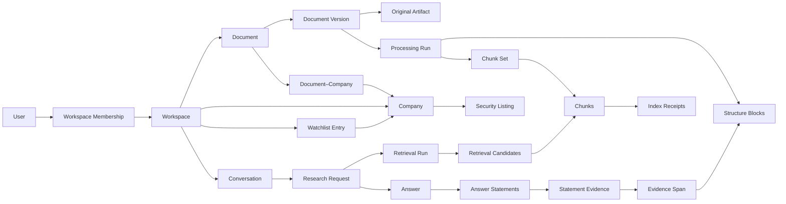
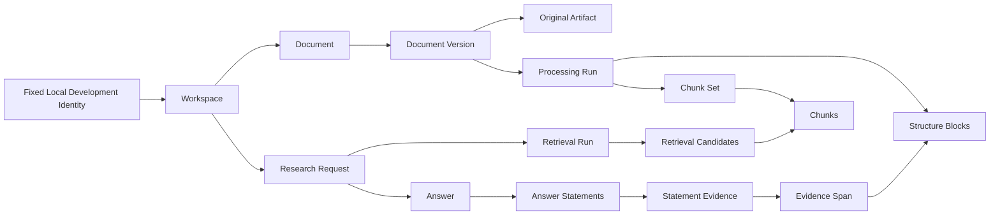

# Investment Research Archive — M0.0 Architecture Flow Comparisons

**Status:** Draft v0.2 — aligned with the implementation-ready M0.0 plan
**Scope:** Compare the production-target flows with the deliberately smaller M0.0 walking skeleton
**Related:** [02-system-design.md](./02-system-design.md), [03-domain-model.md](./03-domain-model.md), [05-delivery-plan.md](./05-delivery-plan.md), [08-m0-0-implementation-plan.md](./08-m0-0-implementation-plan.md), [09-m0-implementation-plan.md](./09-m0-implementation-plan.md)

## 1. Reading rule

M0.0 is a true functional subset of the production target. It proves the same product promise and preserves the same application-owned contracts, identifiers, workspace boundary, evidence anchors, and validation rules. Where a concept is the same, both diagrams use the same name.

In the M0.0 diagrams:

- only active M0.0 nodes and arrows are shown;
- omitted production nodes are added in the milestone named below the diagram;
- M0 replaces local implementations behind existing boundaries without renaming the owning modules;
- M1 adds the dense index path; M2 adds lifecycle reliability; M4 adds fusion, reranking, conversation, and full observability; M9 may add bounded agent orchestration.

## 2. System context

### Production target



Source: [docs/02-system-design.md — §2 System context](./02-system-design.md#2-system-context)

### M0.0



M0.0 source: [docs/05-delivery-plan.md — §4 M0.0](./05-delivery-plan.md#4-m00--lean-proof-of-value) and [docs/02-system-design.md — Pre-foundation proof of value](./02-system-design.md#pre-foundation-proof-of-value)

The fixed identity is resolved by the server and is not client-supplied authorization proof. M0
adds Redis and Celery workers, replaces the development object-storage implementation with
SeaweedFS through the same `Object Storage` boundary, and keeps the application-owned generation
port. M1 adds Pinecone; M4 adds LangSmith tracing. PostgreSQL remains canonical throughout.

## 3. Module relationships and extension seams

### Production target



Source: [docs/02-system-design.md — §4 Component boundaries](./02-system-design.md#4-component-boundaries)

### M0.0



M0.0 source: [docs/02-system-design.md — §4 Component boundaries](./02-system-design.md#4-component-boundaries) and [docs/05-delivery-plan.md — §4 M0.0](./05-delivery-plan.md#4-m00--lean-proof-of-value)

Arrows show code dependency direction, not request-and-response traffic. Return values flow through typed contracts without a reverse dependency. M0 adds `Audit and Usage` and the production adapters. The shared modules and their arrows are unchanged. No module may reach into another module's persistence implementation.

## 4. Document ingestion

### Production target


Source: [docs/02-system-design.md — §6 Document ingestion](./02-system-design.md#6-document-ingestion)

### M0.0


M0.0 source: [docs/05-delivery-plan.md — §4 M0.0](./05-delivery-plan.md#4-m00--lean-proof-of-value)

This follows the production ingestion prefix while narrowing accepted M0.0 processing to the frozen
synthetic PDF. `Execute processing run` is performed by the separate bounded development runner, but
process and resource limits do not provide operating-system secret, filesystem, or network
isolation. [ADR-0004](./adr/0004-m0-0-parser-isolation-boundary.md) makes that isolation a mandatory
M0 gate. In M0, Redis and Celery deliver the same `ProcessingRun` identifier to a Celery worker,
which invokes the same processing application service. M1 appends embeddings, Pinecone indexing,
and `Mark searchable`; optional enrichment remains later in the same flow.

The exact M0 replacement and parser-isolation sequence is defined in
[09-m0-implementation-plan.md](./09-m0-implementation-plan.md).

## 5. Direct RAG

### Production target



Source: [docs/02-system-design.md — §7 Direct RAG flow](./02-system-design.md#7-direct-rag-flow)

### M0.0


M0.0 source: [docs/05-delivery-plan.md — §4 M0.0](./05-delivery-plan.md#4-m00--lean-proof-of-value) and [docs/02-system-design.md — Answer contract](./02-system-design.md#answer-contract)

M1 adds `Dense candidates`. M4 inserts `RRF fusion` and the `Multilingual cross-encoder reranker` before the unchanged `Evidence assembly`; structured lookup becomes the second route. The evidence assembly and validator are already the production concepts in M0.0. Before validation, the stream may contain progress events only; answer statements and citations are emitted from the accepted validation result.

## 6. Agentic extension

### Production target after the M9 admission gate



Source: [docs/02-system-design.md — §9 Agentic extension](./02-system-design.md#9-agentic-extension)

### M0.0



M0.0 source: [docs/05-delivery-plan.md — M0.0 constraints](./05-delivery-plan.md#constraints) and [docs/02-system-design.md — §9 Agentic extension](./02-system-design.md#9-agentic-extension)

M0.0 contains only the direct path already present in the production target. M9 may add the planner branch around these same tested services; it does not replace them.

## 7. Core domain relationships

### Production target



Source: [docs/03-domain-model.md — §4 Core relationships](./03-domain-model.md#4-core-relationships)

### M0.0



M0.0 source: [docs/05-delivery-plan.md — §4 M0.0](./05-delivery-plan.md#4-m00--lean-proof-of-value), constrained by [docs/03-domain-model.md — §9 Domain invariants](./03-domain-model.md#9-domain-invariants)

M0.0 is the evidence-traceability subset of the production model. The fixed local identity is an
execution constraint, not a replacement domain entity; local single-user M1 retains it, and M5 adds
`User` and `Workspace Membership` with OIDC authentication. M1 adds the first narrow dense-indexing
path, M2 adds durable `Index Receipts`, M3 adds companies and watchlists, and M4 adds conversations.
Existing shared entity names and relationships do not change.

## 8. End-to-end delivery flow

### All milestones

```text
Import → Process → Search → Answer → Validate → Open citation
```

Source: [docs/05-delivery-plan.md — §1 Delivery strategy](./05-delivery-plan.md#1-delivery-strategy)

### M0.0

```text
Import → Process → Search → Answer → Validate → Open citation
```

M0.0 source: [docs/05-delivery-plan.md — §4 M0.0](./05-delivery-plan.md#4-m00--lean-proof-of-value)

The product journey is intentionally unchanged. Only the infrastructure beneath `Process` and `Search` grows in later milestones.

## 9. Lifecycles

### Document lifecycle — production target

```text
ACTIVE → SOFT_DELETED → PURGE_PENDING → PURGED
   ↑          |
   └── RESTORE┘  within the recovery period
```

Source: [docs/03-domain-model.md — Document lifecycle](./03-domain-model.md#document-lifecycle)

### Document lifecycle — M0.0

```text
ACTIVE
```

M0.0 source: [docs/05-delivery-plan.md — M0.0 constraints](./05-delivery-plan.md#constraints)

M0.0 supports only the production state `ACTIVE`. M2 adds `SOFT_DELETED`, restore, `PURGE_PENDING`, and `PURGED`; clearing the proof environment is development cleanup, not a product lifecycle transition.

### Processing readiness — production target

```text
CAPTURED → PARSING → LEXICAL_READY → INDEXING → SEARCHABLE
               ↘ FAILED              ↘ FAILED
```

Source: [docs/03-domain-model.md — Processing readiness](./03-domain-model.md#processing-readiness)

### Processing readiness — M0.0

```text
CAPTURED → PARSING → LEXICAL_READY
               ↘ FAILED
```

M0.0 source: [docs/05-delivery-plan.md — §4 M0.0](./05-delivery-plan.md#4-m00--lean-proof-of-value)

M0.0 is the exact lexical prefix of the production lifecycle. It may retrieve the bounded fixture at `LEXICAL_READY`; M1 adds `INDEXING`, `SEARCHABLE`, and the indexing failure path.

### Answer lifecycle — production target

```text
REQUESTED → RETRIEVING → GENERATING → VALIDATING → STREAMED
                    ↘ INSUFFICIENT      ↘ REJECTED / REGENERATED
```

Source: [docs/03-domain-model.md — Answer lifecycle](./03-domain-model.md#answer-lifecycle)

### Answer lifecycle — M0.0

```text
REQUESTED → RETRIEVING → GENERATING → VALIDATING → STREAMED
                    ↘ INSUFFICIENT      ↘ REJECTED
```

M0.0 source: [docs/05-delivery-plan.md — §4 M0.0](./05-delivery-plan.md#4-m00--lean-proof-of-value)

M0.0 uses the same answer states and validator. M1 adds bounded regeneration from `REJECTED`; no M0.0-specific answer state exists.

## 10. M0 handoff rule

M0.0 is easy to extend only if M0 changes adapters and operational guarantees rather than redefining product contracts. Before M0 completes:

1. replace local artifact storage through the existing object-storage port;
2. replace processing delivery with Redis and Celery while keeping the processing application service and `ProcessingRun` contract;
3. keep document versions, structure blocks, chunks, evidence spans, statements, and validation results semantically compatible;
4. rerun the same M0.0 acceptance fixtures through SeaweedFS, Celery, Redis, and the production-shaped service boundaries;
5. implement and test the parser-isolation gate from ADR-0004 before expanding document input;
6. reject any M0.0 shortcut that would bypass authorization, immutable originals, canonical eligibility, or evidence validation.
