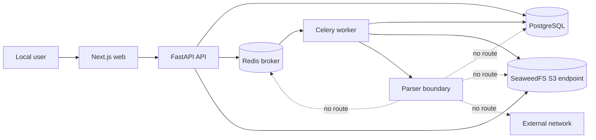
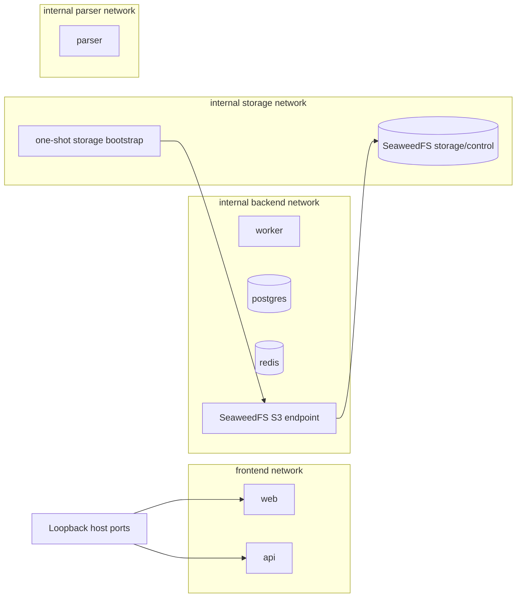
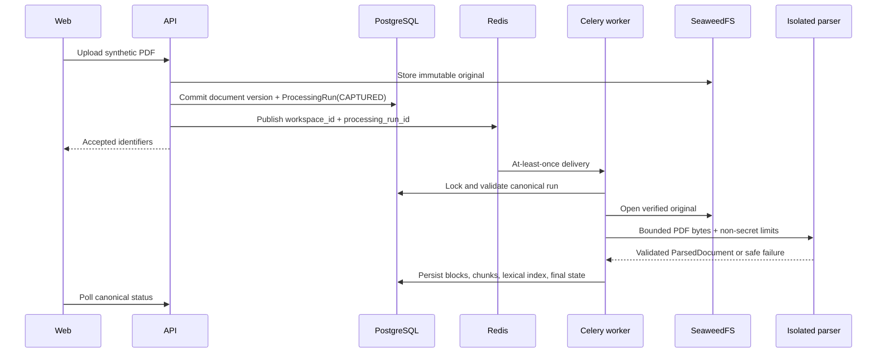

# Investment Research Archive — M0 Implementation Plan

**Status:** Active v0.7 — Steps 1–4 completed; Step 5 in progress \
**Active milestone:** M0 — Engineering foundation  
**Depends on:** completed M0.0 acceptance and its retained contracts  
**Related:** [02-system-design.md](./02-system-design.md),
[04-security-and-operations.md](./04-security-and-operations.md),
[05-delivery-plan.md](./05-delivery-plan.md),
[08-m0-0-implementation-plan.md](./08-m0-0-implementation-plan.md), and
[ADR-0004](./adr/0004-m0-0-parser-isolation-boundary.md),
[ADR-0005](./adr/0005-at-least-once-processing-delivery.md), and
[proposed ADR-0006](./adr/0006-credential-free-parser-runtime.md), and
[ADR-0007](./adr/0007-local-s3-provider.md)

## 1. Purpose and scope

M0 replaces the three development-only M0.0 adapters with a production-shaped local runtime while
preserving the proven product path:

```text
Import → Process → Search → Answer → Validate → Open citation
```

M0 is an engineering-foundation milestone, not a broad feature milestone. It adds the complete local
service topology, asynchronous delivery, S3-compatible original storage, parser isolation,
structured operational signals, container verification, and safe developer workflows. The existing
synthetic acceptance fixture remains the deterministic proof.

M0 does not add OIDC, general document support, live AI generation, Pinecone, embeddings, dense
retrieval, reranking, lifecycle deletion, conversation memory, public hosting, or private data.
Those remain in their assigned later milestones.

## 2. M0 outcomes

M0 is complete only when:

1. one documented command starts the complete local web, API, worker, parser, PostgreSQL, Redis, and
   SeaweedFS topology;
2. migrations finish before API and worker readiness;
3. the API stores originals through the existing `ObjectStorage` port in SeaweedFS locally;
4. the API dispatches a canonical `ProcessingRun` through Redis to Celery without parsing the PDF;
5. the Celery worker invokes a credential-free parser boundary and persists the same versioned
   structure blocks, chunks, and lexical index proven in M0.0;
6. duplicate delivery and safe retry preserve one canonical result;
7. parser-isolation tests prove the boundary required by ADR-0004;
8. the existing answerable, insufficient-evidence, adversarial, workspace-isolation, repeated-answer,
   citation, and original-opening cases still pass;
9. CI builds the runtime images and verifies the complete isolated stack;
10. a new developer can start, verify, reset, and stop the local stack without manually constructing
    internal commands or deleting broad paths.

## 3. Retained contracts and replaced adapters

| M0.0 component                   | M0 action                                                              | Contract or invariant retained                                |
| -------------------------------- | ---------------------------------------------------------------------- | ------------------------------------------------------------- |
| FastAPI modular monolith         | Containerize and add readiness/structured logs                         | Pydantic/OpenAPI contract and module direction                |
| Next.js local process            | Containerize after backend runtime is stable                           | Typed API client and same-origin API boundary                 |
| PostgreSQL Compose service       | Retain and make migration readiness explicit                           | Alembic history and canonical relational state                |
| Local filesystem object storage  | Replace with a provider-neutral S3 adapter backed by SeaweedFS locally | `ObjectStorage`, immutable keys, checksum, workspace scope    |
| Manual single-job runner         | Replace with Redis/Celery delivery                                     | `ProcessingRun`, processing service, independent unit of work |
| Parser inside runner permissions | Replace with a credential-free parser service boundary                 | `DocumentParser`, limits, typed parsed result, safe failure   |
| Deterministic generator          | Retain unchanged                                                       | `AnswerGenerator` and server-side validation                  |
| PostgreSQL lexical retrieval     | Retain unchanged                                                       | eligibility filtering and reproducible ranking                |
| Fixed local identity             | Retain for M0 only                                                     | server-resolved `WorkspaceContext` and non-disclosure         |
| Existing verification scripts    | Extend with complete-stack verification                                | locked, deterministic, self-cleaning gates                    |

M0 changes infrastructure behind ports. It must not rename domain states or bypass the evidence,
workspace, transaction, or immutable-original rules just to simplify container wiring.

## 4. Target runtime and trust boundaries

### 4.1 Service topology



The dashed arrows are prohibited paths, not calls. The parser is an infrastructure security
boundary, not an independently owned business service. It contains no domain database and owns no
canonical state.

### 4.2 Network segmentation



- Only web and API ports bind to host loopback.
- PostgreSQL, Redis, SeaweedFS, worker, parser, and storage bootstrap have no public host port.
- The backend and parser networks use Compose isolation; the parser network has no external route.
- API and worker reach only the SeaweedFS S3 data-plane endpoint; unnecessary storage control
  surfaces remain on the separate internal storage network.
- The parser receives no application, database, Redis, object-storage, or provider credentials.
- The worker is the only component connected to both backend and parser networks and exposes no
  listener on the parser network.
- Containers run as non-root. The parser additionally uses a read-only root filesystem, a bounded
  temporary filesystem, dropped Linux capabilities, `no-new-privileges`, and CPU, memory, process,
  request-size, response-size, and wall-clock limits.
- No Docker socket or broad host directory is mounted into an application container.

A Docker Desktop feasibility probe has confirmed the intended isolated-network channel, non-root
identity, dropped capabilities, `no-new-privileges`, read-only root filesystem, bounded writable
temporary storage, absent synthetic worker-secret markers, and blocked backend and external
network paths. This probe used an Alpine helper image and therefore validates only the Docker
mechanics. Proposed ADR-0006 remains unaccepted until the final parser image and protocol pass the
equivalent Docker Desktop and Linux CI negative tests.

### 4.3 Processing sequence



Redis delivery is temporary and may duplicate a task. PostgreSQL remains the source of truth. A
Celery task acknowledges work only after the idempotent application operation reaches a canonical
outcome. Redelivery of a completed run becomes a safe no-op. A broker publication failure leaves the
run visibly `CAPTURED`; M2 adds the transactional outbox and automatic reconciliation rather than
pretending M0 already provides that later guarantee.

## 5. Planned repository delta

This tree lists expected M0 additions and important edited files. Exact dependency versions are not
recorded here; each dependency work block must perform the repository's current-version,
compatibility, release-age, and security review before changing a manifest or lockfile.

```text
.
├── .github/workflows/ci.yml                 # progressively extended container gates
├── .pre-commit-config.yaml                  # local wrappers around canonical checks
├── .env.example                             # placeholders for service-specific credentials
├── compose.yaml                             # complete local runtime and isolated networks
├── compose.test.yaml                        # deterministic CI/test overrides only
├── README.md                                # verified start, verify, reset, and stop commands
├── backend/
│   ├── .dockerignore
│   ├── Dockerfile                           # non-root API, worker, and parser targets
│   ├── pyproject.toml
│   ├── uv.lock
│   ├── scripts/
│   │   ├── redispatch_captured.py            # narrow recovery for unpublished runs
│   │   ├── reset_local.py                   # narrow, confirmed local reset
│   │   └── verify_stack.py                  # unique project, generated secrets, cleanup
│   ├── src/investment_research/
│   │   ├── bootstrap.py                     # process-specific composition roots
│   │   ├── main.py                          # FastAPI entry point
│   │   ├── worker.py                        # Celery entry point
│   │   ├── parser_app.py                    # credential-free internal parser entry point
│   │   ├── settings.py                      # host/container and per-process validation
│   │   ├── api/routes/health.py
│   │   ├── infrastructure/
│   │   │   ├── health.py                    # dependency readiness probes
│   │   │   ├── logging.py                   # structured, redacted process logs
│   │   │   ├── object_storage/s3.py         # provider-neutral S3 adapter
│   │   │   ├── parsing/client.py            # bounded worker-to-parser adapter
│   │   │   └── queue/
│   │   │       ├── __init__.py
│   │   │       ├── celery.py                # broker configuration
│   │   │       └── tasks.py                 # thin processing task adapter
│   │   └── modules/
│   │       ├── operations/ports.py           # application-owned tracing seam
│   │       ├── processing/contracts.py       # trusted processing-job payload
│   │       ├── processing/ports.py           # dispatcher and retained parser ports
│   │       └── search/ports.py               # dense, embedding, reranking seams
│   └── tests/
│       ├── unit/                             # settings, adapters, tasks, health, logging
│       ├── integration/                      # Redis, Celery, SeaweedFS, PostgreSQL combinations
│       ├── security/                         # parser-boundary negative tests
│       └── acceptance/                       # complete Compose journey
├── frontend/
│   ├── .dockerignore
│   ├── Dockerfile                            # non-root standalone Next.js image
│   ├── next.config.ts                        # standalone output when required
│   └── src/features/archive/                 # automatic processing-state copy only
└── docs/
    ├── 02-system-design.md
    ├── 04-security-and-operations.md
    ├── 05-delivery-plan.md
    ├── 09-m0-implementation-plan.md
    └── adr/
        ├── 0001-modular-monolith-and-workers.md
        ├── 0002-canonical-and-derived-stores.md
        ├── 0006-credential-free-parser-runtime.md
        └── 0007-local-s3-provider.md
```

The tree is a change map, not permission to create every file in one commit. A listed file is added
only when its owning step requires working behavior and tests.

## 6. Fixed implementation rules

1. **One codebase, separate processes:** API, Celery worker, and parser entry points come from the
   repository, while domain modules remain inside the modular monolith.
2. **Canonical processing state:** Celery result storage is disabled; clients read `ProcessingRun`
   from PostgreSQL.
3. **Small queue payload:** tasks carry a versioned payload containing `workspace_id`,
   `processing_run_id`, and an idempotency key, never PDF bytes, ORM objects, secrets, or raw text.
4. **At-least-once safety:** task and processing services are idempotent before late acknowledgement
   is enabled. A short canonical execution lease on `ProcessingRun` prevents concurrent execution
   and permits recovery after worker loss. Permanent validation/parser failures are not retried;
   transient infrastructure failures use bounded retry with backoff and jitter. ADR-0005 governs
   the payload, claim, completion, failure, acknowledgement, and recovery rules. The M0 processing
   profile permits three successfully claimed attempts and uses a 360-second lease, exceeding the
   maximum configurable 300-second execution timeout plus shutdown grace. M2 replaces this fixed
   lease with stage-specific retry history and heartbeats when measured workflows require them.
5. **No cross-module persistence access:** queue and parser adapters call typed application services
   and ports. They do not query another module's tables directly.
6. **S3 behind the retained port:** application modules do not import an S3 SDK. SeaweedFS is a
   local infrastructure choice; immutable create, checksum verification, not-found non-disclosure,
   and workspace prefixes remain provider-neutral adapter behavior governed by ADR-0007.
7. **Parser output is untrusted:** the worker validates response schema, size, ordering, source
   bounds, page bounds, text bounds, and configured parser version before persistence.
8. **Credential separation:** Compose injects only the credentials a process needs. Parser settings
   reject unexpected secret-bearing variables during the isolation tests.
9. **Migration before readiness:** application startup never runs `create_all()` or silently mutates
   schema. A one-shot migration service reaches Alembic `head` before API/worker readiness.
10. **Health is layered:** liveness checks process survival; readiness checks required dependencies
    without returning credentials or internal error details.
11. **Structured logs are safe:** logs use event names and request/job/workspace/trace identifiers;
    raw document text, prompts, credentials, full URLs, and parser internals are excluded.
12. **No unreviewed dependency drift:** lockfiles remain frozen in normal builds and CI. New package
    choices and base-image references receive an authoritative maintenance/security review first.
13. **No premature later features:** M0 adds provider interfaces and no-op adapters only. It does not
    call a vector, embedding, reranking, tracing, or live-generation provider.

## 7. Implementation sequence and work blocks

Every step follows the repository order: backend behavior, CI coverage, frontend behavior only when
required, then the complete step gate. Each step uses a dedicated branch and remains independently
reviewable.

### Step 0 — Runtime decisions and contract freeze

**Suggested branch:** `docs/m0-runtime-decisions`

Backend and architecture:

- accept ADR-0001 for the modular monolith with separate API and Celery processes;
- accept ADR-0002 for canonical PostgreSQL/object-storage ownership and derived Redis/future
  Pinecone state;
- specify the versioned processing-job payload and idempotency behavior without selecting a Celery
  object as an application contract;
- specify the minimal `ProcessingRun` execution lease, attempt ceiling, expiry, and reclaim rules
  needed for at-least-once delivery without introducing the M2 `Job` and `ProcessingStage` model;
- accept ADR-0005 for the complete publish, claim, acknowledgement, retry, and recovery behavior;
- record the locally validated Docker Desktop mechanics in proposed ADR-0006, then keep final parser
  image and protocol checks on Docker Desktop and Linux CI as its acceptance gate;
- record why the parser boundary is infrastructure isolation rather than a business microservice.
- accept ADR-0007 for SeaweedFS in the local stack, a provider-neutral S3 adapter, and a managed
  S3-compatible service selected separately before public deployment.

CI:

- add only a minimal Compose-configuration validation if the topology file changes in this step.

Frontend:

- no change; run current frontend gates.

**Gate:** decisions name owners, trust boundaries, failure semantics, and reconsideration triggers;
no production dependency or empty infrastructure module is introduced.

**Suggested commits:** architecture decisions; processing contract; documentation synchronization.

### Step 1 — Runtime configuration, logging, health, and backend image

**Suggested branch:** `feat/m0-runtime-foundation`

Backend:

- split host-development, container-development, test, API, worker, and parser settings so each
  process receives only its required values;
- retain strict host and URL validation while allowing explicit Compose service names inside the
  container runtime;
- add structured JSON logging with redaction and correlation identifiers using the standard library
  unless a demonstrated gap justifies a dependency;
- separate liveness and readiness checks and add dependency-specific probes;
- build a non-root, reproducible backend image with explicit API, worker, and parser targets;
- test configuration rejection, log redaction, health non-disclosure, non-root execution, and absent
  secrets in image history/configuration.

CI:

- validate Compose syntax and build the backend targets with locked dependencies;
- run existing backend and PostgreSQL gates unchanged.

Frontend:

- no product change; run format, lint, typecheck, tests, contract drift, and production build.

**Gate:** the API image starts against migrated PostgreSQL, reports layered health safely, runs as
non-root, and contains no configured secrets.

**Suggested commits:** settings; logging; health; backend image; CI and docs.

**Local implementation record (2026-09-14):** Process-specific settings, structured safe logging,
correlation identifiers, layered health, the backend image targets, and the independent CI image job
are implemented. The digest-pinned image provides a runnable API target and explicit extension
foundations for the Step 3 worker and parser entry points. Local backend, PostgreSQL migration,
image-metadata, non-root runtime, API-readiness, frontend contract, frontend test, and production
build gates passed. The committed workflow subsequently passed its frontend, backend, and backend
image jobs on the hosted GitHub runner, completing Step 1.

### Step 2 — SeaweedFS object storage replacement

**Suggested branch:** `feat/m0-object-storage`

Backend:

- review and select the maintained S3-compatible Python client before changing dependencies;
- add a provider-neutral S3 adapter behind the existing `ObjectStorage` protocol and configure it
  for SeaweedFS locally;
- preserve conditional immutable creation, streaming checksums, byte counts, workspace-scoped keys,
  uniform unavailable-object errors, and compensating cleanup after failed canonical capture;
- pin the SeaweedFS image by eligible version and digest after compatibility, provenance, and
  vulnerability review; never use `latest`;
- prove whether the single-process local mode can hide unnecessary control surfaces from API and
  worker; otherwise split the S3 gateway and internal storage services before the gate passes;
- configure separate SeaweedFS administrative bootstrap credentials and least-privilege application
  credentials; neither administrative access nor any storage credential reaches web or parser;
- retain `LocalObjectStorage` only for focused unit tests until the M0 acceptance path is migrated;
- add unit and SeaweedFS integration tests for create, concurrent duplicate create, checksum, open,
  missing/foreign non-disclosure, path-like keys, cleanup, restart persistence, credential scope,
  endpoint reachability, and cross-workspace isolation.

CI:

- start disposable SeaweedFS, initialize the test bucket/policy, and run object-storage integration
  tests with generated credentials;
- prove cleanup targets only the unique Compose test project and its volumes.

Frontend:

- no product behavior change; run all existing frontend gates.

**Gate:** capture and authorized original opening pass through SeaweedFS with the same API contract;
conditional-create concurrency, credential separation, control-surface isolation, checksum
integrity, and restart persistence pass without direct SDK imports in application modules.

**Suggested commits:** dependency and adapter; SeaweedFS topology; integration tests; CI and docs.

**Local implementation record (2026-09-15):** The provider-neutral `ObjectStorage` contract now has
a Boto3-backed S3 adapter with conditional immutable writes, streaming checksums, uniform
unavailable-object behavior, workspace-scoped keys, and compensating cleanup. The local Compose
topology splits SeaweedFS master, volume, filer, S3 gateway, and one-shot bucket bootstrap across
private control and data networks. The reviewed SeaweedFS 4.47 base image is pinned by version and
digest under the bounded exception recorded in ADR-0007; administrative bootstrap and
least-privilege application credentials are separate and delivered without values in container
metadata.

The isolated verification command creates its own PostgreSQL and SeaweedFS volumes, migrates and
seeds PostgreSQL, runs direct S3 contracts on the private data network, and runs the unchanged API
capture-and-authorized-open contract in a confined container connected only to PostgreSQL and the S3
data plane. Conditional-write concurrency, checksums, byte integrity, missing/foreign
non-disclosure, credential scope, control-plane isolation, runtime confinement, restart persistence,
and scoped cleanup passed locally. The host API intentionally retains `LocalObjectStorage` until API
and worker join Compose in Step 4; SeaweedFS has no host port. The dedicated CI job is implemented,
but its successful hosted GitHub run remains the final remote confirmation before Step 2 is marked
fully complete.

### Step 3 — Redis/Celery delivery and isolated parsing

**Suggested branch:** `feat/m0-processing-runtime`

Backend:

- review and add compatible Celery/Redis dependencies only after the required package research;
- add a typed `ProcessingDispatcher` port and a thin Celery adapter;
- publish only after canonical capture commits and keep a visible `CAPTURED` run if publication
  fails;
- add a Celery task that validates the versioned payload, reconstructs trusted workspace context,
  and calls the existing processing application service;
- disable Celery result storage and use PostgreSQL status exclusively;
- continue the Alembic history with the minimal processing-run lease and attempt fields; claim and
  release them in short transactions rather than holding a database transaction during parsing;
- reject a concurrent duplicate while its lease is active, reclaim `PARSING` after an expired lease,
  and clear the lease on a terminal state;
- enable late acknowledgement only after duplicate-delivery tests prove idempotency;
- distinguish bounded transient retries from permanent parser, schema, or authorization failures;
- add a narrow developer recovery command that republishes eligible `CAPTURED` runs after a broker
  outage; leave automatic transactional publication and reconciliation to M2;
- make the parser entry point load only non-secret parser configuration;
- stream bounded original bytes from worker to parser and validate the bounded typed response before
  any derived records are written;
- harden the parser container and network as defined in section 4;
- delete the manual runner only after the Celery path passes the same acceptance fixture;
- add tests for duplicate messages, active and expired leases, stale/foreign jobs, worker loss after
  claim, broker outage, bounded retry exhaustion, parser timeout/crash/malformed output, and safe
  canonical state.

Parser security tests:

- injected database, object-storage, broker, and provider secret markers are unavailable;
- unrelated mounted and host paths cannot be read or written;
- external network connections fail while the single worker/parser channel succeeds;
- the root filesystem is read-only and only bounded temporary storage is writable;
- process, memory, CPU, request, response, page, extracted-text, and wall-clock limits are enforced;
- every failure leaves the immutable original intact and the `ProcessingRun` safely inspectable.

CI:

- run Redis, worker, and parser as disposable services;
- execute delivery, redelivery, failure, and isolation tests on Linux;
- keep deterministic unit tests independent of running services.

Frontend:

- remove the displayed manual-runner command;
- show automatic queued/processing status through the existing canonical status endpoint;
- keep the same processing states and safe error copy.

**Gate:** upload automatically reaches `LEXICAL_READY` through Redis, Celery, SeaweedFS, and the
isolated parser; duplicate delivery produces one active output; all ADR-0004 negative tests pass.

**Suggested commits:** processing contracts; queue adapter; Celery worker; parser boundary; security
tests; frontend state/copy; CI and docs.

**Local implementation record (2026-09-16):** The Redis/Celery contracts, task delivery, processing
lease, worker entry point, bounded private parser protocol, and final parser Compose boundary are
implemented. The Docker Desktop isolation gate passed with the repository-owned worker and parser
images: the parser had no canonical credentials or secret mount, joined only the internal parser
network, could not reach Redis or an external address, ran non-root with a read-only root filesystem,
dropped capabilities, `no-new-privileges`, and exact CPU, memory, process, and temporary-storage
limits, and parsed the frozen PDF while rejecting request and extracted-text limit violations.
Disposable Compose checks now deliver generated credentials through read-only mode-`0444` secret
files inside private mode-`0700` temporary directories rather than raw Compose environment values.
This preserves host isolation while allowing native-Linux Docker bind mounts to serve non-root
containers with different UIDs. The Step 3 backend bridge remains non-internal only while host
processes require the loopback PostgreSQL port; Step 4 removes that port after the API joins Compose
and then makes the backend network internal. The parser network is already internal and unaffected
by this transition. Transient parser transport failures now expire their
canonical lease before Celery applies at most two retries with exponential backoff, jitter, and a
30-second cap; the initial delivery plus those retries match the processing profile's three-attempt
ceiling. Permanent failures and exhausted attempts become terminal without retry. Late
acknowledgement, one-message prefetch, worker-loss rejection, and a 420-second Redis visibility
timeout are configured. Unit and PostgreSQL integration tests cover retry classification, bounded
exhaustion, active duplicate rejection, expired-lease reclaim, stale-worker protection, and a
single canonical output after retry. A disposable full-runtime verification now proves live Redis
redelivery after forced Celery pool-worker loss: an early redelivery is deferred until the canonical
lease expires, the second claim reaches `LEXICAL_READY`, and only one derived output set remains.
Real HTTP-adapter and PostgreSQL integration tests now prove the canonical outcomes for parser
timeout, abrupt connection loss, and malformed responses. Transient transport failures exhaust the
three-attempt profile before a safe terminal state; a protocol violation fails after one claim. In
every case the original remains intact, the terminal lease is cleared, and no partial lexical
output exists. A dedicated Linux CI job now runs the parser-isolation and live queue-recovery gates
from the locked backend environment; its first successful hosted GitHub run remains the remote
confirmation. A separate disposable runtime gate now passes the complete frozen fixture journey
without the M0.0 runner: API capture publishes to Redis, Celery and the isolated parser reach
`LEXICAL_READY` using SeaweedFS originals, and the same validated answer, exact citation,
byte-identical original, and insufficient-evidence response remain intact. The Linux processing job
now runs this complete journey after the parser-isolation and worker-loss recovery gates. The
frontend no longer exposes the temporary M0.0 runner command: it presents automatic queued and
processing states while polling the unchanged canonical status endpoint. Its formatting, linting,
type checking, contract check, 15 deterministic tests, and production build pass. The superseded
backend runner and its exclusive tests have been removed after the replacement acceptance gate
passed; the oversized-upload storage assertion was retained in the focused document-capture API
integration suite. The complete local Step 3 gate passes: the locked backend checks, PostgreSQL
integration and migration cycle, parser-isolation checks, live queue-recovery test, automatic M0
fixture journey, and frontend checks are green. Successful hosted CI remains the final remote
confirmation before Step 3 is marked fully complete.

### Step 4 — Complete local container stack

**Suggested branch:** `feat/m0-container-stack`

Backend and runtime:

- add the one-shot migration service and readiness dependency order;
- finalize API, worker, parser, PostgreSQL, Redis, and SeaweedFS health checks;
- ensure restart does not reinitialize persisted credentials or silently rerun destructive seed
  behavior;
- expose only documented loopback ports and verify explicit service networks.

CI:

- build every target from a clean checkout;
- start the complete stack with generated test credentials and a unique Compose project name;
- wait on health rather than fixed sleeps and always remove test containers, networks, and volumes.

Frontend:

- build a non-root standalone Next.js image;
- route browser API calls through the existing same-origin boundary to the internal API service;
- add web container health without exposing internal configuration.

**Gate:** one documented command starts a healthy complete stack from an empty local state; the web
journey works without separately starting Python, pnpm, migrations, or the processing runner.

**Suggested commits:** migration/startup ordering; frontend image; complete Compose topology; stack
smoke test; CI and docs.

**Local implementation record (2026-09-16, migration/startup block):** The backend image now has a
dedicated non-root `migration` target containing the reviewed Alembic configuration and revisions.
Compose runs it only after PostgreSQL is healthy, gives it only PostgreSQL configuration and a
read-only password secret, performs no seed, and prevents the worker from starting unless migration
completed successfully. The backend image gate builds all four backend targets, runs the migration
image twice against a fresh database to prove schema creation and idempotency, and starts the API
only afterward; metadata, minimal-runtime, readiness, cleanup, formatting, lint, typing, and focused
unit gates pass locally. At the end of that block, the Compose API service, final health topology,
frontend image, complete-stack verification, CI wiring, and documented one-command browser journey
remained open.

**Local implementation record (2026-09-16, backend health and API topology block):** Compose now
builds and starts the non-root API after the one-shot migration, healthy PostgreSQL and Redis, and
successful SeaweedFS bucket bootstrap. The API uses the internal S3 data plane and exposes only its
documented loopback port. Its aggregate readiness requires the exact Alembic head, one bounded
connection through the configured Celery broker, and application-credential access to the configured
S3 bucket; responses disclose only the aggregate state. The worker image now has a bounded control
ping addressed to its own Celery node rather than treating mere process survival as health. The
isolated backend image gate starts disposable PostgreSQL and Redis, applies the migration twice,
checks target metadata and non-root runtime contents, and verifies both API health endpoints without
displaying generated credentials. The complete backend Compose dependency graph and both new health
checks passed locally.

**Local implementation record (2026-09-16, final backend network block):** The normal Compose stack
now publishes no PostgreSQL port and marks the backend, parser, storage-control, and storage-data
networks internal. The API alone joins a separate loopback-facing frontend network in addition to
the backend and storage data planes; the worker alone bridges backend, storage-data, and parser.
Host-driven integration gates combine the base file with `compose.test.yaml`, which adds PostgreSQL
to a separate non-internal `host-test` network and publishes one random loopback port. Container-only
gates do not load that override. The resolved Compose configurations, an empty PostgreSQL migration
and 59-test integration cycle, the rebuilt normal stack, aggregate API readiness, absent PostgreSQL
host binding, and Docker's actual internal-network flag passed locally. The backend image CI job now
validates the normal Compose file without a PostgreSQL host port and validates the deterministic
test override separately with its required loopback port. The existing Linux jobs continue to build
the backend targets and execute the isolated object-storage, parser, queue-recovery, and complete M0
fixture gates. Step 4 remains in progress: the frontend image, browser-inclusive complete-stack
verification, documented one-command browser journey, and successful hosted CI confirmation remain
open.

**Local implementation record (2026-09-16, frontend image block):** Next.js now emits its official
standalone output and validates separate host and container API origins. Host development remains
restricted to credential-free loopback origins; the container build accepts only
`http://api:8000`. A locked multi-stage build uses the official digest-pinned Node 24.19.0
glibc-based image and pnpm 11.24.0 with the frozen workspace lockfile. Its allowlisted context
excludes local environment files, installed packages, build output, tests, and unrelated repository
content. The final image contains only the standalone server and static assets in the signed,
digest-pinned `gcr.io/distroless/nodejs24-debian13` runtime at
`sha256:bb6b03d81066993293a10feda7250e8e1cc034035fe9b61cfceededa7c8bf04d`. The
upstream keyless Cosign identity and transparency-log entry were verified. Docker Scout reported no
known vulnerabilities for the base or final ARM64 image on 2026-09-16. The digest was approximately
two days old at approval time and was accepted as a documented exception to the normal 72-hour age
policy because it was immutable, signed, multi-architecture, clean in the approval-time scan, and a
recent continuously rebuilt security-focused runtime. Compose now starts the non-root, read-only web
service only after aggregate API readiness, publishes it on loopback, and connects it only to the
frontend network. Real requests proved the web page, same-origin API proxy, UID/GID `65532`, dropped
capabilities, read-only root filesystem, and network membership. Step 4 still requires the isolated
browser-inclusive complete-stack verifier, its CI wiring, and hosted confirmation.

**Local implementation record (2026-09-16, complete-stack verification block):** The canonical M0
runtime verifier now starts the containerized web and API alongside worker, parser, PostgreSQL,
Redis, and SeaweedFS with generated credentials, unique project naming, and random PostgreSQL, API,
and web loopback ports. Its acceptance client no longer constructs an in-process FastAPI
application. It joins only the frontend network, receives no PostgreSQL, Redis, or object-storage
credentials, first loads the real Next.js page, and sends capture, status, research, evidence, and
original-document requests through the same-origin Next.js proxy. Failure diagnostics include web,
API, worker, and parser logs while cleanup remains scoped to the unique project and verification
image. The fast frontend CI job checks the Dockerfile structure, and the existing bounded runtime
job executes the browser-facing complete-stack gate. The canonical backend check passed with 582
unit tests, the frontend format, lint, type, contract, and 15-test gates passed, and a clean local
complete-stack run reached `LEXICAL_READY`, validated the answer and citation, reopened the immutable
original, returned the explicit insufficient-evidence result, and removed all isolated resources.
Successful hosted CI remains the final Step 4 confirmation.

### Step 5 — Provider seams and developer safety

**Suggested branch:** `chore/m0-developer-workflow`

Backend:

- add typed application-owned interfaces for embeddings, dense retrieval, reranking, and tracing;
- add only no-op or unavailable adapters so M0 makes no provider calls;
- add a narrow reset/seed command that validates the project and working directory, requires explicit
  destructive confirmation, and cannot accept a broad filesystem deletion target;
- extend the canonical verification scripts instead of duplicating long command sequences.

CI:

- add pre-commit configuration that invokes existing canonical format/lint/type/contract checks;
- verify hooks themselves and keep CI authoritative even when local hooks are skipped;
- keep package-manager frozen/locked modes and existing audit policy.

Frontend:

- no feature change; run complete frontend gates.

**Gate:** provider boundaries exist without provider SDKs or network calls; local start/reset/seed and
focused/full verification commands are documented, narrow, repeatable, and tested.

**Suggested commits:** provider ports; safe developer commands; pre-commit/CI; docs.

**Local implementation record (2026-09-16, provider-seams block):** Search now owns immutable,
bounded contracts and typed ports for correlated query/document embeddings, workspace-scoped dense
retrieval, and bounded reranking. The contracts reject duplicate correlation identifiers,
whitespace-only provider text, and non-finite vectors or scores while retaining explicit
configuration versions. M0 infrastructure implements these three ports only as unavailable
adapters: an accidental call raises `SearchProviderUnavailableError` and cannot masquerade as a
valid empty result or contact a provider. A new provider-neutral Operations module defines safe
scalar tracing attributes, categorical errors without exception text, and optional spans. Its M0
no-op adapter exports nothing, requires no credential or SDK, and preserves normal application
exception behavior. None of these adapters is wired into the active lexical research path, so M0
makes no embedding, vector, reranking, or observability-provider call. Focused contract and adapter
tests and the complete 588-test backend unit gate pass. Step 5 still requires the safe local
reset/seed workflow, canonical verification wrappers, pre-commit/CI integration, documentation, and
the unchanged frontend compatibility gate.

### Step 6 — M0 acceptance and handoff

**Suggested branch:** `test/m0-acceptance`

Backend and acceptance:

- run the frozen answerable and insufficient-evidence cases through the complete stack;
- rerun adversarial evidence, workspace isolation, repeated answer, transaction, migration, object
  immutability, delivery duplication, retry, and parser-isolation cases;
- verify that containers and logs contain no injected secret marker or raw document text;
- record measured startup, processing, and test duration as observations, not guarantees.

CI:

- make complete-stack verification a required bounded job;
- retain faster frontend/backend jobs for early feedback;
- confirm cleanup after both passing and intentionally failing test runs.

Frontend:

- perform the browser journey through the containerized same-origin path;
- confirm the exact citation still opens the immutable SeaweedFS original at the expected page.

Documentation:

- update current-behavior diagrams, READMEs, verified commands, ADR statuses, and the M0-to-M1
  handoff;
- mark every retained M0.0 shortcut as removed or intentionally retained with an owner and target
  milestone.

**Gate:** every outcome in section 2 passes from a clean checkout and the M0 exit gate in
`05-delivery-plan.md` is satisfied. Only then may M1 expand accepted document input.

**Suggested commits:** acceptance regression suite; container CI gate; measured results and handoff.

## 8. Verification matrix

| Risk                                  | Deterministic proof                                                          |
| ------------------------------------- | ---------------------------------------------------------------------------- |
| Configuration leakage or wrong target | per-process settings tests and secret-marker scan                            |
| Container privilege                   | non-root, capabilities, read-only filesystem, mount, and network assertions  |
| Schema drift                          | Alembic upgrade/check/downgrade/upgrade cycle                                |
| S3 overwrite or workspace leak        | conditional-create and cross-workspace integration tests                     |
| Lost or duplicate queue delivery      | canonical `CAPTURED` state, execution lease, and idempotent redelivery tests |
| Unsafe retry                          | transient/permanent classification and bounded exhaustion tests              |
| Parser compromise path                | secret, filesystem, network, process, memory, and timeout negative tests     |
| Untrusted parser output               | schema, size, page, ordering, offset, and version validation tests           |
| API contract drift                    | checked OpenAPI snapshot and generated TypeScript declarations               |
| Evidence regression                   | answerable, insufficient, tampered, repeated-answer, and citation cases      |
| Developer cleanup error               | unique project naming, target validation, confirmation, and cleanup tests    |
| Container-only failure                | complete-stack CI from an empty state plus health-based startup              |

## 9. Branch and review strategy

Use one branch per implementation step, not one branch for all of M0 and not one branch per file.
Merge a branch only after its complete gate passes. Delete merged local branches when convenient;
Git history retains the commits.

Expected order:

```text
docs/m0-implementation-plan
  → docs/m0-runtime-decisions
  → feat/m0-runtime-foundation
  → feat/m0-object-storage
  → feat/m0-processing-runtime
  → feat/m0-container-stack
  → chore/m0-developer-workflow
  → test/m0-acceptance
  → M1
```

Commits remain grouped by coherent behavior: contracts before adapters, backend before CI, frontend
after the backend contract is stable, and documentation with the behavior it describes. Do not
combine dependency changes, unrelated refactors, and feature behavior in one commit.

## 10. Deferred decisions and stop conditions

Stop the active work block and review before continuing when:

- the parser boundary cannot pass the Linux and Docker Desktop isolation tests without privileged
  mode, a Docker-socket mount, or broad host mounts;
- the selected S3 client or SeaweedFS cannot preserve immutable conditional creation and checksum
  behavior;
- Celery redelivery cannot be made idempotent with the retained `ProcessingRun` model;
- a new dependency is unmaintained, vulnerable, too new for the release-age policy, or incompatible
  with Python 3.14 or the pinned Node runtime;
- a Compose limitation would require weakening credential or network separation;
- the implementation would require M1/M2 concepts such as authentication, live providers,
  transactional outbox tables, or product retry/deletion workflows merely to make M0 pass.

An unresolved stop condition requires a revised ADR or milestone decision, not a silent workaround.

## 11. Authoritative implementation references

- [Docker Compose services](https://docs.docker.com/reference/compose-file/services/) for non-root
  service configuration, read-only filesystems, capability removal, security options, mounts, and
  process limits.
- [Docker Compose networks](https://docs.docker.com/reference/compose-file/networks/) for explicit
  service membership and externally isolated internal networks.
- [Celery tasks](https://docs.celeryq.dev/en/latest/userguide/tasks.html) for idempotency and late
  acknowledgement behavior.
- [Celery configuration](https://docs.celeryq.dev/en/main/userguide/configuration.html) for worker
  loss, acknowledgement, retry, and prefetch trade-offs.

These sources guide the mechanism but do not replace repository tests. Exact image and package
versions are researched and locked immediately before their owning implementation step.
