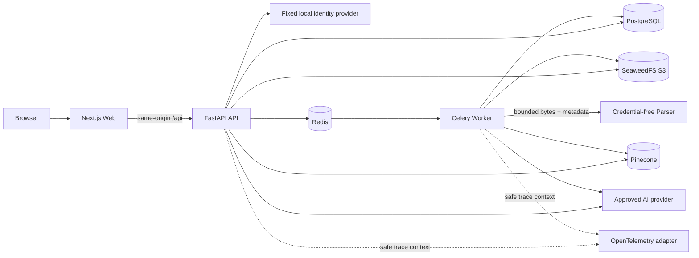
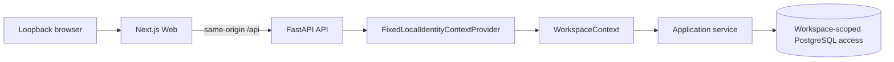
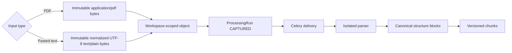
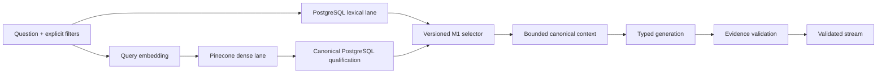

# Investment Research Archive — M1 Implementation Plan

**Status:** Implementation-ready v1.0 — Step 0 complete; Step 1 implementation in progress \
**Active milestone:** M1 — Thin vertical slice \
**Depends on:** completed M0 engineering foundation and accepted ADRs 0001–0009 \
**Related:** [01-product-scope.md](./01-product-scope.md),
[02-system-design.md](./02-system-design.md),
[03-domain-model.md](./03-domain-model.md),
[04-security-and-operations.md](./04-security-and-operations.md),
[05-delivery-plan.md](./05-delivery-plan.md),
[09-m0-implementation-plan.md](./09-m0-implementation-plan.md),
[11-m1-contracts.md](./11-m1-contracts.md),
[ADR-0008](./adr/0008-application-owned-ai-and-vector-adapters.md), and
[ADR-0009](./adr/0009-stable-source-anchors.md)

## 1. Purpose and scope

M1 turns the completed M0 engineering foundation into the first complete local RAG slice. It
preserves the M0 module boundaries, canonical stores, Celery delivery, isolated parser, evidence
validator, same-origin web/API path, and fixed server-owned local identity. It replaces only the
remaining proof adapters needed for one local document-to-answer journey.

The accepted M1 path is deliberately narrow:

1. resolve one fixed local owner and workspace from server-controlled state;
2. capture either one English text PDF or one English pasted-text original;
3. parse, chunk, embed, and index the active content;
4. run both PostgreSQL lexical retrieval and Pinecone dense retrieval;
5. generate a typed answer through one approved AI provider;
6. validate every statement and evidence reference against canonical PostgreSQL state;
7. stream only validated statements and citations;
8. open the immutable PDF page or pasted-text passage used as evidence;
9. retain safe version, latency, usage, cost, and trace identifiers.

M1 is not the complete V1 RAG system or an authenticated release. It does not add OIDC, users,
memberships, browser sessions, multiple-document ingestion, companies, watchlists, broad archive
browsing, reprocessing controls, deletion, transactional outbox delivery, index reconciliation,
RRF, reranking, conversation memory, advanced temporal UX, LangSmith, public hosting,
private-provider data approval, or agent workflows. Those remain assigned to M2–M9.

Only synthetic, openly licensed, redistributable, or otherwise public non-sensitive fixtures may
cross an external embedding, vector, generation, or tracing boundary during M1.

## 2. M1 outcomes

M1 is complete only when:

1. every request resolves the existing fixed local `WorkspaceContext` from server-controlled state,
   never from a client-supplied workspace identifier;
2. Compose publishes the browser entry point only on host loopback and the runtime remains
   explicitly unsuitable for shared, staging, or public deployment;
3. PDF and pasted-text originals are immutable, checksummed, workspace-scoped, and retrievable only
   through scoped API routes;
4. both media types reach `SEARCHABLE` through Celery and the credential-free parser boundary;
5. active chunks receive versioned embeddings and deterministic vector identifiers in a
   workspace-scoped Pinecone namespace;
6. lexical and dense candidates are independently produced, canonically requalified, deduplicated,
   and selected through the versioned M1 dual-lane policy;
7. one approved provider produces a typed answer proposal and statement-support decision while the
   existing server-side evidence validator remains authoritative;
8. invalid model output, unavailable evidence, stale or foreign vector hits, and unsupported
   questions fail safely without leaking another workspace or completing from general knowledge;
9. PDF citations open the correct page and pasted-text citations open the correct immutable text
   passage;
10. canonical records retain the effective identity, request, configuration versions, evidence,
    latency, provider usage, estimated cost, and trace ID;
11. deterministic CI remains independent of live paid providers, while separately bounded opt-in
    smoke tests prove the approved external adapters against public fixtures;
12. all M0 regression, isolation, cleanup, and container gates continue to pass.

## 3. Retained M0 contracts and M1 replacements

| M0 component | M1 action | Contract or invariant retained |
|---|---|---|
| Fixed local identity | Retain for the loopback-only M1 API and worker; replace during M5 | Server-owned `WorkspaceContext`, non-disclosure, explicit workspace scope |
| PDF-only capture | Extend with immutable UTF-8 pasted-text capture | `ObjectStorage`, checksum, version, compensation, workspace prefix |
| PDF-only parser protocol | Extend the same isolated protocol with one allowlisted `text/plain` request | Credential-free parser, strict bounded typed output |
| `LEXICAL_READY` terminal state | Extend to `LEXICAL_READY → INDEXING → SEARCHABLE` | Canonical processing state, execution lease, idempotent redelivery |
| Unavailable embedding adapter | Replace with one approved versioned embedding adapter | `EmbeddingProvider` and bounded correlated vectors |
| Unavailable dense retriever | Replace with Pinecone behind the existing port | `DenseRetriever`, namespace scope, canonical requalification |
| Lexical-only research result | Generalize to lexical and dense canonical sources | `ResearchRequest`, `RetrievalRun`, evidence assembly |
| Deterministic fixture generator | Retain for CI and add one opt-in approved live adapter | `AnswerGenerator`, typed untrusted proposal |
| Deterministic fixture support rule | Retain for CI and add one bounded provider-backed evaluator | `StatementSupportEvaluator`, canonical validation authority |
| No-op tracer | Retain as fallback and add application trace-context recording | `OperationTracer`, safe scalar attributes, no raw text |
| M0 fixture | Retain as a regression fixture and add one pasted-text M1 fixture | Exact expected evidence and insufficient-answer behavior |

M1 adapters must be selectable at the composition root. Deterministic and unavailable adapters
remain first-class test and safe-failure implementations; provider SDK types must not enter module
contracts.

## 4. Target M1 architecture

### 4.1 Runtime and trust boundaries



The browser receives no database, Redis, object-storage, Pinecone, AI-provider, or parser
credential. The parser receives none of those credentials and remains connected only to the
internal parser network. API and worker receive only the provider credentials required by their
own operations.

The fixed provider creates exactly one server-owned `WorkspaceContext`. It accepts no user or
workspace identifier from the browser or queue payload. Repository, object-storage, vector,
evidence, usage, and trace boundaries remain workspace-scoped and retain negative isolation tests.

### 4.2 Local single-user identity flow



M1 adds no login, logout, OIDC token, browser session, `User`, or `WorkspaceMembership` behavior.
The host publishes the web entry point only on loopback. API and worker containers may bind their
container interfaces but remain on private Compose networks without direct host publication. Tests
and runtime verification must fail if host exposure broadens while the fixed identity is active.
Tests may inject other server-created contexts to prove cross-workspace isolation, but no product
route accepts a context or workspace identifier as authorization proof. M5 replaces only this
provider boundary before staging or public deployment; the RAG application services continue to
receive the same `WorkspaceContext` contract.

### 4.3 Capture and source anchors



Pasted text is stored as an original, not only copied into a database field. The exact submitted
Unicode text is encoded once as UTF-8 after a documented newline policy; its checksum and byte size
describe those stored bytes. The isolated parser validates UTF-8 and produces bounded block offsets.

Source anchors become media-aware:

- PDF evidence retains page number plus exact character offsets inside the canonical block;
- pasted-text evidence retains exact character offsets and a text-passage locator without inventing
  a fake page number;
- the API exposes one discriminated locator contract so the frontend cannot confuse page and text
  anchors;
- historical M0 PDF citations remain valid without migration-time reinterpretation.

The final locator schema is accepted in the stable-evidence-anchor ADR before migrations or API
changes begin.

### 4.4 Processing and indexing flow

```text
CAPTURED → PARSING → LEXICAL_READY → INDEXING → SEARCHABLE
               ↘ FAILED          ↘ FAILED       ↘ FAILED
```

M1 extends the single canonical `ProcessingRun`; it does not introduce the M2 `ProcessingStage`,
outbox, receipt, or reconciliation model early.

Capture still publishes the processing job after the canonical database commit. If that publish
fails, the durable run remains `CAPTURED` and the failure is observable, but M1 does not claim
automatic redelivery of that lost publish. The transactional outbox, reconciliation, and visible
repair controls remain M2 scope.

One execution lease may span the narrow M1 task, but canonical commits remain short:

1. claim the run in PostgreSQL and close the transaction;
2. parse outside a transaction;
3. commit blocks, chunks, lexical content, and `LEXICAL_READY` while retaining the owned lease;
4. transition to `INDEXING` in a short transaction;
5. create document embeddings and upsert deterministic vector IDs outside a transaction;
6. mark `SEARCHABLE` and clear the lease in a short transaction.

If the worker dies after lexical commit, an expired-lease redelivery resumes from canonical active
chunks rather than parsing again. If a Pinecone upsert succeeds but the final PostgreSQL transaction
fails, a retry writes the same deterministic vector IDs. Any orphaned vector remains unusable
because every dense hit is requalified against canonical workspace, active-version, document-state,
and configuration data before generation. M2 adds durable indexing intent, receipts, and repair.

Pinecone vector IDs are derived from the workspace, chunk, and embedding configuration version.
Namespaces are workspace-specific. Metadata contains only bounded identifiers and configuration
versions needed for filtering; raw chunk text is not stored as vector metadata.

### 4.5 M1 dual-lane retrieval

M1 proves lexical and dense retrieval without claiming the M4 hybrid baseline:



The M1 selector uses a deterministic, versioned round-robin interleave of eligible lexical and
dense candidates, deduplicated by canonical chunk ID. It records each candidate's origin rank, raw
provider score, and final selection rank. It does not compare lexical and vector scores, calculate
RRF, or rerank. M4 replaces this selector with the measured RRF and cross-encoder pipeline.

### 4.6 Generation, validation, usage, and tracing

The approved generator receives only the bounded question and canonical candidate text permitted
for external processing. It returns the existing typed statement and exact evidence-reference
proposal. A separately versioned statement-support evaluator may use the same approved provider but
has its own prompt, schema, timeout, and usage record.

The server then performs the existing canonical checks. Provider output can propose but cannot
authorize a citation, workspace, document version, chunk, source offset, or support result.

Every provider operation returns application-owned usage metadata. PostgreSQL records provider,
operation, model, configuration version, input/output units where available, latency, estimated
cost, request correlation, and trace ID without raw prompt or document text. OpenTelemetry creates
local trace context; an external trace exporter and LangSmith remain deferred to M4 unless Step 0
demonstrates that M1 cannot satisfy its trace-ID requirement without one.

## 5. Decisions required before implementation

Step 0 must resolve and document these decisions. No provider SDK may be added before the relevant
decision is accepted.

### 5.1 [ADR-0008](./adr/0008-application-owned-ai-and-vector-adapters.md) — Application-owned AI and vector adapters

Confirm:

- Pinecone index mode, region, dimensions, metric, namespace, metadata, and deletion ownership;
- one embedding model and one typed generation model suitable for the public M1 fixtures;
- provider timeouts, batch and token limits, retry ownership, and cost ceilings;
- structured-output and usage-metadata behavior;
- deterministic adapters for normal CI and opt-in live smoke-test commands;
- OpenTelemetry trace-context behavior and whether M1 needs any external exporter.

The direct RAG orchestration remains application-owned. LangChain, LlamaIndex, LangGraph, and
provider-native agent frameworks are not admitted by this decision.

### 5.2 ADR-0009 — Stable PDF and pasted-text evidence anchors

Fix:

- the discriminated PDF-page versus text-passage locator contract;
- nullable/non-null database fields and constraints for each locator kind;
- parser block-offset semantics and newline normalization;
- citation viewer URL behavior;
- compatibility of historical M0 PDF evidence;
- versioning rules for parser, chunks, embeddings, and cited source text.

### 5.3 Dependency and provider approval gate

For every proposed production package, SDK, image, model, and hosted provider:

1. research current maintainer documentation, official registries, changelogs, and advisories;
2. check Python 3.14, Node 24, Next.js 16, FastAPI, Celery, platform, and peer compatibility;
3. apply the repository release-age and known-vulnerability policy;
4. review license, maintenance, data retention, training, region, deletion, and subprocessors;
5. explain cost, lock-in, privacy, security, and simpler alternatives;
6. obtain explicit user approval before changing dependencies or creating provider resources;
7. lock exact resolved packages and pin reviewed container images by digest where applicable.

### 5.4 Fixture freeze

The frozen [`fixtures/m1/manifest.yaml`](../fixtures/m1/manifest.yaml) references:

- the existing frozen synthetic English PDF as an M0 regression source;
- one repository-owned synthetic English UTF-8 pasted-text original;
- one exact-wording lexical question, one semantic-paraphrase question that requires dense-lane
  contribution, and one deliberately unanswerable question;
- exact PDF-page and text-passage ranges, passage hashes, and occurrence counts;
- fixture checksums, CC0 provenance, language, and publication/availability metadata;
- a zero-network, zero-spend normal-CI policy;
- an explicit opt-in live-smoke ceiling of USD 0.10, bounded provider requests and tokens, Pinecone
  Starter limits, and mandatory cleanup.

The frozen files, parser output, hashes, anchors, and budget arithmetic were verified together on
2026-09-17. At the recorded provider rates, the declared maximum OpenAI token use costs USD 0.0601,
leaving headroom below the hard per-run ceiling. A live run must still enforce the manifest before
making any provider request.

## 6. Planned repository delta

The exact provider package names are filled in only after Step 0. The intended ownership is fixed:

```text
investment-research/
├── AGENTS.md
├── README.md
├── compose.yaml
├── compose.test.yaml
├── fixtures/
│   └── m1/
│       ├── manifest.yaml
│       └── documents/
│           └── <approved-pasted-text-fixture>.txt
├── docs/
│   ├── 05-delivery-plan.md
│   ├── 10-m1-implementation-plan.md
│   └── adr/
│       ├── 0008-application-owned-ai-and-vector-adapters.md
│       └── 0009-stable-source-anchors.md
├── backend/
│   ├── migrations/versions/
│   │   ├── 0004_m1_text_sources_and_anchors.py
│   │   └── 0005_m1_indexing_retrieval_and_usage.py
│   ├── scripts/
│   │   ├── seed_m1.py
│   │   ├── verify_m1_runtime.py
│   │   └── verify_m1_providers.py
│   ├── src/investment_research/
│   │   ├── api/
│   │   │   ├── contracts.py
│   │   │   ├── dependencies.py
│   │   │   └── routes/
│   │   │       └── documents.py
│   │   ├── infrastructure/
│   │   │   ├── generation/provider.py
│   │   │   ├── evidence/provider.py
│   │   │   ├── operations/opentelemetry.py
│   │   │   ├── parsing/plain_text.py
│   │   │   └── search/
│   │   │       ├── embedding.py
│   │   │       └── pinecone.py
│   │   ├── modules/
│   │   │   ├── documents/{domain,contracts,application,ports,persistence}.py
│   │   │   ├── processing/{domain,contracts,application,ports,persistence}.py
│   │   │   ├── search/{domain,contracts,application,ports,persistence}.py
│   │   │   ├── research/{domain,contracts,application,ports,persistence}.py
│   │   │   ├── evidence/{domain,contracts,application,ports,persistence}.py
│   │   │   └── operations/
│   │   │       ├── domain.py
│   │   │       ├── contracts.py
│   │   │       ├── application.py
│   │   │       ├── ports.py
│   │   │       └── persistence.py
│   │   ├── bootstrap.py
│   │   └── settings.py
│   └── tests/
│       ├── acceptance/test_m1_runtime_journey.py
│       ├── integration/
│       │   ├── test_text_capture_postgresql.py
│       │   ├── test_dense_retrieval_postgresql.py
│       │   └── test_m1_research_api_postgresql.py
│       └── unit/
│           ├── test_plain_text_parser.py
│           ├── test_embedding_provider.py
│           ├── test_pinecone_retriever.py
│           ├── test_provider_answer_generator.py
│           └── test_usage_and_tracing.py
├── frontend/
│   ├── src/
│   │   ├── app/page.tsx
│   │   ├── features/archive/
│   │   │   ├── document-workflow.tsx
│   │   │   ├── research-workflow.tsx
│   │   │   └── source-viewer.tsx
│   │   └── lib/api/client.ts
│   └── tests/
│       ├── document-input.test.mjs
│       └── source-viewer.test.mjs
└── .github/workflows/ci.yml
```

Files are added only when their owning step needs them. Provider modules may be split further only
when the selected SDK has distinct concerns that cannot remain clear in one small adapter.

## 7. Fixed implementation rules

1. **Fixed identity is local-only.** M1 keeps the existing provider only while the host publishes
   the web entry point on loopback and backend containers remain private; it is never a staging,
   shared-network, public, or production fallback.
2. **Request scope is server-resolved.** No API accepts `workspace_id` as authorization proof.
3. **Worker scope is server-owned.** Queue identifiers are verified against the fixed context and
   canonical run relationships rather than treated as authorization proof.
4. **Redis is transient.** Redis may lose queue, lock, or cache state without losing archive state,
   processing intent, answers, evidence, audit, or usage records.
5. **Provider data is allowlisted.** M1 sends only public/synthetic fixture content and the minimum
   required fields to approved external providers.
6. **No provider types cross a port.** Domain and application modules use immutable application-owned
   contracts and safe error categories.
7. **Pinecone is derived.** PostgreSQL decides authorization, activity, version, deletion, temporal
   eligibility, and whether a hit may reach generation.
8. **Vector IDs are deterministic.** Duplicate indexing and retry overwrite the same derived vector,
   never create a second logical candidate.
9. **No distributed transaction.** Provider work occurs outside database transactions; canonical
   commits are short and repair direction follows ADR-0002.
10. **M1 indexing is deliberately narrow.** It extends one `ProcessingRun`; M2 adds stage history,
    outbox intent, receipts, reconciliation, reprocessing, and deletion.
11. **Dual-lane is not hybrid scoring.** M1 records and deterministically interleaves the two origins;
    M4 adds RRF and reranking after evaluation.
12. **Model output remains untrusted.** Typed output, semantic support evaluation, and canonical
    evidence validation are separate gates.
13. **No answer before validation.** Streaming may expose progress only until the complete answer is
    accepted; statements and citations come from the validated aggregate.
14. **Raw text stays out of telemetry.** Logs, traces, errors, audit, usage, vector metadata, and
    test diagnostics contain safe identifiers and bounded categories by default.
15. **Deterministic CI is mandatory.** Normal unit, integration, acceptance, and PR checks require no
    paid provider, internet access, personal account, or long-lived credential.
16. **Live smoke tests are bounded.** They are explicit, opt-in, public-fixture-only, cost-limited,
    cleanup-aware, and never the only correctness proof.
17. **English behavior remains explicit.** M1 fixtures and UI are English, while stored language and
    provider contracts remain extensible.

## 8. Implementation sequence and work blocks

Each step follows the repository order: backend behavior, CI automation, frontend behavior, then
the complete step gate. A step that needs no frontend change runs the existing frontend checks
without creating artificial UI work.

### Step 0 — Decisions, fixtures, and contract freeze

**Suggested branch:** `docs/m1-runtime-decisions`

Documentation and contracts:

- research and approve embedding, Pinecone, generation, support-evaluation, and tracing choices
  under the dependency policy;
- retain accepted ADR-0008 and ADR-0009;
- retain the frozen M1 fixture manifest, exact expected anchors, provider budget, and data
  classification;
- specify the text-capture payload, source locator union, processing states, indexing job behavior,
  dual-lane selection, provider usage, and trace fields;
- freeze target OpenAPI examples in `docs/11-m1-contracts.md`; generate OpenAPI artifacts only with
  the owning runtime implementation;
- define deterministic fake-provider and opt-in live-provider test boundaries.

**Gate:** every provider and dependency is explicitly approved; every new external data flow is
documented; the API/domain contracts are internally consistent; no unresolved decision would change
a migration, public API, source anchor, or provider port.

**Completed 2026-09-17:** ADR-0008 and ADR-0009 are accepted, the fixture manifest and external
data policy are frozen, and `docs/11-m1-contracts.md` fixes the target application, job, provider,
usage, tracing, API, and verification contracts. No provider resource or credentialed call was
created during Step 0.

**Suggested commits:** RAG-provider ADR; source-anchor ADR; M1 fixture freeze; contract
documentation.

### Step 1 — Pasted-text originals and stable source locators

**Suggested branch:** `feat/m1-document-inputs`

Backend:

- add `text/plain` to the allowlisted original media types and define exact UTF-8/newline behavior;
- add a bounded JSON pasted-text capture endpoint alongside multipart PDF upload;
- store text through the same immutable S3 and canonical metadata flow;
- extend parser protocol dispatch and isolated parser handling for plain text;
- execute each parse in a terminable child process with bounded concurrency and a server-enforced
  hard wall-clock deadline shorter than the worker's HTTP deadline;
- implement the ADR-0009 locator union and migration `0004` without changing historical PDF meaning;
- return media-aware citation viewer data and immutable text passage responses;
- keep capture compensation, checksums, byte limits, workspace scoping, and non-disclosure intact.

CI:

- test malformed Unicode, blank text, excessive bytes/characters, content-type mismatch, newline
  normalization, checksum identity, duplicate immutable writes, cross-workspace access, and parser
  isolation for both media types;
- prove that a deliberately hanging parse is terminated and reaped without preventing the next
  request from succeeding;
- migrate M0 PDF evidence forward and prove its citation still opens the same page and text;
- add the frozen pasted-text fixture and exact expected passage anchor.

Frontend:

- offer explicit PDF and pasted-text input modes without ambiguous mixed submission;
- show media-specific validation and immutable-original behavior;
- render PDF page locators and text-passage locators through one exhaustive source-viewer contract.

**Gate:** one PDF and one pasted-text fixture independently reach the lexical-ready boundary; each
original reopens byte-for-byte; each evidence span resolves to its exact media-appropriate location;
foreign and unknown sources remain indistinguishable; a timed-out parse cannot keep consuming parser
capacity or make the next valid parse fail.

**Implemented through 2026-09-17:** Media-aware source anchors and migration `0004`, immutable
pasted-text capture/download, the `parser-protocol.v2` text path, deterministic exact source blocks,
and terminable bounded child execution are implemented. Unit tests prove strict UTF-8/newline and
block-range behavior plus timeout/reaping/capacity recovery. PostgreSQL integration proves an M1
pasted-text original reaches `LEXICAL_READY` with exact persisted `TEXT_PASSAGE` ranges. Protocol v1
and explicit M0.0 PDF profiles remain unchanged. The complete Step 1 gate remains open until its
remaining PDF-v2, CI, frontend, and full fixture acceptance checks pass.

**Suggested commits:** text/source domain and migration; text capture; isolated text parsing; source
viewer API; document CI; frontend input and viewer; docs.

### Step 2 — Versioned embeddings and Pinecone indexing

**Suggested branch:** `feat/m1-dense-indexing`

Backend:

- extend `ProcessingRun` and its lease transitions through `INDEXING` and `SEARCHABLE`;
- add active-chunk loading needed to resume indexing without reparsing;
- implement the approved embedding adapter behind `EmbeddingProvider`;
- implement Pinecone upsert and readiness behavior behind application-owned ports;
- derive deterministic vector IDs and workspace namespaces;
- store only bounded identifier/version metadata in Pinecone;
- add versioned embedding and dense-index configuration to settings and canonical processing state;
- wire API query embedding separately from worker document embedding with least-privilege credentials;
- add migration `0005` fields required by indexing and configuration history.

CI:

- prove ordered batch correlation, dimension/finite-value validation, timeouts, rate limits, provider
  schema failure, deterministic vector IDs, duplicate upsert, stale lease recovery, and safe failure;
- prove web/parser lack Pinecone and embedding credentials;
- prove provider failure cannot corrupt originals, chunks, or workspace boundaries;
- add an opt-in public-fixture adapter contract smoke test with strict cost and cleanup limits.

Frontend:

- recognize and display `LEXICAL_READY`, `INDEXING`, and `SEARCHABLE` distinctly;
- enable research only at `SEARCHABLE` for the M1 path;
- keep safe terminal error messages free of provider internals.

**Gate:** both approved fixture types become `SEARCHABLE`; duplicate/redelivered indexing produces
the same vector identities; a worker loss resumes from canonical chunks; no vector is accepted as
evidence merely because it exists in Pinecone.

**Suggested commits:** indexing states and migration; embedding adapter; Pinecone adapter; worker
index orchestration; indexing CI; frontend status; docs.

### Step 3 — Canonically qualified dual retrieval

**Suggested branch:** `feat/m1-dual-retrieval`

Backend:

- generalize research retrieval contracts from lexical-only hits to canonical candidate sources;
- embed the query with the approved query-purpose configuration;
- run bounded lexical and dense lanes with the same explicit filters;
- rehydrate every dense hit from PostgreSQL and reject unknown, foreign, inactive, deleted,
  wrong-version, wrong-configuration, or time-ineligible hits;
- apply the versioned deterministic round-robin selector and chunk-ID deduplication;
- persist origin rank, raw score, and final selection rank without comparing unlike score scales;
- update research/evidence readers so both origins resolve through the same canonical source path.

CI:

- test dense paraphrase retrieval, lexical exact wording, overlap deduplication, empty lanes, stable
  order, candidate bounds, stale/foreign vector injection, temporal/document filters, provider
  timeout, and trace-safe failures;
- retain deterministic fake embeddings and dense results for normal CI;
- run the existing adversarial evidence and workspace suites unchanged.

Frontend:

- consume the unchanged validated-answer stream contract;
- expose no provider score as confidence and make no RRF/reranking claim;
- update English explanatory copy only if needed to describe searchable state accurately.

**Gate:** the lexical fixture question and semantic-paraphrase question both select the expected
canonical evidence; injected stale or cross-workspace vector hits never reach generation; repeated
runs with the same versions have the same selected order.

**Suggested commits:** generic retrieval contracts; canonical dense qualification; M1 selector and
persistence; retrieval CI; compatible frontend copy; docs.

### Step 4 — Provider-backed generation and evidence support

**Suggested branch:** `feat/m1-generation`

Backend:

- implement the approved typed generator behind `AnswerGenerator`;
- implement the approved bounded semantic support evaluator behind `StatementSupportEvaluator`;
- version model, prompt, schema, configuration, and validation policy independently;
- bound source count, source text, input/output tokens, retries, timeout, and concurrent calls;
- translate provider failures into safe application categories without raw prompts or document text;
- keep deterministic adapters as the default for unit and integration tests;
- persist only the accepted validated aggregate and safe failed-attempt metadata.

CI:

- test malformed JSON/schema, extra fields, fabricated candidate IDs, wrong offsets, unsupported
  statements, missing evidence, conflicting references, prompt injection, timeout, rate limit,
  refusal, truncation, and provider usage mismatch;
- prove that no statement/citation stream event is emitted before full validation;
- add one bounded opt-in public-fixture live smoke test for answerable and unanswerable questions.

Frontend:

- preserve strict event ordering and runtime validation;
- display validated statements, citations, and explicit insufficient coverage;
- show safe provider failure without exposing provider internals or partially generated prose.

**Gate:** the approved public fixture produces a provider-backed answer whose statements all resolve
to validated original spans; the unanswerable case remains insufficient; adversarial or malformed
provider output emits no answer content.

**Suggested commits:** provider generator; support evaluator; generation policy and error mapping;
generation CI; frontend terminal behavior; docs.

### Step 5 — Canonical usage and trace correlation

**Suggested branch:** `feat/m1-observability`

Backend:

- add minimal canonical usage/audit entities and persistence required by the M1 outcome;
- propagate request, job, workspace, research-request, answer, and trace identifiers;
- implement OpenTelemetry trace context behind `OperationTracer` with safe allowlisted attributes;
- record provider/model/configuration, units, latency, estimated cost, outcome, and trace ID;
- make tracing export optional and fail-open without losing canonical audit/usage state;
- apply per-operation budgets and preserve the combined monthly-cost assumption.

CI:

- test redaction, attribute allowlists, trace propagation, unavailable exporter, incomplete provider
  usage, cost calculation, workspace isolation, and absence of raw question/document/prompt text;
- verify logs, traces, errors, and CI artifacts against injected secret and document markers.

Frontend:

- no artificial observability UI is required in M1;
- preserve request IDs in safe error handling for diagnosis.

**Gate:** one fixture journey can be reconstructed from canonical safe identifiers and version data;
provider use and cost are attributable; tracing failure does not fail a valid answer; no sensitive or
raw fixture text appears in operational output.

**Suggested commits:** operations domain and migration; trace adapter; usage integration; operations
CI; docs.

### Step 6 — M1 acceptance and handoff

**Suggested branch:** `test/m1-acceptance`

Backend and runtime:

- seed the local owner fixture workspace plus an isolated foreign-workspace test fixture
  idempotently;
- run PDF and pasted-text capture through the complete container stack;
- prove lexical wording and semantic paraphrase retrieval;
- prove answerable, unanswerable, malformed-provider, prompt-injection, cross-workspace, repeated
  delivery, worker-loss, parser-isolation, citation-open, and provider-outage cases;
- run bounded opt-in Pinecone, embedding, generation, and support-evaluation smoke tests using only
  the approved public fixtures;
- record measured startup, processing, retrieval, generation, validation, latency, and cost as
  observations rather than guarantees;
- clean only uniquely named M1 test resources and verify cleanup independently.

CI:

- keep deterministic provider fakes in required PR jobs;
- add one complete M1 runtime job from an empty state;
- keep credentialed provider smoke tests separate, manually triggered, bounded, and non-required for
  untrusted pull requests;
- preserve the existing M0 runtime, image, storage, queue, parser, migration, and cleanup jobs.

Frontend:

- complete the browser journey for owner PDF and pasted text;
- open the exact PDF page and pasted-text passage from validated citations;
- confirm insufficient and safe failure states contain no unvalidated prose.

Documentation:

- update current architecture, domain, security, READMEs, commands, diagrams, and ADR statuses;
- record provider/data-flow approvals, fixture provenance, measurements, and remaining M2 gaps;
- hand off the M1 narrow indexing path explicitly to M2 outbox/receipt/reconciliation work.

**Gate:** every outcome in section 2 and the M1 exit gate in `05-delivery-plan.md` pass from a clean
checkout. Only then may M2 add lifecycle breadth and reliability mechanisms.

**Suggested commits:** deterministic M1 acceptance; optional provider smoke gates; browser journey;
measured results and M2 handoff.

## 9. Verification matrix

| Risk | Required deterministic proof |
|---|---|
| Accidental unauthenticated exposure | Compose and runtime gates reject non-loopback host publication |
| Client-selected scope | route and dependency tests prove context remains server-owned |
| Cross-workspace access | API, repository, storage, queue, vector, evidence, usage, and trace negatives |
| Text-original ambiguity | byte/checksum/newline/Unicode and media-aware locator tests |
| Parser expansion | PDF and text secret/filesystem/network/resource negatives plus hard-timeout termination and recovery |
| Lost or duplicate indexing | execution lease, resume, deterministic vector-ID, duplicate-upsert tests |
| Stale or poisoned vector | canonical workspace/version/state/configuration/temporal qualification |
| Retrieval nondeterminism | fixed lane limits, origin ranks, deduplication, and selected-order tests |
| Provider schema drift | strict application contracts and malformed/extra/missing-field fixtures |
| Unsupported answer | semantic support decision plus canonical evidence validation |
| Premature streaming | event-sequence tests proving progress-only output before validation |
| Provider outage or rate limit | bounded timeout/retry and safe canonical outcome |
| Sensitive-data leakage | marker scans over logs, traces, errors, vector metadata, and CI artifacts |
| Cost overrun | bounded units, concurrency, retries, opt-in smoke budget, and usage records |
| Contract drift | checked OpenAPI snapshot and generated TypeScript declarations |
| Container-only failure | complete-stack M1 CI plus retained M0 gates and cleanup inventory |

Deterministic correctness tests and live-provider compatibility tests remain separate. A live smoke
pass cannot replace malformed-output, isolation, idempotency, evidence, or workspace tests.
The three frozen M1 acceptance cases prove the thin slice's specified behavior; they are not a
representative retrieval-quality baseline. M3 freezes the initial reviewed evaluation core, M4
measures the first representative baseline, and M7 expands corpus coverage. Additional reviewed
cases may be collected earlier without moving those milestone gates into M1.

## 10. Branch and review strategy

Use one branch per implementation step and complete backend, CI, frontend, and documentation for
that step before merge:

```text
docs/m1-implementation-plan
  → docs/m1-runtime-decisions
  → feat/m1-document-inputs
  → feat/m1-dense-indexing
  → feat/m1-dual-retrieval
  → feat/m1-generation
  → feat/m1-observability
  → test/m1-acceptance
  → M2
```

Do not combine provider/dependency selection with feature behavior in one commit. Keep migrations,
domain behavior, adapters, CI, frontend, and documentation in reviewable coherent commits. Never
commit provider credentials, real user tokens, private documents, generated indexes, or live trace
exports.

## 11. Deferred decisions and stop conditions

Stop the active work block and review before continuing when:

- the fixed local identity would become reachable beyond loopback or be treated as release-ready;
- the chosen provider cannot meet public/non-sensitive data, retention, deletion, region, training,
  budget, or least-privilege requirements;
- a required package is unmaintained, vulnerable, too new under policy, license-incompatible, or
  incompatible with the pinned runtimes;
- pasted-text support would require fake page numbers or reinterpret existing PDF evidence;
- indexing would make Pinecone authoritative or allow unqualified vector hits into generation;
- retry safety would require pretending the M1 lease is the M2 outbox/stage/reconciliation model;
- the thin slice would require RRF, reranking, conversation memory, company browsing, deletion,
  reprocessing, public hosting, private data, or agent tools merely to pass;
- normal CI would require paid-provider credentials or network access;
- a provider SDK would cross into domain/application code or raw content would enter telemetry.

An unresolved stop condition requires an explicit scope, ADR, provider, or milestone decision. It
must not be bypassed by weakening the loopback boundary, isolation, canonical qualification,
validation, testing, or redaction.

## 12. Authoritative implementation references

Step 0 must replace generic references with the selected providers' official documentation. The
implementation must use primary sources for:

- Pinecone index, namespace, metadata-filtering, upsert, query, quota, and deletion semantics;
- the selected embedding and generation providers' structured output, versioning, usage, retention,
  timeout, rate-limit, and safety behavior;
- OpenTelemetry trace-context, semantic convention, exporter, and redaction behavior;
- official SDK registries, changelogs, security advisories, licenses, and support matrices.

The accepted repository ADRs remain authoritative when a provider guide suggests a shortcut that
would violate canonical ownership, workspace isolation, parser isolation, evidence validation, or
application-owned contracts.
