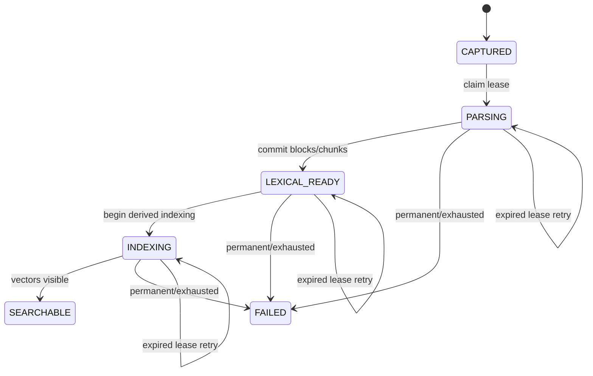

# Investment Research Archive — M1 Contract Freeze

**Status:** Accepted v1 \
**Date:** 2026-09-17 \
**Scope:** M1 capture, parsing, indexing, retrieval, provider usage, tracing, and public API contracts \
**Related:** [M1 implementation plan](./10-m1-implementation-plan.md),
[ADR-0008](./adr/0008-application-owned-ai-and-vector-adapters.md),
[ADR-0009](./adr/0009-stable-source-anchors.md), and
[M1 fixture manifest](../fixtures/m1/manifest.yaml)

## 1. Purpose

This document freezes the cross-module contracts that must remain internally consistent while M1
is implemented. It defines application-owned values and behavior, not provider SDK shapes.

M1 remains a local, loopback-only, fixed-owner slice for public or synthetic English content. It
does not add authentication, shared use, private-data approval, production deployment, RRF,
reranking, durable outbox delivery, reconciliation, or agentic orchestration.

Generated OpenAPI artifacts change only when the owning runtime contract is implemented. The
examples below are the accepted target contract; generated files must never be edited by hand.

## 2. Fixed M1 configuration

**Local tuning amendment (2026-10-12):** The table below remains the historical M1 baseline
and programmatic defaults. Normal provider-backed M1/M1.5 API research can now read five
bounded overrides from [`config/rag.toml`](../config/rag.toml). Candidate lanes remain capped
at 20 each; selected context permits 1–32 chunks within the unchanged 24,000-code-point ceiling.
Each retrieval run stores all four effective limits alongside its unchanged algorithm version;
this explicit snapshot supersedes the requirement to create a new algorithm version for a
numeric limit change alone. Processing, embedding, prompt, and algorithm changes still require
their existing versioning. Historical acceptance/evaluation profiles remain frozen and do not
adopt local tuning implicitly. See the [tuning guide](../config/README.md).

The fifth override, `generation.input_overhead_limit`, is bounded to 16,000–18,000 conservative
UTF-8-byte accounting units and is set to 18,000 in the committed live file. Source-unit preflight
and answer-generation reservations use the same value for both models and all model pairs.
Question and source bytes remain separately reserved; the support reservation and monthly budget
are unchanged. This numeric allowance is not a token measurement or a retrieval-history field.
Provider operations continue to record the resulting reserved cost and reconciled usage.

| Concern                    | M1 value                                                                  |
| -------------------------- | ------------------------------------------------------------------------- |
| Pasted-text maximum        | 100,000 Unicode code points and the existing configured byte limit        |
| Structure-block maximum    | 4,000 Unicode code points                                                 |
| Chunk mapping              | Exactly one chunk per structure block; chunk text equals block text       |
| Embedding model            | OpenAI `text-embedding-3-small`, 1536 dimensions                          |
| Lexical config version     | `m1-english-lexical-v1`                                                   |
| Embedding config version   | `openai-text-embedding-3-small-1536-v1`                                   |
| Embedding batch            | At most 16 inputs and 32,000 total Unicode code points                    |
| Lane candidates            | At most 20 lexical and 20 dense candidates                                |
| Selected context           | At most 8 unique chunks and 24,000 total Unicode code points              |
| Generator                  | OpenAI `gpt-5.6-terra` by default or `gpt-5.6-luna`, low reasoning, strict structured output, no tools |
| Statement-support model    | Independently selected `gpt-5.6-terra` by default or `gpt-5.6-luna`       |
| Generated answer           | At most 8 statements and 2 evidence references per statement              |
| Dense index                | Pinecone Serverless BYOV, cosine, 1536 dimensions, `aws/us-east-1`        |
| Dense-index config version | `pinecone-serverless-cosine-1536-aws-us-east-1-v1`                        |
| M1 selector                | Deterministic lexical-first round-robin with chunk-ID deduplication       |
| Selector config version    | `m1-lexical-first-round-robin-v1`                                         |
| Normal CI                  | Deterministic adapters, no provider network, credentials, or spend        |
| Live smoke                 | Explicit opt-in and bounded by `fixtures/m1/manifest.yaml`                |

Each value is carried by an immutable application configuration version. Changing a value creates a
new version; it never silently changes the meaning of an existing processing or retrieval record.

## 3. Capture and original access

### 3.1 Public endpoints

```text
POST /api/v1/documents       multipart/form-data PDF capture
POST /api/v1/documents/text  application/json pasted-text capture
GET  /api/v1/documents/{document_id}/versions/{version_id}/original
```

The PDF endpoint keeps its existing multipart contract. The text endpoint accepts:

```json
{
  "title": "Northstar Grid Analytics Ltd. - FY2026 Capacity Update",
  "language": "en",
  "published_at": "2026-07-22T00:00:00Z",
  "available_at": "2026-07-22T00:00:00Z",
  "text": "Exact submitted text"
}
```

Rules:

- unknown JSON fields are rejected;
- `title` and timestamps use the existing document metadata rules;
- M1 accepts English (`en`) only while preserving the language field for later expansion;
- `text` must contain visible content, contain no NUL code point, and fit both the 100,000-code-point
  limit and the configured request-byte limit;
- newline normalization, strict UTF-8 encoding, checksums, and media type follow ADR-0009;
- PDF and text inputs are separate endpoints; mixed or ambiguous submissions are rejected;
- neither endpoint accepts `workspace_id`, storage keys, checksums, processing state, or configuration
  versions from the client.

Both endpoints return the existing `DocumentAccepted` shape with server-created document, version,
processing-run identifiers, `CAPTURED`, and a status URL. Text capture uses the same
store-first/commit-second compensation flow and workspace-scoped immutable object key as PDF
capture.

The original endpoint authorizes and integrity-checks both media types. It returns
`application/pdf` for PDF or `text/plain; charset=utf-8` for text, with private no-store caching,
`nosniff`, an inline server-generated safe filename, and no direct object-storage URL.

### 3.2 Application inputs

The Documents module owns a discriminated capture input:

```text
PdfCaptureInput
  kind = PDF
  original filename
  submitted media type
  metadata
  bounded binary stream

PastedTextCaptureInput
  kind = PASTED_TEXT
  metadata
  exact submitted Unicode string
```

Normalization produces one internal `PreparedOriginal` containing media type, safe filename,
normalized byte stream, byte size, SHA-256 checksum, and capture metadata. The common persistence
service receives only this prepared form.

### 3.3 Saved-document catalog follow-up

The owner-approved local usability follow-up adds `GET /api/v1/documents`; it is a read-only subset
of M3, not acceptance of the broader archive or lifecycle milestone. Existing capture and original
routes remain unchanged. The website catalog consumes this contract through the typed API client.

Query parameters:

| Parameter | Contract |
| --- | --- |
| `page_size` | Integer 1–100; default 20 |
| `after_created_at` | Optional timezone-aware timestamp from `next_cursor.created_at` |
| `after_document_id` | Optional UUID from `next_cursor.document_id` |

Supply both continuation fields together or neither. The cursor is an exclusive descending
`Document.created_at`/UUID position, not authorization or a multi-request snapshot. Unknown query
parameters are rejected, including `workspace_id`. Newer imports appear when the first page is
refreshed rather than shifting an existing traversal.

`DocumentCatalogPage` returns `items` and nullable `next_cursor`. Each item contains document and
current-version IDs, title, language, media type, byte size, creation and capture timestamps,
nullable publication and availability timestamps, nullable `processing: ProcessingRunResult`, and
an `original_url` pointing to the existing authorized API route. No workspace IDs, object keys,
checksums, raw source text, or provider configuration are returned. Unknown source dates stay null.

Metadata reads require an active document, its current version, and original metadata in the
server-derived workspace. Processing is loaded in one bounded batch for those current version IDs
only. The latest run is chosen by creation time descending, then UUID descending; no matching run
means null, not `SEARCHABLE`. Safe persisted failure summaries reuse the existing processing-status
contract. Status and document reads use separate short sessions and may change after response;
research and original access must revalidate canonical eligibility rather than trust a list row.

Success returns `200` with `Cache-Control: private, no-store`; invalid input returns the existing
safe `422` envelope, and database failures return a safe `500` without a partial catalog. This
operation performs no writes, storage-byte reads, provider calls, or schema changes. Existing CI
unit, PostgreSQL, OpenAPI-drift, and generated-TypeScript checks cover the new contract.

The website initially loads 20 rows and appends additional cursor pages on demand. It displays
source metadata and the latest processing snapshot, with unknown dates explicitly unknown and
known dates shown in UTC. Users may search all eligible saved sources or select 1–100 documents
marked `SEARCHABLE`; an empty selected scope disables submission instead of becoming an all-source
request. Loading more preserves selection. Manual refresh, capture, and observed processing-state
transitions reload the first page and clear selection without changing selected scope. A catalog
failure blocks selected-scope submission, and selection controls are locked during research.
Hiding or showing the document rows preserves selection and does not trigger a catalog request.
Scope and selected count remain visible while the rows are hidden. Document titles toggle their
checkboxes; Clear selection removes all selected IDs without widening focused scope to all sources.

`/documents/{document_id}/versions/{document_version_id}` opens a complete original independently
of a question. It uses the existing integrity-checking original endpoint, renders PDF bytes or
escaped plain text, and makes no citation/highlight claim. `/sources/{evidence_span_id}` retains
its stricter evidence resolution and exact-location checks. List and original reads bypass browser
caching. No additional backend operation, database table, dependency, or provider call is needed.
Deterministic frontend tests cover the contract and selection rules; browser journey coverage is
extended for reload, original opening, pagination, multi-selection, hiding/showing, clearing, and
refresh. Local production build and browser verification must be confirmed separately, not inferred
from unit tests.

### 3.4 Permanent-deletion follow-up

The separately owner-approved local path follows
[ADR-0019](./adr/0019-permanent-local-document-deletion.md). It has no restoration and removes
complete affected stored answers, including mixed-document answers. It does not approve public
access or complete M2 delivery/reconciliation.

`POST /api/v1/documents/deletions` accepts strict JSON:

```json
{
  "document_ids": ["00000000-0000-4000-8000-000000000003"],
  "confirm_permanent": true
}
```

Require 1–100 distinct UUIDs and the actual JSON boolean `true`; no default confirmation,
client-supplied workspace, object keys, or provider targets. Empty selection never means all.
The application commits exclusion and receipts for the entire batch before publishing ID-only
Celery jobs outside the transaction. One unknown or foreign target returns the same safe `404`;
started parsing or unfinished indexing returns `409`, including a leased `LEXICAL_READY` run
even after lease expiry. Unclaimed `CAPTURED` runs and completed `LEXICAL_READY` runs with no lease
are deletable regardless of embedding/index configuration; document locking and source-write guards
fence delayed or competing processing claims. Historical configuration labels alone cannot reject
completed text extraction; exact vector cleanup still covers those configurations.
Neither rejection admits any part of the selection. Invalid input
returns `422`; canonical database failures return a safe `500`, with status checking recommended
before retry because a connection failure can make the commit outcome uncertain.

Success returns `202` and `DocumentDeletionsAccepted`:

- `items`: ordered receipt snapshots with `document_id`, `state`, `requested_at`, nullable
  `completed_at`, and `/api/v1/documents/{document_id}/deletion` as `status_url`.
- `dispatch_pending_document_ids`: IDs whose publication failed in this attempt. This is not
  durable queue/worker state; an empty list does not mean cleanup completed.

`202` confirms canonical acceptance, not cross-store completion. A known broker failure still
returns the committed receipts and failed publication IDs rather than pretending admission rolled
back. Reposting the same confirmed explicit IDs returns existing receipts and republishes pending
jobs; completed targets publish nothing. Resubmission can race a running worker safely because
canonical receipts and exact-store cleanup are idempotent. The endpoint never calls paid providers
or performs external cleanup itself. No transactional outbox is claimed.

`GET /api/v1/documents/{document_id}/deletion` returns one `DocumentDeletionResult` with `200`.
`PENDING` already excludes the document from new use; `COMPLETED` means verified external cleanup
and canonical purge committed. Receipts survive physical document removal. Unknown, unrequested,
and foreign IDs share the same `404`; malformed UUIDs return `422`; database failure returns a
safe `500`. Both successful operations use `Cache-Control: private, no-store` and expose no source
content, workspace ID, storage key, vector ID, or provider details.

Unit, disposable PostgreSQL, OpenAPI-drift, and generated-TypeScript gates cover this API. Website
confirmation, pending/completed display, and bounded polling remain the next work block; existing
browser controls are not activated by generating a contract.

## 4. Parser, blocks, and chunks

### 4.1 Parser protocol

M1 introduces `parser-protocol.v2`; it does not reinterpret `parser-protocol.v1`. The request carries
only non-secret configuration and one raw original body:

```text
ParserRequestV2
  schema_version = parser-protocol.v2
  media_type = application/pdf | text/plain
  parser_version
  parser_config_version
  max_input_bytes
  max_extracted_characters
  max_pdf_pages when media_type = application/pdf
  max_block_characters = 4000
```

The response is a discriminated union:

```text
ParsedPdfDocument
  kind = PDF
  physical_page_count
  ordered parsed blocks with PDF_PAGE locators

ParsedTextDocument
  kind = PASTED_TEXT
  ordered parsed blocks with TEXT_PASSAGE locators
```

Each parsed block contains its ordinal, block type, exact text, and the source-relative range defined
by ADR-0009. The parser rejects an empty visible result, invalid UTF-8, non-canonical text newlines,
unsupported media, malformed PDFs, invalid ranges, non-contiguous ordinals, and all configured
limit violations.

Each parse executes in a terminable child process rather than an in-process thread. The parser
enforces bounded concurrent children and a hard wall-clock deadline below the worker HTTP deadline,
leaving a fixed response and cleanup margin. At the deadline it terminates and reaps the child,
returns only a safe timeout failure, and remains able to serve the next valid request. Client
disconnect or cancellation does not allow parsing to continue without that same server-owned bound.
Tests use a deliberately blocking parser implementation to prove termination, reaping, capacity
recovery, and successful handling of the following request.

### 4.2 Deterministic M1 block policy

For a new M1 processing run:

1. PDF physical page numbers remain one-based and blank pages still count.
2. Visible PDF page text and canonical pasted text are divided at blank-line paragraph boundaries.
3. A range begins at its first visible code point and ends immediately after its last visible code
   point; excluded separator whitespace remains part of the immutable original but not a block.
4. A paragraph above 4,000 code points is split at the last whitespace at or before the limit.
5. If no such whitespace exists, it is split exactly at 4,000 code points.
6. Splits do not overlap, reorder, normalize, or duplicate source text.
7. M1 emits `PARAGRAPH` unless the parser has deterministic source evidence for another existing
   block type.

Every emitted block must satisfy:

```python
block.text == canonical_source[block.start_character:block.end_character]
```

For PDF, `canonical_source` is the parsed text of the named physical page. For pasted text, it is the
complete normalized original.

M1 creates one chunk for each block. The chunk text is identical to block text and retains the
single `structure_block_id`. This avoids a second offset system. More advanced overlap or
multi-block chunking requires a later version and must not rewrite existing blocks or citations.

Historical M0 PDF blocks and chunks remain unchanged. Newly processed PDFs use the M1 parser and
chunk configuration versions.

## 5. Processing lifecycle and job behavior



`LEXICAL_READY` and `INDEXING` are non-terminal M1 states. They retain an owned lease and have no
`completed_at`. `SEARCHABLE` and `FAILED` are terminal, clear the lease, and require
`completed_at`. Only `FAILED` carries a bounded sanitized `error_summary`.

The existing `processing-job.v1` message remains sufficient because it carries only trusted
workspace and processing-run identifiers plus its deterministic idempotency key. Redelivery reloads
canonical state and:

- reparses only `CAPTURED` or an expired `PARSING` attempt;
- resumes from active canonical chunks for expired `LEXICAL_READY` or `INDEXING`;
- acknowledges `SEARCHABLE` without repeating work;
- refuses a live lease owned by another attempt;
- moves to `FAILED` only for a permanent failure or exhausted attempt limit.

Parsing, embedding, and Pinecone calls occur outside database transactions. State claims and
transitions use short transactions with row locking and lease-owner checks.

The retained M0 deterministic regression path may still exercise lexical-only research at
`LEXICAL_READY`. The M1 product path admits documents only at `SEARCHABLE`.

## 6. Embedding and dense-index contracts

### 6.1 Provider-neutral ports

`EmbeddingProvider` continues to accept ordered, uniquely correlated application inputs. M1 adds:

```text
DenseIndexWriter.upsert(context, request) -> DenseIndexWriteResult
DenseIndexWriter.fetch_visible(context, vector_ids, *, timeout_seconds=None) -> visible_vector_ids
DenseRetriever.retrieve(context, query) -> DenseRetrievalHit[]
```

The application passes `WorkspaceContext`; provider namespaces are derived inside the adapter and
cannot be supplied by an HTTP client or queue payload.

Embedding results must contain exactly one vector per input, in request order, with the same input
identifier and configuration version. Every vector must have exactly 1536 finite numbers. Missing,
extra, duplicate, reordered, wrong-version, wrong-dimension, NaN, or infinite results fail closed
before Pinecone is called.

### 6.2 Deterministic Pinecone identity

The application derives:

```text
namespace = "ws-" + workspace_id.hex
vector_id = "v1:" + sha256(
  workspace_id + ":" + chunk_id + ":" + embedding_config_version
).hexdigest()
```

The exact UTF-8 serialization uses canonical lower-case UUID text and literal colon separators.

Pinecone metadata is limited to:

- `chunk_id`;
- `document_version_id`;
- `chunk_set_id`;
- `embedding_config_version`;
- `dense_index_config_version`.

It contains no raw text, title, filename, question, prompt, answer, user data, credential, active
flag, or authorization decision. PostgreSQL remains authoritative for every returned identifier.

After an upsert, the worker performs bounded fetch-based readiness checks for the deterministic IDs.
It marks the run `SEARCHABLE` only when every active chunk ID is visible. A readiness deadline is a
retryable indexing failure; redelivery safely overwrites the same vector IDs.
The worker checks the shared deadline before and after every fetch batch, passes the remaining time
as `timeout_seconds`, and rejects even a fully visible response that arrives after the deadline.
The Pinecone adapter caps each fetch at both that remaining time and its 20-second operation limit.

### 6.3 Timeouts and retry ownership

Provider SDK retries are disabled. The application is the only retry owner:

| Operation                    | Per-attempt timeout |                   Maximum attempts |
| ---------------------------- | ------------------: | ---------------------------------: |
| Document/query embedding     |          30 seconds |                                  2 |
| Pinecone upsert/query/fetch  |          20 seconds |                                  2 |
| Pinecone readiness sequence  |    30 seconds total | bounded polling, no nested retries |
| Answer generation            |          60 seconds |                                  1 |
| Statement-support evaluation |          30 seconds |                                  1 |

Only classified transport, timeout, rate-limit, and transient service failures are retryable.
Authentication, permission, schema, dimension, malformed output, invalid request, budget, and
canonical-validation failures are permanent. No operation multiplies application attempts with SDK
attempts.

## 7. Dual-lane retrieval and context selection

An M1 `RetrievalRun` records:

- mode `DUAL_LANE`;
- exact query and canonical normalized query;
- filter snapshot;
- lexical, embedding, dense-index, and selector configuration versions;
- lexical and dense candidate limits;
- final context limit;
- start and completion times.

The two lanes execute independently:

1. PostgreSQL returns already eligible lexical hits in descending lexical rank.
2. OpenAI returns one query embedding.
3. Pinecone returns dense identifiers and finite similarity scores from the trusted workspace
   namespace.
4. Every dense hit is reloaded from PostgreSQL and rejected unless workspace, active document
   version, lifecycle, processing state, chunk set, temporal filters, and configuration versions are
   eligible.

All accepted lane candidates are persisted with their own `origin`, origin-local `rank`, and raw
score. The same chunk may therefore have one `LEXICAL` and one `DENSE` candidate record. Raw scores
from different origins are never compared.

The selector produces model context as follows:

1. read lexical rank 1, then dense rank 1, lexical rank 2, dense rank 2, and so on;
2. keep the first occurrence of each canonical `chunk_id`;
3. record `selection_rank` on the candidate that supplied that occurrence;
4. stop before exceeding 8 chunks or 24,000 code points;
5. never truncate a chunk; skip a chunk that would exceed the remaining character budget.

`selection_rank` is separate from the existing origin rank and the M4 `fused_rank`. Persisting both
lane records preserves whether one or both lanes found a chunk, while generation receives each
canonical chunk at most once.

M1 performs no RRF, score normalization, reranking, query rewriting, or conversation-derived
filtering.

## 8. Generation, support evaluation, and evidence

This section freezes the retained M1 exact-substring profile. The separately versioned M1.5
source-unit ID profile is specified in the
[Step 2 design contract](./13-m1-5-rag-quality-plan.md#step-2-contract--citable-units-v1).
Its catalog preparation, ID resolution, provider adapter, Research integration, and explicit
evaluation selection are implemented. Since the owner-approved local change on 2026-10-12,
M1.5 is the default for live Compose and complete host API provider configuration. An explicit
`m1` profile remains available; credential-free development and frozen acceptance adapters retain
their existing defaults. Evaluation CLI policies remain explicitly selectable and unchanged.
It resolves IDs to the same
application-owned evidence-reference shape and preserves the validation and source-viewer
contracts below; it does not reinterpret historical M1 answers.

Generation receives only:

- the research-request identifier;
- the bounded exact question;
- up to 8 selected canonical sources with safe identifiers and exact chunk text;
- the strict output schema and versioned application prompt.

The OpenAI request uses the selected `gpt-5.6-terra` or `gpt-5.6-luna` model, low reasoning,
`store=false`, no tools, no background mode,
and a strict structured-output schema. The provider proposes a retrieval-candidate ID and an exact
supporting substring for each reference; it does not calculate character offsets. The application
adapter accepts a reference only when that substring occurs exactly once in the named supplied
source. It derives the zero-based, half-open source range, constructs an
`UnvalidatedGeneratedAnswer`, and returns it inside `AnswerGenerationResult` together with
validated, content-free `ProviderUsage`. Unknown candidates, absent or repeated substrings, and
invalid answer shapes fail closed. No SDK response object crosses the provider boundary.

An answered proposal contains no more than 8 statements and 2 evidence references per statement.
Each application reference names only a supplied retrieval-candidate ID and a block-local
half-open range. An insufficient proposal contains no statements or citations and names the missing
information.

The current M1 answer prompt, `m1-grounded-answer-prompt-v5`, requires one independently
verifiable factual claim per statement, supported in full by that statement's own references.
Distinct capabilities, activities, or plans must not be bundled with unsupported additions.
Necessary subject, conditions, uncertainty, and time scope remain part of each self-contained
claim. The rendering may summarize only those supported claims; the eight-statement ceiling
requires prioritization, not packing unrelated claims together. This is a generation instruction,
not a replacement for server-side support validation or a guarantee of live model compliance.

The versioned M1 answer prompt defines the four coverage choices for the question as a whole:
`COMPLETE` when every material part is supported, `PARTIAL` when at least one material part is
supported but another remains unanswered, `CONFLICTING` when supplied sources directly disagree
about a material answer, and `INSUFFICIENT` when no answer is supported. The model must set
`missing_information` to `null` except for `INSUFFICIENT`. As a narrow provider-boundary safeguard,
an additional model-authored gap description on an otherwise cited `PARTIAL` proposal is discarded
before application-contract validation. It is not displayed or treated as evidence. Other invalid
coverage shapes still fail closed. After validation, the website shows a fixed incomplete-evidence
notice for `PARTIAL` alongside the accepted cited statements.

Statement support is evaluated separately with its own configuration, prompt, timeout, and usage
record. The application first reads proposed canonical sources in a short transaction, then calls
the support evaluator with no answer transaction open. The support evaluator cannot authorize a
source. In a new answer transaction, the server reloads current sources and re-runs all canonical
workspace, active-version, processing-state, temporal, retrieval-candidate, exact-span, support, and
coverage checks. A recorded support decision may be reused only for the same statement and exact
evidence texts; the provider is not called again inside that transaction.

The research request accepts independent `generation_model` and `support_model` allowlisted values;
both default to `gpt-5.6-terra` for existing callers. Unknown model names fail request validation.
`GET /api/v1/research-requests/models` reports the active runtime's selectable models. It returns
empty lists in the deterministic runtime, so the website does not present provider model controls
there. In the provider-backed runtime, all four Terra/Luna pairs are wired to model-specific
generation, support, configuration-version, usage, and estimated-cost records. The website blocks
submission if it cannot load and validate the model-options response; it never silently substitutes
an unavailable model. Selecting Luna changes only the model used for the chosen role, not canonical
source qualification or evidence-validation authority.

Only the accepted aggregate is persisted and mapped to public answer events. Model tokens or partial
statements are never streamed before validation. Evidence locators and source-viewer behavior follow
ADR-0009.

## 9. Provider usage and cost records

PostgreSQL owns one immutable provider-operation identity with controlled lifecycle updates:

```text
ProviderOperation
  id
  workspace_id
  correlation_id
  research_request_id | processing_run_id
  operation
  provider
  model
  configuration_version
  state = STARTED | SUCCEEDED | FAILED
  reserved_cost_micro_usd
  actual_cost_micro_usd
  input_units
  output_units
  started_at
  completed_at
  duration_ms
  trace_id
  safe_error_code
```

Exactly one of `research_request_id` or `processing_run_id` is required. `operation` is one of
`DOCUMENT_EMBEDDING`, `QUERY_EMBEDDING`, `ANSWER_GENERATION`, or `STATEMENT_SUPPORT`.

The additive M1.5 accounting extension introduces research-owned `RERANKING` through migration
`0009_m1_5_reranking_operations`. Its input units are provider-reported reranking units and its
output units are zero. These units are not interchangeable with embedding or generation tokens.
This ledger extension does not activate runtime reranking or define its live pricing policy.

The local M1.5 reservation service additionally requires an explicit
`RerankingRequestQuotaPolicy` for reranking. Its 0–500-request experiment ceiling applies to one
workspace and UTC month, with zero disabling admission and no implicit default. Every reserved
attempt counts regardless of lifecycle state, provider, or configuration version. Counting and
insertion share the existing workspace budget transaction lock; rejection occurs before an
external call and does not create a ledger row. Other operation kinds are unaffected.
This local safeguard does not verify Pinecone's remaining account-wide quota, external usage, or
billing month. Verified account/quota conditions and runtime configuration remain prerequisites
for live reranking; an included allowance cannot be silently treated as an unlimited zero rate.

Before a paid call, the application commits `STARTED` with the maximum reserved cost allowed by the
bounded request. Budget checks include completed actual cost plus active reservations. After the
call it records provider-reported units where available, application-estimated cost, duration, and
`SUCCEEDED` or a safe `FAILED` category in a separate short transaction.

The local M1 runtime hard-caps all paid provider operations together at `5,000,000` micro-USD per
workspace and UTC month. A deployment may configure a smaller value but not a larger one. If a
failed attempt reports no trustworthy usage, its full reservation becomes actual cost so timeouts
or malformed responses cannot silently release potentially spent budget.

Provider-reported input and output units must each remain within the attempt's declared maximum,
independently of the calculated cost. Zero pricing and integer cost rounding cannot bypass these
ceilings. Excess units or cost cause a non-retriable contract failure; untrustworthy usage is not
persisted, and the full reserved cost is retained conservatively.

Costs are integer micro-US dollars, never binary floating point. Pricing inputs are versioned and
time-stamped. Provider usage records contain no request body, response body, prompt, question,
source text, exact evidence, filename, or credential. A failure to reserve budget prevents the
provider call; a failure to finalize usage fails the product operation visibly rather than hiding
unrecorded paid work.

The M1 live-smoke runner additionally enforces every request, token, vector, query, plan, cleanup,
and total-spend limit in the frozen fixture manifest.

## 10. Trace context

OpenTelemetry supplies in-process W3C trace context through the application-owned
`OperationTracer`. M1 configures no exporter and no LangSmith integration.

Approved span names are:

```text
document.capture
processing.parse
processing.index
embedding.document
embedding.query
pinecone.upsert
pinecone.query
research.retrieve
research.generate
evidence.evaluate_support
evidence.validate
```

The additive M1.5 accounting extension also approves `search.rerank` for `RERANKING` operations.
It follows the same content-free attribute and failure rules; runtime wiring remains pending.

Approved attributes are safe identifiers, configuration versions, provider/model names, operation
kind, lifecycle state, bounded counts, duration, outcome, and safe error category. Questions,
prompts, original text, chunk text, evidence text, generated text, filenames, headers, URLs with
credentials, and exception messages are forbidden.

Queue and internal HTTP propagation use headers rather than business payload fields. Malformed
incoming context is ignored and replaced, never trusted as authorization. Tracing failure never
changes a canonical product result. The local trace ID is copied to the provider-operation record
for correlation.

## 11. Public response contracts

### 11.1 Processing status

`ProcessingRunResult.state` becomes:

```text
CAPTURED | PARSING | LEXICAL_READY | INDEXING | SEARCHABLE | FAILED
```

No provider error text is exposed. `FAILED` returns only the bounded sanitized summary already
owned by the canonical run.

### 11.2 Evidence result

The evidence response retains block-relative offsets and adds the ADR-0009 locator union:

```json
{
  "evidence_span_id": "00000000-0000-4000-8000-000000000001",
  "document_id": "00000000-0000-4000-8000-000000000002",
  "document_version_id": "00000000-0000-4000-8000-000000000003",
  "start_character": 0,
  "end_character": 94,
  "exact_text": "The primary constraint on new customer deployments is a shortage of high-voltage transformers.",
  "text_sha256": "42e268188a9227904fb39c5e4f6b28edb55e71cbbfab2509d8cde798dd8de978",
  "locator": {
    "kind": "TEXT_PASSAGE",
    "start_character": 185,
    "end_character": 279
  },
  "viewer_url": "/sources/00000000-0000-4000-8000-000000000001"
}
```

For PDF, `locator` is `{"kind": "PDF_PAGE", "page": 2}`. Unknown locator variants fail contract
validation.

### 11.3 Research stream

The research SSE stream reports actual application stages while the request is running:

```text
research.progress(EMBEDDING_QUESTION)
research.progress(SEARCHING_SOURCES)
research.progress(SELECTING_PASSAGES)
research.context(sources in final generation-input order)
research.progress(GENERATING_ANSWER)
research.progress(VALIDATING_EVIDENCE)
research.progress(SAVING_RESULT)
answer.statement + answer.citation
answer.completed
```

The credential-free lexical path omits `EMBEDDING_QUESTION`. A stream can instead end with one
terminal `answer.insufficient` or `research.failed`. Ten-second SSE comment heartbeats keep idle
connections open without claiming progress. Progress is not a percentage or an answer preview;
statements and citations are emitted only after the complete answer has passed validation. Once
streaming begins, failures are reported as a safe terminal event rather than changing the HTTP
status; `PROVIDER_UNAVAILABLE` and `INTERNAL_ERROR` with the HTTP request ID contain no provider or
database details. Provider authentication, rate-limit, timeout, refusal, and schema details remain
internal safe categories.

The additive `research.context` event carries the prepared generation input's ordered `sources`,
after canonical context preparation and before generation. Each source includes candidate, chunk,
document, version, and block IDs, medium/page information, and unchanged passage text. The event
permits an empty selection, at most 32 unique chunks/candidates, and at most 24,000 Unicode code
points in total, matching the application safety ceilings. No question, workspace ID, credentials,
provider response, storage key, or internal prompt is included. The selected passages are not
validated citations or proof that a provider call succeeded or used every passage. Source-unit
profiles retain these same passages while presenting their bounded units to the answer model.

The local website provides a collapsed context panel with counts, ordered passages, source IDs,
page numbers, and authorized original links. Titles come from the already loaded catalog; missing
titles fall back to document IDs without additional provider calls. Context is retained for the
current request on success, insufficiency, or failure, and cleared on the next question. It is not
a persistent context-history feature and is never copied to normal logs, traces, or browser storage.
The existing workspace boundary and `private, no-store, no-transform` stream headers also apply
to source context. Clients must update their runtime allowlists and regenerate TypeScript types;
the envelope stays `1.0`, and older streams without this additive event remain supported.

The opt-in M1.5 source-ID path adds `RESEARCH_CONTEXT_LIMIT` to the error-code enum when catalog
preparation or its input-metadata preflight exceeds an application-owned bound. It ends with one
`research.failed`, `retriable=false`, and the fixed message: "Retrieved sources exceed the current
research limits. Try a more focused question or select a single document." It emits no answer
statements or citations and never returns the exception message or counters to the browser.
The server records the content-free `research.context_limit.exceeded` event with the HTTP request
ID and validated category/counters; see the [runtime guide](./development.md#default-m15-source-id-research).
This is not insufficient evidence or a provider outage. The SSE envelope and schema version stay
unchanged; strict clients must regenerate the enum and update their runtime allowlist together
with the API. The retained M1 generation/evidence contract remains unchanged.

## 12. Deterministic and live verification boundaries

Normal tests inject deterministic implementations for embeddings, dense indexing/retrieval,
generation, support evaluation, usage pricing, and tracing. They use fixed vectors and typed
responses, never branch on hidden network state, and prove malformed-provider behavior explicitly.

Live tests:

- require an explicit command and explicit fixture-manifest opt-in;
- accept only the frozen `public_synthetic` fixtures;
- require the exact approved provider/model/index configuration;
- preflight credentials, Starter-plan assumptions, request/token/cost ceilings, and cleanup scope;
- create deterministic, uniquely prefixed derived resources;
- stop before a call that would exceed a bound;
- remove only resources carrying the exact run prefix;
- report safe counts, usage, cost, and outcome without raw fixture or model content.

For diagnosing a typed generation-response validation failure, the same smoke runner permits an
explicit `--show-local-generation-output` option only in an interactive terminal outside CI. It
retains the approved frozen public-synthetic manifest, the same request and spend limits, and the
same cleanup. Only the model-generated `output_text` from a failed parse is shown locally; response
metadata, credentials, prompts, and provider error bodies are not printed. The option is absent
from the hosted workflow and must not be used with private or sensitive content.

Live checks are compatibility evidence only. They never replace deterministic correctness,
workspace-isolation, citation, failure, migration, or API-contract tests.

## 13. Implementation ownership

| Contract                                                | Owning module |
| ------------------------------------------------------- | ------------- |
| Capture inputs, normalization, original metadata        | Documents     |
| Parser protocol, blocks, chunks, processing lifecycle   | Processing    |
| Embedding, dense index, retrieval runs, selection       | Search        |
| Generation proposal and context bounds                  | Research      |
| Support evaluation and canonical citation validation    | Evidence      |
| Provider usage, pricing versions, and trace correlation | Operations    |
| HTTP, SSE, and OpenAPI mapping                          | API           |
| Exhaustive locator rendering                            | Frontend      |

Modules communicate through these application-owned contracts. Provider SDK objects, responses,
exceptions, retry settings, or identifiers do not cross into domain or public API models.

Step 0 is complete only when this document, ADR-0008, ADR-0009, the M1 fixture manifest, and the M1
implementation plan agree. Step 1 may then implement the text and locator subset without inventing
new cross-module semantics.
