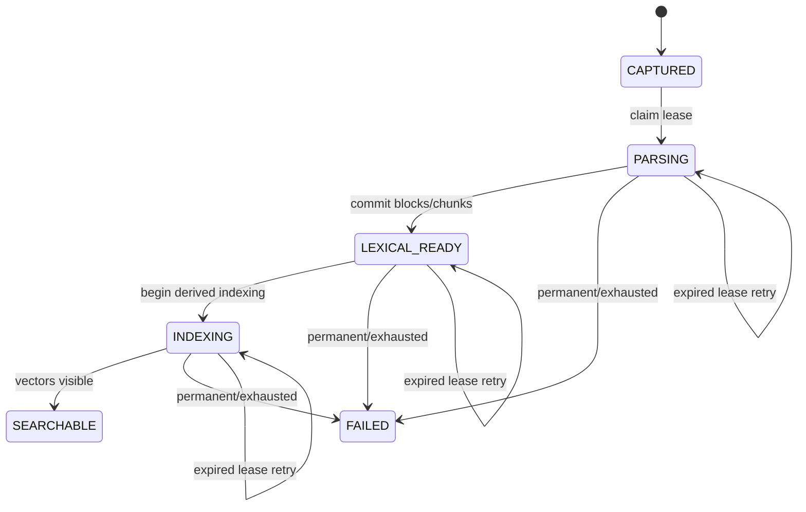

# Investment Research Archive — M1 Contract Freeze

**Status:** Accepted v1 \
**Date:** 2026-09-17 \
**Scope:** M1 capture, parsing, indexing, retrieval, provider usage, tracing, and public API contracts \
**Related:** [M1 implementation plan](./10-m1-implementation-plan.md),
[ADR-0008](./adr/0008-application-owned-ai-and-vector-adapters.md),
[ADR-0009](./adr/0009-stable-source-anchors.md), and
[M1 fixture manifest](../fixtures/m1/manifest.yaml)

## 1. Purpose

This document freezes the cross-module contracts that must remain internally consistent while M1
is implemented. It defines application-owned values and behavior, not provider SDK shapes.

M1 remains a local, loopback-only, fixed-owner slice for public or synthetic English content. It
does not add authentication, shared use, private-data approval, production deployment, RRF,
reranking, durable outbox delivery, reconciliation, or agentic orchestration.

Generated OpenAPI artifacts change only when the owning runtime contract is implemented. The
examples below are the accepted target contract; generated files must never be edited by hand.

## 2. Fixed M1 configuration

| Concern                    | M1 value                                                                  |
| -------------------------- | ------------------------------------------------------------------------- |
| Pasted-text maximum        | 100,000 Unicode code points and the existing configured byte limit        |
| Structure-block maximum    | 4,000 Unicode code points                                                 |
| Chunk mapping              | Exactly one chunk per structure block; chunk text equals block text       |
| Embedding model            | OpenAI `text-embedding-3-small`, 1536 dimensions                          |
| Lexical config version     | `m1-english-lexical-v1`                                                   |
| Embedding config version   | `openai-text-embedding-3-small-1536-v1`                                   |
| Embedding batch            | At most 16 inputs and 32,000 total Unicode code points                    |
| Lane candidates            | At most 20 lexical and 20 dense candidates                                |
| Selected context           | At most 8 unique chunks and 24,000 total Unicode code points              |
| Generator                  | OpenAI `gpt-5.6-terra`, low reasoning, strict structured output, no tools |
| Generated answer           | At most 8 statements and 2 evidence references per statement              |
| Dense index                | Pinecone Serverless BYOV, cosine, 1536 dimensions, `aws/us-east-1`        |
| Dense-index config version | `pinecone-serverless-cosine-1536-aws-us-east-1-v1`                        |
| M1 selector                | Deterministic lexical-first round-robin with chunk-ID deduplication       |
| Selector config version    | `m1-lexical-first-round-robin-v1`                                         |
| Normal CI                  | Deterministic adapters, no provider network, credentials, or spend        |
| Live smoke                 | Explicit opt-in and bounded by `fixtures/m1/manifest.yaml`                |

Each value is carried by an immutable application configuration version. Changing a value creates a
new version; it never silently changes the meaning of an existing processing or retrieval record.

## 3. Capture and original access

### 3.1 Public endpoints

```text
POST /api/v1/documents       multipart/form-data PDF capture
POST /api/v1/documents/text  application/json pasted-text capture
GET  /api/v1/documents/{document_id}/versions/{version_id}/original
```

The PDF endpoint keeps its existing multipart contract. The text endpoint accepts:

```json
{
  "title": "Northstar Grid Analytics Ltd. - FY2026 Capacity Update",
  "language": "en",
  "published_at": "2026-07-22T00:00:00Z",
  "available_at": "2026-07-22T00:00:00Z",
  "text": "Exact submitted text"
}
```

Rules:

- unknown JSON fields are rejected;
- `title` and timestamps use the existing document metadata rules;
- M1 accepts English (`en`) only while preserving the language field for later expansion;
- `text` must contain visible content, contain no NUL code point, and fit both the 100,000-code-point
  limit and the configured request-byte limit;
- newline normalization, strict UTF-8 encoding, checksums, and media type follow ADR-0009;
- PDF and text inputs are separate endpoints; mixed or ambiguous submissions are rejected;
- neither endpoint accepts `workspace_id`, storage keys, checksums, processing state, or configuration
  versions from the client.

Both endpoints return the existing `DocumentAccepted` shape with server-created document, version,
processing-run identifiers, `CAPTURED`, and a status URL. Text capture uses the same
store-first/commit-second compensation flow and workspace-scoped immutable object key as PDF
capture.

The original endpoint authorizes and integrity-checks both media types. It returns
`application/pdf` for PDF or `text/plain; charset=utf-8` for text, with private no-store caching,
`nosniff`, an inline server-generated safe filename, and no direct object-storage URL.

### 3.2 Application inputs

The Documents module owns a discriminated capture input:

```text
PdfCaptureInput
  kind = PDF
  original filename
  submitted media type
  metadata
  bounded binary stream

PastedTextCaptureInput
  kind = PASTED_TEXT
  metadata
  exact submitted Unicode string
```

Normalization produces one internal `PreparedOriginal` containing media type, safe filename,
normalized byte stream, byte size, SHA-256 checksum, and capture metadata. The common persistence
service receives only this prepared form.

## 4. Parser, blocks, and chunks

### 4.1 Parser protocol

M1 introduces `parser-protocol.v2`; it does not reinterpret `parser-protocol.v1`. The request carries
only non-secret configuration and one raw original body:

```text
ParserRequestV2
  schema_version = parser-protocol.v2
  media_type = application/pdf | text/plain
  parser_version
  parser_config_version
  max_input_bytes
  max_extracted_characters
  max_pdf_pages when media_type = application/pdf
  max_block_characters = 4000
```

The response is a discriminated union:

```text
ParsedPdfDocument
  kind = PDF
  physical_page_count
  ordered parsed blocks with PDF_PAGE locators

ParsedTextDocument
  kind = PASTED_TEXT
  ordered parsed blocks with TEXT_PASSAGE locators
```

Each parsed block contains its ordinal, block type, exact text, and the source-relative range defined
by ADR-0009. The parser rejects an empty visible result, invalid UTF-8, non-canonical text newlines,
unsupported media, malformed PDFs, invalid ranges, non-contiguous ordinals, and all configured
limit violations.

Each parse executes in a terminable child process rather than an in-process thread. The parser
enforces bounded concurrent children and a hard wall-clock deadline below the worker HTTP deadline,
leaving a fixed response and cleanup margin. At the deadline it terminates and reaps the child,
returns only a safe timeout failure, and remains able to serve the next valid request. Client
disconnect or cancellation does not allow parsing to continue without that same server-owned bound.
Tests use a deliberately blocking parser implementation to prove termination, reaping, capacity
recovery, and successful handling of the following request.

### 4.2 Deterministic M1 block policy

For a new M1 processing run:

1. PDF physical page numbers remain one-based and blank pages still count.
2. Visible PDF page text and canonical pasted text are divided at blank-line paragraph boundaries.
3. A range begins at its first visible code point and ends immediately after its last visible code
   point; excluded separator whitespace remains part of the immutable original but not a block.
4. A paragraph above 4,000 code points is split at the last whitespace at or before the limit.
5. If no such whitespace exists, it is split exactly at 4,000 code points.
6. Splits do not overlap, reorder, normalize, or duplicate source text.
7. M1 emits `PARAGRAPH` unless the parser has deterministic source evidence for another existing
   block type.

Every emitted block must satisfy:

```python
block.text == canonical_source[block.start_character:block.end_character]
```

For PDF, `canonical_source` is the parsed text of the named physical page. For pasted text, it is the
complete normalized original.

M1 creates one chunk for each block. The chunk text is identical to block text and retains the
single `structure_block_id`. This avoids a second offset system. More advanced overlap or
multi-block chunking requires a later version and must not rewrite existing blocks or citations.

Historical M0 PDF blocks and chunks remain unchanged. Newly processed PDFs use the M1 parser and
chunk configuration versions.

## 5. Processing lifecycle and job behavior



`LEXICAL_READY` and `INDEXING` are non-terminal M1 states. They retain an owned lease and have no
`completed_at`. `SEARCHABLE` and `FAILED` are terminal, clear the lease, and require
`completed_at`. Only `FAILED` carries a bounded sanitized `error_summary`.

The existing `processing-job.v1` message remains sufficient because it carries only trusted
workspace and processing-run identifiers plus its deterministic idempotency key. Redelivery reloads
canonical state and:

- reparses only `CAPTURED` or an expired `PARSING` attempt;
- resumes from active canonical chunks for expired `LEXICAL_READY` or `INDEXING`;
- acknowledges `SEARCHABLE` without repeating work;
- refuses a live lease owned by another attempt;
- moves to `FAILED` only for a permanent failure or exhausted attempt limit.

Parsing, embedding, and Pinecone calls occur outside database transactions. State claims and
transitions use short transactions with row locking and lease-owner checks.

The retained M0 deterministic regression path may still exercise lexical-only research at
`LEXICAL_READY`. The M1 product path admits documents only at `SEARCHABLE`.

## 6. Embedding and dense-index contracts

### 6.1 Provider-neutral ports

`EmbeddingProvider` continues to accept ordered, uniquely correlated application inputs. M1 adds:

```text
DenseIndexWriter.upsert(context, request) -> DenseIndexWriteResult
DenseIndexWriter.fetch_visible(context, vector_ids) -> visible_vector_ids
DenseRetriever.retrieve(context, query) -> DenseRetrievalHit[]
```

The application passes `WorkspaceContext`; provider namespaces are derived inside the adapter and
cannot be supplied by an HTTP client or queue payload.

Embedding results must contain exactly one vector per input, in request order, with the same input
identifier and configuration version. Every vector must have exactly 1536 finite numbers. Missing,
extra, duplicate, reordered, wrong-version, wrong-dimension, NaN, or infinite results fail closed
before Pinecone is called.

### 6.2 Deterministic Pinecone identity

The application derives:

```text
namespace = "ws-" + workspace_id.hex
vector_id = "v1:" + sha256(
  workspace_id + ":" + chunk_id + ":" + embedding_config_version
).hexdigest()
```

The exact UTF-8 serialization uses canonical lower-case UUID text and literal colon separators.

Pinecone metadata is limited to:

- `chunk_id`;
- `document_version_id`;
- `chunk_set_id`;
- `embedding_config_version`;
- `dense_index_config_version`.

It contains no raw text, title, filename, question, prompt, answer, user data, credential, active
flag, or authorization decision. PostgreSQL remains authoritative for every returned identifier.

After an upsert, the worker performs bounded fetch-based readiness checks for the deterministic IDs.
It marks the run `SEARCHABLE` only when every active chunk ID is visible. A readiness deadline is a
retryable indexing failure; redelivery safely overwrites the same vector IDs.

### 6.3 Timeouts and retry ownership

Provider SDK retries are disabled. The application is the only retry owner:

| Operation                    | Per-attempt timeout |                   Maximum attempts |
| ---------------------------- | ------------------: | ---------------------------------: |
| Document/query embedding     |          30 seconds |                                  2 |
| Pinecone upsert/query/fetch  |          20 seconds |                                  2 |
| Pinecone readiness sequence  |    30 seconds total | bounded polling, no nested retries |
| Answer generation            |          60 seconds |                                  1 |
| Statement-support evaluation |          30 seconds |                                  1 |

Only classified transport, timeout, rate-limit, and transient service failures are retryable.
Authentication, permission, schema, dimension, malformed output, invalid request, budget, and
canonical-validation failures are permanent. No operation multiplies application attempts with SDK
attempts.

## 7. Dual-lane retrieval and context selection

An M1 `RetrievalRun` records:

- mode `DUAL_LANE`;
- exact query and canonical normalized query;
- filter snapshot;
- lexical, embedding, dense-index, and selector configuration versions;
- lexical and dense candidate limits;
- final context limit;
- start and completion times.

The two lanes execute independently:

1. PostgreSQL returns already eligible lexical hits in descending lexical rank.
2. OpenAI returns one query embedding.
3. Pinecone returns dense identifiers and finite similarity scores from the trusted workspace
   namespace.
4. Every dense hit is reloaded from PostgreSQL and rejected unless workspace, active document
   version, lifecycle, processing state, chunk set, temporal filters, and configuration versions are
   eligible.

All accepted lane candidates are persisted with their own `origin`, origin-local `rank`, and raw
score. The same chunk may therefore have one `LEXICAL` and one `DENSE` candidate record. Raw scores
from different origins are never compared.

The selector produces model context as follows:

1. read lexical rank 1, then dense rank 1, lexical rank 2, dense rank 2, and so on;
2. keep the first occurrence of each canonical `chunk_id`;
3. record `selection_rank` on the candidate that supplied that occurrence;
4. stop before exceeding 8 chunks or 24,000 code points;
5. never truncate a chunk; skip a chunk that would exceed the remaining character budget.

`selection_rank` is separate from the existing origin rank and the M4 `fused_rank`. Persisting both
lane records preserves whether one or both lanes found a chunk, while generation receives each
canonical chunk at most once.

M1 performs no RRF, score normalization, reranking, query rewriting, or conversation-derived
filtering.

## 8. Generation, support evaluation, and evidence

Generation receives only:

- the research-request identifier;
- the bounded exact question;
- up to 8 selected canonical sources with safe identifiers and exact chunk text;
- the strict output schema and versioned application prompt.

The OpenAI request uses `gpt-5.6-terra`, low reasoning, `store=false`, no tools, no background mode,
and a strict structured-output schema. Provider output remains an `UnvalidatedGeneratedAnswer`.
The application adapter returns it inside `AnswerGenerationResult` together with validated,
content-free `ProviderUsage`; no SDK response object crosses the provider boundary.

An answered proposal contains no more than 8 statements and 2 evidence references per statement.
Each reference names only a supplied retrieval-candidate ID and a block-local half-open range. An
insufficient proposal contains no statements or citations and names the missing information.

Statement support is evaluated separately with its own configuration, prompt, timeout, and usage
record. The application first reads proposed canonical sources in a short transaction, then calls
the support evaluator with no answer transaction open. The support evaluator cannot authorize a
source. In a new answer transaction, the server reloads current sources and re-runs all canonical
workspace, active-version, processing-state, temporal, retrieval-candidate, exact-span, support, and
coverage checks. A recorded support decision may be reused only for the same statement and exact
evidence texts; the provider is not called again inside that transaction.

Only the accepted aggregate is persisted and mapped to public answer events. Model tokens or partial
statements are never streamed before validation. Evidence locators and source-viewer behavior follow
ADR-0009.

## 9. Provider usage and cost records

PostgreSQL owns one immutable provider-operation identity with controlled lifecycle updates:

```text
ProviderOperation
  id
  workspace_id
  correlation_id
  research_request_id | processing_run_id
  operation
  provider
  model
  configuration_version
  state = STARTED | SUCCEEDED | FAILED
  reserved_cost_micro_usd
  actual_cost_micro_usd
  input_units
  output_units
  started_at
  completed_at
  duration_ms
  trace_id
  safe_error_code
```

Exactly one of `research_request_id` or `processing_run_id` is required. `operation` is one of
`DOCUMENT_EMBEDDING`, `QUERY_EMBEDDING`, `ANSWER_GENERATION`, or `STATEMENT_SUPPORT`.

Before a paid call, the application commits `STARTED` with the maximum reserved cost allowed by the
bounded request. Budget checks include completed actual cost plus active reservations. After the
call it records provider-reported units where available, application-estimated cost, duration, and
`SUCCEEDED` or a safe `FAILED` category in a separate short transaction.

The local M1 runtime hard-caps all paid provider operations together at `5,000,000` micro-USD per
workspace and UTC month. A deployment may configure a smaller value but not a larger one. If a
failed attempt reports no trustworthy usage, its full reservation becomes actual cost so timeouts
or malformed responses cannot silently release potentially spent budget.

Costs are integer micro-US dollars, never binary floating point. Pricing inputs are versioned and
time-stamped. Provider usage records contain no request body, response body, prompt, question,
source text, exact evidence, filename, or credential. A failure to reserve budget prevents the
provider call; a failure to finalize usage fails the product operation visibly rather than hiding
unrecorded paid work.

The M1 live-smoke runner additionally enforces every request, token, vector, query, plan, cleanup,
and total-spend limit in the frozen fixture manifest.

## 10. Trace context

OpenTelemetry supplies in-process W3C trace context through the application-owned
`OperationTracer`. M1 configures no exporter and no LangSmith integration.

Approved span names are:

```text
document.capture
processing.parse
processing.index
embedding.document
embedding.query
pinecone.upsert
pinecone.query
research.retrieve
research.generate
evidence.evaluate_support
evidence.validate
```

Approved attributes are safe identifiers, configuration versions, provider/model names, operation
kind, lifecycle state, bounded counts, duration, outcome, and safe error category. Questions,
prompts, original text, chunk text, evidence text, generated text, filenames, headers, URLs with
credentials, and exception messages are forbidden.

Queue and internal HTTP propagation use headers rather than business payload fields. Malformed
incoming context is ignored and replaced, never trusted as authorization. Tracing failure never
changes a canonical product result. The local trace ID is copied to the provider-operation record
for correlation.

## 11. Public response contracts

### 11.1 Processing status

`ProcessingRunResult.state` becomes:

```text
CAPTURED | PARSING | LEXICAL_READY | INDEXING | SEARCHABLE | FAILED
```

No provider error text is exposed. `FAILED` returns only the bounded sanitized summary already
owned by the canonical run.

### 11.2 Evidence result

The evidence response retains block-relative offsets and adds the ADR-0009 locator union:

```json
{
  "evidence_span_id": "00000000-0000-4000-8000-000000000001",
  "document_id": "00000000-0000-4000-8000-000000000002",
  "document_version_id": "00000000-0000-4000-8000-000000000003",
  "start_character": 0,
  "end_character": 94,
  "exact_text": "The primary constraint on new customer deployments is a shortage of high-voltage transformers.",
  "text_sha256": "42e268188a9227904fb39c5e4f6b28edb55e71cbbfab2509d8cde798dd8de978",
  "locator": {
    "kind": "TEXT_PASSAGE",
    "start_character": 185,
    "end_character": 279
  },
  "viewer_url": "/sources/00000000-0000-4000-8000-000000000001"
}
```

For PDF, `locator` is `{"kind": "PDF_PAGE", "page": 2}`. Unknown locator variants fail contract
validation.

### 11.3 Research stream

The existing SSE event names and ordering remain:

```text
research.progress(RETRIEVING)
research.progress(GENERATING)
research.progress(VALIDATING)
answer.statement + answer.citation
answer.completed
```

or one terminal `answer.insufficient` / `research.failed`. Statements and citations are emitted only
after the complete answer has passed validation. M1 adds safe error code `PROVIDER_UNAVAILABLE`;
provider authentication, rate-limit, timeout, refusal, and schema details remain internal safe
categories.

## 12. Deterministic and live verification boundaries

Normal tests inject deterministic implementations for embeddings, dense indexing/retrieval,
generation, support evaluation, usage pricing, and tracing. They use fixed vectors and typed
responses, never branch on hidden network state, and prove malformed-provider behavior explicitly.

Live tests:

- require an explicit command and explicit fixture-manifest opt-in;
- accept only the frozen `public_synthetic` fixtures;
- require the exact approved provider/model/index configuration;
- preflight credentials, Starter-plan assumptions, request/token/cost ceilings, and cleanup scope;
- create deterministic, uniquely prefixed derived resources;
- stop before a call that would exceed a bound;
- remove only resources carrying the exact run prefix;
- report safe counts, usage, cost, and outcome without raw fixture or model content.

Live checks are compatibility evidence only. They never replace deterministic correctness,
workspace-isolation, citation, failure, migration, or API-contract tests.

## 13. Implementation ownership

| Contract                                                | Owning module |
| ------------------------------------------------------- | ------------- |
| Capture inputs, normalization, original metadata        | Documents     |
| Parser protocol, blocks, chunks, processing lifecycle   | Processing    |
| Embedding, dense index, retrieval runs, selection       | Search        |
| Generation proposal and context bounds                  | Research      |
| Support evaluation and canonical citation validation    | Evidence      |
| Provider usage, pricing versions, and trace correlation | Operations    |
| HTTP, SSE, and OpenAPI mapping                          | API           |
| Exhaustive locator rendering                            | Frontend      |

Modules communicate through these application-owned contracts. Provider SDK objects, responses,
exceptions, retry settings, or identifiers do not cross into domain or public API models.

Step 0 is complete only when this document, ADR-0008, ADR-0009, the M1 fixture manifest, and the M1
implementation plan agree. Step 1 may then implement the text and locator subset without inventing
new cross-module semantics.
