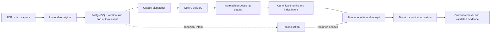

# Investment Research Archive — M2 Implementation Plan

**Status:** Step 0 accepted; Step 1 storage, claims, and bounded drain implemented; runtime activation/repair pending

**Date:** 2026-10-01

**Baseline updated:** 2026-10-14

**Milestone:** M2 — Reliable ingestion and lifecycle

**Deletion-policy update (2026-10-12):** The owner approved the local permanent-deletion path in
[ADR-0019](./adr/0019-permanent-local-document-deletion.md), including complete dependent-answer
removal and detached cost retention. Its no-restoration policy supersedes every older restore or
30-day recovery proposal in this draft. The local schema, API, worker purge, and confirmed bulk
deletion UI are now implemented. M2 extends their durable delivery and repair; this does not accept
the full lifecycle gate or replace the still-pending live Pinecone purge verification. ADR-0021
adds the owner-approved content-free replay marker without retaining deleted source metadata.

**Accepted starting point (2026-10-14):** The
[M1.5 closeout](./13-m1-5-rag-quality-plan.md#local-acceptance-and-m2-handoff-2026-10-14)
records successful hosted project CI, the owner-confirmed working website, and the bounded local
RAG profile disposition. Preserve those contracts and their quality limits. This document updates
the inherited baseline. Step 0 has now frozen the additive contracts and bounded Step 1 ownership.

**Sources of truth:** [Delivery plan](./05-delivery-plan.md),
[M1-to-M2 handoff](./10-m1-implementation-plan.md#81-m1-to-m2-handoff),
[M1.5 RAG quality plan](./13-m1-5-rag-quality-plan.md),
[domain model](./03-domain-model.md), [security and operations](./04-security-and-operations.md),
and accepted [ADRs](./adr/README.md). M1's frozen contracts remain in
[11-m1-contracts.md](./11-m1-contracts.md); this plan extends them rather than rewriting them.
The accepted additive technical contracts are in [15-m2-contracts.md](./15-m2-contracts.md).
They define implementation requirements, not endpoints or settings already available at runtime.

## 1. Outcome and boundaries

M1 already captures one PDF or pasted-text original, processes it asynchronously, searches the
current eligible content, and produces a validated answer with an exact source location. The local
research form can ask about saved eligible documents without another upload. Accepted local M1.5
adds the default RRF/source-ID/document-attribution path. Its approved usability follow-ups provide
a bounded catalog, original views, multi-document selection, and permanent deletion. They do not
complete M2's lifecycle responsibilities. M2 makes the path reliable when imports, workers,
providers, versions, and deletion do not proceed perfectly.

The M2 exit gate is the one in the delivery plan: replaying any job or outbox event produces the
same final canonical state, while deleted or inactive content cannot become evidence even if stale
vectors remain. The existing PDF, pasted-text, citation, insufficient-answer, workspace-isolation,
provider-failure, recovery, and cleanup gates must keep passing.

M2 does **not** add broader archive discovery, companies, watchlists, metadata filters, new RRF or
reranking behavior, conversation memory, authentication, public hosting, or agent workflows. Preserve
the existing catalog rather than rebuild it. RRF/source IDs are the accepted M1.5 local default;
reranking remains an opt-in experiment. The remaining features retain their M3–M9 owners. The
fixed local owner and loopback-only runtime remain in force; only approved public or non-sensitive
material may reach external AI providers.

## 2. Existing contracts and the M2 delta

| Boundary    | Inherited local baseline                                                                                                      | M2 extension                                                                                                                               |
| ----------- | ----------------------------------------------------------------------------------------------------------------------------- | ------------------------------------------------------------------------------------------------------------------------------------------ |
| Capture     | A new `Document`, version 1, immutable original, and `ProcessingRun` are recorded together; queue publication follows commit. | Multiple PDFs, later immutable versions, exact-duplicate provenance, and a durable dispatch event in the capture transaction.              |
| Processing  | One leased `ProcessingRun` resumes parsing or indexing after redelivery.                                                      | A durable `Job` view and independently retryable `ProcessingStage` attempts expose safe failure and repair history.                        |
| Dense index | Deterministic vector IDs and bounded visibility checks precede `SEARCHABLE`.                                                  | Durable index intent and receipts explain partial writes; reconciliation repairs missing, stale, and orphaned vectors.                     |
| Activation  | One current document version and active chunk set are used for new retrieval.                                                 | A candidate version or reprocessing run stays inactive until its complete derived output is ready; one PostgreSQL transaction promotes it. |
| Catalog     | Bounded current-document listing, original views, and explicit multi-document research selection.                              | Preserve these contracts while adding the owning steps' version, stage, and retry controls; no broader M3 discovery work.                    |
| Deletion    | Confirmed batch admission, immediate exclusion, exact scoped purge, dependent-answer removal, detached accounting, and bounded worker retries under ADR-0019. | Add durable publication and periodic reconciliation, and verify interrupted cleanup and live Pinecone absence without changing the retention policy. |

The intended flow is:



PostgreSQL and immutable object storage remain canonical. Redis transports work; Pinecone remains
rebuildable. A queue acknowledgement, vector match, or receipt is never authorization proof.
External calls and parsing occur outside database transactions. Workspace, current-version,
active-output, deletion, and temporal eligibility are rechecked before a result becomes evidence.

## 3. Approved product policies and technical freeze

The owner approved the five proposed product/operational policies on 2026-10-14; permanent
deletion was already accepted in ADR-0019. These are target M2 rules, not claims of implemented
behavior. The owner subsequently approved the initial limits and content-free replay protection.
`15-m2-contracts.md` and accepted ADR-0010/ADR-0020/ADR-0021 freeze the technical boundaries for
implementation. Runtime activation still requires each owning step's verification gate.

1. **Version activation.** Keep `Document.current_version_id` as the active version for new
   research. Capturing version 2 records a pending immutable version without moving that pointer.
   Promote it only after its required processing and index visibility pass. A failed candidate
   leaves version 1 searchable. New documents may point at their first version before it becomes
   searchable, as M1 already does; processing state still prevents premature retrieval.
2. **Duplicate and request replay semantics.** Scope exact content-hash detection to one workspace
   and media type. A separate intentional import retains its own document/version and records a
   `DuplicateRelation`; it is never silently merged. Repeating the _same request idempotency key_
   returns the same result or a safe conflict for different input, rather than creating another
   original. Do not deduplicate physical originals across workspaces.
3. **Batch behavior.** Bound both per-file and total request size/count. Treat each accepted PDF as
   its own capture transaction and return a result for each item; one rejected file must not hide
   successfully captured siblings. Use the frozen partial-success shape and replay behavior in
   `15-m2-contracts.md` before changing the frontend.
4. **Historical citation access.** Old `EvidenceSpan` identities, source offsets, and immutable
   versions must survive reprocessing and version promotion. Current M1 source opening rejects an
   inactive version. The owner approved a separate authorized historical-answer view of retained
   evidence; keep it separate from _new-answer_ eligibility. Do not loosen the
   existing endpoint silently. Pending-deletion and purged content must never be exposed through it.
5. **Purge retention matrix.** ADR-0019 freezes source-bound answer removal, exact-target cleanup,
   content-free receipts/accounting, and backup-expiry boundaries for the local path. There is no
   application restoration period. ADR-0021 additionally retains only content-free request identity
   to prevent replay resurrection. M2 must verify delivery/reconciliation without weakening source
   removal; a public or multi-user retention policy needs separate review.
6. **Periodic repair trigger.** The owner approved one separately run Celery Beat scheduler using the existing
   broker and worker image, not an embedded worker `-B` or a new backing service. PostgreSQL remains
   the work authority, so duplicate or missed ticks are harmless; a bounded operator command can
   drain due work if the scheduler is unavailable. Validate the Compose and CI topology before
   activating this process addition. Approval does not authorize deployment or credential changes.

No new production dependency is approved by this plan. If implementation needs one, follow the
repository's version, security, release-age, compatibility, and explicit-approval rules first.

### 3.1 Step 0 policy review — owner-approved (2026-10-14)

The first Step 0 work block compared these choices with accepted ADRs and current implementation.
The owner then approved the five proposed policies and, after the technical draft, accepted the
initial limits and content-free replay protection. Section 3.3 records Step 0 completion. That
acceptance does not activate public schemas or scheduler wiring. No runtime code, migration,
provider call, or existing archive data changed in this review.

| Decision | Recommended user-visible or operational behavior | Approval boundary |
| --- | --- | --- |
| Version activation | Keep the old searchable version available while its replacement is pending. Switch the current version and active derived output together only after required processing succeeds. A failed replacement does not hide the old version. | Policy approved; preserve expected-state checks and reject promotion after deletion admission. |
| Replay versus intentional duplicates | Repeating the same scoped request key and input returns the original capture result; changed input conflicts. A separately submitted import remains a separate archive item and receives exact-duplicate provenance. | Accepted, including ADR-0021 content-free protection after purge; no silent merge, cross-workspace hash lookup, or shared physical original. |
| Multiple uploads | Give each accepted PDF its own result and processing run. Item-level validation failure does not roll back accepted siblings; whole-request size/count violations are rejected before any capture. Retry identities belong to individual items. | Additive envelope, limits, and status codes accepted in `15-m2-contracts.md`, not implemented. |
| Historical citations | Allow an explicitly historical, workspace-authorized view of evidence used by a retained accepted answer, even after a newer version becomes current. Label the old version; do not admit it to new retrieval. Pending or completed deletion denies access immediately. | Accepted ADR-0020 narrowly extends ADR-0009 for the new view; source-access tests remain required before activation. |
| Permanent deletion | Keep immediate exclusion, exact scoped cleanup, removal of complete affected answers, detached accounting, and no restoration. | ADR-0019 remains in force with the explicit ADR-0021 replay-record supplement. Durable delivery, repair, and live Pinecone absence verification remain M2 work. |
| Periodic repair | Run one separate Celery Beat scheduler using the existing Celery dependency and worker image. It triggers bounded repair; PostgreSQL decides which work is due. No embedded worker scheduler or new backing service. | Accepted ADR-0010 and `15-m2-contracts.md` define the technical bounds and activation gates before changing Compose. |

The historical-view decision is not permission to browse arbitrary inactive versions or to use
old model output as evidence. Resolve the retained answer-to-span-to-original relationship under
the trusted workspace, retain exact checksums and offsets, and recheck document lifecycle. A
separate contract must cover both evidence metadata and the immutable original download; opening
only the evidence metadata would leave the PDF/text viewer unable to complete the journey.

### 3.2 Compatibility findings and verified existing bounds

These findings are from source inspection, not a new runtime or provider test:

- `modules/documents/application.py` stores an immutable object, commits document/version/run
  metadata, and then calls `_dispatch_processing`. A broker failure is logged and leaves the run
  captured. Step 1 must commit an outbox event with the run, not claim that Redis publication and
  PostgreSQL commit are atomic. Preserve the existing object-first capture boundary.
- `OpenOriginalService.open_for_processing` currently uses
  `DocumentRepository.get_original_artifact_by_version_id`; its shared query requires
  `Document.current_version_id` to match. Pending-version processing therefore needs a separate
  internal read authorized by its canonical processing run, lifecycle, and workspace. Do not
  remove the current-version predicate from shared public reads to make a candidate processable.
- Public original access also uses the current-version query. The evidence route documents a
  current citation view, and ADR-0009 explicitly fails closed for inactive versions. Historical
  answer access must be separately designed and tested, not inferred from immutable storage.
- `ProcessingJobV1` contains only the schema version, workspace ID, run ID, and deterministic
  idempotency key. Reuse that payload in Step 1; an outbox publication receipt is not proof of
  processing completion or exactly-once delivery. Reconciliation must detect lost messages even
  after a successful publication receipt.
- Both existing processing profiles allow three claimed attempts with a 360-second lease.
  `queue/tasks.py` schedules at most two transient retries with backoff capped at 30 seconds and
  jitter. The broker visibility timeout is 420 seconds. These are inherited run/delivery values,
  not automatically valid defaults for new stage leases or outbox attempts.
- Current setting defaults are 25 MiB per original, 250 PDF pages, and 2,000,000 extracted
  characters; pasted-text capture also has a 100,000-character input ceiling. They are not a
  multi-upload total-size/count policy. Keep the existing single-upload paths compatible and
  explicitly freeze additional batch limits rather than inventing environment keys here.
- Preserve the Alembic history through `0012_rag_context_bounds`, existing catalog/selection,
  ID-only purge jobs, and ADR-0019 guards. In particular, an expired processing lease alone does
  not make a document deletable or authorize competing source writes.

Source locations above are relative to `backend/src/investment_research/`. Processing limits are
defined in `modules/processing/application.py`, queue policies in `infrastructure/queue/`, upload
defaults in `settings_models.py`, and the text ceiling in `modules/documents/contracts.py`.

### 3.3 Step 0 acceptance and first implementation boundary (2026-10-14)

The owner approved the product policies, then accepted the proposed initial limits and content-free
replay marker. `15-m2-contracts.md` version 1 and ADR-0010/ADR-0020/ADR-0021 now govern M2
implementation. The fixture catalog defines two immutable source versions and ten offline failure
scenarios; structural verification does not claim the runtime scenarios have passed.

The contract freezes additive HTTP/error shapes, replay scopes, activation expectations, stage/event
states, attempt and lease bounds, source-access/deletion boundaries, and migration/backfill ownership.
Existing `ProcessingRun` remains Step 1's business-work authority. Preserve the Alembic chain through
`0012_rag_context_bounds`, existing evidence and costs, and legacy attempt counts without inventing
per-stage history. No runtime feature or broad M2 acceptance follows from this documentation gate.

The first runtime work block is Step 1's scoped outbox persistence and
capture transaction with focused rollback, workspace-isolation, and duplicate-intent tests. Keep
the existing capture response and frontend unchanged. Subsequent Step 1 blocks add bounded
dispatch/repair, required offline CI and Compose verification, and frontend compatibility checks;
the persistence block alone does not satisfy the Redis-outage recovery gate.

**Contract-draft verification (2026-10-14):** Local checks passed balanced Markdown fences and 55
relative links/anchors across seven documents, valid JSON with two distinct canonical originals,
ten unique lifecycle scenarios, source references, and supplementary-plane Unicode evidence ranges.
`git diff --check`, `pnpm format`, `pnpm lint`, `pnpm typecheck`, and `pnpm test` passed; the latter
includes generated-contract checking and 95 deterministic tests. These checks validate the draft's
structure and unchanged frontend compatibility, not M2 runtime behavior. No application code,
generated OpenAPI schema, migration, dependency, browser, Docker runtime, real archive, secret file,
or paid provider was changed or exercised. That draft verification preceded the owner acceptance
recorded above; it is not a new frontend or runtime execution during closeout.

**Step 0 closeout verification (2026-10-14):** Rechecked ten Markdown documents, 122 relative
links/anchors, all three accepted M2 ADR statuses, the contract fixture metadata, two distinct
canonical originals, ten unique scenario references, and exact Unicode evidence ranges.
`git diff --check` passed. M1.5 changes are limited to current status/handoff wording; historical
quality observations are unchanged. The preceding frontend checks and 95-test result remain
applicable to unchanged frontend sources; they were not rerun in this documentation-only closeout.
No backend, browser, Docker, live provider, or actual purge behavior is claimed verified by Step 0.

## 4. Planned repository delta

These are target ownership locations, not files already present. Names and physical tables are
confirmed against the frozen Step 0 contracts before a migration is written.

| Owner                                                                                 | Intended change                                                                                                                                                                              |
| ------------------------------------------------------------------------------------- | -------------------------------------------------------------------------------------------------------------------------------------------------------------------------------------------- |
| `modules/documents/`               | New-version capture, duplicate provenance, lifecycle transitions, and the existing separate deletion contracts/services/ports. Preserve the original-storage port and ADR-0019 policy. |
| `modules/processing/{domain,contracts,ports,application,persistence}.py`              | Stage state, attempt history, bounded retry/lease ownership, and existing `ProcessingRun` compatibility. Keep parser and provider work outside transactions.                                 |
| `modules/delivery/` (new, confirmed by Step 0)                                       | Typed `OutboxEvent` contracts, scoped repositories, due-event claiming, dispatch, and safe retry policy. `Job` is a later projection, not a second state authority. Application modules use declared ports, not another module's persistence. |
| `modules/search/{ports,indexing,persistence}.py` and `modules/processing/indexing.py` | Durable index intent, receipts, desired-versus-observed reconciliation, and active-output promotion. Pinecone SDK behavior stays behind `infrastructure/search/`.                            |
| `infrastructure/database/{unit_of_work,metadata}.py`                                  | Compose capture, stage, outbox, receipt, and promotion writes in short PostgreSQL transactions. Repositories never commit independently.                                                     |
| `infrastructure/queue/`, `bootstrap.py`, `compose.yaml`                               | Thin event/task adapters, one repair trigger, process wiring, and health checks without another business service.                                                                            |
| `api/routes/{documents,processing}.py`                                                | Version/batch capture, status/history, retry, reprocess, and permanent-deletion contracts. Preserve the separately approved local catalog; no broad company discovery API. |
| `backend/migrations/versions/`                                                        | Sequential Alembic revisions after the current inherited head `0012_rag_context_bounds`; preserve `0009` reranking, `0010`/`0011` deletion, and `0012` context-tuning history. Each work block includes constraints, backfill/compatibility, indexes, and an upgrade test. No `create_all()` in application code. |
| `frontend/src/features/archive/`                                                      | Minimal batch/version, stage/error/retry, reprocess, and permanent-deletion controls in their owning steps. Preserve the approved local catalog; M3 owns broader archive discovery. |
| `backend/tests/`, `frontend/`, `.github/workflows/ci.yml`, runtime verifiers          | Offline correctness and PostgreSQL/Compose failure gates; live providers remain bounded, optional, and public-synthetic only.                                                                |

At minimum, Step 0 reviews the need for `jobs`, `outbox_events`, `processing_stages`, stage-attempt
history, `duplicate_relations`, request-idempotency records, index intents/receipts,
`reconciliation_runs`, and document lifecycle fields. A table is added only when it owns durable
state that the existing models cannot represent without ambiguous authority.

## 5. Implementation sequence

Each numbered step is one bounded implementation step. Within it, complete backend behavior and
its focused tests first, then required CI checks, then real frontend behavior, and finally its full
gate. If there is no frontend change, run the existing frontend checks without adding artificial
UI files. Pause between coherent work blocks for review as required by `AGENTS.md`.

### Step 0 — Freeze contracts and compatibility (documentation gate)

- Decide the six contracts in Section 3, including public API schemas and safe error categories.
- Freeze stage names, retry classes/ceilings, event schema and idempotency keys, receipt identity,
  lifecycle timestamps, and the purge retention/FK matrix. Derive limits from existing settings;
  do not invent unverified configuration names or numeric values in documentation.
- Specify migration/backfill behavior for M1 runs and answers. Do not invent historical stage
  attempts that never occurred; mark legacy state honestly.
- Preserve the already implemented catalog/selection and ADR-0019 deletion contracts, detached
  accounting, and the Alembic chain through `0012_rag_context_bounds`. Extend durable delivery and
  repair instead of introducing a second deletion workflow or rewriting historical migrations.
- Add synthetic fixtures for two versions, exact duplicates, partial index visibility, stale
  vectors, worker loss, interrupted permanent deletion, and a known historical citation.

**Gate:** Contracts, migration ownership, security implications, and the first implementation work
block are reviewable without any M2 runtime code. Resolve conflicts with accepted ADRs before Step 1.

**Accepted on 2026-10-14:** Section 3.3 records the owner decision, frozen contracts, synthetic
fixture boundary, and first work block. Runtime checks remain attached to Steps 1–6, not claimed
as completed Step 0 tests.

### Step 1 — Durable outbox delivery for the existing M1 job

**Backend:** Persist one versioned, workspace-scoped `OutboxEvent` in the same transaction as a new
`ProcessingRun(CAPTURED)`. Keep the object-first immutable capture and narrow compensation rule.
Claim due events in bounded PostgreSQL batches with row locking/`SKIP LOCKED`, a short claim lease,
attempt ceiling, safe error class, and deterministic event identity. Publish the existing small
`processing-job.v1` payload outside the claim transaction; mark delivery in another transaction.
A crash between publish and receipt can publish twice, so the current run lease and idempotency
checks remain authoritative. Publication is not proof of worker execution: periodic repair also
re-examines canonical `CAPTURED` runs and expired leases after a grace period, even if an event was
marked published before Redis lost its message. Add one periodic drain trigger plus a narrow manual
repair command.

**CI:** Prove database rollback leaves no event, broker outage leaves due canonical intent, duplicate
dispatch has one effect, competing dispatchers claim disjoint events, expired claims recover, and
Redis loss both before and after a publication receipt eventually processes the captured run.
Verify the scheduler boundary without a live paid provider.

**Frontend:** No new UI. Existing capture and status remain compatible.

**Gate:** Capture succeeds with Redis down; after Redis returns, the run advances without manual
database repair and without duplicate canonical output. The M1 runtime gate still passes.

**Storage work block (2026-10-14):** Implemented the Delivery value/port/table boundary and
cross-module infrastructure repository. PDF/text capture commits one deterministic generation-zero
event with document/version/original metadata and the processing run. Duplicate scoped intent is
idempotent; unknown/foreign reads share absence. Migration `0013_processing_outbox` backfills only
eligible unclaimed captured runs, preserves legacy state/leases, and refuses a downgrade that would
discard intent/history. PostgreSQL readiness now requires that revision.

Canonical document purge cancels and detaches delivery rows before removing runs, preserving only
content-free IDs/counts/error categories/publication times. An uncertain capture commit preserves
its possibly canonical original and produces the existing safe API failure; definitive pre-commit
rollback retains narrow object compensation. Request-key replay and tombstones are not implemented
by this block. Module boundaries remain enforced by the unchanged architecture tests.

Verification: `scripts.verify_backend` passed format/lint/type checks and 2,241 unit tests.
`scripts.verify_postgres` passed empty migration cycling, schema drift checks, legacy-upgrade and
transaction/purge/isolation tests: 247 passed and seven separate SeaweedFS tests skipped.
`pnpm format`, `pnpm lint`, `pnpm typecheck`, and `pnpm test` passed, including generated contracts
and 95 frontend tests. Existing verifier discovery includes the new tests; no paid CI gate is added.
Only isolated PostgreSQL resources were created/removed. No normal archive, browser, production
build, live provider, or full M0/M1/queue runtime journey was exercised in this block.

The existing post-commit Celery fast path remains active; it does not write outbox publication
receipts. No dispatcher, claim/drain command, scheduler, or periodic repair is enabled yet. Pending
intent does not prove the legacy fast path never delivered. Step 1's full Redis-outage/recovery gate
is still open. The next work block adds bounded claiming/publication and receipt fencing before
the separate scheduler/repair and complete runtime gates.

**Claim/receipt work block (2026-10-19):** Added domain-owned fenced transitions, a separate typed
delivery repository/unit of work, and PostgreSQL single-row `FOR UPDATE SKIP LOCKED` claims ordered
by due time/event ID. A claim checks the trusted workspace, active/current document, and untouched
captured run, consumes one publication attempt, and assigns a fresh 30-second token. Started or
terminal legacy work is cancelled as redundant; processing state/attempts are not reset. Expired
delivery claims can be reclaimed up to three total claims; final expiry or transient-attempt
exhaustion is retained as `BLOCKED`. Permanent job failures do not auto-retry.

Separate receipt transactions require the matching unexpired token and recheck source eligibility.
They allow a worker to have started after publication, but cannot overwrite purge cancellation or
a newer claim. No transaction includes a broker call. The new functions are not wired into runtime
dispatch, and no schema, capture response, frontend, provider budget, or scheduler changes here.
The future caller still owns readiness-before-claim, capped backoff/jitter, the 20-target/30-second
sweep, the shared two-second publication deadline, and runtime activation tests.

Existing CI discovery includes the new deterministic transition and PostgreSQL concurrency/fencing
tests. The next block implements the bounded broker adapter and drain orchestration, followed by
repair generations, the separate scheduler, and the complete Redis-loss/M1 runtime gates. Do not
interpret tested receipt primitives as an already-running publication or recovery service.

Verification: `scripts.verify_backend` passed formatting, linting, typing, and 2,256 unit tests.
`scripts.verify_postgres` passed migration cycling, schema drift checks, and 258 integration tests;
seven SeaweedFS-only tests were skipped because their separate verifier was not active. The new
tests cover competing open transactions, rollback, foreign/unknown scope, expired and replaced
tokens, retry/exhaustion, legacy worker start, and purge cancellation. `pnpm format`, `pnpm lint`,
`pnpm typecheck`, and `pnpm test` passed, including contract checking and 95 frontend tests.
The isolated PostgreSQL container, networks, and volume were removed. No paid provider, browser,
normal archive, production build, or full M0/M1/queue runtime journey was exercised. Hosted CI has
not been run or claimed by this local work block.

**Bounded broker/drain work block (2026-10-19):** Added a typed publisher boundary and
`DrainOutboxService`: broker readiness precedes each individual claim; a committed claim is
published outside a database transaction and acknowledged in a separate fenced transaction.
The monotonic sweep inspects at most 20 returned targets in 30 seconds. Each broker operation is
capped at two seconds and the smaller remaining sweep/lease allowance. Known broker unavailability
before claim consumes no attempt; uncertainty after claim records a bounded jittered retry and
stops the sweep. Invalid publication blocks the owned event, while unexpected programming/database
failures propagate instead of silently retrying.

The synchronous Celery adapter runs a disposable Python helper from the existing runtime/dependencies.
Startup and connection/write/read work share the parent-enforced deadline; late success is rejected
and timed-out children are killed/reaped. OS scheduling/reaping can add cleanup latency. A bounded
private stdin pipe contains only broker configuration and the ID-only job; no credentials in argv,
inherited database/storage/provider environment, raw helper output, or environment-file loading.
The helper disables Celery/Kombu hidden retries. Redis authentication errors are configuration errors.
This is an internal adapter, not a new service, dependency, or parser sandbox.

CI coverage extends the existing queue-recovery verifier: its synthetic capture defers legacy direct
dispatch, explicitly drains canonical intent through the bounded adapter, then exercises real worker
loss/recovery and exact permanent cleanup. Normal application capture/bootstrap and purge dispatch
remain unchanged. The operator command, bounded repair generations, scheduler, Redis-loss-before/after-
receipt scenarios, and complete M1 runtime gate still belong to subsequent Step 1 work blocks.

Verification: `scripts.verify_backend` passed formatting, linting, typing, and 2,287 unit tests,
including a real timed-out helper termination and safe failure-output checks.
`scripts.verify_postgres` passed migration cycling, schema drift checks, and 261 integration tests;
seven separate SeaweedFS-only tests were skipped. Drain integration proves claim commit/lock release
before publication, preserved intent after lost acknowledgement, and no attempt consumed on a known
broker outage. `scripts.verify_queue_recovery` passed real Redis publication through the new adapter,
safe rejection of deliberately invalid disposable broker credentials, worker-loss recovery with one
canonical output, and canonical/original purge. The first successful queue run preceded the final
authentication classification; the verifier was repeated with that final path and negative probe.
`pnpm format`, `pnpm lint`, `pnpm typecheck`, and `pnpm test` passed, including generated-contract
checking and 95 frontend tests. No frontend source, dependency, Compose topology, public schema,
provider budget, or normal archive changed. No browser, production frontend build, paid provider,
full M0/M1 journey, or hosted CI execution is claimed. This is still not Step 1's complete
Redis-outage/automatic-repair gate.

**Recovery value-rule block (2026-10-21):** Added only the pure next-generation rule for a
published-but-unstarted delivery candidate. It preserves the old immutable receipt, waits at least
420 seconds from publication, derives the next scoped deterministic identity, and refuses a fourth
generation or non-published/blocked/cancelled intent. This is not canonical eligibility or automatic
repair: the next repository block must lock/recheck active/current unstarted work and the latest
event, retain history, and insert under scoped uniqueness without resetting an existing generation.
No database, broker, scheduler, frontend, public API, or execution-attempt behavior changes here.
Verification: all 12 focused recovery-rule tests passed; `scripts.verify_backend` passed formatting,
linting, typing, and 2,299 unit tests. Existing CI discovery includes the new test file. No database,
Docker, frontend, browser, or live-provider checks were rerun for this pure value-rule change.

**Targeted recovery repository block (2026-10-21):** Added a single-event `recover_unstarted`
operation to the existing delivery transaction. It checks workspace and active/current source,
holds a document SHARE lock compatible with processing's source-write guard, and locks only an
untouched captured run and its exact latest event. Locked rows are skipped without falling back to
older generations. A scoped unique insert retains the previous receipt; repeats return the existing
direct successor without resetting its state/attempts. Superseded, foreign/unknown, premature,
started/terminal, excluded, or exhausted targets do not create intent. The operation neither commits
nor publishes and is not wired to a scanner, scheduler, operator command, or normal capture. Recovery
of expired execution work and full automatic-repair activation remain pending.
Verification: `scripts.verify_backend` passed formatting, linting, typing, and 2,299 unit tests.
`scripts.verify_postgres` passed migration cycling, drift checks, and 272 integration tests, including
11 new recovery cases; seven separate SeaweedFS-only tests were skipped. The disposable database,
networks, and volume were removed. Existing CI discovery includes the tests. No broker, frontend,
browser, live provider, normal archive, or full runtime journey was exercised by this block.

**Bounded recovery scan block (2026-10-21):** Added a content-free, workspace-scoped snapshot
of at most twenty eligible latest published events after the 420-second grace period. Started,
excluded/non-current, exhausted, and superseded work is excluded before the limit; receipt time
and event ID give stable ordering. `RecoverUnstartedOutboxService` closes the snapshot transaction
and requalifies each target through `recover_unstarted` in a separate transaction. Skipped targets
consume a slot. A cooperative thirty-second deadline prevents starting further recovery work, not
an in-flight SQL cancellation guarantee. Prepared counts include idempotently reused successors;
they do not assert new execution or broker delivery. Existing CI discovery includes the new unit
and PostgreSQL tests without another workflow. The normal app, scheduler, operator command,
expired-execution recovery, exhausted-work status, and shared-budget repair/drain coordinator
remain outside this block. Step 1 is still incomplete.
Verification: all seven focused scan unit tests passed. `scripts.verify_backend` passed formatting,
linting, typing, and 2,306 unit tests. `scripts.verify_postgres` passed migration cycling, schema
drift checks, and 278 integration tests, including six new scan cases and extended eligibility
checks; seven separate SeaweedFS-only tests were skipped. The isolated database, volume, and
networks were removed. No frontend/browser, broker, live-provider, normal archive, or full runtime
journey checks were rerun for this internal recovery block.

**Expired-execution eligibility block (2026-10-22):** Added only the pure
`ProcessingRun.can_reclaim_expired` snapshot rule. It requires an expired complete execution
lease, unfinished `PARSING`/active `LEXICAL_READY`/`INDEXING`, and remaining attempts under the
existing caller-supplied processing profile. Publication age alone never qualifies running work.
Untouched captured runs, completed historical lexical work, searchable/failed states, live
leases, and exhausted allowances are rejected. The check changes no lease, attempt, processing
state, output, or delivery generation. A newly claimed fence makes its current snapshot ineligible.
The next database recovery block must lock/reload the canonical run and qualify trusted workspace,
active/current source, latest intent, and unchanged execution ownership before preparing bounded
delivery. The snapshot is not authorization. Existing CI unit discovery covers the new file;
database reconciliation, broker/drain integration, scheduler, and normal runtime activation are
not implemented by this block. Step 1 remains incomplete.
Verification: 67 focused processing tests passed, including 39 new eligibility cases.
`scripts.verify_backend` passed formatting, linting, typing, and 2,345 unit tests. No schema,
persistence, broker, frontend, or provider behavior changed; PostgreSQL/Compose, frontend/browser,
and live-provider checks were not rerun for this pure snapshot rule.

**Targeted expired-execution preparation block (2026-10-22):** Added `recover_expired` to
the short delivery transaction. It accepts the expected execution lease ID and existing profile
ceiling, locks/reloads the scoped active/current source and run, applies the expired-execution
rule, and locks the exact latest delivery event. Shared lock/insert helpers keep the existing
unstarted path equivalent. Changed/live fences, completed/exhausted work, excluded/non-current
sources, superseded intent, and locked targets cannot create a generation. The existing 420-second
publication grace is retained alongside execution expiry, so repeated scans cannot immediately
consume all generations while newly published work waits for a worker. Idempotent insertion
retains receipts and all execution fields, without committing or publishing. This is preparation
only: the existing captured-only drain does not yet publish expired-run intent. Bounded expired
scanning, dispatch qualification, shared-budget coordination, exhaustion status, scheduler/operator
wiring, and the full Step 1 gate remain pending. Existing unit/PostgreSQL CI discovery includes
the added tests; no paid provider, frontend, or normal-runtime change is part of this block.
Verification: 59 focused recovery unit tests passed, including eight new delivery-value cases.
`scripts.verify_backend` passed formatting, linting, typing, and 2,353 unit tests after correcting
a test fixture's optional-lease type. `scripts.verify_postgres` passed migration cycling, schema
drift checks, and 293 integration tests, including 15 new expired-recovery cases; seven separate
SeaweedFS-only tests were skipped. The isolated database, volume, and networks were removed.
No broker, browser/frontend, live-provider, normal archive, or full runtime journey was exercised.

**Bounded expired-execution scan block (2026-10-22):** Added a typed content-free candidate
carrying event ID and observed execution lease ID. The new scoped query shares active/current
source qualification, latest published intent, grace, generation ceiling, stable ordering, and
the twenty-target bound with the existing unstarted query. It additionally filters unfinished
leased parsing/indexing work with expired fences and remaining profile attempts before applying
the limit. Completed lexical work, including historical M1 completion, is excluded.
`RecoverExpiredOutboxService` closes the snapshot transaction and rechecks each observed token in
its own `recover_expired` transaction. Changed/skipped work consumes a slot; later execution cannot
be authorized by an earlier token. The cooperative thirty-second deadline stops further work, not
in-flight SQL. Prepared counts do not imply broker delivery or processing completion. Existing CI
unit/integration discovery includes the tests. The captured-only drain, normal app, scheduler,
operator command, exhausted-work status, and shared-budget runtime coordinator remain unchanged;
Step 1 is not complete. This block adds no schema, dependencies, paid calls, or frontend behavior.
Verification: 16 focused scan unit tests passed, including nine new expired-scan cases.
`scripts.verify_backend` passed formatting, linting, typing, and 2,362 unit tests.
`scripts.verify_postgres` passed migration cycling, schema drift checks, and 298 integration tests,
including five new scan cases and extended existing eligibility assertions. Seven separate
SeaweedFS-only tests were skipped. The disposable database, volume, and networks were removed.
No broker, frontend/browser, live-provider, normal archive, or full runtime journey was exercised.

**Opt-in recovery-dispatch block (2026-10-22):** The delivery transaction factory accepts an
explicit existing processing-profile attempt ceiling. Default dispatch preserves unfinished
later-generation intent; opt-in dispatch can claim latest due recovery events after canonical
expiry/source checks. Claims lock the event and run with `SKIP LOCKED` and refresh snapshots;
active/current source SHARE guards fence lifecycle changes. Live recovery work is excluded before
the one-target limit, while source locks defer intent without cancelling it. Generation-zero
legacy work retains its existing redundant-start cancellation. Exhausted execution allowances
block due intent without increasing publication counts or modifying processing state. Terminal
and ineligible work cannot be published. Publication claims keep their own existing ceilings and
leases; the unchanged drain closes the claim transaction before publishing and separately records
receipts, including a fake consumer that has already taken a new execution fence. This explicit
database-factory option adds no environment key, normal runtime activation, schema, dependency,
frontend, or paid call. Existing backend/PostgreSQL CI discovery covers the added tests. Shared
tick orchestration, complete exhaustion status, real Redis-loss verification, scheduler/operator
wiring, and the full Step 1 gate remain pending.
Verification: 31 focused delivery unit tests passed, including five new exhaustion/opt-in cases.
`scripts.verify_backend` passed formatting, linting, typing, and 2,367 unit tests after adding
explicit types for the jointly selected ORM rows. `scripts.verify_postgres` passed migration
cycling, schema drift checks, and 311 integration tests, including 13 new recovery-dispatch cases.
Seven separate SeaweedFS-only tests were skipped. The disposable database, volume, and networks
were removed. Publication/consumer behavior used a recording test adapter, not Redis or a live
provider. No frontend/browser, normal archive, hosted CI, or full runtime journey was exercised.

**Shared phase-budget block (2026-10-22):** Added `OutboxSweepBudget` and moved the existing
twenty-target/thirty-second constants into that application-owned value boundary. Both recovery
services and the drain accept one shared budget and optional smaller per-call limits. Preparations
and returned claims consume separate slots, conservatively even for the same target; skipped,
cancelled, and blocked targets count, while empty lookups do not. Candidate SQL receives the
remaining capped limit. A later phase cannot restart the deadline or allowance; exhausted budget
prevents snapshots, claims, and broker readiness probes. Broker timeouts use shared remaining time.
Already-started SQL and mandatory fenced failure/receipt bookkeeping may complete after the
deadline. Calls without an explicit budget retain standalone behavior. Existing unit and PostgreSQL
CI discovery covers combined budget tests and existing service regressions. This block provides
shared limits, not automatic tick orchestration: the coordinator must pass one instance and
allocate phase capacity before runtime activation. Scheduler/operator wiring, full exhaustion
status, real Redis-loss gates, and the complete Step 1 gate remain pending. No schema, environment
keys, dependencies, paid calls, normal-runtime wiring, or frontend behavior changed.
Verification: 41 focused delivery tests passed, including 14 new shared-budget cases.
`scripts.verify_backend` passed formatting, linting, typing, and 2,381 unit tests.
`scripts.verify_postgres` passed migration cycling, schema drift checks, and 315 integration tests,
including four new shared-budget/SQL-limit cases. Seven separate SeaweedFS-only tests were skipped.
The disposable database, volume, and networks were removed. Publication used a recording test
adapter; no Redis, live-provider, frontend/browser, normal archive, hosted CI, or full runtime
journey was exercised by this block.

**Opt-in repair-coordinator block (2026-10-22):** Added one application-owned pass that composes
unstarted recovery, expired-execution recovery, and delivery with the same twenty-slot/thirty-second
budget. Each preparation category is capped at five; the drain receives the remaining slots,
reserving at least ten for returned claims when both categories fill their allowances. Empty
categories leave more publication capacity. This is not a guarantee of successful publication,
hard SQL cancellation, or end-to-end queue fairness. Slow preparation can exhaust the shared
deadline. Broker outages may leave prepared pending intent, but readiness still precedes every
publication claim. Existing source eligibility, execution fences, publication ceilings, short
transactions, and separate receipts remain authoritative. Results report safe phase observations,
not processing completion; unexpected failures propagate. The trusted composition root must bind
the existing processing-profile ceiling consistently in the coordinator and delivery transaction
factory. Existing unit/PostgreSQL CI discovery covers the new orchestration and isolation tests.
No schema, dependency, environment key, frontend, paid call, normal-runtime wiring, scheduler, or
operator command is added. Full exhaustion status, actual Redis-loss gates, and the complete
Step 1 activation gate remain pending.
Verification: 50 focused delivery tests passed, including nine new coordinator cases.
`scripts.verify_backend` passed formatting, linting, typing, and 2,390 unit tests.
`scripts.verify_postgres` passed migration cycling, schema drift checks, and 317 integration tests,
including the coordinator variant of the mixed-phase budget test and a workspace-isolation case.
Seven separate SeaweedFS-only tests were skipped. The disposable database, volume, and networks
were removed. Publication used a recording adapter; no Redis, live provider, frontend/browser,
normal archive, hosted CI, or complete runtime journey was exercised in this block.

**Real Redis publication-loss verification block (2026-10-22):** The existing queue verifier now
pauses its isolated worker before a deferred-dispatch fixture capture. A test publisher sends a
real message, then reports publication uncertainty before the canonical receipt; exactly one
queued message is removed. The coordinator retries within generation zero and records attempt
two. That acknowledged message is also removed. Repair before grace must be a no-op; an injected
UTC clock advances only this probe beyond the unchanged 420-second grace, preparing and publishing
generation one while retaining the prior receipt and processing snapshot. Repeated repair must
do nothing. No production clock/policy or database timestamps are rewritten, and the monotonic
broker deadline is unchanged. This is an acknowledgement-loss simulation, not an actual
publisher-process crash or stopped Redis-server test. The existing subsequent worker-child loss,
single-output verification, and synthetic permanent cleanup remain required. Failure cleanup
resumes paused services before removing the disposable project. The existing offline CI command
covers the extended gate; its step label now includes outbox loss. No normal runtime or scheduler
is activated. Automatic trigger/operator wiring, full exhaustion status, actual broker-outage
and expired-execution coordinator gates, and the complete Step 1 acceptance remain pending.
Verification: 16 focused queue/coordinator unit tests and the full `scripts.verify_backend` gate
passed, including formatting, linting, typing, and 2,393 unit tests. The extended
`scripts.verify_queue_recovery` passed locally against real isolated PostgreSQL, Redis, parser,
Celery worker, and SeaweedFS: publication-loss repair, worker-loss reclaim on attempt two, exactly
one expected fixture output, and completed synthetic original/canonical purge. Its unique project,
volumes, and networks were removed successfully. No paid provider, browser/frontend, normal archive,
hosted CI, separate PostgreSQL integration suite, or full M0/M1 runtime journey was exercised.

**Stopped-Redis capture verification block (2026-10-22):** The existing queue gate now stops only
its disposable Redis service after pausing the worker/parser. The real capture service preserves
the synthetic original, run, and generation-zero outbox intent with legacy dispatch explicitly
deferred. Two bounded coordinator passes must report `BROKER_UNAVAILABLE` and leave the processing
snapshot, pending intent, and both attempt counters unchanged. After Redis restarts and passes
health checks, a second probe selects that same scoped captured run; it does not recapture or
repair rows manually. The retained intent then enters the existing real message-loss, worker-loss,
single-output, and permanent-cleanup gates. Unit tests extend orchestration/failure cleanup coverage,
and the existing CI command includes the new scenario. This is an explicitly invoked application
service test, not proof of the normal HTTP capture path during outage or periodic automatic repair.
No normal runtime, scheduler, credentials, attempt policy, or paid provider behavior is changed.
Scheduler/operator wiring, full exhaustion status, expired-execution coordinator verification,
and complete Step 1 acceptance remain pending.
Verification: 20 focused queue/coordinator tests passed. `scripts.verify_backend` passed
formatting, linting, typing, and 2,397 unit tests. The extended `scripts.verify_queue_recovery`
passed locally with actual Redis stop/start, retained capture/intent, unchanged outage counters,
publication-loss repair, worker-loss recovery on attempt two, exactly one expected fixture output,
and completed original/canonical purge. The unique project's containers, volumes, and networks
were removed successfully. No normal archive, live paid provider, frontend/browser, hosted CI,
separate PostgreSQL integration suite, or full M0/M1 runtime journey was exercised in this block.

**Expired-execution coordinator verification block (2026-10-22):** After the existing real
worker-child crash and first-source purge, the queue gate pauses its worker for a second synthetic
source. A guarded, read-only mounted probe requires explicit isolated verification, container
location, test environment, and the M0 regression profile. Injected past fixture clocks create an
already mature publication; a synthetic abandoned execution is claimed through the existing
domain transition with a ten-second test-only lease. Its one queued message is removed. The
coordinator must reject live-fence recovery without changing canonical snapshots, then prepare
and publish one generation after actual expiry within a bounded monotonic wait. It preserves
execution state/count/token and prior receipts; repeated repair is a no-op. The resumed real
worker must reclaim on attempt two, produce exactly one expected fixture output, and complete
permanent cleanup of the second source. Production policy is unchanged. The probe arranges a
lost execution; it is not a second actual crash, operator command, scheduler, or normal-runtime
activation. Existing CI discovery/queue invocation includes the extended gate. Full exhaustion
status, scheduler/operator wiring, and complete Step 1 activation remain pending.
Verification: 32 focused probe/queue/coordinator tests passed. `scripts.verify_backend` passed
formatting, linting, typing, and 2,409 unit tests. The extended `scripts.verify_queue_recovery`
passed locally against real isolated PostgreSQL, Redis, Celery worker, parser, and SeaweedFS.
Both sources produced one expected fixture output on processing attempt two and were permanently
purged; the second source exercised the coordinator after real expiry of its synthetic lease.
The project's containers, volumes, and networks were removed successfully. No normal archive,
paid provider, frontend/browser, hosted CI, separate PostgreSQL integration suite, or complete
M0/M1 runtime journey was exercised in this block.

**Recovery exhaustion-closure block (2026-10-22):** Existing preparation snapshots now include
mature final-generation and exhausted-execution publications for bounded closure. Targeted
operations requalify the active/current source, same expired execution token, run, and latest
event under the existing locks. Exhaustion becomes `BLOCKED` / `ATTEMPTS_EXHAUSTED`, preserving
publication receipts/counts, event/generation identity, processing state/counts/fences, and older
history. Live, changed, excluded, foreign, or superseded targets cannot be closed. Closed intent
leaves future snapshots. Recovery results count `blocked` separately from `prepared`, within
the unchanged shared budget; no generation or execution allowance is added. Outbox exhaustion
does not establish processing failure or prove an earlier message was never delivered.
Migration `0014_outbox_exhaustion_receipts` changes only the publication constraint, without row
rewrites, to retain exhausted blocked receipts; readiness requires it. Downgrade rejects incompatible
retained history rather than discarding/mislabeling it. Existing unit/PostgreSQL discovery covers
receipt preservation, fencing, isolation, locks, rollback, concurrency, result counts, migration
compatibility, and safe downgrade refusal. No new HTTP/UI behavior, dependencies, paid call,
scheduler, operator command, or normal runtime activation is introduced. Scheduler/operator wiring
and the complete Step 1 activation gate remain pending.
Verification: 50 focused recovery/coordinator tests passed, including eleven new exhaustion cases.
`scripts.verify_backend` passed formatting, linting, typing, and 2,420 unit tests.
`scripts.verify_postgres` passed head/base/head migration cycling, drift checks, and 324 integration
tests, including seven new closure/migration cases and extended existing recovery assertions.
Seven separate SeaweedFS-only tests were skipped. `scripts.verify_queue_recovery` passed the real
Redis outage/publication-loss, worker-crash, expired-execution, single-output, and two-source purge
gates. An initial Docker Desktop outage prevented the first infrastructure runs; after the owner
restarted Docker, both verifiers passed sequential reruns. No containers/networks/volumes remained
from the failed attempts, and successful test projects were fully removed. No normal archive,
paid provider, frontend/browser, hosted CI, or complete M0/M1 runtime journey was exercised.

**Explicit worker repair-adapter block (2026-10-22):** A strict, content-free
`outbox-repair-tick.v1` signal now invokes the existing bounded coordinator through the registered
`investment_research.delivery.repair_outbox.v1` task. The payload cannot supply workspace authority,
document content, or policy overrides. Worker composition resolves its server-owned local identity,
binds the processing profile's attempt ceiling consistently, and reuses child-owned resources with
a broker-only publisher. Registration neither sends a tick nor adds a schedule. Task retries are
disabled and results ignored; canonical claims and ceilings govern duplicate delivered ticks.
The queue verifier explicitly sends one tick after purging its synthetic sources, observes success
for that exact task ID without printing worker logs, and rechecks canonical absence. This proves
adapter execution, not scheduled recovery or business-work completion. Existing CI already runs
this verifier. No dependencies, migrations, HTTP/UI changes, paid calls, operator command, scheduler,
or normal capture outbox activation are added. Step 1 remains incomplete pending those runtime
wiring and complete activation gates.
Verification: 68 focused task, lifecycle, queue, and verifier unit tests passed.
`scripts.verify_backend` passed formatting, linting, typing, and 2,438 unit tests.
`scripts.verify_queue_recovery` passed the existing real broker-outage, publication-loss,
worker-crash, expired-execution, single-output, and two-source purge checks, plus the new explicit
repair-task probe. Its containers, networks, and volumes were removed successfully. No normal
archive, paid provider, frontend/browser, hosted CI, separate PostgreSQL integration suite, or
complete M0/M1 runtime journey was exercised in this block.

**Manual repair-command block (2026-10-22):**
`python -m investment_research.repair_outbox` invokes one existing bounded coordinator pass without
requiring a scheduler or repair-tick consumer. It resolves the same fixed server-owned workspace,
loads only database/broker/runtime/profile configuration, checks the current schema, and disposes
its engine on success/failure. Recovery and delivery use the selected worker profile's shared
attempt ceiling; the publisher receives only broker settings. No provider/parser/storage client,
force/reset/scope/limit override, or automatic repetition is introduced. Published processing may
still use the live worker's approved providers/budget. Output contains only phase counts and safe
stop categories. Exit `0` means a completed bounded pass, not global health or processing completion;
exit `1` also covers encountered exhaustion, rejected receipts, unavailable/invalid publication,
and deadlines. The delivery guide owns usage and complete exit semantics. Existing unit discovery
and queue CI cover the command without workflow changes. No migration, dependency, frontend, paid
test, scheduler, or normal capture dispatch change belongs to this block. Step 1 remains incomplete
pending separate scheduler wiring, automatic dispatch activation, and complete runtime gates.
Verification: 201 focused command/settings tests passed. `scripts.verify_backend` passed
formatting, linting, typing, and 2,465 unit tests. `scripts.verify_queue_recovery` passed the real
broker-outage, publication-loss, worker-crash, expired-execution, single-output, two-source purge,
and explicit worker-task gates, plus the new empty-archive operator-command smoke check. Both
purged sources remained canonically absent; the test project's containers, networks, and volumes
were removed successfully. No normal archive, paid provider, frontend/browser,
hosted CI, separate PostgreSQL integration suite, or complete M0/M1 runtime journey was exercised.

### Step 2 — Processing stages, attempts, and safe retry controls

**Backend:** Add `ProcessingStage` state and attempt history for the required parse/lexical and
embed/index work. Each stage has a stable run-scoped identity, versioned input/output references,
bounded attempt policy, lease owner and expiry, and a safe terminal error category. Resume a
completed stage without repeating it; reclaim only expired attempts; prevent stale owners from
committing. Expose scoped stage status and a retry action for eligible failed work. Keep the M1
`ProcessingRun` state as the aggregate readiness view, not a second conflicting authority.

**CI:** Cover concurrent/duplicate delivery, crash after claim, transient versus permanent error,
attempt exhaustion, parser limits, partial output rollback, wrong-workspace/unknown equivalence,
and upgrade of existing M1 rows without fabricated attempt history.

**Frontend:** Show stage-level progress, safe failure text, and a retry control only when the API
reports that the operation is eligible. Do not expose parser internals or credentials.

**Gate:** An eligible failed stage retries without recomputing earlier completed stages; permanent
failures and exhausted attempts remain visible and cannot loop forever.

### Step 3 — Multiple imports, immutable versions, and exact duplicates

**Backend:** Extend PDF and pasted-text capture through the existing validation and immutable
storage boundary. Add bounded multi-PDF capture, an explicit create-version operation guarded by
trusted workspace and expected current-version state, request-idempotency records, and scoped
exact-hash `DuplicateRelation` records. Keep each intentional import's provenance. A pending new
version cannot become a search or evidence source before promotion; the old active version remains
available if the new one fails. Return per-item and per-version processing identifiers.

**CI:** Test partial batch success, size/count limits, same-key replay and changed-payload conflict,
concurrent version numbers, identical bytes with distinct provenance, cross-workspace duplicates,
object/metadata partial failure, and the old-version availability window.

**Frontend:** Permit multiple PDFs and a later PDF/text version for a known document ID. Show each
item's capture/processing result; do not implement the M3 archive browser.

**Gate:** An import retry does not multiply canonical records; an intentional exact duplicate is
recorded rather than silently discarded; a failed pending version does not hide the old answerable
version.

### Step 4 — Index intent, receipts, and reconciliation

**Backend:** Create durable per-vector index intent from canonical chunks and configuration
versions. Upsert with existing deterministic vector IDs, record success/failure/visibility receipts,
and retry only outstanding intent. Reconciliation compares the desired active _and pending
candidate_ sets with bounded provider observation, repairs missing vectors, and schedules truly
stale/orphaned IDs for deletion. A candidate vector needed for a future atomic promotion is not an
orphan merely because it is not yet active.
Extend provider-neutral index ports for exact-ID deletion and bounded namespace listing only where
needed; do not authorize from Pinecone metadata. Record reconciliation runs and safe counts.

**CI:** Use deterministic adapters for partial upserts, delayed visibility, timeout, replay,
missing/stale/orphaned vectors, workspace isolation, bounded pagination, and cleanup idempotency.
An optional public-synthetic live check validates Pinecone-specific listing/deletion behavior.

**Frontend:** No new search UI; show existing processing state and safe repair status if the API
exposes it. M3 owns discovery screens.

**Gate:** Canonical active chunks and provider vectors converge after retries; stale provider hits
remain ineligible before cleanup completes. The current M1 citation gate still passes.

### Step 5 — Reprocessing and atomic promotion

**Backend:** Reprocess an immutable `DocumentVersion` with a new `ProcessingRun`, parser/chunk/
embedding/index configuration versions, and shadow derived output. Do not mutate old blocks,
chunks, vectors, or evidence spans. After required stages and vector visibility succeed, promote
the new chunk set/run and, for a pending content version, `Document.current_version_id` in one
short PostgreSQL transaction with an expected-state check. Schedule old-vector cleanup through
durable intent; a failed candidate leaves the old active set unchanged.

**CI:** Race promotion with research, delete, another promotion, provider failure, and retry. Prove
there is no mixed old/new answer context, no activation gap, and historical citation IDs/offsets
remain unchanged. Exercise the explicit historical-view policy from Step 0.

**Frontend:** Add a reprocess action and show pending versus active outcome for the document being
handled. No archive-wide reprocessing screen.

**Gate:** Replaying promotion is a no-op; only one compatible active set is used for new research,
and a failed candidate cannot displace it.

### Step 6 — Permanent local deletion and bounded purge

**Backend:** Retain and extend the implemented ADR-0019 path: `ACTIVE → PURGE_PENDING`, then
physical content removal and a `COMPLETED` deletion receipt. Commit canonical exclusion and scoped
intent together; perform exact
object/vector cleanup outside transactions, then remove source rows and complete affected research
history in a short transaction. Preserve detached content-free provider accounting and the minimal
receipt. No restoration, recovery deadline, broad filesystem, bucket, namespace, or database delete.
Convert capture replay outcomes to ADR-0021's minimal used-key markers in the canonical purge
transaction; remove fingerprints and old response data rather than retaining them as replay state.
Integrate deletion publication with M2's durable outbox and periodic repair. Recover pending cleanup
after publication failure, worker loss, or exhausted delivery without restoring source eligibility
or treating a broker acknowledgement as completion.

**CI:** Test research and citation denial immediately after canonical exclusion, stale-vector rejection,
no restoration path, repeated and interrupted purge, object/provider failure,
cross-workspace non-disclosure, and retention/FK behavior. Document the required 35-day backup
expiry boundary; M5 owns the later full backup-and-restore exercise. Use isolated synthetic
resources only; never purge the user's normal local archive during verification.

**Frontend:** Preserve the existing above-catalog Delete selected confirmation and bounded
multi-selection. Extend status/recovery controls only where the frozen M2 contract requires them.
Distinguish pending cleanup from completed deletion; do not offer restore or claim cross-store
completion before it is verified.

**Gate:** Deleted content cannot enter a new answer even with stale vectors; no restore operation
exists; repeated purge has the same content-free terminal result and does not reset cost accounting.

**Local follow-up status:** Admission/purge services, exact-key/vector adapters, detached accounting,
migration `0011_document_purge_guards`, and bounded Celery purge delivery are implemented. The
isolated queue-recovery gate verifies PostgreSQL and unversioned SeaweedFS cleanup. Confirmed
batch admission and scoped receipt reads are exposed through the HTTP API. The website implements
confirmed bulk deletion and honest pending/completed status, including bounded reads and explicit
same-batch retry. The owner confirms working website compatibility at M1.5 closeout; live Pinecone
deletion verification remains pending. Page-reload discovery of older deletion batches is not
implemented. The general website confirmation is not an independent deletion-store verification.
This does not complete M2's durable outbox or periodic reconciliation work.

## 6. Final M2 acceptance and review

Run a clean-database migration to Alembic head, an upgrade from M1 data, drift checks, backend
format/lint/type/unit/PostgreSQL tests, frontend format/lint/type/contracts/tests/build, and the
isolated Compose journey. Add a synthetic failure matrix for Redis outage, worker crash, duplicate
message/event, partial Pinecone write, provider timeout, stale vector, version promotion, delete,
permanent purge, and detached accounting. Preserve the M1 PDF/text, answerable/unanswerable, exact-citation, and
cross-workspace cases. No normal CI gate calls paid providers.

Review migrations, repository boundaries, queue payloads, object keys, logs, and traces for
workspace leakage and raw content. Verify that all user-facing state transitions have safe English
messages. Update compact specifications and affected module READMEs as each step lands; record an
ADR only for a genuinely new or changed cross-cutting decision. M2 is not accepted merely because
all happy-path requests succeed.

The most important acceptance sequence is:

```text
Capture → lose Redis → recover delivery → retry a failed stage → index partially
→ reconcile → activate once → answer with exact evidence → request permanent deletion
→ reject a stale vector → retry interrupted cleanup → verify purge and preserved costs
```

Each arrow must be observable through canonical state or a safe operational record. Destructive
purge cases run only in isolated disposable test projects.

## 7. Stop conditions and references

Stop before implementation when an unresolved choice would alter source access, retention,
workspace authorization, a provider credential, or the public API contract. Stop before live
provider work if its fixture, limits, cleanup, and cost approval are not explicit. Do not use a
successful Pinecone write, Redis delivery, or model response as proof that canonical state changed.

The scheduling and claim approach is informed by the official
[Celery periodic-task guidance](https://docs.celeryq.dev/en/main/userguide/periodic-tasks.html)
and PostgreSQL's [queue-like `SKIP LOCKED` behavior](https://www.postgresql.org/docs/17/sql-select.html).
Pinecone documents [bounded serverless vector-ID listing](https://docs.pinecone.io/reference/api/2025-04/data-plane/list);
the exact SDK and Starter-plan behavior still require Step 4 verification.
