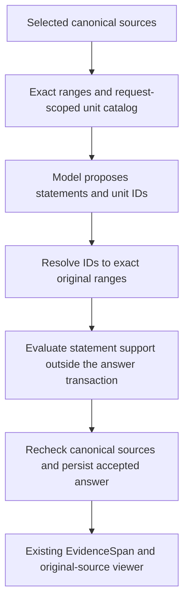

# Investment Research Archive — M1.5 RAG Quality Proof Plan

**Status:** Active — Step 2 comparisons recorded; Step 3 internal orchestration tested; runtime activation/adoption pending
**Date:** 2026-10-01  
**Milestone:** M1.5 — RAG quality proof, after accepted M1 and before M2

**Sources of truth:** [Delivery plan](./05-delivery-plan.md),
[M1 contracts](./11-m1-contracts.md), [system design](./02-system-design.md),
[domain model](./03-domain-model.md), [security and operations](./04-security-and-operations.md),
and accepted [ADRs](./adr/README.md). This plan advances selected M4 RAG work without claiming
that the full M4 gate is complete.

## 1. Outcome and boundary

The accepted M1 path already answers questions over saved, eligible PDF and pasted-text documents
with lexical and dense retrieval, typed generation, statement-support evaluation, and exact
original-source citations. M1.5 makes that path more robust and measurable for a local portfolio
demonstration. It does not turn the application into a public or production service.

The implementation order is M1 → M1.5 → M2 → M3 → remaining M4 work. M2 still owns durable
delivery, versions, reprocessing, deletion, and index reconciliation. M3 still owns archive
browsing, company metadata, filters, and a broader discovery/evaluation core. M4 still owns the
complete routed, conversational, temporal, and production-shaped direct-RAG gate.

Only approved public, synthetic, openly licensed, or otherwise approved non-sensitive material
may reach external providers. Fixed local identity and loopback-only access remain in force. No
new production dependency, paid-plan upgrade, or hosted tracing service is approved by this plan.
The owner separately approved the bounded Pinecone reranking experiment in
[ADR-0018](./adr/0018-pinecone-reranking-experiment.md); that approval permits implementation,
not live execution, private-data processing, or default adoption.

## 2. Baseline and design rules

M1's selector alternates eligible PostgreSQL lexical and canonically qualified Pinecone dense
hits, deduplicates chunk IDs, and passes at most eight chunks and 24,000 code points to generation.
It has no RRF or reranking. The generator currently proposes a candidate ID and verbatim substring;
the server resolves offsets and rejects a missing or ambiguous quote. Luna's observed
`quote_not_found` failures make quote selection a specific M1.5 test case, not permission to
weaken validation.

- Preserve the M1 API response and citation-viewer contract unless a reviewed contract change is
  required. A selected model must never make an unsupported statement visible.
- Keep PostgreSQL and immutable originals canonical. Pinecone scores and model-selected IDs are
  untrusted suggestions, not evidence or authorization.
- Apply workspace, current-version, lifecycle, processing, configuration, and temporal eligibility
  before fusion, reranking, or generation, then revalidate evidence before answer publication.
- Keep deterministic correctness tests separate from measured retrieval and answer quality.
- Version every evaluated corpus, query, retrieval policy, citable-unit policy, reranker,
  prompt, model pair, and result manifest. Do not silently re-interpret M1 records.
- Compare added quality with latency, cost, and failure rates. Keep the M1 baseline available for
  an honest before/after comparison; do not adopt a more complex component without evidence.

## 3. Work sequence

Each step follows the repository order: backend behavior and tests, required CI, frontend only
where the step needs it, then the complete step gate. Work in coherent reviewable blocks and pause
between blocks. All required CI tests use deterministic adapters and spend no provider credits.

### Step 0 — Freeze the evaluation contract and starting baseline

Define a versioned, reviewed, redistributable corpus and question manifest before tuning ranking
or prompts. Include PDF and pasted text, multiple documents, exact-word and paraphrased questions,
answerable and unanswerable cases, a direct source conflict, repeated wording, Unicode, and a
question that exposes the known Luna quote failure. Each case records approved source spans or
explicit expected non-answer behavior; reviewers must not infer truth from the model's output.

Record the current M1 policy, fixture provenance and permitted provider exposure, model pair,
corpus/query versions, configuration, and descriptive baseline results. Select critical
correctness gates and quality measurements before comparing candidates. At minimum measure
candidate recall at the context budget, answer support, exact citation validity, appropriate
abstention/conflict handling, end-to-end latency, provider usage, estimated cost, and safe failure
rate. Small-sample statistics are descriptive, not population-level quality claims.

**Gate:** every case and expected evidence range is reviewed, the deterministic baseline is
reproducible offline, and any live baseline is separately opt-in, bounded, and recorded without
raw document text or secrets in logs, traces, or CI artifacts. No RRF tuning precedes this gate.

**Current Step 0 status (2026-10-07):** The owner reviewed the six synthetic cases in
[`fixtures/m1_5/evaluation.json`](../fixtures/m1_5/evaluation.json). The fixture digests and original
source ranges have a credential-free validator. Separate retrieval-only and end-to-end observation
scorers have deterministic unit tests, and canonical chunks and citations can be mapped to reviewed
source passages. An isolated PostgreSQL run now supplies the first retrieval-only M1 baseline:
required reviewed evidence was available in context for 5/5 answerable cases, using deterministic
embedding and SQLite vector adapters. Its measured median retrieval time was 6.5 ms on one local
run, not a provider latency estimate. See the [corpus guide](../fixtures/m1_5/README.md) for the
reproduction command and limitations. A separate credential-free contract test now exercises all
six reviewed cases against the canonical evidence validator with scripted proposals: exact
quotes, conflict and abstention shapes are accepted, while an altered quote and a rejected support
decision fail closed. This is a validator correctness check; its support decision is fixed by the
test. A complete offline application run now exercises retrieval through canonical answer
persistence and readback: 6/6 scripted coverage and citation outcomes match, including one conflict
and one abstention, and two injected invalid proposals persist `REJECTED` without published
content. Its first local median was 47 ms and maximum 71 ms, including passage mapping. The
existing PostgreSQL CI job discovers these tests automatically. The generator and support adapter
use reviewed fixture rules, so independent support assessments, provider usage, cost, and live
model quality remain unmeasured by these offline runs. The offline correctness baseline is
reproducible; the separately opted-in live starting measurements and subsequent owner acceptance
of the v2 baseline are recorded below. The offline runs alone did not close Step 0.

A credential-free live preflight now pins this reviewed corpus digest and reports the existing
M1 configuration and independently selected Terra/Luna model prices. Its sequential invocation
guard reserves attempted calls before access, retains unknown-usage reservations, validates
reported usage, and enforces role request limits and an OpenAI accounting ceiling of at most
USD 0.80. The [corpus guide](../fixtures/m1_5/README.md#credential-free-live-preflight) documents the
verified command, estimates, and limitations. It does not contact providers, authorize spend,
replace canonical application accounting, or record a live quality baseline. Budgeted wrappers
for all four provider roles and an owned Pinecone namespace lifecycle now have deterministic unit
coverage. The lifecycle limits unique vectors, applies total visibility and cleanup deadlines,
and reports failed cleanup while closing both index clients. The opt-in runner now connects the
frozen corpus to unchanged M1 retrieval, generation, canonical accounting, evidence validation,
and persisted-answer readback in its own migrated disposable PostgreSQL database. It records every
case, retains budget/provider/rejection failures, separates preparation from question usage, and
keeps unknown usage totals explicitly null. Its client and database cleanup is tested, and its
content-free JSON report records cleanup status without overwriting existing results. Existing
unit and PostgreSQL CI jobs discover the deterministic tests automatically. The command defaults
to credential-free preflight; paid execution requires both public-synthetic and Pinecone-Starter
confirmations plus an explicit output path. See the
[live-run guide](../fixtures/m1_5/README.md#opt-in-live-baseline). The owner subsequently executed
the bounded Terra/Terra baseline on 2026-10-06. Re-scoring its observations reproduced 5/5
answerable retrieval hits and 5/6 expected coverage outcomes, with one safely rejected ambiguous
quote. The measured configuration, latency, reservations, missing usage totals, historical
invocation ceiling, verified cleanup, and citation-score limitation are recorded in the
[live starting measurement](../fixtures/m1_5/README.md#recorded-live-starting-measurement).
That historical report has no independent support assessments. New offline and live observations
use the version-2 per-citation mapping contract and explicitly record
`m1.5-observation-score-v2`. It accepts multiple valid citations inside one expected passage while
rejecting unmatched or unexpected citations. Version-1 observations and historical scores retain
the old rule; no missing mapping is inferred. The contract and comparison boundary are maintained
in the [corpus guide](../fixtures/m1_5/README.md). Future retrieval-policy comparisons require v2
observations on both sides. RRF tuning has not started; starting-baseline acceptance is recorded
with the v2 run below.

The live runner now retains optional, allowlisted provider diagnostics and failed canonical
validation rules, also printed per failed case. No raw error, source, answer, or model-authored
validation reason is retained. Older reports remain readable but their missing diagnostics
cannot establish the cause of an earlier failure. The field contract is in the
[live-run guide](../fixtures/m1_5/README.md#opt-in-live-baseline). This diagnostic change does not
alter the M1 pipeline or close the independent quality-review gate.

The owner approved an explicit local-only inspection option for these frozen public-synthetic
cases. `--show-local-model-output` requires execution and an interactive terminal, rejects CI,
and displays proposals, quotes, support decisions with their exact canonical evidence texts, and
canonical results without adding provider calls or weakening validation. Evidence text is displayed
only alongside a returned support decision, not retained in the JSON measurement report or normal
logs. This diagnostic does not establish whether an earlier rejection selected the wrong source
unit or was an incorrect model judgment. The flag now also requests a short English support
`reason` under the separate `m1-5-local-support-reason-prompt-v1` profile. The reason remains
non-authoritative terminal-only diagnostic text; normal runs keep the Boolean-only M1 schema and
prompt. Requesting explanations can change decisions and token usage, so these runs must not be
reported as unchanged baselines or proof of a previous rejection's cause. Existing request counts,
output limits, and spending ceilings remain unchanged. This is a manual inspection aid, not an
independent quality assessment; its boundary is documented in the
[live-run guide](../fixtures/m1_5/README.md#interactive-local-inspection).

The diagnostic profile initially failed runner admission because the runner reconstructed the
comparison plan without the explanation mode. Its admission check now includes the same explicit
local mode as the CLI and provider setup. Offline regression tests exercise the real runner entry
point for both answer policies and still reject inconsistent budgets, prompt versions, and vector
limits before runtime access. This correction does not remove or weaken plan validation.

The owner subsequently recorded a v2 Terra/Terra baseline under the approved USD 0.80 invocation
ceiling. It retained 5/5 answerable retrieval hits, 4/6 matching coverage and citation outcomes,
and two safe failures: an ambiguous budget quote and a rejected conflict statement. Cleanup was
verified. The [v2 measurement and qualitative review](../fixtures/m1_5/README.md#recorded-version-2-baseline-and-review)
records the unchanged configuration, descriptive latency, reservations, and missing cost totals.
The Codex content comparison is separate from the application's support decisions and is not
itself human approval or a structured independent-model evaluation. The corpus verifier reconfirmed
all six source ranges against the originals. The owner found the correct battery wording in the
console, and an offline replay rejected the altered attached quote; no validation defect was
demonstrated. The owner accepted the explained six-case measurement as the starting baseline on
2026-10-07. Step 0 is accepted for this scope; the transcript discrepancy is not an open technical
blocker. Preserve this run, including both failures; do not tune prompts or ranking to obtain a
selectively successful baseline. Unknown aggregate usage and cost remain unknown, and the report's
independent-support count remains 0/6. This acceptance neither closes the two failures nor claims
the final M1.5 quality gate. Step 1 is in progress; no runtime retrieval-policy change is active.

### Step 1 — Reciprocal rank fusion of the existing two lanes

Add an application-owned selector that fuses lexical and dense _ranks_, not incomparable raw
scores. Use a documented fixed RRF constant, deterministic tie-breaking, chunk-ID deduplication,
and the existing context budget. Keep lane-origin ranks and raw scores for audit; record the new
fusion policy/version and fused rank separately from M1 selection rank. Canonical qualification
must finish before a hit can contribute to fusion.

Test one-lane-only hits, hits in both lanes, ties, duplicates, empty lanes, stale/foreign vectors,
and budget boundaries. Compare the same reviewed cases with M1 round-robin and RRF without
changing embeddings, corpus, or prompts between runs.

**Gate:** all M1 correctness and isolation tests still pass. The RRF comparison is reproducible,
and the chosen default is justified by measured quality without critical evidence regressions.
If RRF does not help, retain M1 as the default and document the result.

**Current Step 1 status (2026-10-07):** The first work block implements standalone, typed RRF
fusion and context selection in Search. The fixed `m1-5-rrf-k60-v1` formula uses equal lane weights,
k = 60, exact rational ordering, and chunk-UUID tie-breaking. It preserves both lane contributions,
deduplicates chunks across lanes, rejects duplicate lane votes and inconsistent canonical payloads,
and retains separate fusion and selection ranks under the existing context bounds. The targeted
new-RRF and retained-M1 selector checks passed 40 tests plus formatting, lint, and typing. See the
[Search module guide](../backend/src/investment_research/modules/search/README.md#standalone-m15-reciprocal-rank-fusion)
for the formula and boundary.

The second work block wires RRF as an explicit internal profile in the existing research service,
after canonical qualification and before the unchanged context budget. Every qualified lane record
retains its original rank and score plus the shared chunk's fusion rank, including unselected hits.
The scoped repository reconstructs the fixed-policy ranks before staging writes; the existing
`fused_rank` column needs no migration. The normal composition still supplies the M1 profile: no
default switch, new provider call, environment setting, API field, reranker, or frontend change is
included. Offline service and PostgreSQL tests cover audit round trips, source identities, budget
exclusions, and foreign/unknown/inactive/temporal/document-filter exclusions. Existing CI discovers
these tests through `scripts.verify_backend` and `scripts.verify_postgres`.

**Second-block verification (2026-10-07):** `scripts.verify_backend` passed formatting, lint,
typing, and 1,277 unit tests. `scripts.verify_postgres` passed the empty upgrade/downgrade/upgrade
cycle, schema-drift checks, and 111 integration tests, including all four new RRF cases. Seven
SeaweedFS-only tests were skipped by that PostgreSQL-only gate. The disposable database and its
owned resources were removed afterward. No live providers, browser, or frontend build were used
for this backend-only work block.

**Paired offline comparison (2026-10-07):** A third work block records M1 and RRF selections from
the same canonically qualified lanes for all six frozen questions. It adds a strict content-free
comparison report and scorer, with reproducible test-only chunk identities and the unchanged
context limits. Both policies retained all required evidence for 5/5 answerable cases; all six
selected chunk sets and orders were identical. Four questions had no lexical hits; the other two
had one lexical hit each. This is a weak discrimination sample using deterministic substitutes,
not evidence of improved live retrieval or model-answer quality. The
[paired comparison guide](../fixtures/m1_5/README.md#paired-m1rrf-offline-comparison) records the
case-level ranks, timing boundary, verified commands, and limitations.

Verification passed 1,296 backend unit tests, formatting, lint, typing, and 112 PostgreSQL tests
with seven unrelated SeaweedFS-only skips. The migration cycle and schema checks passed, and the
disposable database resources were removed. Existing CI discovers the paired test automatically;
no provider call, historical report rewrite, frontend change, or default switch occurred.

**Live-selector preparation (2026-10-07):** A fourth work block adds the explicit evaluation-only
`--retrieval-policy m1|rrf` option to the free planner and opt-in runner. The default remains M1.
The runner uses the planned frozen selector, and its v2 observations and summary record that
version. Models, prompts, corpus, context bounds, request ceilings, and USD 0.80 per-invocation
budget are unchanged. Unknown selector versions fail closed. Existing CI automatically exercises
both profiles across success, budget exhaustion, provider failures, quote rejection, and rejected
support; PostgreSQL assertions inspect the stored selector versions and RRF fusion ranks.
Verification passed formatting, lint, typing, 1,300 unit tests, and 126 PostgreSQL tests with seven
separate storage skips. Migration/drift checks and owned database cleanup passed. Both free RRF
preflight commands were executed; no paid run, browser, frontend change, or historical rewrite
occurred. The [live selector guide](../fixtures/m1_5/README.md#live-selector-experiment) explains
that separate invocations are not paired candidate snapshots and that their combined spend is
not automatically approved.

**Approved live comparison protocol (2026-10-07):**
`m1.5-sequential-live-comparison-v1` specifies one fresh M1 run followed by one RRF run with
Terra/Terra, all six frozen cases, unchanged configurations, and new v2 reports. The owner approved
the combined reservation envelope of USD 1.60 as two existing USD 0.80 invocation caps and
executed both runs. There are no selective retries, implicit budget increases, or default
changes. Verified cleanup and compatible configurations are prerequisites for comparison.
The [protocol](../fixtures/m1_5/README.md#live-comparison-protocol) defines the metrics,
stop conditions, and inference limits. Separate live runs are descriptive, not a controlled
candidate-snapshot experiment; unchanged or inconclusive results retain M1.

**Recorded live outcome and default decision (2026-10-07):** Both policies retained required
evidence for 5/5 answerable questions. M1 matched expected coverage in 5/6 cases and catalog
citations in 4/6; RRF matched both in 3/6. Both retained the ambiguous pilot-budget quote failure;
RRF additionally rejected rollout and conflict statements during support/coverage validation.
Neither report recorded an unsafe failure; both verified cleanup. Combined reservations were
USD 1.301216, not actual charges. Aggregate usage/cost and independent answer-support review
remain unavailable. Re-scoring reproduced both stored summaries. The
[measurement record](../fixtures/m1_5/README.md#recorded-sequential-live-comparison-2026-10-07)
preserves hashes, timings, configuration checks, failures, and inference limits.

Retain M1 as the default: the offline comparison was unchanged and the live observations showed
no demonstrated benefit justifying adoption. RRF remains an evaluation-only profile. This is a
bounded negative/inconclusive experiment, not proof that RRF is generally inferior. No further
paid run is approved, and quote or support validation is not weakened. Step 2 targets the known
quote-selection limitation rather than repeating this ranking experiment.

Frontend format, lint, typing, contract checks, and 45 tests passed. At the time of comparison
recording, the production build and required hosted checks, including the M1 runtime gate, still
needed confirmation. The owner subsequently reported the RRF branch merged; retain those gate
confirmations before integrating the Step 2 provider profile. No browser was used during review. The offline
retrieval-only report is not a v2 answer observation; the sequential live reports do not establish
independent support quality or complete the M1.5 acceptance gate.

### Step 2 — Model-selectable citable source units

Design a bounded set of pre-generation citable units derived deterministically from eligible
canonical `StructureBlock` text. Give each unit an opaque request-scoped ID and exact
block-relative Unicode-code-point range. The model may select unit IDs for a statement instead of
copying `exact_text`; the server resolves each ID to immutable original text and the existing PDF
page or pasted-text locator. An ID does not itself authorize support: the statement-support
evaluator and canonical evidence checks remain mandatory.

Freeze the unit-boundary and ID contract before code changes. Do not store a new `EvidenceSpan`
merely because a unit was offered to a model, and do not replace stable original-document anchors
with chunk or vector IDs. Preserve historical M1 answers and the source viewer. Test repeated
phrases, whitespace, line breaks, Unicode, overlapping/adjacent units, unknown IDs, mixed or
cross-workspace IDs, changed eligibility, and multiple supporting units.

**Gate:** exact citations still open the original location, invalid IDs fail closed, and the
reviewed Luna quote-failure cases are compared against the prior exact-substring contract. No
fuzzy match or whole-chunk citation is accepted as a workaround.

#### Step 2 contract — Citable units v1

**Design recorded:** 2026-10-07. The preparation/resolution, ID adapter, and opt-in Research and
evaluation integration are implemented. Initial live comparisons are recorded below; normal
runtime adoption and remaining review gates are open. This is not a default-policy change or
evidence that Step 2 passed. After reporting the RRF branch merged, the
owner confirmed Step 1's production-build and hosted-CI readiness before the ID-adapter block.
That confirmation is owner-reported, not independently executed build or hosted verification.
The existing M1 quote profile remains available and unchanged for historical interpretation.

The design follows the source-ID/locator separation in the official
[citation guide](https://developers.openai.com/api/docs/guides/citation-formatting). Strict
[Structured Outputs](https://developers.openai.com/api/docs/guides/structured-outputs?api-mode=responses)
can restrict selection to supplied IDs, but cannot establish statement support. The exact
granularity and limits below are project decisions to evaluate, not a claim of universal optimality
or state-of-the-art answer quality. This internal generation policy preserves ADR-0008's adapter
boundary and ADR-0009's canonical anchors; it does not introduce another canonical entity.

**Preparation and boundaries**

- Build the catalog in Research after canonical qualification and context selection, before answer
  generation. Retain the selected context's existing bounds of 8 chunks and 24,000 Unicode code
  points. Do not retrieve, embed, index, or call a model to create units.
- Derive ranges from the complete immutable `StructureBlock.text`, not from a rewritten chunk.
  The current M1 chunk equals one complete block. Reject a source that cannot be proven to map
  to that block; future overlapping or multi-block chunk policies require explicit range mapping,
  not an assumed zero offset.
- Use the version `m1-5-citable-units-en-v1`. In original order, split at a run of `.`, `?`, or `!`,
  followed by zero or more closing characters from `"'”’)]}`, then whitespace or the block end.
  Also split at blank-line paragraph separators: two line feeds with only spaces or tabs between
  them. A single PDF line break is not a boundary. Include terminal punctuation and closing
  characters in the preceding range. This is a deterministic English heuristic, not linguistic
  sentence recognition; abbreviations and list punctuation can produce short units.
- Limit each unit to 800 code points. For a longer range, split at the last whitespace position
  after the current start and at or before that limit; if none exists, split exactly at the limit.
  Remove leading/trailing separator whitespace only by moving range endpoints. Never normalize,
  dehyphenate, paraphrase, reorder, or change characters inside a range. Retain every non-whitespace
  character, including text without sentence punctuation.
- Units are nonempty, ordered, non-overlapping, block-relative half-open ranges `[start, end)`.
  Each contains visible text and satisfies `unit.text == block.text[start:end]`. A short block may
  legitimately yield one unit; do not expand another selected range to a whole chunk as recovery.
- Deduplicate equal canonical ranges, not equal text. Two occurrences of the same sentence at
  different offsets remain two distinct units. If future overlapping candidates expose the same
  mapped range, offer it once and retain the first selected candidate as its retrieval provenance.
- Offer at most 256 units per request. Overflow fails before answer generation with a safe,
  application-owned limit error. Do not silently omit later passages, merge all units into a
  chunk-sized fallback, or ask the model to repair the catalog. The cap and 800-character limit
  require explicit boundary tests and quality measurement before adoption.

**Identity and provider contract**

The server-only canonical key is `(workspace_id, document_version_id, structure_block_id,
start_character, end_character, unit_policy_version)`. It is independent of lexical/dense lane,
chunk rank, and wording elsewhere. Use this key for deterministic deduplication; do not create
a database row or log source content for it.

Derive the internal `source_unit_id` as UUIDv5 with the research-request UUID as namespace
and the canonical key serialized as a fixed-order compact JSON array, using lowercase UUID strings
and integer offsets. This gives reproducible handles within one request and distinct handles across
requests. The canonical range stays stable across unchanged inputs; the internal ID is
request-scoped, not a permanent citation ID, secret, or authorization token. Resolve it only in the
current server-owned catalog, never through a global lookup or by decoding model-supplied metadata.

Present units in selected-source order and block-offset order, grouped under their source. The
current **v3 provider input** assigns short handles `u1` through `uN` in catalog order and pairs
each handle, in the provider's `source_unit_id` field, directly with its unchanged unit `text`.
Keep the alias-to-UUID mapping server-owned and local to the validated current request. Handle
spelling may recur in another request, but no mapping is reused across requests. The adapter maps
selected handles back to internal UUIDs before the existing exact-range resolver; the model never
receives these UUIDs as unit references.
Each entry's `separator_before` and its source's `trailing_separator` retain the original boundary
whitespace. Concatenating those separators and texts in order reproduces the complete original
block exactly. Do not additionally serialize the full block, send character offsets, duplicate
unit text, or discard surrounding visible content. Canonical ranges remain server-owned;
separators are not additional citable units. Quote-like instructions inside a source remain
untrusted data. The model selects one or two distinct supplied
`source_unit_id` values per statement; it returns neither `exact_text` nor offsets nor a
retrieval-candidate ID for this profile. Keep the existing 8-statement limit, four coverage states,
and `missing_information` rules. A claim requiring more than two units must be decomposed into
independently supported statements or safely omitted, not bypass the evidence limit.

**Input presentation revision (2026-10-07):** The previous v1 adapter serialized the original block
beside a separate ID/range catalog, requiring the model to associate character ranges with text.
The v2 profile makes that association explicit without changing unit boundaries, request-scoped
IDs, evidence resolution, model selection, support policies, or website defaults. The initial
revision used generator `openai-responses-citable-units-v2`, prompt
`m1-5-citable-units-en-answer-prompt-v2`, and a model-specific configuration ending in
`low-citable-units-en-v2`. The canonical unit policy remains `m1-5-citable-units-en-v1`.
Historical comparisons below retain their recorded versions and results; they do not establish
v2 quality. Preflight still checks the complete serialized input, prompt, schema, and expansion
margins against the existing reservation before a paid call. A separately authorized, versioned
live comparison is required before adopting the format in normal runtime.

**V2 offline verification (2026-10-07):** Focused adapter, plan, CLI, and budget-wrapper checks passed
243 tests. The complete backend gate passed formatting, Ruff, Mypy, and 1,627 unit tests; isolated
PostgreSQL verification passed the empty upgrade/downgrade/upgrade cycle, metadata checks, and
143 integration tests. Seven separate SeaweedFS tests were skipped in this PostgreSQL-only run;
its disposable database and volume were removed. Existing frontend formatting, lint, type,
contract, and 45 tests passed. The credential-free RRF/citable-units/document-attribution preflight
reported the v2 answer prompt and unchanged USD 0.80 cap. No paid provider call, production build,
or hosted-CI verification was performed for this revision. These results establish transport and
validation correctness, not improved live answer or source-selection quality.

**Standalone-claim prompt revision (2026-10-07):** This revision introduced prompt
`m1-5-citable-units-en-answer-prompt-v3`; its model-specific generation configuration ends in
`low-citable-units-en-v3`. Generator and input presentation remain v2, canonical units and IDs
remain v1, and historical observations are not rewritten. The prompt and statement-field schema
description now explicitly require claims to be understandable without previous statements or
`rendered_text`. State the supported subject, metric, period, and units when needed; select the
supporting units before composing the claim, retain qualifications, and avoid unrelated additions.
An absent fact in one passage or a generic notice cannot establish an archive-wide negative claim.

Four short synthetic examples outside the evaluation corpus illustrate independent financial
claims, an unsupported inference requiring `INSUFFICIENT`, a `PARTIAL` answer containing only its
supported part, and attributed conflicting reports. Example facts are not current
evidence. This follows the official guidance on [clear instructions and varied examples](https://developers.openai.com/api/docs/guides/prompt-engineering)
and [concise reasoning-model prompts](https://developers.openai.com/api/docs/guides/reasoning-best-practices),
without requesting hidden reasoning or adding another generation stage. There is no pronoun
blacklist, regex-based truth check, automatic claim salvage, repair loop, evaluator relaxation,
model change, budget increase, or website adoption. Instruction delivery and schema behavior can
be tested offline; live adherence and judge agreement still require separately authorized
evaluation and independent review.

**Standalone-claim verification (2026-10-07):** Focused checks passed 245 tests. Complete backend
formatting, linting, typing, and all 1,629 unit tests passed. The isolated PostgreSQL gate passed
143 integration tests, with seven separate S3 tests intentionally skipped; the empty migration
cycle, schema checks, and test-resource cleanup passed. Frontend formatting, linting, typing,
contract generation checks, and all 45 tests passed. Credential-free preflight reported prompt v3
and the unchanged USD 0.80 cap. Existing CI discovery covers the tests without a workflow change.
No paid provider call, production build, browser check, or hosted-CI verification was performed
for this revision. The longer instructions consume part of the existing input allowance; preflight
still fails closed rather than increasing its ceiling. These checks do not establish improved
live statement quality or source selection.

The strict provider schema defines the current catalog IDs once as a shared enum and forbids extra
fields. The adapter also checks catalog membership and duplicate IDs, independently of provider
schema compliance. An empty catalog must not produce an empty enum or a paid generation call;
use the existing no-evidence path. Unknown, malformed, or duplicate handles fail closed, as do
mismatches between the input and its request-scoped catalog. Reusing the spelling `u1` in a later
request is valid only as a reference to that later request's own catalog. Internal UUID resolution
retains its independent workspace/request checks, with bounded content-free diagnostics.

**Resolution, validation, and compatibility**

Resolve each selected unit to its catalog-owned retrieval candidate, exact block range, and exact
text. Return the existing `UnvalidatedEvidenceReference` shape to application validation. The
statement-support evaluator still receives the statement and resolved exact evidence text outside
the answer transaction. Before atomically storing an accepted answer, reload and revalidate all
canonical workspace, request/candidate, active-version, processing, temporal, text, and range rules.
A known ID is not proof of support. Do not combine separated units into a larger implied quote or
use fuzzy matching to rescue an invalid reference.

**Support attribution context — opt-in experiment (2026-10-07):** Local support explanations
identified an input gap: a quote can establish a constraint while omitting the company, report
title, or date visible to the answer generator. The experimental contract is
`ContextualStatementSupportInput` in Evidence; `support_context.py` builds it without database or
provider calls. The evaluation runner selects it only with `--support-policy attribution`.
The default `--support-policy m1` and the website retain exact-text-only evaluation.

For each exact reference, independently recheck canonical workspace, retrieval, active-version,
processing, temporal, identity, media locator, text, hash, and original range eligibility. Reject
the complete preparation if any source or reference fails. Keep each reference paired with a
prefix of its own immutable `StructureBlock`: start at its first non-whitespace character, stop
at the first blank-line paragraph separator (`LF`, optional spaces/tabs, `LF`) or 800 Unicode
code points, and exclude trailing whitespace only by reducing the range. Preserve all
characters inside that range. The context policy is `m1-5-same-block-attribution-v1`; quotes plus
their contexts together still fit within 24,000 code points, with at most two distinct references.

This prefix is untrusted original attribution context, not a verified metadata field or an
automatic header extractor. It may identify the subject/report/date of that same quote; it must
not rescue a factual claim absent from the exact cited evidence. Never combine headers and quotes
from different documents, manufacture company/date values, normalize original text, expand a
citation to include the prefix, or create extra `EvidenceSpan` records merely for context. A block
without identifying text remains ambiguous. This same-block profile performs no cross-page lookup.

The contextual OpenAI profile is `m1-5-attribution-support-prompt-v1`; interactive local inspection
uses `m1-5-local-attribution-support-reason-v1`. It receives the statement and separate paired
objects containing document/version/block IDs, exact quote text, and attribution context. IDs group
the sources but do not establish facts. The prompt restricts context use to explicit, unambiguous
subject/report/date attribution within that paired source; operational facts, quantities, plans,
causes, and qualifications still require exact quoted support. Ambiguity or disagreement fails
closed rather than importing facts from another source.

Both evaluation-run and canonical provider-operation accounting include the full serialized
contextual input. No limits or prices increase. Research evaluates outside the answer transaction
and rebuilds context from freshly rechecked canonical sources before persistence. Recorded support
decisions are keyed by the entire immutable contextual request, including statement, exact references,
original ranges, identities, text, and context policy. A mismatch rejects the answer without a new
paid call inside the transaction. Validation and support-accounting configuration versions identify
the attribution experiment separately from M1.

Existing offline CI checks discover the added unit and PostgreSQL runner tests. They cover profile
admission, source isolation, payload accounting, unchanged citations, and final decision replay; they
do not establish real-model quality. Local-output restrictions and the USD 0.80 default run ceiling
remain unchanged. Quality improvement remains unproven until a separately authorized live comparison;
a local model reason is a diagnostic, not independent evidence of correctness. A block without a
useful identifying prefix may still fail, and this experiment is not a default-policy decision.

**Document-prefix attribution follow-up (2026-10-07):** The owner's supplied Luna/Luna RRF and
source-unit run with the same-block profile recorded six cases, two failures, 73,715 micro-USD
reserved, and verified cleanup. Its rollout quote lacked the identifying header, and the conflict
check could not connect a separate header citation to the factual citation in that same report.
An additional rollout inference about another capacity not being the main constraint was not
supported by its own quote and must not be rescued. The accepted revenue citation was exact but
covered a wider table than the reviewed passage; independent support review and citation precision
remain separate quality concerns. These observations do not establish evaluator correctness or a
general model-quality rate.

The separately selected `--support-policy document_attribution` tests a bounded extension without
changing `m1`, `attribution`, or the website default. With this profile only, the canonical source
reader loads the first `StructureBlock` by ordinal from the candidate's exact workspace, document
version, and processing run. It applies the same unchanged-prefix algorithm and 800-code-point
limit; it does not scan arbitrary pages, infer metadata, or retrieve another report's header.
The context policy is `m1-5-document-prefix-attribution-v1`. A factual quote may come from a
different block or page of that output. Preparation requires matching workspace, processing run,
document, and version identities; missing or mismatched context fails closed without falling back
to another profile. Mixing context policies within one request is forbidden.

The new support prompt is `m1-5-document-attribution-support-prompt-v1`; interactive inspection uses
`m1-5-local-document-attribution-support-reason-v1`. Each entry includes its exact quote block ID,
separate attribution block ID, shared document/version IDs, and `attribution_scope` set to
`same_document_version`. The application proves that relationship before the provider call; IDs
still establish no factual meaning. Explicit company/report/date attribution need not be repeated
inside the factual quote. Quotes from different blocks of the same version may jointly support
that report's attribution and facts. Ambiguous multi-report content, a conflicting local subject,
or attribution borrowed across documents or versions still fails. All operational facts,
quantities, causes, qualifications, and conclusions require exact cited support; identifying context
does not turn a claim of sufficient capacity into proof that it is not the primary constraint.

Both the detached read and final persistence use the opt-in reader. The full immutable contextual
input, including prefix ranges, text, source block, workspace, processing run, and policy, keys the
recorded decision. A changed header is rejected without another paid call inside the transaction.
Full-input accounting, two-reference/24,000-code-point limits, model prices, and the USD 0.80 run
ceiling are unchanged. Existing CI discovers the added reader, profile, accounting, replay, and
complete-runner regression tests. This is a correctness-tested experiment, not an accepted quality
improvement; a separate live run and independent review remain necessary. No frontend change,
schema migration, citation expansion, extra context evidence span, or reindexing is introduced.

**Local correctness verification (2026-10-07):** Backend formatting, Ruff, and Mypy passed with
1,619 unit tests. The isolated PostgreSQL verifier passed 143 integration tests, the empty
upgrade/downgrade/upgrade cycle, and schema checks; seven separate S3 checks were intentionally
skipped. OpenAPI drift and frontend formatting, lint, typecheck, contract, and 45 tests passed.
The credential-free document-attribution preflight passed. No paid provider run, production build,
hosted CI, or browser check was performed for this extension.

Create or reuse `EvidenceSpan` records only through the existing validated-answer persistence path.
Offering a unit creates no evidence record. Retain the existing PDF locator, pasted-text absolute
range calculation, evidence-span URL, HTTP/OpenAPI events, and source viewer. No migration,
reprocessing, vector upload, frontend change, or historical answer rewrite is required by this
contract. New generator/configuration/prompt versions must identify the unit policy; do not
reinterpret the frozen M1 versions. Validate serialized-input/schema overhead against existing
token reservations before enabling any paid comparison; no budget increase or live run is approved
by this design.



**Work blocks and verification**

1. Implement typed catalogs, deterministic range construction, identity, and resolution, with
   unit tests for repeated text, whitespace, PDF wrapping, abbreviations, decimal numbers,
   Unicode, long unbroken text, adjacent units, canonical deduplication, and exact cap boundaries.
2. Add a separately versioned ID-selection generator profile and strict-schema tests; retain the
   M1 quote profile. Prove rejection of unknown/duplicate/cross-request IDs and unchanged coverage,
   failure, usage-accounting, local-output, and no-provider-call behavior.
3. Wire the profile through the research workflow and evaluation runner without changing the
   runtime default. PostgreSQL tests cover same-text/different-offset citations, reused evidence,
   two supporting units, foreign sources, changed eligibility after support evaluation, and
   historical PDF/text citation readback. Existing CI must discover these deterministic tests;
   frontend contract and complete runtime gates confirm compatibility.
4. After correctness checks, obtain separate approval for a bounded old/new live comparison on
   unchanged cases, retrieval, and model pair. Include the repeated-budget case and observed Luna
   PDF quote failures. Record citation validity, independently reviewed support, coverage, safe
   failures, latency, usage, cost, and catalog size. Do not claim an evaluator false rejection or
   improved answer quality merely because copied-quote errors disappear. Adopt only with a
   documented benefit and no critical regression; otherwise retain M1.

**First backend block (2026-10-07):** Research now owns standalone typed source pairs, canonical
range keys, request-scoped UUIDv5 handles, validated catalogs, deterministic range construction,
and resolution to the existing `UnvalidatedEvidenceReference`. They enforce the frozen bounds,
complete block mapping, trusted workspace, exact Unicode slices, canonical deduplication, source
order, non-overlap, and preservation of visible source content. Resolution rejects unknown,
duplicate, foreign, mixed-catalog, and cross-request references without fuzzy recovery. See the
[Research guide](../backend/src/investment_research/modules/research/README.md#standalone-m15-citable-unit-preparation)
for file responsibilities and the trust boundary.

The complete `scripts.verify_backend` gate passed formatting, lint, full typing, and 1,357 unit
tests, including 57 new source-unit cases. Existing unit CI discovers the tests automatically.
No dependency, database schema, provider adapter, bootstrap wiring, API, frontend, historical
answer, or runtime default changed. No provider, PostgreSQL, Docker, browser, or frontend build
was run for this pure in-memory backend block. The remaining Step 2 integration, source-opening,
compatibility, hosted verification, and approved quality-comparison gates remain open.

**Second backend block (2026-10-07):** The standalone `OpenAICitableUnitAnswerGenerator` now
selects one or two request-scoped source-unit IDs per statement and resolves them to existing
unvalidated evidence references. `CitableAnswerGenerationInput` binds the catalog to the trusted
workspace, request, ordered source provenance, and exact text. The provider schema declares the
current ID enum once; the application independently rejects foreign, unknown, cross-request,
mixed, and duplicate IDs. Sources are serialized once, alongside ID/range metadata. Repeated
wording retains distinct original offsets without copied-quote or fuzzy-match recovery.

The adapter reuses M1's bounded transport, safe error categories, exact usage validation, and
explicit local-output callbacks, while keeping separate prompt/schema/resolution hooks and new
model-specific profile versions. All four coverage states and the existing partial-answer field
rule remain. Neither a valid ID nor a schema-valid answer establishes statement support.

Preflight retains the existing 16,000-unit input-overhead reservation. It measures serialized
metadata, prompt, and schema bytes, with 512-unit margins each for SDK schema expansion and request
framing; question and source bytes remain reserved separately by M1 accounting. Catalogs may
contain up to 256 units, but a metadata-heavy request can hit the unchanged reservation sooner.
Empty catalogs and reservation overflows make no generation call. Integration must preserve the
existing no-evidence path and map preparation failures safely before any paid operation.

At the end of this second block, the profile was not yet wired into Research, bootstrap, or the
evaluation runner; the third block below supplies opt-in workflow integration. M1's quote profile,
normal runtime defaults, API, source viewer, persisted answers, database schema, and dependencies
remain unchanged. Existing unit CI discovers the new adapter tests; no workflow or frontend edit
is required for this standalone block. Workflow/ledger integration, PostgreSQL citation readback,
complete compatibility gates, hosted confirmation, and separately approved live comparison
remained open for that block. See the [Generation guide](../backend/src/investment_research/infrastructure/generation/README.md#standalone-m15-source-unit-id-adapter).

Verification passed `scripts.verify_paths` (153 targeted tests, including retained M1 and catalog
regressions) and the complete `scripts.verify_backend` gate: formatting, Ruff, full typing, and
1,412 unit tests, including 55 new adapter cases. The pinned SDK's actual strict-schema conversion
was checked offline, including the 256-ID enum and the schema-expansion margin. No paid provider,
PostgreSQL, Docker, browser, or frontend build was run for this standalone backend block.

**Third backend block (2026-10-07):** The opt-in Research input builder reloads selected candidate
eligibility and complete original blocks through a short workspace-scoped PostgreSQL read. It
verifies selected provenance, media locators, ranges, and text before detaching the catalog.
Provider preflight occurs outside that read and before canonical or evaluation spend reservation.
An empty selection produces the existing insufficient aggregate with no generation/support calls.
Nonempty requests retain the existing ledger, support evaluation outside a transaction, final
canonical recheck, atomic persistence, canonical evidence-span reuse, and source-opening contract.

The evaluation plan and runner now independently select M1/RRF retrieval and M1/source-unit
answers. `--answer-policy citable_units` is explicit; M1 remains the CLI and website default.
The frozen prompt version resolves to the separate model-specific generation profile. The
existing 80-cent invocation ceiling and 16,000-unit generation overhead remain unchanged. The
budget wrapper counts original source and question bytes once, not duplicate server-only catalog
snapshots. Unknown profile versions fail instead of silently falling back. No database schema,
dependency, bootstrap, public API, or frontend implementation changes.

This free preflight prints the selected plan without keys, Docker, or provider requests:

```bash
cd backend
uv run --locked python -m scripts.verify_m1_5_live_baseline \
  --retrieval-policy rrf \
  --answer-policy citable_units
```

Execution is still separately opt-in and requires `--execute`, both existing confirmations, and
a new ignored JSON output path. This implementation does not approve another paid comparison.
Existing backend-unit and PostgreSQL CI discover the new tests; no artificial CI/frontend edits
are needed. Hosted checks and complete M0/M1 runtime compatibility remain merge gates.

**Known deterministic quality limitation:** With unchanged v2 scoring, all six scripted answers
have expected coverage and all five answered cases have exact canonical citations, but only five
of six cases satisfy reviewed citation matching. The first PDF unit includes a heading preceding
the reviewed FY2025 revenue passage; its wider range fails the frozen containment metric. Keep
this penalty visible instead of changing anchors, scoring, or source text to improve the result.
Neither scripted support nor transport correctness establishes live answer quality. Granularity,
independent support review, bounded old/new live comparison, and adoption remain open.

Verification for this third block passed the complete backend gate (308 formatted Python files,
Ruff, Mypy over 278 source files, and 1,443 unit tests), the disposable PostgreSQL gate (136 passed,
seven SeaweedFS-only tests intentionally skipped), migration round-trip and schema checks, the
free RRF/source-unit preflight, and `git diff --check`. Frontend formatting, lint, type checking,
contract drift checks, and all 45 tests passed. The owner confirmed the production build; an
agent-side sandbox build could not bind the port required by Turbopack. No paid provider requests,
browser checks, complete M0/M1 runtime checks, or hosted CI confirmation were performed for this
block. These results verify opt-in integration, not live quality or adoption.

#### Initial owner-run live comparisons (2026-10-07)

The owner executed five bounded runs on the six existing synthetic cases and supplied the terminal
transcripts for review. The model names, source-reference shapes, selector versions, case outcomes,
reservation totals, and reported cleanup below were checked against those transcripts. These are
owner-run observations, not agent-executed tests or an independent review of citation support.
Raw JSON reports remain ignored local evaluation artifacts; they were not inspected for this record.

Retrieval and answer policy are separate experimental controls. `--answer-policy m1` means the
copied-quote answer contract, not M1 retrieval. All first four runs used
`m1-5-rrf-k60-v1`; only the fifth used `m1-lexical-first-round-robin-v1`.

| Answer/support models | Retrieval | Answer policy | Failed cases / 6 | Reserved USD | Reported cleanup |
| --------------------- | --------- | ------------- | ---------------- | ------------ | ---------------- |
| Terra/Terra | RRF | M1 copied quotes | 3 | 0.650454 | Verified |
| Terra/Terra | RRF | Citable units | 0 | 0.715730 | Verified |
| Luna/Luna | RRF | M1 copied quotes | 4 | 0.069614 | Verified |
| Luna/Luna | RRF | Citable units | 1 | 0.076194 | Verified |
| Terra/Terra | M1 | Citable units | 0 | 0.671656 | Verified |

Each invocation retained the USD 0.80 reservation ceiling. Reserved USD is a conservative
application estimate, not actual provider billing or measured token-based spend. Completed cases
include the expected insufficient-evidence result; zero failures does not mean six answered
questions. Every run correctly withheld the unsupported dividend answer.

**Observed failures and interpretation**

- Terra/RRF/copied quotes rejected the rollout and conflicting-report cases during statement
  support validation and failed the repeated European-budget sentence with `quote_ambiguous`.
  Terra/RRF/citable units completed all six cases, including explicit conflicting coverage and
  expected abstention. The same repeated-budget ambiguity disappeared in the Luna ID run.
- Luna/RRF/copied quotes additionally rejected the revenue case, for four failures in total.
  Luna/RRF/citable units completed five cases. Its remaining conflicting-report failure was
  `COVERAGE,STATEMENT_SUPPORT`: the support evaluator returned false for the transformer-shortage
  statement. It was not an unknown-ID, copied-quote, or provider-format failure. The transcript
  alone does not establish that the evaluator falsely rejected supported evidence.
- Terra/citable units had no case failures under either retrieval selector. This small result does
  not demonstrate RRF superiority, equivalence of retrieved passages, or equal latency. Generator
  statements and evidence selections varied between runs, including the number of supporting units.

The runs used `scripts.verify_m1_5_live_baseline --execute` with explicit `--retrieval-policy`,
`--answer-policy`, `--answer-model`, `--support-model`, and `--max-spend-usd 0.80`; both existing
public-synthetic/Starter confirmations and a new JSON path beneath `outputs/m1_5` were required.
`--show-local-model-output` displayed synthetic proposals and support decisions only in the owner's
interactive terminal. Changing one policy while retaining the model pair gives the comparison
matrix above; repeated runs are still stochastic, not guaranteed replays.

**Disposition:** Record an initial benefit for ID-based reference resolution and fewer observed
safe failures, but retain opt-in use and the unchanged website default. Do not weaken support
validation to make Luna pass. Before adoption or Step 2 acceptance, independently check resolved
original spans and supported claims, retain the known wider revenue-unit scoring penalty, verify
source opening and complete runtime/hosted compatibility, and review the earlier Luna PDF
`quote_not_found` scenario. These tiny fixture runs do not settle that broader PDF issue. Latency,
actual usage/cost, catalog sizes, and reviewed citation metrics were not provided in the terminal
excerpts and remain unverified here. Live partial coverage was not exercised by these six cases.

#### Standalone-claim v3 owner-run observations (2026-10-07)

After the v2 input presentation and v3 standalone-claim instructions, the owner executed one
Luna/Luna run and one Terra/Terra run using RRF, citable units, and document-prefix attribution.
The supplied commands selected generator `openai-responses-citable-units-v2`, answer prompt
`m1-5-citable-units-en-answer-prompt-v3`, model-specific `low-citable-units-en-v3` configuration,
and unchanged `m1-5-citable-units-en-v1` unit boundaries. Interactive inspection requested the
separate `m1-5-local-document-attribution-support-reason-v1` support profile; these are not
Boolean-only support-profile measurements. Both invocations retained the USD 0.80 ceiling.

| Answer/support models | Evidence supplied for this record | Failed cases / 6 | Reserved micro-USD | Reserved USD | Reported cleanup |
| --------------------- | --------------------------------- | ---------------- | ------------------ | ------------ | ---------------- |
| Luna/Luna | Detailed terminal transcript and completion summary | 0 | 73,902 | 0.073902 | Verified |
| Terra/Terra | Completion summary only | 0 | 733,744 | 0.733744 | Verified |

The Luna transcript shows five streamed results and the expected dividend abstention. Revenue
statements explicitly identify the company and periods and select the revenue unit rather than
a notice. The rollout answer cites the transformer constraint and preserves uncertainty about
supplier lead times without adding an unsupported claim about another capacity. The two July 22
reports receive separately attributed statements and `CONFLICTING` coverage. The repeated budget
and line-break delivery cases complete with resolved IDs. All displayed support decisions are
positive, and the terminal results report no failed validation rules. These observations describe
the application checks; they do not replace independent verification against the originals.

Terra's reported zero failures and cleanup are recorded without inferring its statement wording,
selected units, coverage distribution, citation precision, or support decisions. Raw JSON reports
were not inspected for this record. Reservation totals are conservative application estimates,
not actual bills or token-based spend; their roughly tenfold difference is not a measured cost
comparison. Latency and aggregate provider usage remain unverified here.

**Disposition:** Preserve both earlier failures and these successful observations. One run per
model pair on six known cases does not demonstrate reliability, equal model quality, RRF
superiority, or that prompt v3 alone caused the change. The known wider revenue-unit scoring
penalty is not cleared by a successful application result. Independent support review remains
pending, live `PARTIAL` coverage remains unexercised, and source opening plus complete-runtime,
build, and hosted-CI gates still require confirmation for the current revision. Retain opt-in
use and unchanged website defaults; this record does not accept Step 2 or the M1.5 exit gate.

#### Luna v3 transcript-to-original review (2026-10-08)

Codex compared the eight displayed support-evaluated statements and the dividend abstention with
the three original fixtures, rather than adopting the application's support decisions as truth.
The [PDF](../fixtures/m0_0/documents/northstar-grid-analytics-fy2025-earnings-brief.pdf) was extracted
and all four pages visually inspected; the complete
[Capacity Update](../fixtures/m1/documents/northstar-grid-analytics-fy2026-capacity-update.txt) and
[Operations Note](../fixtures/m1_5/documents/northstar-grid-analytics-fy2026-operations-note.txt)
were read directly. The existing corpus verifier passed with `--require-reviewed`, confirming
fixture hashes and all six catalog source ranges. No additional provider call was made.

| Case | Statements reviewed | Content comparison |
| ---- | ------------------- | ------------------ |
| FY2025 revenue | 2 | PDF page 2 supports both revenue amounts, years, and 22.0% growth; the company is identified in the original report. |
| FY2026 rollout constraint | 2 | Transformer shortage and expected supplier improvement in the first half of 2027 are supported; uncertainty is retained. |
| FY2026 dividend | 0 | None of the three originals establishes a declared FY2026 dividend; abstention is appropriate for this corpus. |
| Conflicting constraint | 2 | Each July 22 report supports its separately attributed finding; the disagreement is preserved. |
| European pilot budget | 1 | The original contains EUR 12 million twice; the displayed quote supports the amount. |
| Battery-cabinet window | 1 | The original supports an expected shift into Q2 2027, not a guaranteed delivery date. |

No unsupported material claim was identified in those eight displayed statements. Citation
precision is separate: the revenue quote also contains `PRIMARY ACCEPTANCE EVIDENCE`, making it
wider than the frozen expected passage. Preserve that scoring penalty. This review neither reran
the saved citation metric nor verified the run's UUID-to-offset mapping or which repeated budget
occurrence was stored. Saved reports, source-viewer behavior, and Terra's individual answers were
not inspected. The historical run still reports `independent_support_review=pending`; this is a
qualitative Codex review, not owner approval or a structured independent-model assessment. It does
not change website defaults, close Step 2, or establish general model reliability.

#### Local runtime compatibility follow-up (2026-10-08)

The local M0 compatibility check initially failed during test collection: Docker preserved an
owner-only host test-file mode while the copied file was root-owned, so the non-root verification
runtime could not read it. The verification builder now normalizes test-tree read/traversal
permissions, matching the existing source-tree handling; host permissions and production targets
are unchanged. See [the backend image contract](../backend/README.md#container-image).

After that correction, `scripts.verify_m0_runtime` passed the deterministic fixture journey,
including repeated-question evidence reuse, byte-identical original retrieval, insufficient-evidence
behavior, and sensitive-log checks. This is a local M0 regression result, not a live-provider quality
measurement or hosted-CI confirmation. Complete M1/browser source-opening verification and the
remaining Step 2 acceptance decisions are still pending; website defaults remain unchanged.

#### Local runtime profile preparation (2026-10-08)

The owner approved wiring the source-unit path into local website research, testing PDF and text
source opening, and deciding the default only after that verification. Retain M1 for comparisons;
do not add a browser-facing policy switch, provider, dependency, migration, or reindexing step.

The first block adds the API-owned `research_profile` configuration contract, loaded from
`INVESTMENT_RESEARCH_RESEARCH_PROFILE`: `m1` remains the default; `m1-5-citable-units` is reserved
for the existing RRF, source-unit generation, and document-prefix support combination. That profile
requires M1 processing and complete external API providers with the unchanged monthly budget.
Unknown names and credential-free acceptance/regression adapters are rejected. Worker and parser
settings do not load the profile. Processing and research profiles remain separate.

The first block prepared and validated configuration only; it did not yet change composition or
Compose forwarding. The following wiring record supersedes that initial backend limitation,
not the pending Compose and manual-test gate. No default adoption or Step 2 acceptance is recorded.
The focused format, lint, type, and settings checks passed all 169 settings tests.
The complete backend gate passed 1,640 unit tests; frontend formatting, lint, type, contract,
and all 45 tests passed. Existing CI invokes the same backend gate and discovers the new tests.
No production build, Docker runtime, browser, hosted CI, or paid-provider run was executed for this
configuration-only block; runtime/source-opening verification belongs to the wiring block.

#### Opt-in API composition (2026-10-08)

`build_api_container` now selects the existing RRF selector, citable-unit generator/input builder,
canonical document-prefix reader, and contextual support evaluator when the validated API setting
is `research_profile=m1-5-citable-units`. The default `m1` profile retains copied-quote generation,
M1 selection, and its existing support policy. No browser policy selector, public request field,
provider, dependency, migration, reindexing, or new canonical citation identity is introduced.
Both profiles preserve all four Terra/Luna generation/support pairs, model-specific prices, the
shared monthly operation ledger, provider cleanup, and opt-in local failure diagnostics.

The source-ID profile records the existing generator and model-specific prompt/configuration
versions and `m1-5-document-attribution-validation-v1-{support_model}`. Support operations record
their model-specific configuration with the `-document-attribution-v1` suffix. The application
reloads canonical sources before preparation, evaluates support outside the answer transaction,
and independently rechecks exact evidence and attribution state before atomic persistence.

Offline API integration tests cover PDF and pasted-text locators, every model pair, repeated
wording resolved to the selected occurrence, canonical span opening, foreign-workspace rejection,
RRF provenance, operation accounting, unknown IDs, and unsupported statements. Existing CI
already discovers these tests through its backend and PostgreSQL gates; no artificial workflow
or frontend change is required because the public contract and source viewer remain unchanged.

**Verification:** `verify_backend` passed formatting, lint, typing of 281 Python files, and all
1,644 unit tests. `verify_postgres` passed empty upgrade/downgrade/upgrade, schema checks, seed,
all 153 PostgreSQL integration tests, and owned-resource cleanup; seven separate SeaweedFS tests
were expected skips. Frontend formatting, lint, type checking, contract checking, and all 45
tests passed. No production build or full Docker application-runtime gate ran in this block.

At completion of this backend block, Compose forwarding was still pending; the following runtime
record supersedes that limitation. The owner must verify PDF/text citation opening on the local
website before deciding the default. No paid-provider, browser, hosted-CI, default-adoption, or
Step 2 acceptance result is inferred from backend wiring.

#### Live Compose selection (2026-10-08)

`compose.m1-live.yaml` now forwards `INVESTMENT_RESEARCH_RESEARCH_PROFILE` only to the API,
using `m1` when the value is absent or empty. The base Compose and credential-free acceptance
overlays remain unchanged; worker, parser, web, provider credentials, volumes, and indexes do not
receive a new profile or policy. This is an explicit local opt-in, not default adoption.

The [root run guide](../README.md#opt-in-m15-source-id-research) documents a shell-scoped API
restart selecting `m1-5-citable-units` and a return to `m1`. The agent does not inspect or alter
the owner's real environment or secret files. New research requests use the selected policy;
existing searchable sources require no upload or reindexing simply to select it. Only approved
public or synthetic content may be used, and normal paid-provider accounting still applies.

Four configuration integration tests render actual base/live Compose with a clean environment,
disabled `.env` loading, and disposable synthetic placeholders. They verify the default and both
explicit profiles, API-only forwarding, retained file-backed role credentials, parser exclusion,
and loopback web/API ports without a daemon, container startup, or live-provider request. The
existing PostgreSQL CI test discovery includes this configuration test file.

**Verification:** Focused formatting, lint, type checking, and all four Compose-render cases passed.
The complete backend gate passed formatting of 312 Python files, lint, typing of 282 files, and
all 1,644 unit tests. `git diff --check` passed. No full application-runtime, browser, production
build, paid-provider, or complete PostgreSQL suite was rerun for this Compose-only forwarding block.

**Owner gate still pending:** Run an answerable PDF and pasted-text question on the local website,
open their citations, and verify the correct PDF page and exact text range. The agent must not use
the owner's browser. Report model pair and success/failure without posting private document text
or credentials. Only after this gate should the owner decide whether to make the profile default.
No manual browser, paid-provider, hosted-CI, or Step 2 acceptance result is recorded by this block.

#### Source-unit limit diagnostics (2026-10-08)

Owner-run questions reached `CitableUnitLimitError`, previously mapped to a generic stream error.
The supplied logs identified the exception class but not which bound was exceeded; no specific
root cause is inferred from those historical records. The four checks now attach typed,
content-free categories and observed/limit counters: source count, context code points, unit count,
and conservative serialized-input metadata accounting. Catalog preparation stops at the first
rejected unit, so a unit-count observation is a lower bound, not a full-catalog census. Metadata
accounting is not actual provider token usage.

The API emits `research.context_limit.exceeded` through the fail-closed JSON formatter and one
`RESEARCH_CONTEXT_LIMIT` stream failure with a fixed narrowing/single-document suggestion. The
frontend accepts the regenerated enum and shows that message using its existing terminal state.
No source text, document identifiers, exception messages, credentials, or model output are added
to these normal logs. Raw local diagnostics remain separately opt-in.

The 8-source, 24,000-character, 256-unit, and existing input-reservation limits are unchanged;
no passage truncation, silent unit dropping, automatic retry, policy-version change, or new paid
call is introduced. Preparation still fails before paid answer generation; earlier query-provider
operations may already have incurred cost. This block improves diagnosis, not overflow recovery.

**Verification:** Targeted backend checks passed 162 tests. Full backend formatting, lint, typing,
and all 1,667 unit tests passed; deterministic OpenAPI export checking passed. Frontend formatting,
lint, typing, generated-contract checking, and all 47 tests passed. Existing CI already runs these
gates. No Docker runtime, production build, browser, PostgreSQL suite, hosted CI, or paid-provider
test was run for this diagnostic block. The owner must rebuild API and web, repeat an affected
question, and provide the safe category/counters before selecting a bounded-context correction.
The source-opening/default-adoption gate remains pending.

#### Short model-facing source handles (2026-10-08)

A later owner-supplied diagnostic identified `input_metadata`, with 20,007 conservative accounting
units against the unchanged 16,000-unit limit. Long UUIDs in the provider input and allowlisted
schema contributed avoidable overhead; this is not a measurement of actual model tokens or proof
that identifiers alone explain every overflow.

The v3 transport uses short, ordered request-local handles rather than UUID strings. Generator
`openai-responses-citable-units-v3`, prompt `m1-5-citable-units-en-answer-prompt-v4`, and each
model-specific configuration ending in `low-citable-units-en-v4` record this change. The prompt's
standalone-claim instructions remain in force. Canonical UUIDv5 identities, unit policy v1, source
text, separators, exact range resolution, evidence validation, budgets, and all four preparation
limits are unchanged. No migration, reindexing, silent passage dropping, or default adoption is
introduced. Many tiny units or heavily escaped text can still exceed the same metadata ceiling.

Offline regression coverage compares identical synthetic 120-unit payloads: the short-handle
representation fits the existing ceiling while the UUID equivalent exceeds it. Further tests
cover alias reuse across requests, malformed/unknown IDs, duplicate selection, and unchanged exact
source resolution. Existing PostgreSQL API and evaluation tests now exercise the same transport;
normal CI discovers them without a new workflow. This is a bounded transport correction, not a
live retrieval-quality or source-opening acceptance result. Historical measurements above remain
unchanged. The choice follows the official guidance to use [simple source IDs and server-owned
locators](https://developers.openai.com/api/docs/guides/citation-formatting), within the existing
structured-answer contract rather than adopting a new citation syntax.

**Verification:** Focused checks passed 209 tests. The complete backend gate passed formatting,
Ruff, Mypy, and all 1,675 unit tests. Isolated PostgreSQL verification passed the empty migration
cycle, schema checks, and 157 integration tests; seven separate SeaweedFS tests were intentionally
skipped, and the disposable test database and volume were removed. Deterministic OpenAPI export
checking passed; frontend formatting, lint, typing, generated-contract checking, and all 47 tests
passed. No paid-provider request, production build, browser check, or hosted-CI verification was
performed for this revision. The owner's affected document/question must still be retested after
rebuilding the opt-in API, and source-opening/default-adoption gates remain pending.

### Step 3 — Bounded reranking experiment

Research a maintained multilingual cross-encoder or provider behind a small typed adapter.
Before adding a dependency or paid service, review security, license, data handling, Python 3.14
compatibility, release age, runtime resources, latency, and cost with the user. Keep a no-rerank
path. Reranking receives only canonically eligible, bounded candidates, and its output cannot
introduce an unqualified source or relax the evidence contract.

Compare M1, RRF, and RRF-plus-rerank on the same frozen cases. Include timeout, invalid score,
provider outage, and budget tests. A reranker is adopted only when measured benefit justifies
added complexity and latency; a negative result is a valid documented outcome.

**Gate:** deterministic CI passes without the real reranker, live checks remain separate and
bounded, and the selected policy has a recorded quality/latency/cost comparison.

#### Provider boundary and implementation blocks (2026-10-08)

The owner selected Pinecone Inference's hosted `bge-reranker-v2-m3` as the first multilingual
cross-encoder experiment. [ADR-0018](./adr/0018-pinecone-reranking-experiment.md) owns the endpoint,
public/synthetic text exposure, credential, validation, timeout/retry, quota, and versioning rules.
This is not integrated Pinecone search or a new text store. The existing application-owned
`Reranker` port is the starting point; no package upgrade or local model-serving stack is approved.
Existing Step 2 source-opening and default-adoption gates remain open rather than being silently
closed by this provider choice.

Complete one coherent block at a time:

1. **Decision and security boundary:** record the provider approval and synchronize the compact
   architecture/security references. Gate: consistent documentation and valid local links; no
   runtime, credential, dependency, or paid-provider change.
2. **Backend adapter and offline contract tests:** inspect the locked SDK's inference transport;
   freeze numeric input limits and verified truncation behavior before implementing correlation,
   complete ranking, deadlines, retry limits, safe errors, and returned usage. Gate: focused
   formatting, lint, typing, and deterministic adapter tests; stop if a new dependency or an
   unapproved boundary is required.
3. **Application, configuration, and accounting:** add an explicit RRF-plus-rerank policy before
   context selection, canonical score persistence, opt-in runtime wiring, and bounded usage/quota
   accounting. Preserve the existing no-rerank selector and generation/source-unit bounds. Gate:
   isolation, budget, timeout, failure, persistence, and paired-selection tests without live calls.
4. **CI and compatibility:** make the new deterministic checks part of existing CI; do not add a
   credentialed required job. No frontend feature is required merely to add a reranker. Gate:
   backend/contract/frontend checks and the affected isolated runtime verification.
5. **Owner-run comparison and review:** extend the opt-in evaluator with reranking observations;
   freeze account/quota and spend conditions before an explicitly authorized live run. Compare
   M1, RRF, and RRF-plus-rerank on the same reviewed cases with the same model pair and citable-unit
   policy. Gate: reviewed quality, latency, usage/cost, failure, and source-opening evidence; record
   adoption, rejection, or an inconclusive result without changing historical runs.

#### Adapter boundary implemented (2026-10-08)

Block 2 adds `infrastructure/search/pinecone_reranking.py` and an application-owned
`RerankResponse` carrying the complete ranking, model/configuration version, and provider usage.
It reuses the locked Pinecone 10.0.0 async inference transport behind the synchronous port,
without adding or upgrading dependencies. SDK retries are disabled; a cancellable overall
deadline is at most 20 seconds and no overlapping call is accepted on one adapter.

The owner supplied the hosted BGE model descriptor: `max_sequence_length=1024`,
`max_batch_size=100`, and `truncate` accepts `END` or `NONE`, with `NONE` as default. The frozen
application configuration `m1-5-pinecone-bge-none-v1` explicitly sends `NONE` and bounds inputs at
40 candidates, 1,000 query code points, 8,000 code points per passage, and 80,000 total input code
points. Character bounds are not token guarantees; rejected hosted-model inputs fail without
shortening text, dropping candidates, batching, or retrying. A different windowing policy requires
a separate version and comparison.

The adapter sends no canonical identifiers or unrelated metadata. It disables document echo,
requires every returned input position exactly once, rejects unexpected models and malformed
scores/usage, and uses original input order for score ties. Reranking units remain distinct from
OpenAI tokens and price estimates. The offline SDK-transport tests require no live credentials.

Block 2 local gate: backend format/lint and strict Mypy passed; all 1,729 unit tests passed.
This checks the adapter boundary, not live model compatibility, quality, or the full Step 3 gate.

#### Accounting foundation — Block 3A (2026-10-08)

Block 3 is split into reviewable sub-blocks. Block 3A prepares research-owned `RERANKING`
operations, canonical persistence, and the approved `search.rerank` trace name. Provider-reported
reranking units occupy `input_units`; `output_units` is zero. Input/output-unit ceilings are now
checked independently of price, including zero rates and integer cost rounding. The existing
cost-overrun exception remains compatible; research callers safely handle either ceiling breach
without retrying or continuing to the next provider. Unknown failure usage retains the full cost
reservation. The USD 5 monthly workspace budget and evaluator spend ceiling are unchanged.

Revision `0009_m1_5_reranking_operations` explicitly updates the two existing CHECK expressions
without changing historical records. Its PostgreSQL regression covers historical-row preservation,
research ownership, workspace isolation, and zero-priced usage. Empty/new-kind-free databases can
downgrade; databases with reranking records reject downgrade atomically rather than deleting or
relabeling accounting history. Synthetic zero-rate tests do not freeze a live pricing policy.

The readiness probe now requires revision `0009_m1_5_reranking_operations`. The existing live
evaluation explicitly retains only its four approved M1 operation kinds; it rejects reranking
before reservation rather than accidentally applying statement-support token pricing.

Block 3A local gate passed: backend format/lint, strict Mypy across 285 source files, all 1,742
unit tests, and the isolated PostgreSQL migration/seed/drift cycle with 158 integration tests.
Seven SeaweedFS tests were correctly skipped because their separate verification stack was not
active. The dedicated migration regression passed, and only disposable PostgreSQL resources were
removed. No frontend/build, complete runtime, hosted-CI, or paid-provider verification was run.

#### Local request-quota guard — Block 3B1 (2026-10-08)

The next sub-block adds `ProviderOperationRepository.count_operations` and an explicit
`RerankingRequestQuotaPolicy` to the reservation service. Reranking is denied when the policy is
absent. The local experiment ceiling must be an integer from 0 to 500 requests per workspace and
UTC month; zero disables new reservations, and no runtime default or environment key is added.
The existing budget lock serializes cost checking, request counting, and insertion of `STARTED`.
Every reserved reranking attempt counts, including failures, unknown usage, and active calls;
changing keys or configuration does not reset it. Canonical PostgreSQL history survives restarts.
Other provider operations and the existing dollar budgets remain unchanged.

The [Pinecone pricing page](https://www.pinecone.io/pricing/), rechecked on 2026-10-08, still lists
500 monthly BGE requests for Starter. The local workspace guard is not a provider-account meter:
other workspaces, installations, evaluation databases, and external calls may consume the same
account allowance. Do not equate a local UTC month to a verified provider billing period. Account
and remaining-quota confirmation and an approved live pricing policy remain required before use.
This block creates no new schema or service and performs no live provider call.

Block 3B1 local gate passed: backend formatting/lint, strict Mypy across 286 files, all 1,762
unit tests, and the isolated PostgreSQL migration/seed/drift cycle with 161 integration tests.
The three new PostgreSQL tests prove lifecycle/window/workspace counting, durable consumption
after failure and service recreation, and serialization of concurrent zero-priced reservations.
Seven SeaweedFS tests were correctly skipped because their separate stack was not active.
Only disposable verification resources were removed. No frontend/build, full runtime, hosted-CI,
or paid-provider check was run; no live reranking allowance or price was confirmed.

#### Pure RRF-plus-rerank selection — Block 3B2 (2026-10-09)

`search/reranking_contracts.py` and `search/reranking.py` prepare and apply the standalone
`m1-5-rrf-k60-bge-none-v1` selector. Preparation retains the complete deduplicated canonical RRF
union before context filtering; empty fusion needs no request or provider usage. The existing
BGE model/configuration and 40/1,000/8,000/80,000 input bounds now have one shared definition used
by both preparation and the Pinecone adapter. Source text is never truncated or rewritten.

Chunk UUIDs remain server-local correlation handles, not persisted retrieval-candidate IDs or
external payload metadata. Selection rejects incomplete, duplicate, foreign, misordered, or
unexpected-model/configuration responses, non-finite scores, and invalid usage. Equal scores
retain original RRF order. Whole-chunk selection keeps the existing 8-source/24,000-code-point
maxima and preserves pre/post ranks, lane contributions, scores, and complete returned usage.
An invalid or missing result never silently falls back to the unchanged no-rerank path.

This sub-block makes no provider or database calls and adds no runtime option. Canonical
eligibility/public-data approval before transmission, accounting around the external call,
canonical revalidation afterward, and score persistence belong to the next integration block.
The search-module guide documents that pending wiring. Normal tests remain offline; no new
dependency, migration, key, live pricing decision, or frontend change is introduced.

Block 3B2 local gate passed: backend formatting/lint, strict Mypy across 289 files, and all
1,800 unit tests. The focused selector/fusion/adapter suite passed 125 tests, including 38 new
selection regressions. No PostgreSQL/Docker, frontend/build, hosted-CI, or live-provider check
was run in this pure selection block; the full Step 3 integration gate remains open.

#### Reranking persistence validation — Block 3B3 (2026-10-09)

The existing retrieval repository now accepts `m1-5-rrf-k60-bge-none-v1` only with bounded
dual-lane configuration and reconstructable RRF ranks. Every qualified lane record must retain
a finite reranking score, including unselected records; both records for a shared chunk must
agree. Selected chunks follow descending scores with original RRF rank as the tie-breaker.
Empty results and budget exclusions remain valid. All coherence checks run before staging;
transactions remain caller-owned and existing composite foreign keys prevent foreign-workspace
chunk links independently. The M1 and no-rerank RRF paths remain unchanged.

The current `reranker_score`, `fused_rank`, and `selection_rank` columns suffice. The complete
reranking order is reproducible from unique chunk scores, fusion ranks, and the selector version;
no additional rank column, migration, or model/configuration default is added. These persistence
checks do not establish text eligibility, prove a provider call, or replace context-character
validation. At this block's completion, retrieval orchestration and post-call canonical
revalidation remained pending; Block 3B4 below implements that internal caller.

Block 3B3 local gate passed: backend format/lint, strict Mypy across 290 files, all 1,818 unit
tests, and the isolated PostgreSQL migration/seed/drift cycle with 169 integration tests.
The 18 new unit cases and eight new PostgreSQL cases cover scores, ordering, ties, empty results,
workspace isolation, atomic rejection, and caller-owned rollback. Seven SeaweedFS tests were
correctly skipped because their separate stack was not active. Only disposable PostgreSQL test
resources were removed. No frontend/build, complete runtime, hosted-CI, or paid-provider check
was run. Existing test discovery includes these regressions without a new credentialed CI job.

#### Accounted retrieval orchestration — Block 3B4 (2026-10-09)

`research/reranking.py` introduces `AccountedRerankingService` with explicitly supplied provider
identity, unit-price policy, positive input-unit ceiling, and zero output units. It requires
server-owned public/synthetic approval scoped to the reviewed corpus, never a client flag or
permission to send private data. Operations separately enforces the durable request quota and
monthly workspace budget. No live price, free allowance, or new runtime default is inferred.

`RetrieveResearchService` accepts `RrfRerankingProfile` only together with this service. After
the existing query embedding and dense retrieval, it loads canonical lexical/dense snapshots
in a short read transaction and closes it before preparing RRF input and reranking. The service
reserves quota/cost, makes one external call, validates the complete result, and finalizes usage
outside any retrieval transaction. Empty eligible input consumes no reranking reservation/call.
Reranking has no automatic retry or silent RRF fallback; existing query-provider retry rules are
unchanged. Synthetic test rates are not approved live pricing.

A final short transaction rereads both canonical lanes and requires unchanged membership, order,
provenance, text, and raw scores before atomically saving the complete lane records, shared fusion
ranks/reranking scores, and bounded selected sources. Any snapshot change aborts persistence;
the successful provider operation and its cost remain recorded. No source is substituted and
no paid call is repeated. Existing citable-unit, support, and final evidence checks remain intact.

Block 3B4 local gate passed: backend format/lint, strict Mypy across 291 source files, all 1,837
unit tests, and the isolated PostgreSQL migration/seed/drift cycle with 177 integration tests.
The 19 new unit cases and eight new PostgreSQL cases cover detached execution, committed
reservation visibility, durable quota/budget denial, one-attempt failure accounting, empty
inputs, snapshot changes, complete score round-trips, and workspace isolation. Seven SeaweedFS
tests were correctly skipped because their separate stack was not active. Only disposable
PostgreSQL test resources were removed. Existing test discovery includes these cases without
a new credentialed CI job. No frontend/build, complete runtime, hosted-CI, or paid-provider
verification was run. Bootstrap, API profiles, and evaluator configuration do not yet activate
the new service; normal website behavior is unchanged.

The remaining Block 3B work stays open: verified live price/account-quota policy and opt-in
API/evaluator configuration and composition. Blocks 4–5 and
the complete Step 3 gate remain open. No default change, hosted CI confirmation, live reranking
result, or quality/latency improvement is claimed. Earlier source-opening/default-adoption gates
remain open as well.

### Step 4 — Quality hardening and portfolio evidence

Exercise the four existing coverage states (`COMPLETE`, `PARTIAL`, `CONFLICTING`,
`INSUFFICIENT`) across both available answer/support-model choices. Review failures by stage and
reason without making raw provider output a normal log or UI feature. Fix narrowly demonstrated
retrieval, selection, prompt, or validation issues and rerun the frozen cases after each change.

Publish a concise, reproducible local architecture explanation, versioned evaluation summary,
before/after examples, costs, known limitations, and a safe demo script using only approved
documents. The user may capture screenshots or run the browser journey themselves; public hosting
remains M6, not an M1.5 deliverable.

**Gate:** the complete M1 runtime and source-opening gates pass; no critical workspace,
eligibility, citation, abstention, or provider-failure regression remains; results and limitations
are reproducible and accurately described. This is a local RAG quality proof, not an M2 reliability
gate or the full M4 release gate.

## 4. Handoff and stop rule

Stop M1.5 when its reviewed correctness gates pass and the chosen retrieval/citation approach has
one reproducible baseline comparison with quality, latency, and cost. Do not extend the phase
indefinitely to chase every model failure or metric. Record unsupported or inconclusive variants
and hand off to M2; expand the corpus and discovery measurements in M3; finish routing,
conversation, temporal modes, tracing/export decisions, and the full direct-RAG gate in M4.

The first implementation block after this plan is the evaluation contract and baseline. No new
ranking or model dependency should be introduced before those cases are reviewed.
