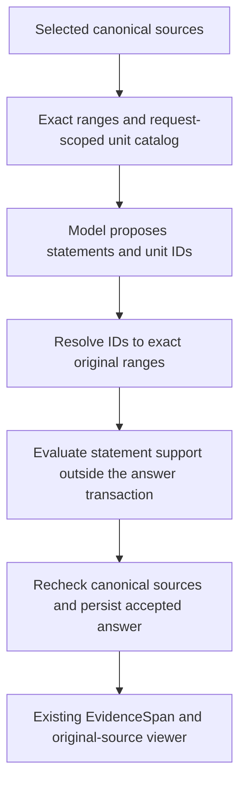

# Investment Research Archive — M1.5 RAG Quality Proof Plan

**Status:** Active — Step 2 source-ID workflow and evaluation integration implemented; comparison pending
**Date:** 2026-10-01  
**Milestone:** M1.5 — RAG quality proof, after accepted M1 and before M2

**Sources of truth:** [Delivery plan](./05-delivery-plan.md),
[M1 contracts](./11-m1-contracts.md), [system design](./02-system-design.md),
[domain model](./03-domain-model.md), [security and operations](./04-security-and-operations.md),
and accepted [ADRs](./adr/README.md). This plan advances selected M4 RAG work without claiming
that the full M4 gate is complete.

## 1. Outcome and boundary

The accepted M1 path already answers questions over saved, eligible PDF and pasted-text documents
with lexical and dense retrieval, typed generation, statement-support evaluation, and exact
original-source citations. M1.5 makes that path more robust and measurable for a local portfolio
demonstration. It does not turn the application into a public or production service.

The implementation order is M1 → M1.5 → M2 → M3 → remaining M4 work. M2 still owns durable
delivery, versions, reprocessing, deletion, and index reconciliation. M3 still owns archive
browsing, company metadata, filters, and a broader discovery/evaluation core. M4 still owns the
complete routed, conversational, temporal, and production-shaped direct-RAG gate.

Only approved public, synthetic, openly licensed, or otherwise approved non-sensitive material
may reach external providers. Fixed local identity and loopback-only access remain in force. No
new production dependency, paid provider, or hosted tracing service is approved by this plan.

## 2. Baseline and design rules

M1's selector alternates eligible PostgreSQL lexical and canonically qualified Pinecone dense
hits, deduplicates chunk IDs, and passes at most eight chunks and 24,000 code points to generation.
It has no RRF or reranking. The generator currently proposes a candidate ID and verbatim substring;
the server resolves offsets and rejects a missing or ambiguous quote. Luna's observed
`quote_not_found` failures make quote selection a specific M1.5 test case, not permission to
weaken validation.

- Preserve the M1 API response and citation-viewer contract unless a reviewed contract change is
  required. A selected model must never make an unsupported statement visible.
- Keep PostgreSQL and immutable originals canonical. Pinecone scores and model-selected IDs are
  untrusted suggestions, not evidence or authorization.
- Apply workspace, current-version, lifecycle, processing, configuration, and temporal eligibility
  before fusion, reranking, or generation, then revalidate evidence before answer publication.
- Keep deterministic correctness tests separate from measured retrieval and answer quality.
- Version every evaluated corpus, query, retrieval policy, citable-unit policy, reranker,
  prompt, model pair, and result manifest. Do not silently re-interpret M1 records.
- Compare added quality with latency, cost, and failure rates. Keep the M1 baseline available for
  an honest before/after comparison; do not adopt a more complex component without evidence.

## 3. Work sequence

Each step follows the repository order: backend behavior and tests, required CI, frontend only
where the step needs it, then the complete step gate. Work in coherent reviewable blocks and pause
between blocks. All required CI tests use deterministic adapters and spend no provider credits.

### Step 0 — Freeze the evaluation contract and starting baseline

Define a versioned, reviewed, redistributable corpus and question manifest before tuning ranking
or prompts. Include PDF and pasted text, multiple documents, exact-word and paraphrased questions,
answerable and unanswerable cases, a direct source conflict, repeated wording, Unicode, and a
question that exposes the known Luna quote failure. Each case records approved source spans or
explicit expected non-answer behavior; reviewers must not infer truth from the model's output.

Record the current M1 policy, fixture provenance and permitted provider exposure, model pair,
corpus/query versions, configuration, and descriptive baseline results. Select critical
correctness gates and quality measurements before comparing candidates. At minimum measure
candidate recall at the context budget, answer support, exact citation validity, appropriate
abstention/conflict handling, end-to-end latency, provider usage, estimated cost, and safe failure
rate. Small-sample statistics are descriptive, not population-level quality claims.

**Gate:** every case and expected evidence range is reviewed, the deterministic baseline is
reproducible offline, and any live baseline is separately opt-in, bounded, and recorded without
raw document text or secrets in logs, traces, or CI artifacts. No RRF tuning precedes this gate.

**Current Step 0 status (2026-10-07):** The owner reviewed the six synthetic cases in
[`fixtures/m1_5/evaluation.json`](../fixtures/m1_5/evaluation.json). The fixture digests and original
source ranges have a credential-free validator. Separate retrieval-only and end-to-end observation
scorers have deterministic unit tests, and canonical chunks and citations can be mapped to reviewed
source passages. An isolated PostgreSQL run now supplies the first retrieval-only M1 baseline:
required reviewed evidence was available in context for 5/5 answerable cases, using deterministic
embedding and SQLite vector adapters. Its measured median retrieval time was 6.5 ms on one local
run, not a provider latency estimate. See the [corpus guide](../fixtures/m1_5/README.md) for the
reproduction command and limitations. A separate credential-free contract test now exercises all
six reviewed cases against the canonical evidence validator with scripted proposals: exact
quotes, conflict and abstention shapes are accepted, while an altered quote and a rejected support
decision fail closed. This is a validator correctness check; its support decision is fixed by the
test. A complete offline application run now exercises retrieval through canonical answer
persistence and readback: 6/6 scripted coverage and citation outcomes match, including one conflict
and one abstention, and two injected invalid proposals persist `REJECTED` without published
content. Its first local median was 47 ms and maximum 71 ms, including passage mapping. The
existing PostgreSQL CI job discovers these tests automatically. The generator and support adapter
use reviewed fixture rules, so independent support assessments, provider usage, cost, and live
model quality remain unmeasured by these offline runs. The offline correctness baseline is
reproducible; the separately opted-in live starting measurements and subsequent owner acceptance
of the v2 baseline are recorded below. The offline runs alone did not close Step 0.

A credential-free live preflight now pins this reviewed corpus digest and reports the existing
M1 configuration and independently selected Terra/Luna model prices. Its sequential invocation
guard reserves attempted calls before access, retains unknown-usage reservations, validates
reported usage, and enforces role request limits and an OpenAI accounting ceiling of at most
USD 0.80. The [corpus guide](../fixtures/m1_5/README.md#credential-free-live-preflight) documents the
verified command, estimates, and limitations. It does not contact providers, authorize spend,
replace canonical application accounting, or record a live quality baseline. Budgeted wrappers
for all four provider roles and an owned Pinecone namespace lifecycle now have deterministic unit
coverage. The lifecycle limits unique vectors, applies total visibility and cleanup deadlines,
and reports failed cleanup while closing both index clients. The opt-in runner now connects the
frozen corpus to unchanged M1 retrieval, generation, canonical accounting, evidence validation,
and persisted-answer readback in its own migrated disposable PostgreSQL database. It records every
case, retains budget/provider/rejection failures, separates preparation from question usage, and
keeps unknown usage totals explicitly null. Its client and database cleanup is tested, and its
content-free JSON report records cleanup status without overwriting existing results. Existing
unit and PostgreSQL CI jobs discover the deterministic tests automatically. The command defaults
to credential-free preflight; paid execution requires both public-synthetic and Pinecone-Starter
confirmations plus an explicit output path. See the
[live-run guide](../fixtures/m1_5/README.md#opt-in-live-baseline). The owner subsequently executed
the bounded Terra/Terra baseline on 2026-10-06. Re-scoring its observations reproduced 5/5
answerable retrieval hits and 5/6 expected coverage outcomes, with one safely rejected ambiguous
quote. The measured configuration, latency, reservations, missing usage totals, historical
invocation ceiling, verified cleanup, and citation-score limitation are recorded in the
[live starting measurement](../fixtures/m1_5/README.md#recorded-live-starting-measurement).
That historical report has no independent support assessments. New offline and live observations
use the version-2 per-citation mapping contract and explicitly record
`m1.5-observation-score-v2`. It accepts multiple valid citations inside one expected passage while
rejecting unmatched or unexpected citations. Version-1 observations and historical scores retain
the old rule; no missing mapping is inferred. The contract and comparison boundary are maintained
in the [corpus guide](../fixtures/m1_5/README.md). Future retrieval-policy comparisons require v2
observations on both sides. RRF tuning has not started; starting-baseline acceptance is recorded
with the v2 run below.

The live runner now retains optional, allowlisted provider diagnostics and failed canonical
validation rules, also printed per failed case. No raw error, source, answer, or model-authored
validation reason is retained. Older reports remain readable but their missing diagnostics
cannot establish the cause of an earlier failure. The field contract is in the
[live-run guide](../fixtures/m1_5/README.md#opt-in-live-baseline). This diagnostic change does not
alter the M1 pipeline or close the independent quality-review gate.

The owner approved an explicit local-only inspection option for these frozen public-synthetic
cases. `--show-local-model-output` requires execution and an interactive terminal, rejects CI,
and displays proposals, quotes, support decisions, and canonical results without adding provider
calls or weakening validation. The JSON measurement report remains content-free. This is a manual
inspection aid, not an independent quality assessment; its boundary is documented in the
[live-run guide](../fixtures/m1_5/README.md#interactive-local-inspection).

The owner subsequently recorded a v2 Terra/Terra baseline under the approved USD 0.80 invocation
ceiling. It retained 5/5 answerable retrieval hits, 4/6 matching coverage and citation outcomes,
and two safe failures: an ambiguous budget quote and a rejected conflict statement. Cleanup was
verified. The [v2 measurement and qualitative review](../fixtures/m1_5/README.md#recorded-version-2-baseline-and-review)
records the unchanged configuration, descriptive latency, reservations, and missing cost totals.
The Codex content comparison is separate from the application's support decisions and is not
itself human approval or a structured independent-model evaluation. The corpus verifier reconfirmed
all six source ranges against the originals. The owner found the correct battery wording in the
console, and an offline replay rejected the altered attached quote; no validation defect was
demonstrated. The owner accepted the explained six-case measurement as the starting baseline on
2026-10-07. Step 0 is accepted for this scope; the transcript discrepancy is not an open technical
blocker. Preserve this run, including both failures; do not tune prompts or ranking to obtain a
selectively successful baseline. Unknown aggregate usage and cost remain unknown, and the report's
independent-support count remains 0/6. This acceptance neither closes the two failures nor claims
the final M1.5 quality gate. Step 1 is in progress; no runtime retrieval-policy change is active.

### Step 1 — Reciprocal rank fusion of the existing two lanes

Add an application-owned selector that fuses lexical and dense _ranks_, not incomparable raw
scores. Use a documented fixed RRF constant, deterministic tie-breaking, chunk-ID deduplication,
and the existing context budget. Keep lane-origin ranks and raw scores for audit; record the new
fusion policy/version and fused rank separately from M1 selection rank. Canonical qualification
must finish before a hit can contribute to fusion.

Test one-lane-only hits, hits in both lanes, ties, duplicates, empty lanes, stale/foreign vectors,
and budget boundaries. Compare the same reviewed cases with M1 round-robin and RRF without
changing embeddings, corpus, or prompts between runs.

**Gate:** all M1 correctness and isolation tests still pass. The RRF comparison is reproducible,
and the chosen default is justified by measured quality without critical evidence regressions.
If RRF does not help, retain M1 as the default and document the result.

**Current Step 1 status (2026-10-07):** The first work block implements standalone, typed RRF
fusion and context selection in Search. The fixed `m1-5-rrf-k60-v1` formula uses equal lane weights,
k = 60, exact rational ordering, and chunk-UUID tie-breaking. It preserves both lane contributions,
deduplicates chunks across lanes, rejects duplicate lane votes and inconsistent canonical payloads,
and retains separate fusion and selection ranks under the existing context bounds. The targeted
new-RRF and retained-M1 selector checks passed 40 tests plus formatting, lint, and typing. See the
[Search module guide](../backend/src/investment_research/modules/search/README.md#standalone-m15-reciprocal-rank-fusion)
for the formula and boundary.

The second work block wires RRF as an explicit internal profile in the existing research service,
after canonical qualification and before the unchanged context budget. Every qualified lane record
retains its original rank and score plus the shared chunk's fusion rank, including unselected hits.
The scoped repository reconstructs the fixed-policy ranks before staging writes; the existing
`fused_rank` column needs no migration. The normal composition still supplies the M1 profile: no
default switch, new provider call, environment setting, API field, reranker, or frontend change is
included. Offline service and PostgreSQL tests cover audit round trips, source identities, budget
exclusions, and foreign/unknown/inactive/temporal/document-filter exclusions. Existing CI discovers
these tests through `scripts.verify_backend` and `scripts.verify_postgres`.

**Second-block verification (2026-10-07):** `scripts.verify_backend` passed formatting, lint,
typing, and 1,277 unit tests. `scripts.verify_postgres` passed the empty upgrade/downgrade/upgrade
cycle, schema-drift checks, and 111 integration tests, including all four new RRF cases. Seven
SeaweedFS-only tests were skipped by that PostgreSQL-only gate. The disposable database and its
owned resources were removed afterward. No live providers, browser, or frontend build were used
for this backend-only work block.

**Paired offline comparison (2026-10-07):** A third work block records M1 and RRF selections from
the same canonically qualified lanes for all six frozen questions. It adds a strict content-free
comparison report and scorer, with reproducible test-only chunk identities and the unchanged
context limits. Both policies retained all required evidence for 5/5 answerable cases; all six
selected chunk sets and orders were identical. Four questions had no lexical hits; the other two
had one lexical hit each. This is a weak discrimination sample using deterministic substitutes,
not evidence of improved live retrieval or model-answer quality. The
[paired comparison guide](../fixtures/m1_5/README.md#paired-m1rrf-offline-comparison) records the
case-level ranks, timing boundary, verified commands, and limitations.

Verification passed 1,296 backend unit tests, formatting, lint, typing, and 112 PostgreSQL tests
with seven unrelated SeaweedFS-only skips. The migration cycle and schema checks passed, and the
disposable database resources were removed. Existing CI discovers the paired test automatically;
no provider call, historical report rewrite, frontend change, or default switch occurred.

**Live-selector preparation (2026-10-07):** A fourth work block adds the explicit evaluation-only
`--retrieval-policy m1|rrf` option to the free planner and opt-in runner. The default remains M1.
The runner uses the planned frozen selector, and its v2 observations and summary record that
version. Models, prompts, corpus, context bounds, request ceilings, and USD 0.80 per-invocation
budget are unchanged. Unknown selector versions fail closed. Existing CI automatically exercises
both profiles across success, budget exhaustion, provider failures, quote rejection, and rejected
support; PostgreSQL assertions inspect the stored selector versions and RRF fusion ranks.
Verification passed formatting, lint, typing, 1,300 unit tests, and 126 PostgreSQL tests with seven
separate storage skips. Migration/drift checks and owned database cleanup passed. Both free RRF
preflight commands were executed; no paid run, browser, frontend change, or historical rewrite
occurred. The [live selector guide](../fixtures/m1_5/README.md#live-selector-experiment) explains
that separate invocations are not paired candidate snapshots and that their combined spend is
not automatically approved.

**Approved live comparison protocol (2026-10-07):**
`m1.5-sequential-live-comparison-v1` specifies one fresh M1 run followed by one RRF run with
Terra/Terra, all six frozen cases, unchanged configurations, and new v2 reports. The owner approved
the combined reservation envelope of USD 1.60 as two existing USD 0.80 invocation caps and
executed both runs. There are no selective retries, implicit budget increases, or default
changes. Verified cleanup and compatible configurations are prerequisites for comparison.
The [protocol](../fixtures/m1_5/README.md#live-comparison-protocol) defines the metrics,
stop conditions, and inference limits. Separate live runs are descriptive, not a controlled
candidate-snapshot experiment; unchanged or inconclusive results retain M1.

**Recorded live outcome and default decision (2026-10-07):** Both policies retained required
evidence for 5/5 answerable questions. M1 matched expected coverage in 5/6 cases and catalog
citations in 4/6; RRF matched both in 3/6. Both retained the ambiguous pilot-budget quote failure;
RRF additionally rejected rollout and conflict statements during support/coverage validation.
Neither report recorded an unsafe failure; both verified cleanup. Combined reservations were
USD 1.301216, not actual charges. Aggregate usage/cost and independent answer-support review
remain unavailable. Re-scoring reproduced both stored summaries. The
[measurement record](../fixtures/m1_5/README.md#recorded-sequential-live-comparison-2026-10-07)
preserves hashes, timings, configuration checks, failures, and inference limits.

Retain M1 as the default: the offline comparison was unchanged and the live observations showed
no demonstrated benefit justifying adoption. RRF remains an evaluation-only profile. This is a
bounded negative/inconclusive experiment, not proof that RRF is generally inferior. No further
paid run is approved, and quote or support validation is not weakened. Step 2 targets the known
quote-selection limitation rather than repeating this ranking experiment.

Frontend format, lint, typing, contract checks, and 45 tests passed. At the time of comparison
recording, the production build and required hosted checks, including the M1 runtime gate, still
needed confirmation. The owner subsequently reported the RRF branch merged; retain those gate
confirmations before integrating the Step 2 provider profile. No browser was used during review. The offline
retrieval-only report is not a v2 answer observation; the sequential live reports do not establish
independent support quality or complete the M1.5 acceptance gate.

### Step 2 — Model-selectable citable source units

Design a bounded set of pre-generation citable units derived deterministically from eligible
canonical `StructureBlock` text. Give each unit an opaque request-scoped ID and exact
block-relative Unicode-code-point range. The model may select unit IDs for a statement instead of
copying `exact_text`; the server resolves each ID to immutable original text and the existing PDF
page or pasted-text locator. An ID does not itself authorize support: the statement-support
evaluator and canonical evidence checks remain mandatory.

Freeze the unit-boundary and ID contract before code changes. Do not store a new `EvidenceSpan`
merely because a unit was offered to a model, and do not replace stable original-document anchors
with chunk or vector IDs. Preserve historical M1 answers and the source viewer. Test repeated
phrases, whitespace, line breaks, Unicode, overlapping/adjacent units, unknown IDs, mixed or
cross-workspace IDs, changed eligibility, and multiple supporting units.

**Gate:** exact citations still open the original location, invalid IDs fail closed, and the
reviewed Luna quote-failure cases are compared against the prior exact-substring contract. No
fuzzy match or whole-chunk citation is accepted as a workaround.

#### Step 2 contract — Citable units v1

**Design recorded:** 2026-10-07. The standalone preparation/resolution and ID-adapter blocks below
implement part of this contract; runtime integration and adoption remain open. This is not a
default-policy change or evidence that Step 2 passed. After reporting the RRF branch merged, the
owner confirmed Step 1's production-build and hosted-CI readiness before the ID-adapter block.
That confirmation is owner-reported, not independently executed build or hosted verification.
The existing M1 quote profile remains available and unchanged for historical interpretation.

The design follows the source-ID/locator separation in the official
[citation guide](https://developers.openai.com/api/docs/guides/citation-formatting). Strict
[Structured Outputs](https://developers.openai.com/api/docs/guides/structured-outputs?api-mode=responses)
can restrict selection to supplied IDs, but cannot establish statement support. The exact
granularity and limits below are project decisions to evaluate, not a claim of universal optimality
or state-of-the-art answer quality. This internal generation policy preserves ADR-0008's adapter
boundary and ADR-0009's canonical anchors; it does not introduce another canonical entity.

**Preparation and boundaries**

- Build the catalog in Research after canonical qualification and context selection, before answer
  generation. Retain the selected context's existing bounds of 8 chunks and 24,000 Unicode code
  points. Do not retrieve, embed, index, or call a model to create units.
- Derive ranges from the complete immutable `StructureBlock.text`, not from a rewritten chunk.
  The current M1 chunk equals one complete block. Reject a source that cannot be proven to map
  to that block; future overlapping or multi-block chunk policies require explicit range mapping,
  not an assumed zero offset.
- Use the version `m1-5-citable-units-en-v1`. In original order, split at a run of `.`, `?`, or `!`,
  followed by zero or more closing characters from `"'”’)]}`, then whitespace or the block end.
  Also split at blank-line paragraph separators: two line feeds with only spaces or tabs between
  them. A single PDF line break is not a boundary. Include terminal punctuation and closing
  characters in the preceding range. This is a deterministic English heuristic, not linguistic
  sentence recognition; abbreviations and list punctuation can produce short units.
- Limit each unit to 800 code points. For a longer range, split at the last whitespace position
  after the current start and at or before that limit; if none exists, split exactly at the limit.
  Remove leading/trailing separator whitespace only by moving range endpoints. Never normalize,
  dehyphenate, paraphrase, reorder, or change characters inside a range. Retain every non-whitespace
  character, including text without sentence punctuation.
- Units are nonempty, ordered, non-overlapping, block-relative half-open ranges `[start, end)`.
  Each contains visible text and satisfies `unit.text == block.text[start:end]`. A short block may
  legitimately yield one unit; do not expand another selected range to a whole chunk as recovery.
- Deduplicate equal canonical ranges, not equal text. Two occurrences of the same sentence at
  different offsets remain two distinct units. If future overlapping candidates expose the same
  mapped range, offer it once and retain the first selected candidate as its retrieval provenance.
- Offer at most 256 units per request. Overflow fails before answer generation with a safe,
  application-owned limit error. Do not silently omit later passages, merge all units into a
  chunk-sized fallback, or ask the model to repair the catalog. The cap and 800-character limit
  require explicit boundary tests and quality measurement before adoption.

**Identity and provider contract**

The server-only canonical key is `(workspace_id, document_version_id, structure_block_id,
start_character, end_character, unit_policy_version)`. It is independent of lexical/dense lane,
chunk rank, and wording elsewhere. Use this key for deterministic deduplication; do not create
a database row or log source content for it.

Derive the provider-visible `source_unit_id` as UUIDv5 with the research-request UUID as namespace
and the canonical key serialized as a fixed-order compact JSON array, using lowercase UUID strings
and integer offsets. This gives reproducible handles within one request and distinct handles across
requests. The canonical range stays stable across unchanged inputs; the external handle is
request-scoped, not a permanent citation ID, secret, or authorization token. Resolve it only in the
current server-owned catalog, never through a global lookup or by decoding model-supplied metadata.

Present units in selected-source order and block-offset order, grouped under their source. Serialize
the original source text once, with unit IDs and boundaries as metadata; do not duplicate the full
chunk and every unit's text in the prompt. Preserve surrounding context. Quote-like instructions
inside a source remain untrusted data. The model selects one or two distinct supplied
`source_unit_id` values per statement; it returns neither `exact_text` nor offsets nor a
retrieval-candidate ID for this profile. Keep the existing 8-statement limit, four coverage states,
and `missing_information` rules. A claim requiring more than two units must be decomposed into
independently supported statements or safely omitted, not bypass the evidence limit.

The strict provider schema defines the current catalog IDs once as a shared enum and forbids extra
fields. The adapter also checks catalog membership and duplicate IDs, independently of provider
schema compliance. An empty catalog must not produce an empty enum or a paid generation call;
use the existing no-evidence path. Unknown, cross-request, mixed-catalog, or duplicate references
fail closed, with bounded content-free diagnostics.

**Resolution, validation, and compatibility**

Resolve each selected unit to its catalog-owned retrieval candidate, exact block range, and exact
text. Return the existing `UnvalidatedEvidenceReference` shape to application validation. The
statement-support evaluator still receives the statement and resolved exact evidence text outside
the answer transaction. Before atomically storing an accepted answer, reload and revalidate all
canonical workspace, request/candidate, active-version, processing, temporal, text, and range rules.
A known ID is not proof of support. Do not combine separated units into a larger implied quote or
use fuzzy matching to rescue an invalid reference.

Create or reuse `EvidenceSpan` records only through the existing validated-answer persistence path.
Offering a unit creates no evidence record. Retain the existing PDF locator, pasted-text absolute
range calculation, evidence-span URL, HTTP/OpenAPI events, and source viewer. No migration,
reprocessing, vector upload, frontend change, or historical answer rewrite is required by this
contract. New generator/configuration/prompt versions must identify the unit policy; do not
reinterpret the frozen M1 versions. Validate serialized-input/schema overhead against existing
token reservations before enabling any paid comparison; no budget increase or live run is approved
by this design.



**Work blocks and verification**

1. Implement typed catalogs, deterministic range construction, identity, and resolution, with
   unit tests for repeated text, whitespace, PDF wrapping, abbreviations, decimal numbers,
   Unicode, long unbroken text, adjacent units, canonical deduplication, and exact cap boundaries.
2. Add a separately versioned ID-selection generator profile and strict-schema tests; retain the
   M1 quote profile. Prove rejection of unknown/duplicate/cross-request IDs and unchanged coverage,
   failure, usage-accounting, local-output, and no-provider-call behavior.
3. Wire the profile through the research workflow and evaluation runner without changing the
   runtime default. PostgreSQL tests cover same-text/different-offset citations, reused evidence,
   two supporting units, foreign sources, changed eligibility after support evaluation, and
   historical PDF/text citation readback. Existing CI must discover these deterministic tests;
   frontend contract and complete runtime gates confirm compatibility.
4. After correctness checks, obtain separate approval for a bounded old/new live comparison on
   unchanged cases, retrieval, and model pair. Include the repeated-budget case and observed Luna
   PDF quote failures. Record citation validity, independently reviewed support, coverage, safe
   failures, latency, usage, cost, and catalog size. Do not claim an evaluator false rejection or
   improved answer quality merely because copied-quote errors disappear. Adopt only with a
   documented benefit and no critical regression; otherwise retain M1.

**First backend block (2026-10-07):** Research now owns standalone typed source pairs, canonical
range keys, request-scoped UUIDv5 handles, validated catalogs, deterministic range construction,
and resolution to the existing `UnvalidatedEvidenceReference`. They enforce the frozen bounds,
complete block mapping, trusted workspace, exact Unicode slices, canonical deduplication, source
order, non-overlap, and preservation of visible source content. Resolution rejects unknown,
duplicate, foreign, mixed-catalog, and cross-request references without fuzzy recovery. See the
[Research guide](../backend/src/investment_research/modules/research/README.md#standalone-m15-citable-unit-preparation)
for file responsibilities and the trust boundary.

The complete `scripts.verify_backend` gate passed formatting, lint, full typing, and 1,357 unit
tests, including 57 new source-unit cases. Existing unit CI discovers the tests automatically.
No dependency, database schema, provider adapter, bootstrap wiring, API, frontend, historical
answer, or runtime default changed. No provider, PostgreSQL, Docker, browser, or frontend build
was run for this pure in-memory backend block. The remaining Step 2 integration, source-opening,
compatibility, hosted verification, and approved quality-comparison gates remain open.

**Second backend block (2026-10-07):** The standalone `OpenAICitableUnitAnswerGenerator` now
selects one or two request-scoped source-unit IDs per statement and resolves them to existing
unvalidated evidence references. `CitableAnswerGenerationInput` binds the catalog to the trusted
workspace, request, ordered source provenance, and exact text. The provider schema declares the
current ID enum once; the application independently rejects foreign, unknown, cross-request,
mixed, and duplicate IDs. Sources are serialized once, alongside ID/range metadata. Repeated
wording retains distinct original offsets without copied-quote or fuzzy-match recovery.

The adapter reuses M1's bounded transport, safe error categories, exact usage validation, and
explicit local-output callbacks, while keeping separate prompt/schema/resolution hooks and new
model-specific profile versions. All four coverage states and the existing partial-answer field
rule remain. Neither a valid ID nor a schema-valid answer establishes statement support.

Preflight retains the existing 16,000-unit input-overhead reservation. It measures serialized
metadata, prompt, and schema bytes, with 512-unit margins each for SDK schema expansion and request
framing; question and source bytes remain reserved separately by M1 accounting. Catalogs may
contain up to 256 units, but a metadata-heavy request can hit the unchanged reservation sooner.
Empty catalogs and reservation overflows make no generation call. Integration must preserve the
existing no-evidence path and map preparation failures safely before any paid operation.

At the end of this second block, the profile was not yet wired into Research, bootstrap, or the
evaluation runner; the third block below supplies opt-in workflow integration. M1's quote profile,
normal runtime defaults, API, source viewer, persisted answers, database schema, and dependencies
remain unchanged. Existing unit CI discovers the new adapter tests; no workflow or frontend edit
is required for this standalone block. Workflow/ledger integration, PostgreSQL citation readback,
complete compatibility gates, hosted confirmation, and separately approved live comparison
remained open for that block. See the [Generation guide](../backend/src/investment_research/infrastructure/generation/README.md#standalone-m15-source-unit-id-adapter).

Verification passed `scripts.verify_paths` (153 targeted tests, including retained M1 and catalog
regressions) and the complete `scripts.verify_backend` gate: formatting, Ruff, full typing, and
1,412 unit tests, including 55 new adapter cases. The pinned SDK's actual strict-schema conversion
was checked offline, including the 256-ID enum and the schema-expansion margin. No paid provider,
PostgreSQL, Docker, browser, or frontend build was run for this standalone backend block.

**Third backend block (2026-10-07):** The opt-in Research input builder reloads selected candidate
eligibility and complete original blocks through a short workspace-scoped PostgreSQL read. It
verifies selected provenance, media locators, ranges, and text before detaching the catalog.
Provider preflight occurs outside that read and before canonical or evaluation spend reservation.
An empty selection produces the existing insufficient aggregate with no generation/support calls.
Nonempty requests retain the existing ledger, support evaluation outside a transaction, final
canonical recheck, atomic persistence, canonical evidence-span reuse, and source-opening contract.

The evaluation plan and runner now independently select M1/RRF retrieval and M1/source-unit
answers. `--answer-policy citable_units` is explicit; M1 remains the CLI and website default.
The frozen prompt version resolves to the separate model-specific generation profile. The
existing 80-cent invocation ceiling and 16,000-unit generation overhead remain unchanged. The
budget wrapper counts original source and question bytes once, not duplicate server-only catalog
snapshots. Unknown profile versions fail instead of silently falling back. No database schema,
dependency, bootstrap, public API, or frontend implementation changes.

This free preflight prints the selected plan without keys, Docker, or provider requests:

```bash
cd backend
uv run --locked python -m scripts.verify_m1_5_live_baseline \
  --retrieval-policy rrf \
  --answer-policy citable_units
```

Execution is still separately opt-in and requires `--execute`, both existing confirmations, and
a new ignored JSON output path. This implementation does not approve another paid comparison.
Existing backend-unit and PostgreSQL CI discover the new tests; no artificial CI/frontend edits
are needed. Hosted checks and complete M0/M1 runtime compatibility remain merge gates.

**Known deterministic quality limitation:** With unchanged v2 scoring, all six scripted answers
have expected coverage and all five answered cases have exact canonical citations, but only five
of six cases satisfy reviewed citation matching. The first PDF unit includes a heading preceding
the reviewed FY2025 revenue passage; its wider range fails the frozen containment metric. Keep
this penalty visible instead of changing anchors, scoring, or source text to improve the result.
Neither scripted support nor transport correctness establishes live answer quality. Granularity,
independent support review, bounded old/new live comparison, and adoption remain open.

Verification for this third block passed the complete backend gate (308 formatted Python files,
Ruff, Mypy over 278 source files, and 1,443 unit tests), the disposable PostgreSQL gate (136 passed,
seven SeaweedFS-only tests intentionally skipped), migration round-trip and schema checks, the
free RRF/source-unit preflight, and `git diff --check`. Frontend formatting, lint, type checking,
contract drift checks, and all 45 tests passed. The owner confirmed the production build; an
agent-side sandbox build could not bind the port required by Turbopack. No paid provider requests,
browser checks, complete M0/M1 runtime checks, or hosted CI confirmation were performed for this
block. These results verify opt-in integration, not live quality or adoption.

### Step 3 — Bounded reranking experiment

Research a maintained multilingual cross-encoder or provider behind a small typed adapter.
Before adding a dependency or paid service, review security, license, data handling, Python 3.14
compatibility, release age, runtime resources, latency, and cost with the user. Keep a no-rerank
path. Reranking receives only canonically eligible, bounded candidates, and its output cannot
introduce an unqualified source or relax the evidence contract.

Compare M1, RRF, and RRF-plus-rerank on the same frozen cases. Include timeout, invalid score,
provider outage, and budget tests. A reranker is adopted only when measured benefit justifies
added complexity and latency; a negative result is a valid documented outcome.

**Gate:** deterministic CI passes without the real reranker, live checks remain separate and
bounded, and the selected policy has a recorded quality/latency/cost comparison.

### Step 4 — Quality hardening and portfolio evidence

Exercise the four existing coverage states (`COMPLETE`, `PARTIAL`, `CONFLICTING`,
`INSUFFICIENT`) across both available answer/support-model choices. Review failures by stage and
reason without making raw provider output a normal log or UI feature. Fix narrowly demonstrated
retrieval, selection, prompt, or validation issues and rerun the frozen cases after each change.

Publish a concise, reproducible local architecture explanation, versioned evaluation summary,
before/after examples, costs, known limitations, and a safe demo script using only approved
documents. The user may capture screenshots or run the browser journey themselves; public hosting
remains M6, not an M1.5 deliverable.

**Gate:** the complete M1 runtime and source-opening gates pass; no critical workspace,
eligibility, citation, abstention, or provider-failure regression remains; results and limitations
are reproducible and accurately described. This is a local RAG quality proof, not an M2 reliability
gate or the full M4 release gate.

## 4. Handoff and stop rule

Stop M1.5 when its reviewed correctness gates pass and the chosen retrieval/citation approach has
one reproducible baseline comparison with quality, latency, and cost. Do not extend the phase
indefinitely to chase every model failure or metric. Record unsupported or inconclusive variants
and hand off to M2; expand the corpus and discovery measurements in M3; finish routing,
conversation, temporal modes, tracing/export decisions, and the full direct-RAG gate in M4.

The first implementation block after this plan is the evaluation contract and baseline. No new
ranking or model dependency should be introduced before those cases are reviewed.
