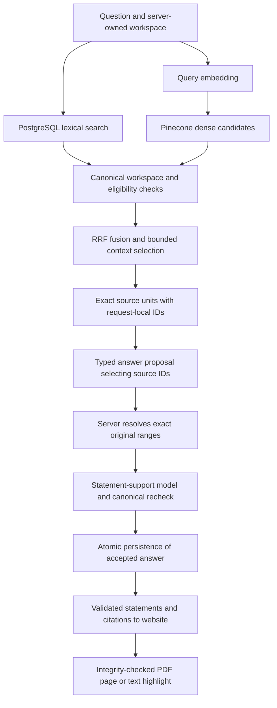

# M1.5 — Evidence-grounded RAG portfolio guide

**Snapshot:** 2026-10-10; local implementation and recorded evaluation, not milestone acceptance.

Investment Research Archive answers questions over saved PDF and pasted-text documents with
verifiable original-source citations. The application owns retrieval, source selection,
validation, and usage accounting; models propose answers but cannot authorize evidence.
This guide explains the implemented M1.5 path, its measured limits, and an owner-run local demo.
The [M1.5 plan](./13-m1-5-rag-quality-plan.md) remains the source of truth for completion gates;
the [source review](../fixtures/m1_5/closeout-review.md) records the evaluation evidence.

## 1. Implemented architecture

Ingestion stores immutable originals in S3-compatible storage (SeaweedFS locally) and canonical
document/version/processing records in PostgreSQL. Celery workers parse documents, create
versioned chunks, obtain embeddings, and populate the derived Pinecone index. Redis carries
transient queue state, not the only copy of product records. Research can use eligible saved
documents without another upload.

The opt-in `m1-5-citable-units` API profile follows this bounded research path:



- Lexical retrieval uses PostgreSQL full-text search (`tsvector`, GIN, `ts_rank_cd`), not BM25.
- Dense retrieval uses OpenAI embeddings and a workspace-specific Pinecone namespace. External
  hits must resolve to eligible canonical chunks; vector scores are not evidence authorization.
- RRF combines rank positions from the two lanes rather than adding incompatible raw scores.
  A chunk found by both lanes is one candidate with two rank contributions.
- Context is bounded to eight sources and 24,000 code points. Versioned source units carry exact
  canonical ranges; the model selects short request-local handles such as `u1` instead of
  copying a quote. The server rejects unknown or invalid selections.
- The support model receives one proposed statement and its resolved exact quotes, plus a checked
  document prefix for company/report/date attribution only. The prefix cannot supply missing
  operational facts. Model calls occur outside the answer-writing transaction; canonical state
  is rechecked before accepted statements and spans are persisted together.
- `COMPLETE`, `PARTIAL`, `CONFLICTING`, and `INSUFFICIENT` are application-owned coverage states.
  Raw model prose is not published merely because its JSON parses. Citations resolve to original
  document spans, not mutable chunks or vector IDs.

| Responsibility | Code entry point |
| --- | --- |
| Runtime profile composition | [bootstrap.py](../backend/src/investment_research/bootstrap.py) |
| Lexical retrieval | [search/postgresql.py](../backend/src/investment_research/infrastructure/search/postgresql.py) |
| Rank fusion | [search/fusion.py](../backend/src/investment_research/modules/search/fusion.py) |
| Canonical source-unit preparation | [research/citable_generation.py](../backend/src/investment_research/modules/research/citable_generation.py) |
| Structured source-ID generation | [generation/openai_citable_units.py](../backend/src/investment_research/infrastructure/generation/openai_citable_units.py) |
| Statement-support provider | [evidence/openai.py](../backend/src/investment_research/infrastructure/evidence/openai.py) |
| Answer orchestration and persistence boundary | [research/answer_validation.py](../backend/src/investment_research/modules/research/answer_validation.py) |

The [system design](./02-system-design.md) also contains later target behavior; it must not be
read as a claim that routed queries, conversation, or all lifecycle workflows exist today.

## 2. Profiles and concrete changes from M1

| Aspect | Retained M1 baseline | Implemented M1.5 option |
| --- | --- | --- |
| Hybrid selection | Alternating lexical/dense hits, deduplicated by chunk | Unweighted RRF with recorded lane contributions |
| Citation selection | Model supplies candidate ID and copied exact substring | Model selects source-unit IDs; server supplies exact original text and ranges |
| Repeated wording | An ambiguous copied substring fails safely | A selected unit identifies a particular canonical occurrence |
| Support attribution | Exact selected quotes | Exact quotes plus a restricted, checked same-document prefix |
| Reranking | None | Separate opt-in Pinecone BGE experiment, not enabled by the website profile |

For example, M1 could reject Luna's proposed quote after the model changed PDF line breaks.
Source-ID selection removes the requirement for the model to reproduce those characters; it
does not guarantee that the selected evidence supports the proposed claim. A repeated EUR 12
million budget sentence likewise needs a selected occurrence, not permission to choose an
arbitrary matching string. Canonical and semantic support validation remain mandatory.

The prompt-v6 focus correction asks for only the question's requested facts while retaining
necessary uncertainty and conflict. In the reviewed rollout answer, the published statement
contains the transformer constraint without the earlier unsolicited supplier forecast. This is
a recorded example, not a controlled causal measurement of the prompt change.

M1 remains the configuration default and a comparison path. M1.5 is available through explicit
API profile selection, without migrations or reindexing. The normal website support response
contains only `supported: true/false`; a separate local evaluation option requests a short reason
and changes the support prompt/schema. Raw failure logging is another opt-in diagnostic, not a
normal product feature. No default, model, or diagnostic setting changes in this guide.

## 3. Recorded evaluation, not a general accuracy claim

The owner-run observation on 2026-10-09 used the reviewed twelve-case `closeout-v2` catalog:
three fictional CC0 originals, RRF `m1-5-rrf-k60-v1`, source-unit answer prompt v6, Luna/Luna,
no reranker, and the **diagnostic support-reason variant**. The
[case-by-case review](../fixtures/m1_5/closeout-review.md#prompt-v6-live-observation-and-qualitative-source-review--2026-10-09)
retains catalog/report digests, source assessments, and owner approval. Historical reports stay
ignored and unchanged; raw provider output is not a portfolio artifact.

| Measurement | Recorded result |
| --- | --- |
| Execution failures / cleanup | 0/12; VERIFIED |
| Expected coverage state | 12/12 |
| Required factual evidence present | 10/10 answerable cases |
| Exact citation validity | 10/10 checked answers |
| Correct uncited abstention | 2/2 |
| Strict citation target match | 10/12 |
| Median / maximum question latency | 4,895 ms / 10,411 ms |
| Estimated question-phase / total OpenAI cost | USD 0.010788 / USD 0.010813 |
| Conservative retained reservation | USD 0.138298, not an actual charge |

The strict score remains 10/12: three additional genuine company/report/date attribution links
across two answers were outside the frozen factual targets. Do not turn exact quote validity
into a claim of perfect citation precision. The qualitative developer-agent review found no
unsupported material claim among 14 published statements; the owner accepted that review, not
an independent human assessment of every statement. Structured independent-support assessment
in the historical report remains pending.

Earlier small M1-versus-RRF and RRF-versus-reranker comparisons did not establish a quality
benefit justifying default adoption. Their protocols and limitations remain in the
[M1.5 plan](./13-m1-5-rag-quality-plan.md). Catalog v2 corrected one question's unsupported fiscal
period, so its results are not an unchanged paired comparison with v1. The twelve-case result
does not measure the normal Boolean-only support prompt, current Terra-v6 quality, or reliability
on varied real documents. Costs use repository price policies, exclude Pinecone billing, and
are not provider invoices; maximum reservations must not be presented as token charges.

## 4. Safe owner-run local demonstration

Use only the approved synthetic originals listed in the [review guide](../fixtures/m1_5/closeout-review.md#documents-and-scope).
Prerequisites and owner-managed credentials are in the [root run guide](../README.md#install).
Use a local workspace containing only approved demo material. Do not clear an existing archive,
inspect secrets, or enable raw diagnostics to prepare a recording. Normal provider charges apply.

From the repository root, start the provider-backed stack with an explicit M1.5 profile:

```shell
INVESTMENT_RESEARCH_RESEARCH_PROFILE=m1-5-citable-units \
  docker compose --env-file .env -f compose.yaml -f compose.m1-live.yaml up --build --detach --wait
```

Keep that explicit profile when recreating the API: a later ordinary Compose invocation may
restore the M1 default. Do not add `compose.m1-local-diagnostics.yaml`. The profile preserves the
ordinary Boolean-only support response and does not activate BGE reranking.

Open `http://127.0.0.1:3000` yourself. Choose answer/support models explicitly; Luna/Luna matches
the recorded answer-model pair, but not its diagnostic support prompt. A demo observation is a
new live result, not an automatic repeat of the saved scores.

1. Import the approved FY2025 PDF if absent and wait for `SEARCHABLE`. Select
   `Current processed document`; ask “What were Northstar's FY2025 revenue and year-over-year
   growth?” Inspect the validated facts and open the citation at physical PDF page 2.
2. Paste the approved capacity update if absent and wait for `SEARCHABLE`. In the same document
   scope, ask “What is the primary constraint on new customer deployments?” Expect a supported
   transformer-shortage answer; open the exact text highlight.
3. With that document still selected, ask “What is the European pilot budget?” Expect
   `INSUFFICIENT`: a budget in another document must not fill the selected document's gap.
4. For a multi-document example, first import the approved operations note, then select
   `All saved documents` and ask “What do the reports say is the primary constraint on
   new customer deployments?” Inspect both conflicting claims and their separate original
   citations. Do not resolve the disagreement from general model knowledge.
5. Record profile, model pair, question, coverage, citation-opening result, and any safe error.
   Capture only approved synthetic content; omit keys, private hosts, raw logs, and account pages.

This is a manual demonstration, not a new automated evaluation result or public deployment.
Existing searchable sources do not need re-uploading just to change the research profile.

### Credential-free reproduction checks

From `backend/`, validate the reviewed catalog and preview the matching **normal-support** plan:

```shell
uv run --locked python -m scripts.verify_m1_5_corpus \
  --manifest ../fixtures/m1_5/evaluation-closeout-v2.json --require-reviewed
uv run --locked python -m scripts.verify_m1_5_live_baseline \
  --corpus closeout-v2 --retrieval-policy rrf --answer-policy citable_units \
  --support-policy document_attribution \
  --answer-model gpt-5.6-luna --support-model gpt-5.6-luna --max-spend-usd 0.80
```

These commands make no provider calls and do not prove answer quality. Live execution is a
separate owner-approved action requiring execution confirmations, credentials, and a fresh
ignored report path. `--show-local-model-output` would additionally request support reasons;
omit it when measuring the normal website support contract. See the
[evaluation guide](../fixtures/m1_5/README.md) for the full bounded execution protocol.

## 5. What this demonstrates, and what remains

A defensible portfolio description is: “Built an application-owned local RAG pipeline with
PostgreSQL lexical and Pinecone dense retrieval, optional RRF and cross-encoder reranking,
structured source-ID generation, canonical citation validation, model-based statement support,
and bounded provider-usage accounting. Recorded a versioned twelve-question synthetic evaluation
with explicit abstention, conflict, latency, cost, and citation-precision limitations.”

Do not claim production readiness, authenticated multi-user deployment, measured superiority
of RRF/reranking, representative accuracy, or deployed LangSmith evaluation. Fixed local identity,
loopback access, bounded English source-unit heuristics, and public/synthetic-only provider use
remain constraints. Provider outages, limits, and semantic-support errors can still stop a
request safely; source IDs prevent copying mistakes, not every reasoning or retrieval error.

Backend and PostgreSQL checks, frontend checks, and owner-reported M1 runtime/build results are
recorded in the [plan](./13-m1-5-rag-quality-plan.md). The credential-free M1 runtime gate does not
establish live M1.5 profile quality. Final hosted-CI confirmation, explicit profile/disposition
decisions, and milestone acceptance remain separate; this documentation closes none silently.
M2 owns ingestion/lifecycle reliability, M3 archive/discovery and broader corpus measurements,
and remaining M4 work owns routing, conversation, temporal modes, and the full direct-RAG gate.
