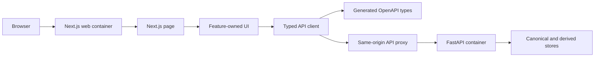

# Frontend

This directory contains the English-first Next.js web application. It presents archive workflows and communicates with backend capabilities only through FastAPI.

## Structure

| Path                      | Responsibility                                                 |
| ------------------------- | -------------------------------------------------------------- |
| `src/app/`                | Next.js App Router layout, pages, and global styles.           |
| `src/features/`           | Feature-owned UI state, components, and English copy.          |
| `src/lib/`                | Shared product copy and the typed API boundary.                |
| `tests/`                  | Deterministic frontend contract and product tests.             |
| `.env.example`            | Safe local example for the server-only FastAPI origin.         |
| `Dockerfile`              | Locked multi-stage standalone build and Distroless runtime.    |
| `Dockerfile.dockerignore` | Allowlisted build context that excludes local and secret data. |
| `package.json`            | Frontend dependencies and executable development checks.       |
| `next.config.ts`          | Standalone output and allowlisted same-origin API target.      |
| `postcss.config.mjs`      | Tailwind CSS PostCSS integration.                              |
| `tsconfig.json`           | Strict TypeScript and Next.js compiler configuration.          |

## Data boundary

The API client uses generated types, checks received payloads at runtime, and reaches FastAPI through
a same-origin Next.js rewrite. Product feature screens call that client rather than constructing
transport requests themselves. The frontend must never connect directly to PostgreSQL, object
storage, Redis, Pinecone, or AI providers.

## Container boundary

The build stage uses the repository-pinned Node and pnpm versions with the frozen workspace lockfile
to create the Next.js standalone output. The final image copies only that output and static assets
into the signed, digest-pinned Distroless Node 24 runtime. It runs as UID/GID `65532`, contains no
shell or package manager, and exposes no build tools or source tree.

Host development accepts only a credential-free loopback FastAPI origin. The container build fixes
the server-side target to `http://api:8000`; arbitrary service names, credentials, paths, queries,
and fragments are rejected. Compose connects the web service only to the frontend network and
publishes its port on loopback.

The generated API types are development-only declarations and add no browser runtime code. Installation, startup, and verification commands are maintained in the repository [`README.md`](../README.md).
