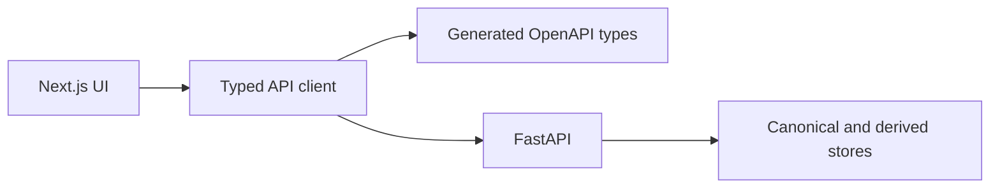

# Frontend

This directory contains the English-first Next.js web application. It presents archive workflows and communicates with backend capabilities only through FastAPI.

## Structure

| Path                 | Responsibility                                           |
| -------------------- | -------------------------------------------------------- |
| `src/app/`           | Next.js App Router layout, pages, and global styles.     |
| `src/lib/`           | Shared product copy and the typed API boundary.          |
| `tests/`             | Deterministic frontend contract and product tests.       |
| `package.json`       | Frontend dependencies and executable development checks. |
| `next.config.ts`     | Next.js configuration.                                   |
| `postcss.config.mjs` | Tailwind CSS PostCSS integration.                        |
| `tsconfig.json`      | Strict TypeScript and Next.js compiler configuration.    |

## Data boundary

The API client and product feature screens are introduced when their implementation steps begin. The frontend must never connect directly to PostgreSQL, object storage, Redis, Pinecone, or AI providers.

The generated API types are development-only declarations and add no browser runtime code. Installation, startup, and verification commands are maintained in the repository [`README.md`](../README.md).
