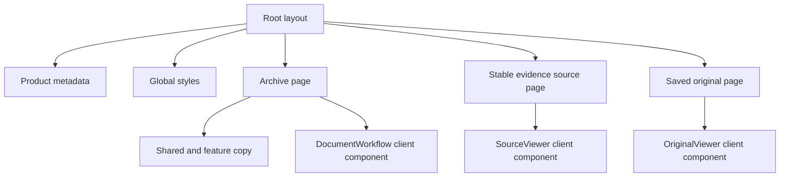

# App Router

This directory owns the Next.js route tree, shared document layout, and global presentation entry point.

## Current files

| File                                                           | Responsibility                                                                       |
| -------------------------------------------------------------- | ------------------------------------------------------------------------------------ |
| `layout.tsx`                                                   | Defines English document metadata, imports global styles, and renders route content. |
| `page.tsx`                                                     | Composes the local M1 archive shell and implemented research workflow.               |
| `sources/[evidenceSpanId]/page.tsx`                            | Delegates one opaque stable source route to the verified source viewer.              |
| `documents/[documentId]/versions/[documentVersionId]/page.tsx` | Opens a complete authorized original independently of a research citation.           |
| `globals.css`                                                  | Defines Tailwind CSS integration and global visual defaults.                         |

## Rendering relationship

`page.tsx` remains a server component and delegates browser state, PDF or pasted-text capture,
status polling, and evidence-grounded research to the archive feature. Future document and research
pages are added here only when their backend path is ready. Route components may call typed frontend
feature or API functions, but they must not contain backend persistence logic or independently
redefine API payloads.

The dynamic source route receives only an evidence-span identifier. It does not expose exact text,
object-storage keys, or a direct provider URL. `SourceViewer` resolves the authorized evidence and
immutable original through the same-origin API before rendering any source content.

The saved-original route carries only document and version identifiers. `OriginalViewer` reuses
the authorized original endpoint and displays the complete PDF or plain text without a citation
highlight. Invalid identifiers, unavailable versions, and integrity failures do not render content.
This route does not replace or relax the evidence-span route above.

All V1 interface text remains English. The `lang` metadata stays explicit so additional interface languages can be introduced deliberately later.
