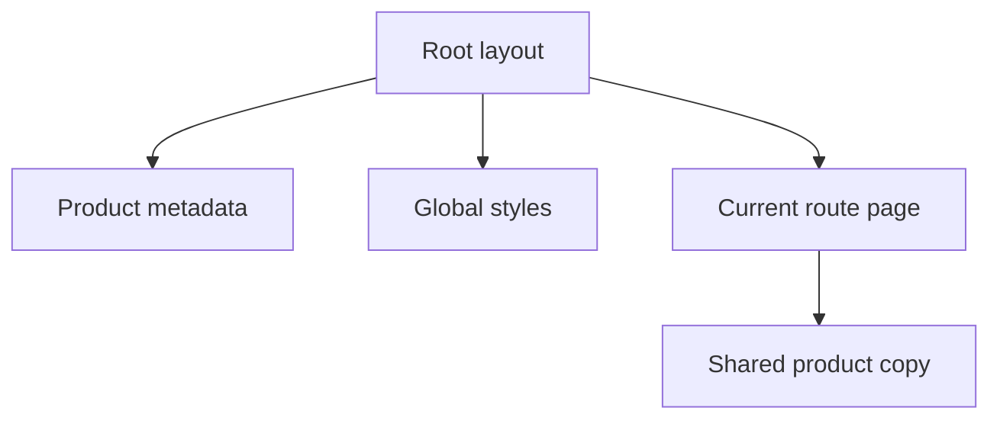

# App Router

This directory owns the Next.js route tree, shared document layout, and global presentation entry point.

## Current files

| File          | Responsibility                                                                       |
| ------------- | ------------------------------------------------------------------------------------ |
| `layout.tsx`  | Defines English document metadata, imports global styles, and renders route content. |
| `page.tsx`    | Renders the current M0.0 foundation page.                                            |
| `globals.css` | Defines Tailwind CSS integration and global visual defaults.                         |

## Rendering relationship

Future document and research pages are added here only when their backend path is ready. Route components may call typed frontend feature or API functions, but they must not contain backend persistence logic or independently redefine API payloads.

All V1 interface text remains English. The `lang` metadata stays explicit so additional interface languages can be introduced deliberately later.
