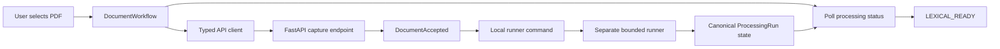
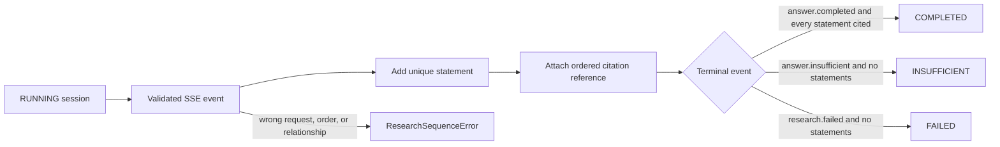
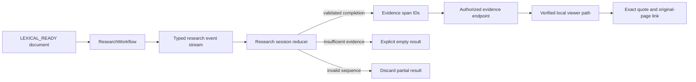

# Archive Feature

This directory owns the English M0.0 archive workflow presented by the home page. It coordinates
browser state and calls the shared API client; it does not define transport payloads, access
PostgreSQL, or process PDF content.

## Current files

| File                    | Responsibility                                                                  |
| ----------------------- | ------------------------------------------------------------------------------- |
| `copy.ts`               | Centralizes feature text and synthetic fixture defaults for later localization. |
| `document-workflow.tsx` | Captures one PDF, presents the runner command, and polls canonical status.      |
| `research-session.ts`   | Reduces validated SSE events into one ordered, fail-closed UI result.           |
| `research-workflow.tsx` | Asks a bounded question and opens resolved evidence in the original PDF.        |

## Capture and processing flow

The upload response supplies the processing status URL and canonical identifiers. The browser never
starts PDF parsing inside the API process. During M0.0, the user runs the displayed single-job
command in a separate terminal while the component polls the workspace-scoped status endpoint. M0
will replace that manual delivery step with Celery while preserving the same processing service and
status contract.

All network access goes through `src/lib/api/client.ts`. Raw exceptions are not rendered. The
component displays only safe API messages or a generic local failure message, and active requests
are aborted when their component lifecycle ends.

## Research state flow

`research-session.ts` has no React or network dependency. It keeps streamed events tied to one
research request, rejects duplicate or out-of-order relationships, and refuses to complete an answer
whose statement has no citation. Resolving a citation remains a separate authorized API call; only
then does `attachCitationSource` add the exact source location to the completed UI state.

## Research UI flow

`document-workflow.tsx` mounts the research UI only for a `LEXICAL_READY` processing run. The UI
submits the current document ID as an explicit research filter and never treats streamed partial text
as a usable answer. After a validated terminal event, each unique evidence span is resolved through
the workspace-scoped API. The resulting viewer URL must still pass the frontend's local API-path
check before it becomes an external-page link. This avoids trusting an arbitrary URL returned over
the network and keeps exact source text separate from the streamed answer contract.
