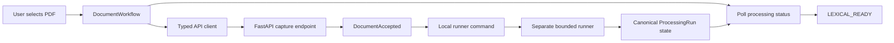

# Archive Feature

This directory owns the English M0.0 archive workflow presented by the home page. It coordinates
browser state and calls the shared API client; it does not define transport payloads, access
PostgreSQL, or process PDF content.

## Current files

| File                    | Responsibility                                                                  |
| ----------------------- | ------------------------------------------------------------------------------- |
| `copy.ts`               | Centralizes feature text and synthetic fixture defaults for later localization. |
| `document-workflow.tsx` | Captures one PDF, presents the runner command, and polls canonical status.      |

## Capture and processing flow

The upload response supplies the processing status URL and canonical identifiers. The browser never
starts PDF parsing inside the API process. During M0.0, the user runs the displayed single-job
command in a separate terminal while the component polls the workspace-scoped status endpoint. M0
will replace that manual delivery step with Celery while preserving the same processing service and
status contract.

All network access goes through `src/lib/api/client.ts`. Raw exceptions are not rendered. The
component displays only safe API messages or a generic local failure message, and active requests
are aborted when their component lifecycle ends.
