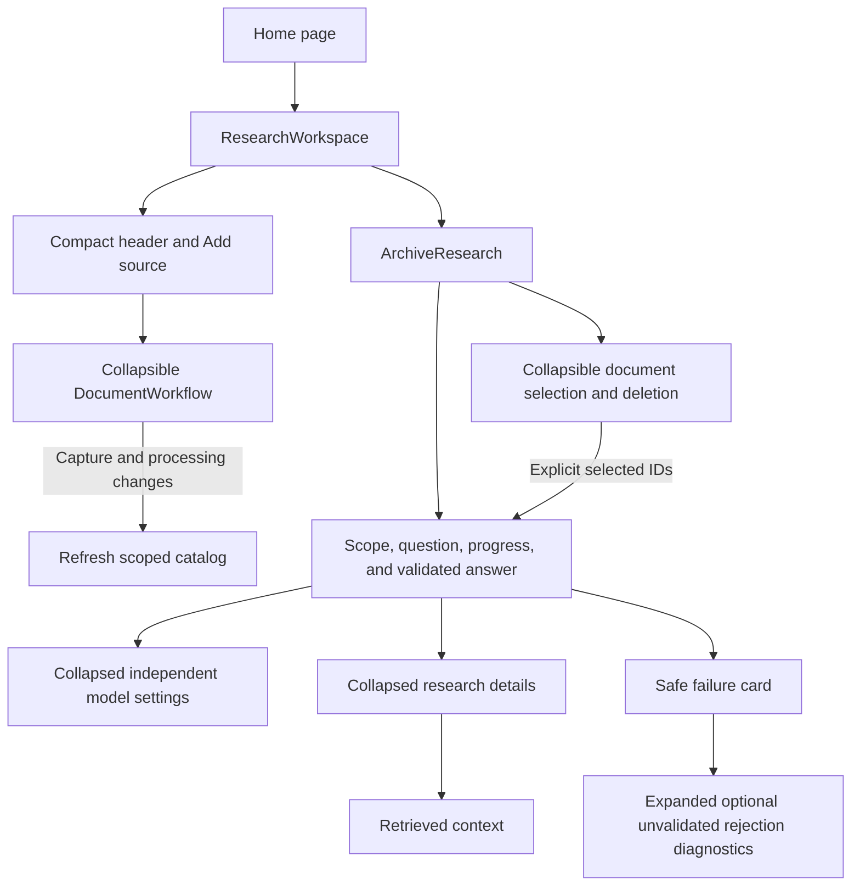
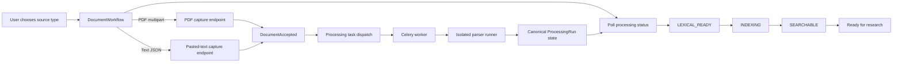
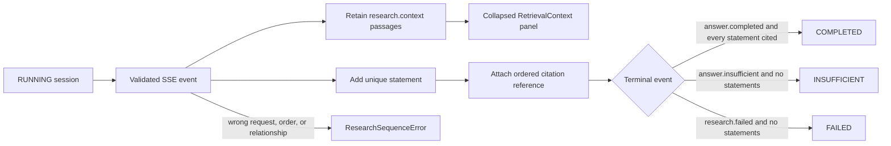
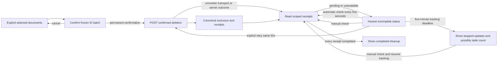

# Archive Feature

This directory owns the English M1 archive workflow presented by the home page. It coordinates
browser state and calls the shared API client; it does not define transport payloads, access
PostgreSQL, or parse document content.

## Current files

| File                          | Responsibility                                                                         |
| ----------------------------- | -------------------------------------------------------------------------------------- |
| `copy.ts`                     | Centralizes English feature text and defaults for later localization.                  |
| `research-workspace.tsx`      | Composes the compact header, collapsible import panel, and archive research workspace. |
| `archive-research.tsx`        | Loads the saved-document catalog and coordinates explicit research scope.              |
| `document-selection.ts`       | Keeps bounded selection and empty-scope admission independent of React.                |
| `document-deletion.ts`        | Tracks explicit deletion IDs and bounded, cancellation-aware receipt reads.            |
| `document-deletion-panel.tsx` | Confirms permanent deletion and displays pending, uncertain, and completed cleanup.    |
| `document-workflow.tsx`       | Captures one PDF or pasted-text original and polls its background-processing status.   |
| `processing-state.ts`         | Defines polling completion and fail-closed research admission.                         |
| `publication-date.ts`         | Formats the user's local calendar day for the editable publication-date default.       |
| `research-session.ts`         | Reduces validated SSE events into one ordered, fail-closed UI result.                  |
| `research-workflow.tsx`       | Loads model choices, asks a bounded question, and opens exact source evidence.         |
| `retrieval-context.tsx`       | Displays ordered selected passages separately from validated answer citations.         |
| `source-anchor.ts`            | Verifies exact pasted-text ranges and checksums using Unicode code points.             |
| `source-viewer.tsx`           | Resolves and renders an authorized immutable PDF or pasted-text source.                |
| `original-viewer.tsx`         | Opens a complete authorized original without claiming citation validation.             |

## Workspace presentation

The home page is a research workspace rather than a numbered demonstration. Its compact header
offers **Add source**, which opens an inline import panel and moves keyboard focus to it. Closing
returns focus to the trigger. The panel stays mounted while hidden: import drafts, selected dates,
active requests, and processing polls are preserved. The stable workspace callback refreshes the
catalog after capture and observed processing-state transitions.

On desktop, a collapsible document sidebar sits beside the question and answer area. On narrow
screens, the areas stack and the document toggle remains available. Hiding documents expands the
research area without remounting research, losing selection, or fetching another catalog page.
Search scope and the selected count stay above the question even when documents are hidden.
The sidebar shows titles, publication dates, processing status, and original links; other metadata
and selection help are expandable. It cannot be hidden while deletion confirmation or submission
locks selection. Permanent deletion controls remain at the top of the sidebar.

Answer and evidence-check model choices are independent under collapsed **Model settings**;
their current pair is visible in the summary. Progress, validated results, and safe failures remain
in the main area. Optional local rejection diagnostics appear expanded directly inside the failure
card, separately labeled as unvalidated. The collapsed **Research details** section below the result
contains retrieved context, not rejection diagnostics; both remain separate from validated citations.
Neither collapsing controls nor the layout changes authorization, provider choices, or validation.

Deterministic tests cover copy, contracts, and state transitions. The Playwright suite includes
workspace visibility, draft/model retention, focus, and responsive-layout assertions; running it
and confirming a production build are separate verification steps, not implied by static checks.

## Capture and processing flow

Both capture responses supply the same processing status URL and canonical identifiers. The browser
never starts parsing inside the API process. Each capture endpoint commits the canonical `CAPTURED`
run and publishes its task to Celery, and the component polls the workspace-scoped status endpoint
until the run reaches `SEARCHABLE` or `FAILED`. Both `LEXICAL_READY` and `INDEXING` remain active
M1 states and therefore continue polling without offering the new document as a research filter.
The worker invokes the isolated parser runner through protocol v2 while the historical protocol-v1
PDF path remains a backend regression contract.

The publication-date input defaults to the user's current local calendar day after browser
hydration, rather than a frozen fixture or build date. An explicit edit, including clearing the
optional field, takes precedence over the default. PDF and pasted-text imports use the same value;
the existing UTC-midnight transport convention remains unchanged. This is an editable convenience,
not an inferred publication date or a change to an already stored source.

All network access goes through `src/lib/api/client.ts`. Raw exceptions are not rendered. The
component displays only safe API messages or a generic local failure message, and active requests
are aborted when their component lifecycle ends.

## Research state flow

`research-session.ts` has no React or network dependency. It keeps streamed events tied to one
research request, rejects duplicate or out-of-order relationships, and refuses to complete an answer
whose statement has no citation. Resolving a citation remains a separate authorized API call; only
then does `attachCitationSource` add the exact source location to the completed UI state.

The research question starts empty and has no fixture-example buttons. Each resolved citation in
a validated answer shows the authorized document-version title, its UTC publication date, and the
PDF page or text character range. The date is the publication date selected when importing the
source, not the upload timestamp; missing dates are labeled "Publication date unknown". These
fields come from the evidence endpoint rather than the current catalog page.

The UI groups six actual progress events into four stable, English display steps:

| Display step                                  | Backend stages                            |
| --------------------------------------------- | ----------------------------------------- |
| Preparing the question for search             | `EMBEDDING_QUESTION`                      |
| Finding relevant passages                     | `SEARCHING_SOURCES`, `SELECTING_PASSAGES` |
| Drafting an answer from the selected passages | `GENERATING_ANSWER`                       |
| Checking the answer and its evidence          | `VALIDATING_EVIDENCE`, `SAVING_RESULT`    |

A step is active or complete only after its corresponding event arrives; no percentage or timed
animation implies unobserved progress. The credential-free lexical path omits the embedding step.
The answer and citations remain hidden until the terminal validated events arrive.

The independent `research.context` event exposes the bounded final passage selection before
generation. `research-session.ts` rejects duplicate, cross-request, and late context events.
`retrieval-context.tsx` shows counts, original links, page numbers, IDs, and unchanged text with
native expandable controls; source content is escaped by React, never rendered as HTML. Catalog
titles are display labels only, with an ID fallback for unloaded entries. The current selection
survives a failed or insufficient request and resets for a new question. It neither proves an
answer nor records successful provider use, and is not stored in browser persistence or logs.

With the explicit local diagnostic override, a terminal evidence rejection can also carry
`diagnostic` details. `rejection-diagnostic.tsx` displays rejected claims, the model pair, selected
excerpts, and failed rules under **Rejected answer diagnostics**. The session reducer requires
every excerpt range to belong to this request's selected context; the component uses Unicode
code-point slicing and React text escaping. These unvalidated claims never enter the accepted
statement/citation list and reset for a new question. Normal runs have no diagnostic payload.
See the [runtime guide](../../../../docs/development.md#default-m15-source-id-research) for the
public/synthetic-only opt-in and its limitations.

## Research UI flow

```mermaid
flowchart LR
    ARCHIVE[Saved archive] --> LIST[Bounded document catalog]
    LIST --> SCOPE[All eligible sources or explicit selected document IDs]
    SCOPE --> OPTIONS[Load approved model options]
    LIST --> ORIGINAL_VIEW[OriginalViewer without citation highlight]
    ORIGINAL_VIEW --> ORIGINAL
    OPTIONS -->|provider mode| CHOICES[Choose answer and support models]
    OPTIONS -->|deterministic mode| FORM[ResearchWorkflow]
    CHOICES --> FORM
    OPTIONS -->|unavailable or invalid| BLOCK[Disable research submission]
    FORM -->|all saved documents: empty document_ids| STREAM
    FORM -->|selected documents: 1 to 100 IDs| STREAM
    SCOPE -->|selected scope without IDs| BLOCK
    STREAM[Typed research event stream] --> SESSION[Research session reducer]
    SESSION -->|validated completion| IDS[Evidence span IDs]
    IDS --> RESOLVE[Authorized evidence endpoint]
    RESOLVE --> SAFE[Verified stable source path]
    SAFE --> SOURCE[SourceViewer route]
    SOURCE --> ORIGINAL[Authorized immutable original]
    ORIGINAL --> LOCATOR{Locator kind}
    LOCATOR -->|PDF_PAGE| PAGE[PDF blob at stored physical page]
    LOCATOR -->|TEXT_PASSAGE| TEXT[Verified exact-range highlight]
    SESSION -->|insufficient evidence| EMPTY[Explicit empty result]
    SESSION -->|evidence rejected and local diagnostics enabled| DIAGNOSTIC[Unvalidated claims and selected excerpts]
    SESSION -->|invalid sequence| REJECT[Discard partial result]
```

`research-workspace.tsx` always mounts `ArchiveResearch`, including after a page reload with no new
upload, and keeps `DocumentWorkflow` mounted behind the import toggle. Capture and each observed
processing-state transition notify the workspace to refresh the catalog.
The catalog loads 20 entries per request and appends pages using the server's unmodified cursor.
Titles, media, language, byte size, publication, capture, and availability dates are shown alongside
the latest processing snapshot. Unknown dates remain unknown; displayed dates use UTC.

The default scope submits `document_ids: []` to search eligible current sources in the server-derived
workspace. Checkboxes select 1–100 documents, automatically enabling selected scope. Research
requires every selected document to be `SEARCHABLE`. Queued, Text extracted, Failed, and unprocessed
documents can be selected for deletion only; Parsing and Indexing cannot be selected. Backend
admission rechecks processing eligibility as described below. Loading more preserves selection.
The document rows and pagination can be hidden and shown without changing selection or making
another request. Scope controls and the selected count remain visible. Clicking a document title
toggles its checkbox. Clear selection removes all chosen documents while preserving focused scope,
so submission stays blocked until documents are selected again or all-source scope is chosen.
Refreshing clears selection but preserves selected scope, visibly disabling submission until the
user selects again or explicitly chooses all sources. List errors also block selected-scope
submission, never silently widening a question. Selection controls are disabled during research.
The server rechecks eligibility; neither the status snapshot nor possession of an ID authorizes use.

## Permanent local deletion

Delete selected appears at the top of the document sidebar. Collapsing the sidebar also hides its
controls without cancelling accepted cleanup; reopening restores its tracked status. All-source scope,
empty selection, failed catalog reads, and ongoing research disable deletion. A second explicit
confirmation lists the frozen selection and explains irreversible source/dependent-answer removal
and the backup/provider/export boundaries in ADR-0019. Cancel sends no request. Selection and
research are blocked during confirmation and deletion submission, not during background tracking
or a manual status check.

Queued (`CAPTURED`), Text extracted (`LEXICAL_READY`), Failed, and sources without a processing
snapshot can be selected for deletion, but research still requires every selected source to be
Searchable. Parsing and Indexing remain unselectable. The catalog does not expose lease details:
the backend rechecks every processing run at admission, accepts unclaimed queued work and completed
Text extracted output without a lease regardless of embedding/index configuration, and rejects the
entire batch if parsing or unfinished dense indexing is still in progress.
Even an expired lease does not prove that external work stopped. Refresh before trying a rejected
selection again; this feature does not cancel a running worker.

The catalog and displayed research result are invalidated when a confirmed deletion is attempted
and refreshed after the operation. This conservatively clears stale answer/citation UI even when
the commit outcome is uncertain. `202` and successful publication never imply cleanup completion.
After submission, one status-read round runs before releasing the submission lock. Unfinished
batches then receive background checks with five seconds between rounds for up to five minutes.
The monotonic tracking budget includes read latency, and its cancellation signal also bounds
in-flight reads. Each read round has a shared ten-second deadline and at most five concurrent
reads; the submission timeout is fifteen seconds. Completed receipts are not reread. Background
tracking never submits a deletion request or invalidates a newly displayed research answer.
When tracking stops, the UI explicitly warns that the count may be stale and that accepted worker
cleanup continues independently. A manual check or explicit retry cancels the previous tracking
loop before reading; an unfinished result starts a fresh bounded tracking period.
Timeouts and missing receipts preserve the last confirmed snapshots rather than reporting success
or silently repeating the POST. Page unmount cancels both foreground and background requests.
An explicit retry checks status first, then resubmits only the same confirmed IDs if needed.
The backend remains authoritative and idempotent.

Tracking is page-local: reload does not cancel worker cleanup, but the UI does not yet rediscover
earlier batches. This limitation is shown before confirmation and while cleanup is pending.
The durable receipt endpoint survives deletion; broader delivery and reconciliation remain M2
work. A pending batch stays visible until confirmed complete rather than being silently dismissed.
Usage accounting, exported copies, provider-held copies, and backups are not claimed erased.

In provider mode, the form independently selects the answer-generation and statement-support models from the
backend-advertised Terra/Luna choices; both default to Terra. In deterministic mode, the paid-model
controls are absent. An unavailable or invalid choices response disables submission instead of
making an implicit model choice. The UI never treats streamed partial text as a usable answer.
After a validated terminal event, each unique evidence span is resolved through the
workspace-scoped API. The resulting viewer URL must still pass the frontend's stable local
source-path check before it becomes an original-source link. The discriminated locator renders
either the PDF page or the one-based visible text range without inventing pages for text. This
avoids trusting an arbitrary URL returned over the network and keeps exact source text separate
from the streamed answer contract.

The stable `/sources/{evidence_span_id}` page resolves the evidence span again and requires the API
to confirm that exact opaque route. It then loads the original through the authorized same-origin
endpoint. PDF bytes are exposed only through a short-lived browser object URL with the stored
physical page fragment. Pasted text is split with `Array.from`, so supplementary-plane characters
count as one Unicode code point just as they do in Python. The stored range must reproduce
`exact_text` and its SHA-256 checksum before the viewer renders the original with only that range
inside a `<mark>` element. Unknown media, mismatched routes, invalid ranges, and changed text fail
closed without rendering source content.

The separate `/documents/{document_id}/versions/{document_version_id}` page opens an original
without needing a question or citation. It uses the same authorized, integrity-checking original
endpoint. PDFs use a revocable object URL and offer a separate-tab fallback; text is rendered as
escaped plain text, preserving whitespace. It has no evidence highlight and explicitly distinguishes
the complete original from a validated cited passage. Neither viewer exposes storage URLs or keys.
