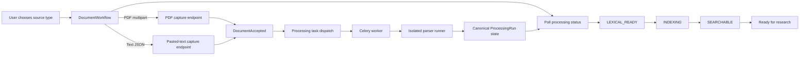
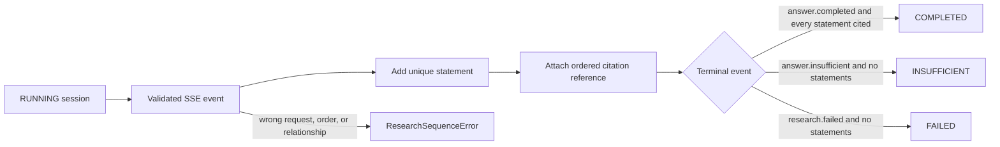

# Archive Feature

This directory owns the English M1 archive workflow presented by the home page. It coordinates
browser state and calls the shared API client; it does not define transport payloads, access
PostgreSQL, or parse document content.

## Current files

| File                    | Responsibility                                                                       |
| ----------------------- | ------------------------------------------------------------------------------------ |
| `copy.ts`               | Centralizes English feature text and defaults for later localization.                |
| `archive-research.tsx`  | Loads the saved-document catalog and coordinates explicit research scope.            |
| `document-selection.ts` | Keeps bounded selection and empty-scope admission independent of React.              |
| `document-workflow.tsx` | Captures one PDF or pasted-text original and polls its background-processing status. |
| `processing-state.ts`   | Defines polling completion and fail-closed research admission.                       |
| `publication-date.ts`   | Formats the user's local calendar day for the editable publication-date default.     |
| `research-session.ts`   | Reduces validated SSE events into one ordered, fail-closed UI result.                |
| `research-workflow.tsx` | Loads model choices, asks a bounded question, and opens exact source evidence.       |
| `source-anchor.ts`      | Verifies exact pasted-text ranges and checksums using Unicode code points.           |
| `source-viewer.tsx`     | Resolves and renders an authorized immutable PDF or pasted-text source.              |
| `original-viewer.tsx`   | Opens a complete authorized original without claiming citation validation.           |

## Capture and processing flow

Both capture responses supply the same processing status URL and canonical identifiers. The browser
never starts parsing inside the API process. Each capture endpoint commits the canonical `CAPTURED`
run and publishes its task to Celery, and the component polls the workspace-scoped status endpoint
until the run reaches `SEARCHABLE` or `FAILED`. Both `LEXICAL_READY` and `INDEXING` remain active
M1 states and therefore continue polling without offering the new document as a research filter.
The worker invokes the isolated parser runner through protocol v2 while the historical protocol-v1
PDF path remains a backend regression contract.

The publication-date input defaults to the user's current local calendar day after browser
hydration, rather than a frozen fixture or build date. An explicit edit, including clearing the
optional field, takes precedence over the default. PDF and pasted-text imports use the same value;
the existing UTC-midnight transport convention remains unchanged. This is an editable convenience,
not an inferred publication date or a change to an already stored source.

All network access goes through `src/lib/api/client.ts`. Raw exceptions are not rendered. The
component displays only safe API messages or a generic local failure message, and active requests
are aborted when their component lifecycle ends.

## Research state flow

`research-session.ts` has no React or network dependency. It keeps streamed events tied to one
research request, rejects duplicate or out-of-order relationships, and refuses to complete an answer
whose statement has no citation. Resolving a citation remains a separate authorized API call; only
then does `attachCitationSource` add the exact source location to the completed UI state.

The UI groups six actual progress events into four stable, English display steps:

| Display step                                  | Backend stages                            |
| --------------------------------------------- | ----------------------------------------- |
| Preparing the question for search             | `EMBEDDING_QUESTION`                      |
| Finding relevant passages                     | `SEARCHING_SOURCES`, `SELECTING_PASSAGES` |
| Drafting an answer from the selected passages | `GENERATING_ANSWER`                       |
| Checking the answer and its evidence          | `VALIDATING_EVIDENCE`, `SAVING_RESULT`    |

A step is active or complete only after its corresponding event arrives; no percentage or timed
animation implies unobserved progress. The credential-free lexical path omits the embedding step.
The answer and citations remain hidden until the terminal validated events arrive.

## Research UI flow

```mermaid
flowchart LR
    ARCHIVE[Saved archive] --> LIST[Bounded document catalog]
    LIST --> SCOPE[All eligible sources or explicit selected document IDs]
    SCOPE --> OPTIONS[Load approved model options]
    LIST --> ORIGINAL_VIEW[OriginalViewer without citation highlight]
    ORIGINAL_VIEW --> ORIGINAL
    OPTIONS -->|provider mode| CHOICES[Choose answer and support models]
    OPTIONS -->|deterministic mode| FORM[ResearchWorkflow]
    CHOICES --> FORM
    OPTIONS -->|unavailable or invalid| BLOCK[Disable research submission]
    FORM -->|all saved documents: empty document_ids| STREAM
    FORM -->|selected documents: 1 to 100 IDs| STREAM
    SCOPE -->|selected scope without IDs| BLOCK
    STREAM[Typed research event stream] --> SESSION[Research session reducer]
    SESSION -->|validated completion| IDS[Evidence span IDs]
    IDS --> RESOLVE[Authorized evidence endpoint]
    RESOLVE --> SAFE[Verified stable source path]
    SAFE --> SOURCE[SourceViewer route]
    SOURCE --> ORIGINAL[Authorized immutable original]
    ORIGINAL --> LOCATOR{Locator kind}
    LOCATOR -->|PDF_PAGE| PAGE[PDF blob at stored physical page]
    LOCATOR -->|TEXT_PASSAGE| TEXT[Verified exact-range highlight]
    SESSION -->|insufficient evidence| EMPTY[Explicit empty result]
    SESSION -->|invalid sequence| REJECT[Discard partial result]
```

`document-workflow.tsx` always mounts `ArchiveResearch`, including after a page reload with no new
upload. It refreshes the catalog after capture and each observed processing-state transition.
The catalog loads 20 entries per request and appends pages using the server's unmodified cursor.
Titles, media, language, byte size, publication, capture, and availability dates are shown alongside
the latest processing snapshot. Unknown dates remain unknown; displayed dates use UTC.

The default scope submits `document_ids: []` to search eligible current sources in the server-derived
workspace. Checkboxes select 1–100 `SEARCHABLE` documents, automatically enabling selected scope;
pending, missing, and failed statuses cannot be selected. Loading more preserves selection.
The document rows and pagination can be hidden and shown without changing selection or making
another request. Scope controls and the selected count remain visible. Clicking a document title
toggles its checkbox. Clear selection removes all chosen documents while preserving focused scope,
so submission stays blocked until documents are selected again or all-source scope is chosen.
Refreshing clears selection but preserves selected scope, visibly disabling submission until the
user selects again or explicitly chooses all sources. List errors also block selected-scope
submission, never silently widening a question. Selection controls are disabled during research.
The server rechecks eligibility; neither the status snapshot nor possession of an ID authorizes use.

In provider mode, the form independently selects the answer-generation and statement-support models from the
backend-advertised Terra/Luna choices; both default to Terra. In deterministic mode, the paid-model
controls are absent. An unavailable or invalid choices response disables submission instead of
making an implicit model choice. The UI never treats streamed partial text as a usable answer.
After a validated terminal event, each unique evidence span is resolved through the
workspace-scoped API. The resulting viewer URL must still pass the frontend's stable local
source-path check before it becomes an original-source link. The discriminated locator renders
either the PDF page or the one-based visible text range without inventing pages for text. This
avoids trusting an arbitrary URL returned over the network and keeps exact source text separate
from the streamed answer contract.

The stable `/sources/{evidence_span_id}` page resolves the evidence span again and requires the API
to confirm that exact opaque route. It then loads the original through the authorized same-origin
endpoint. PDF bytes are exposed only through a short-lived browser object URL with the stored
physical page fragment. Pasted text is split with `Array.from`, so supplementary-plane characters
count as one Unicode code point just as they do in Python. The stored range must reproduce
`exact_text` and its SHA-256 checksum before the viewer renders the original with only that range
inside a `<mark>` element. Unknown media, mismatched routes, invalid ranges, and changed text fail
closed without rendering source content.

The separate `/documents/{document_id}/versions/{document_version_id}` page opens an original
without needing a question or citation. It uses the same authorized, integrity-checking original
endpoint. PDFs use a revocable object URL and offer a separate-tab fallback; text is rendered as
escaped plain text, preserving whitespace. It has no evidence highlight and explicitly distinguishes
the complete original from a validated cited passage. Neither viewer exposes storage URLs or keys.
