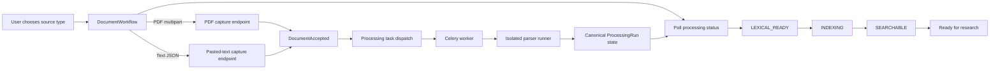
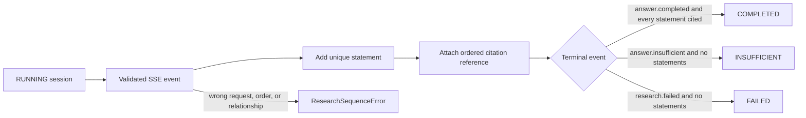
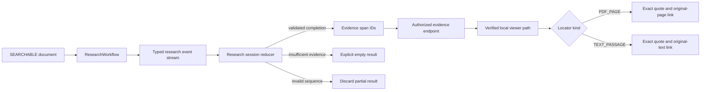

# Archive Feature

This directory owns the English M1 archive workflow presented by the home page. It coordinates
browser state and calls the shared API client; it does not define transport payloads, access
PostgreSQL, or parse document content.

## Current files

| File                    | Responsibility                                                                       |
| ----------------------- | ------------------------------------------------------------------------------------ |
| `copy.ts`               | Centralizes English feature text and defaults for later localization.                |
| `document-workflow.tsx` | Captures one PDF or pasted-text original and polls its background-processing status. |
| `processing-state.ts`   | Defines polling completion and fail-closed research admission.                       |
| `research-session.ts`   | Reduces validated SSE events into one ordered, fail-closed UI result.                |
| `research-workflow.tsx` | Asks a bounded question and opens resolved PDF-page or text-passage evidence.        |

## Capture and processing flow

Both capture responses supply the same processing status URL and canonical identifiers. The browser
never starts parsing inside the API process. Each capture endpoint commits the canonical `CAPTURED`
run and publishes its task to Celery, and the component polls the workspace-scoped status endpoint
until the run reaches `SEARCHABLE` or `FAILED`. Both `LEXICAL_READY` and `INDEXING` remain active
M1 states and therefore continue polling without exposing the research form. The worker invokes the
isolated parser runner through protocol v2 while the historical protocol-v1 PDF path remains a
backend regression contract.

All network access goes through `src/lib/api/client.ts`. Raw exceptions are not rendered. The
component displays only safe API messages or a generic local failure message, and active requests
are aborted when their component lifecycle ends.

## Research state flow

`research-session.ts` has no React or network dependency. It keeps streamed events tied to one
research request, rejects duplicate or out-of-order relationships, and refuses to complete an answer
whose statement has no citation. Resolving a citation remains a separate authorized API call; only
then does `attachCitationSource` add the exact source location to the completed UI state.

## Research UI flow

`document-workflow.tsx` mounts the research UI only for the M1 `SEARCHABLE` state. The UI submits the
current document ID as an explicit research filter and never treats streamed partial text as a
usable answer. After a validated terminal event, each unique evidence span is resolved through the
workspace-scoped API. The resulting viewer URL must still pass the frontend's local API-path check
before it becomes an original-source link. The discriminated locator renders either the PDF page or
the one-based visible text range without inventing pages for text. This avoids trusting an arbitrary
URL returned over the network and keeps exact source text separate from the streamed answer
contract.
