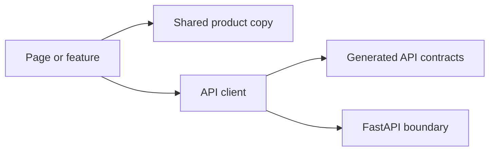

# Frontend Library

This directory contains shared, framework-light frontend utilities and application-owned boundaries used by pages or feature components.

## Contents

| Path              | Responsibility                                                 |
| ----------------- | -------------------------------------------------------------- |
| `product-copy.ts` | Central product name and short evidence-focused description.   |
| `api/`            | Generated backend contracts and, later, the typed HTTP client. |

Shared code belongs here only when multiple frontend consumers need it or when it represents an application-wide boundary. UI components and feature-specific behavior should remain in their owning component or feature directory rather than turning `lib/` into an unstructured utility collection.
