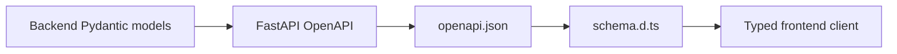

# Frontend API Boundary

This directory owns the frontend side of the FastAPI contract. It contains generated declarations now and will later contain the small application-owned HTTP client.

## Contents

| Path                     | Responsibility                                                                  |
| ------------------------ | ------------------------------------------------------------------------------- |
| `generated/openapi.json` | Deterministic snapshot exported from the FastAPI application.                   |
| `generated/schema.d.ts`  | Readonly TypeScript declarations generated from that snapshot.                  |
| `client.ts`              | Added later when the first implemented product endpoint needs a browser client. |

## Contract lifecycle

Files under `generated/` must never be edited manually. Backend tests verify that `openapi.json` matches the application; the frontend contract check verifies that `schema.d.ts` matches `openapi.json`. Together they make contract drift fail automated checks.

Generation and verification commands are documented in the repository [`README.md`](../../../../README.md#update-api-contracts). API payload types must be imported from the generated schema rather than redefined by hand.
