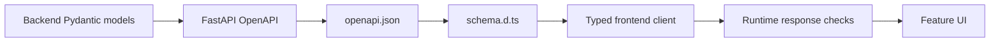

# Frontend API Boundary

This directory owns the frontend side of the FastAPI contract. It combines generated declarations
with a small application-owned HTTP client and explicit runtime checks at the network boundary.

## Contents

| Path                     | Responsibility                                                                   |
| ------------------------ | -------------------------------------------------------------------------------- |
| `generated/openapi.json` | Deterministic snapshot exported from the FastAPI application.                    |
| `generated/schema.d.ts`  | Readonly TypeScript declarations generated from that snapshot.                   |
| `client.ts`              | Sends typed requests, validates responses, decodes SSE, and rejects unsafe URLs. |

## Contract lifecycle



Files under `generated/` must never be edited manually. Backend tests verify that `openapi.json` matches the application; the frontend contract check verifies that `schema.d.ts` matches `openapi.json`. Together they make contract drift fail automated checks.

Generation and verification commands are documented in the repository [`README.md`](../../../../README.md#update-api-contracts). API payload types must be imported from the generated schema rather than redefined by hand.

## Request path

```mermaid
flowchart LR
    UI[Browser feature] --> CLIENT[client.ts]
    CLIENT --> SAME[/api/v1 path]
    SAME --> PROXY[Next.js same-origin rewrite]
    PROXY --> API[Loopback FastAPI]
```

The browser receives only relative `/api/v1/` paths. `next.config.ts` reads the server-only
`INVESTMENT_RESEARCH_API_ORIGIN` setting and accepts only a credential-free loopback HTTP origin in
M1. This avoids exposing an internal target in a `NEXT_PUBLIC_` variable and avoids a permissive
CORS policy.

The local M1 rewrite has a 120-second proxy timeout because one synchronous research request can
include multiple bounded provider calls before FastAPI emits its validated answer events. This
limit prevents the observed 30-second disconnect but does not guarantee that every slow request
will finish within the proxy window. A disconnected browser does not prove that the backend stopped;
repeating the question can create another paid provider operation.

Successful JSON responses are checked for the fields used by the application instead of being
trusted solely because TypeScript compiled. Server-sent events are buffered across arbitrary network
chunks, decoded by their `event` discriminator, and rejected if their runtime shape does not match the
generated union. PDF capture uses the multipart endpoint; pasted-text capture uses its bounded JSON
endpoint. Both return the same `DocumentAccepted` contract and enter the same status flow.
Backend-provided status and viewer URLs must remain relative application API paths. Evidence results
must carry either a valid `PDF_PAGE` or `TEXT_PASSAGE` locator; unknown locator kinds fail before they
reach the UI.

Known API error codes retain their safe public messages and request IDs. An unstructured HTTP
failure instead reports its status and a possible web-to-API timeout without displaying its raw
body. Connection and stream failures also use fixed safe messages; transport exception text and
unknown error-code messages never reach the UI.
