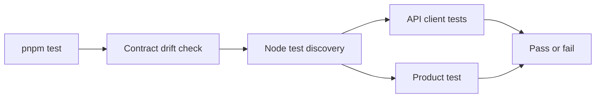

# Frontend Tests

This directory contains deterministic tests for frontend-owned behavior and the backend contract consumed by the frontend.

## Current coverage

| File or command        | Responsibility                                                                        |
| ---------------------- | ------------------------------------------------------------------------------------- |
| `api-client.test.mjs`  | Verifies multipart, safe errors, runtime contracts, SSE framing, and local API paths. |
| `product.test.mjs`     | Verifies product identity, fixture boundaries, and automatic-processing copy.         |
| `pnpm contracts:check` | Verifies that generated TypeScript declarations match the committed OpenAPI snapshot. |

Tests run through the frontend package script and therefore through the repository-level `pnpm test`
command and CI. The Node test runner discovers conventionally named test files automatically.
Browser interaction and accessibility tests should be added with actual user workflows; they should
not be introduced as empty infrastructure before a feature requires them.
