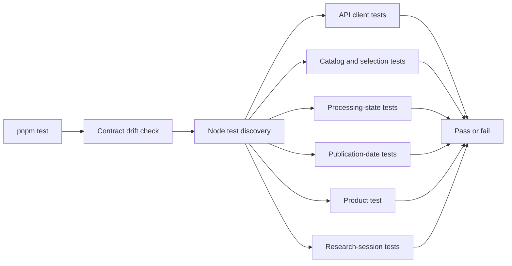

# Frontend Tests

This directory contains deterministic tests for frontend-owned behavior and the backend contract consumed by the frontend.

## Current coverage

| File or command             | Responsibility                                                                                      |
| --------------------------- | --------------------------------------------------------------------------------------------------- |
| `api-client.test.mjs`       | Verifies multipart, safe errors, runtime contracts, SSE framing, and local API paths.               |
| `document-catalog.test.mjs` | Verifies bounded catalog requests, runtime metadata checks, and fail-closed multi-source selection. |
| `processing-state.test.mjs` | Verifies polling completion and fail-closed research admission.                                     |
| `publication-date.test.mjs` | Verifies local calendar formatting, leap days, and timezone boundaries for the upload default.      |
| `product.test.mjs`          | Verifies product identity, fixture boundaries, and automatic-processing copy.                       |
| `research-session.test.mjs` | Verifies stream order, cited completion, insufficient evidence, safe failure, and source binding.   |
| `pnpm contracts:check`      | Verifies that generated TypeScript declarations match the committed OpenAPI snapshot.               |

Tests run through the frontend package script and therefore through the repository-level `pnpm test`
command and CI. The Node test runner discovers conventionally named test files automatically.
Research-session tests require a complete statement-and-citation sequence before completion and
prove that insufficient evidence or safe provider failure contains no answer statements. A failure
after partial answer content is treated as a protocol violation rather than a usable partial result.
Browser interaction and accessibility tests should be added with actual user workflows; they should
not be introduced as empty infrastructure before a feature requires them.

The existing `e2e/m1-browser-journey.spec.ts` covers selecting a saved source after reload,
opening originals independently of citations, and a mocked multi-source/pagination/refresh journey.
These browser tests are separate from `pnpm test`; adding or type-checking them is not evidence of
a successful browser run. They use public synthetic sources or local response stubs, not paid
provider calls. The existing browser CI runs them separately; local browser verification remains
owner-controlled.
