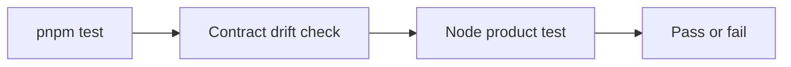

# Frontend Tests

This directory contains deterministic tests for frontend-owned behavior and the backend contract consumed by the frontend.

## Current coverage

| File or command        | Responsibility                                                                        |
| ---------------------- | ------------------------------------------------------------------------------------- |
| `product.test.mjs`     | Verifies the product identity and evidence-focused description.                       |
| `pnpm contracts:check` | Verifies that generated TypeScript declarations match the committed OpenAPI snapshot. |

Tests run through the frontend package script and therefore through the repository-level `pnpm test` command and CI. Browser interaction and accessibility tests should be added with actual user workflows; they should not be introduced as empty infrastructure before a feature requires them.
